<!-- The German README, the twin of README.md: the same headings, snippets and diagrams, in
German, which scripts/check-project.sh compares with those of README.md. The badges read
appinfo/info.xml on main, as in README.md. An anchor such as <a id="requirements"></a>
above a heading lets an English page of the German website link to it. -->
<div align="center">


# Paperless Sync

**Dein Paperless-ngx-Archiv als stets aktueller Ordnerbaum in Nextcloud Dateien – dazu ein Eingang von Nextcloud zu Paperless.**

[](https://apps.nextcloud.com/apps/paperless_sync)
[](#voraussetzungen)
[](LICENSE)
[](https://dennis-otto.github.io/paperless-sync/de/)

[**Im App Store holen**](https://apps.nextcloud.com/apps/paperless_sync) · [Voraussetzungen](#voraussetzungen) · [Schnellstart](#schnellstart) · [Dokumentation](https://dennis-otto.github.io/paperless-sync/de/) · [FAQ](https://dennis-otto.github.io/paperless-sync/de/faq.html) · [Fehlerbehebung](https://dennis-otto.github.io/paperless-sync/de/troubleshooting.html) · [Hilfe](#hilfe-und-feedback) · [Änderungen](CHANGELOG.md) · [English](README.md)

<picture>
  <source media="(prefers-color-scheme: dark)" srcset="docs/images/de/archive-dark.gif">
  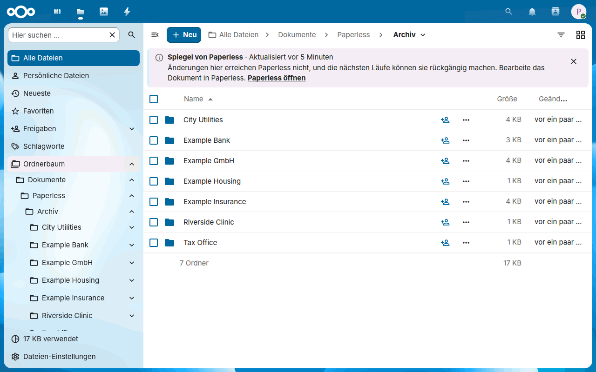
</picture>

</div>

Paperless Sync ist eine native Nextcloud-App. Sie schreibt die fertigen Dokumente von Paperless-ngx in einen Ordnerbaum in den Dateien eines Nextcloud-Benutzers, nach Korrespondent, Dokumenttyp und Jahr, und hält den Baum aktuell: Ein neuer Titel benennt eine Datei um, ein neuer Korrespondent verschiebt sie, und der Papierkorb von Paperless hat einen eigenen Ordner. Dateien, die du in einen Eingangsordner in Nextcloud legst, gehen den umgekehrten Weg, zu Paperless. Paperless bleibt die maßgebliche Quelle, und Nextcloud gibt dir die Dokumente in Dateien, in seinen Desktop- und Mobil-Clients, in seinem Viewer und in Freigaben.

Anders als ein Mount des Medienordners von Paperless oder ein Skript, das über WebDAV kopiert, läuft Paperless Sync in Nextcloud als einer seiner Hintergrundjobs: Es braucht keinen zusätzlichen Container und kein gespeichertes Nextcloud-Passwort, die Kopien sind echte Dateien von Nextcloud mit Versionen, Freigaben und Suche, eine Bearbeitung in Nextcloud erreicht nie die Originale in Paperless, und eine Kopie, deren Dokument Paperless verlässt, wird nur gelöscht, wenn du das endgültige Löschen einschaltest, und erst, nachdem vollständige Scans von Paperless bestätigen, dass das Dokument weg ist. [Der Vergleich](https://dennis-otto.github.io/paperless-sync/alternatives.html) stellt jeden Weg, Paperless und Nextcloud zu verbinden, nebeneinander, mit Anleitungen für den Umstieg von einem Mount oder vom WebDAV-Container.

Die [Dokumentations-Website](https://dennis-otto.github.io/paperless-sync/de/) zeigt diese Anleitung auf Deutsch und Englisch, zusammen mit den [FAQ](https://dennis-otto.github.io/paperless-sync/de/faq.html) und der [Fehlerbehebung](https://dennis-otto.github.io/paperless-sync/de/troubleshooting.html), und auf Englisch mit dem [Vergleich mit den Alternativen](https://dennis-otto.github.io/paperless-sync/alternatives.html), der [Architektur](docs/architecture.md), dem [Sicherheitsdesign](docs/security.md), der [Automatisierung](docs/automation.md), den [Entscheidungen](docs/decisions/README.md) und der [Roadmap](docs/roadmap.md).

<sub>💛 Wenn Paperless Sync dir hilft, [bewerte es im App Store](https://apps.nextcloud.com/apps/paperless_sync), damit andere es finden, oder [unterstütze seine Entwicklung](https://github.com/sponsors/Dennis-Otto).</sub>

<!-- --8<-- [start:how-it-works] -->

## So funktioniert es

<picture>
  <source media="(prefers-color-scheme: dark)" srcset="docs/images/diagrams/how-paperless-sync-moves-documents.de.dark.svg">
  
</picture>

Im eingestellten Intervall startet der Cron von Nextcloud einen Lauf der App in Nextcloud. Er liest die fertigen Dokumente von Paperless und schreibt jedes in das Archiv in den Dateien des eingestellten Nextcloud-Zielbenutzers, an den Pfad, den die Pfadvorlage aus seinen Metadaten bildet; andere Benutzer sehen das Archiv, wenn dieser Benutzer es mit ihnen teilt. Ändern sich die Metadaten in Paperless, wandert die Datei; kommt ein Dokument in den Papierkorb von Paperless, wandert seine Kopie nach `_Gelöscht`. Dateien, die jemand in `Eingang` legt, gehen den umgekehrten Weg, zu Paperless.

<!-- --8<-- [end:how-it-works] -->
<!-- --8<-- [start:requirements] -->

<a id="requirements"></a>

## Voraussetzungen

<!-- On the website, the hook in .github/mkdocs_project.py writes the versions of appinfo/info.xml into the fields. -->

- **Nextcloud <span data-app="nextcloud">33–35</span>**, mit dem System-Cron für seine Hintergrundjobs, wie Nextcloud es empfiehlt: *Administrationseinstellungen → Grundeinstellungen → Hintergrund-Jobs → Cron*. Jeder Lauf der App ist einer dieser Jobs.
- **PHP <span data-app="php">8.2+</span>** auf dem Nextcloud-Server.
- **Paperless-ngx 2.16 oder neuer, 3.x eingeschlossen**. Jede Anfrage der App verlangt Version 9 der Paperless-API, die diese Versionen bereitstellen, damit ein neuer Standard von Paperless die Antworten, die die App liest, nicht verändern kann; die Einstellungsseite nennt die Version von Paperless, die der letzte Lauf erreicht hat. Paperless braucht eine Adresse, die der Nextcloud-Server über HTTP oder HTTPS erreicht; für eine Adresse deines lokalen Netzwerks, etwa `http://paperless:8000` in Docker oder `http://192.168.1.20:8000`, schalte die Einstellung [Paperless läuft in meinem lokalen Netzwerk](#paperless-im-lokalen-netzwerk) ein.
- **Ein Paperless-Konto für die App**, das kein Superuser ist, mit einem API-Token. Es muss die zu spiegelnden Dokumente anzeigen und herunterladen, ihre Korrespondenten, Dokumenttypen, Speicherpfade und Tags anzeigen und für den Eingang Dokumente hinzufügen dürfen; gehören ihm die Dokumente, spiegelt es den Papierkorb von Paperless sofort. [Paperless-Verbindung](#paperless-verbindung) listet die genauen Berechtigungen auf, und **Verbindung testen** prüft sie.
- **Platz in den Dateien des Zielbenutzers**, des Nextcloud-Benutzers, dem das Archiv gehört: Das Archiv zählt zum Kontingent dieses Benutzers.

| Getestet mit | Versionen | Wie |
| --- | --- | --- |
| Nextcloud | <span data-app="nextcloud">33–35</span>, jeweils das aktuelle Release | die End-to-End-Tests in Docker, jede Nacht und bei jeder Änderung der App, auf SQLite, PostgreSQL, MariaDB und S3-Objektspeicher, und das Update vom letzten Release auf PostgreSQL und MariaDB |
| Paperless-ngx | 2.20, das letzte Release von 2.x, und das aktuelle Release von 3.x | die [Vertragstests](https://github.com/Dennis-Otto/paperless-sync/blob/main/tests/e2e/README.md#contract-tests-against-a-real-paperless-ngx) gegen ein echtes Paperless in Docker, jede Woche und bei jeder Änderung daran, wie die App mit Paperless spricht |

<!-- --8<-- [end:requirements] -->
<!-- --8<-- [start:quick-start-section] -->

## Schnellstart

<!-- --8<-- [start:quick-start] -->

1. Installiere **Paperless Sync** aus dem [Nextcloud App Store](https://apps.nextcloud.com/apps/paperless_sync) unter *Apps* oder mit `occ app:install paperless_sync`. Der System-Cron von Nextcloud muss laufen.
2. Öffne in Nextcloud **Administrationseinstellungen → Paperless Sync**. Gib die Paperless-Adresse ein, wähle den Nextcloud-Benutzer, dem das Archiv gehört, aus den Benutzern, die das Feld anbietet, und schalte die Module ein, die du möchtest, etwa den Eingang. Für ein Paperless unter einer Adresse deines Netzwerks, etwa `http://paperless:8000`, schalte **Paperless läuft in meinem lokalen Netzwerk** ein. Lass die Synchronisation ausgeschaltet.
3. Öffne **Ein Konto für die App in Paperless anlegen**, gib das API-Token eines Paperless-Superusers ein, aus *Mein Profil* in seinem Menü, und klicke auf **Konto anlegen und speichern**. Die App legt den Benutzer `nextcloud-sync` an, keinen Superuser, mit nur den Berechtigungen, die deine Module brauchen, und einem zufälligen Passwort, speichert die Einstellungen mit dem Token dieses Benutzers, nie mit deinem, und zeigt die Verbindungs-Checkliste. Mach das Konto danach zum Eigentümer der zu spiegelnden Dokumente, damit ihr Papierkorb das Archiv sofort erreicht, wie es die Checkliste sagt. Um das Token deines Superusers aus Nextcloud herauszuhalten, lege das Konto von Hand an, wie *Das Konto der App* unter *Konfiguration* beschreibt, gib sein Token in **Paperless-API-Token** ein und klicke stattdessen auf **Verbindung testen**.
4. Starte einen **Testlauf** und lies seine Zusammenfassung: Er listet auf, was ein Lauf ändern würde, ohne etwas zu ändern.
5. Schalte die Synchronisation ein und speichere. Der Cron von Nextcloud führt sie im eingestellten Intervall aus, und die Dokumente erscheinen in `Dokumente/Paperless/Archiv` dieses Benutzers, auf einem Nextcloud mit der Standardsprache Deutsch; sonst in `Documents/Paperless/Archive`.

<!-- --8<-- [end:quick-start] -->

<a id="getting-started-in-the-settings"></a>

### Erste Schritte in den Einstellungen

Bis der erste Lauf erfolgreich war, öffnen sich die Einstellungen mit **Erste Schritte**, den Schritten des Schnellstarts in ihrer sicheren Reihenfolge: mit Paperless verbinden, mit dem Konto der App oder einem eigenen Token, bis keine Zeile der Verbindungs-Checkliste fehlschlägt, wählen, wer die Dokumente erhält, einen Testlauf machen, die geplante Synchronisation einschalten und auf den ersten Lauf warten. Jeder Schritt sagt in Worten, ob er *Erledigt*, *Als Nächstes* oder *Offen* ist, nach dem, was Nextcloud speichert, nicht nach dem, was sich die Seite merkt, und sein Knopf führt an seine Stelle auf der Seite, etwa zur Einrichtung des Kontos der App, solange kein Token gespeichert ist, zu **Verbindung testen**, solange eine Zeile der Checkliste fehlschlägt, oder zu **Testlauf starten**. Ein Screenreader hört, wenn ein Schritt erledigt ist und welcher als Nächstes kommt. Nach einem Testlauf schätzt der letzte Schritt, wie lange die erste Synchronisation dauert, aus den Dokumenten, die der Testlauf gefunden hat, der Batchgröße und dem Intervall, wie es die [FAQ](https://dennis-otto.github.io/paperless-sync/de/faq.html#wie-lange-dauert-die-erste-synchronisation) erklärt. Sobald der erste Lauf erfolgreich war, blendet sich die Liste aus, und **Erste Schritte zeigen** oben in den Einstellungen holt sie zurück. Solange den Einstellungen die Adresse von Paperless, sein Token oder der Zielbenutzer fehlt, sagt *Administration → Übersicht*, dass Paperless Sync installiert, aber noch nicht eingerichtet ist, mit einem Link zu seinen Einstellungen.

<!-- Das Bild kommt aus tests/e2e/screenshots.mjs, auf einer neuen Installation, deren Verbindung gespeichert ist. -->
<picture>
  <source media="(prefers-color-scheme: dark)" srcset="docs/images/de/settings-getting-started-dark.png">
  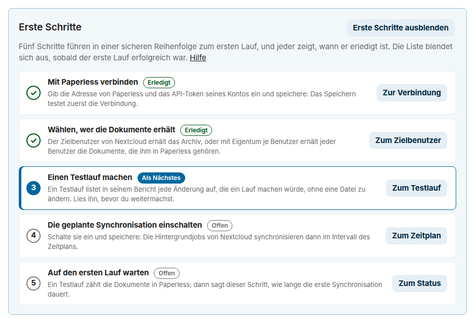
</picture>
<!-- --8<-- [end:quick-start-section] -->
<!-- --8<-- [start:features] -->

## Funktionen

### Archiv

- Ein Ordnerbaum in den Dateien des eingestellten Nextcloud-Benutzers, oder [jedes Benutzers, mit den Dokumenten, die ihm in Paperless gehören](#eigentum-je-benutzer) und, wenn du es wählst, [denen, die Paperless mit ihm teilt](#dokumente-die-paperless-teilt), nach Korrespondent, Dokumenttyp und Jahr, aus einer [Pfadvorlage](#variablen-der-pfadvorlage), die du ändern kannst, mit Basis-, Archiv-, Eingangs-, Fehler- und Gelöscht-Ordnern deiner Wahl
- Variablen mit den Namen, die Paperless-ngx für seine eigenen Dateinamen verwendet, etwa die Archivseriennummer, der Eigentümer, die Tags, der Name des Monats und benutzerdefinierte Felder, und eine Vorschau unter der Vorlage, die schon beim Tippen zeigt, wohin die neuesten Dokumente kommen, bevor du speicherst
- Das Archiv-PDF jedes Dokuments oder seine Originaldatei
- Umbenennen und Verschieben, wenn sich die Metadaten in Paperless ändern, ohne leere Ordner zurückzulassen
- Jede Kopie bleibt in Nextcloud dieselbe Datei: Ein neuer Inhalt ihres Dokuments, etwa eine neue Archivversion, aktualisiert sie an Ort und Stelle, sodass ihre Freigaben, öffentlichen Links, Kommentare, Tags, Favoriten und Versionen bei ihr bleiben
- Dokumente im Posteingang von Paperless warten, bis sie fertig sind, und ein Dokument, das einen ausgeschlossenen Tag oder wieder den Posteingangs-Tag bekommt, bleibt draußen, seine Kopie wird entfernt; oder das Archiv [spiegelt nur die Dokumente mit den Tags, die du wählst](#welche-dokumente-das-archiv-spiegelt), etwa `Nextcloud`
- Eine feste Markierung wie `[P123]` in jedem Dateinamen, die [Paperless Unified Search](https://github.com/Dennis-Otto/paperless-unified-search) versteht
- Auf Wunsch [Metadaten neben dem Archiv](#metadaten-neben-dem-archiv): eine JSON-Datei für jedes Dokument mit seinen Tags, Notizen, benutzerdefinierten Feldern und Daten, und ein Verzeichnis des ganzen Archivs als CSV, sodass sich das Archiv auch ohne Paperless selbst beschreibt
- Auf Wunsch die [Tags von Paperless als Tags von Nextcloud](#tags-in-nextcloud) an den Kopien, die jeder Änderung in Paperless folgen, sodass Dateien das Archiv nach ihnen filtert und durchsucht; die Tags, die Leute in Nextcloud anlegen, bleiben ihre

### Eingang

- Dateien in einem Eingangsordner von Nextcloud, auf Wunsch auch in seinen Unterordnern, gehen als neue Dokumente zu Paperless
- Jede Datei kann ihre Tags mitbringen: einen für jeden ihrer Unterordner, wie es der Consume-Ordner von Paperless mit `PAPERLESS_CONSUMER_SUBDIRS_AS_TAGS` tut, und Tags für jeden Import; die App legt die Tags an, die Paperless fehlen, wenn du sie lässt
- Die App verfolgt die Paperless-Aufgabe jeder Datei: Nach einem Erfolg entfernt sie die Datei oder behält sie, wie du wählst; nach einem Fehler verschiebt sie die Datei in den Fehlerordner, neben den Grund
- Kann Paperless eine Datei gerade nicht annehmen, wartet das Hochladen und versucht es erneut, nach 15 Minuten bis zu einem Tag

### Dateien

- [An Paperless senden](#aus-dateien-senden) im Menü einer Datei oder eines Ordners in Dateien: Die Mitglieder einer Gruppe, die du wählst, standardmäßig die Administratoren, senden sie mit den Tags des Eingangs, sie bleibt, wo sie ist, und eine Benachrichtigung sagt ihnen, sobald Paperless sie hat, mit einem Link zum neuen Dokument
- [Regeln von Flow](#durch-eine-regel-von-flow-senden), die Dateien von selbst senden, etwa jedes PDF, das ein Mitglied einer Gruppe hochlädt, mit eigenen Tags; nur die Administratoren legen sie an
- *In Paperless öffnen* im Menü jeder Kopie des Archivs öffnet ihr Dokument in Paperless
- [Ein Hinweis über der Liste](https://dennis-otto.github.io/paperless-sync/de/use.html#was-bearbeiten-umbenennen-und-löschen-bewirken) sagt, was ein Ordner der App tut: dass das Archiv ein Spiegel ist, wann der Eingang seine Dateien sendet und wo die Gründe fehlgeschlagener Importe stehen; auch für alle, die den Ordner über eine Freigabe erreichen
- Eine Datei, deren Inhalt Paperless schon hat, wird nicht noch einmal hochgeladen, Paperless-ngx 3.x legt also kein Duplikat an; der Absender erfährt das Dokument, das ihn hat

### Sicherheit

- Die Synchronisation bleibt aus, bis du sie einschaltest, und ein Testlauf listet jede Änderung auf, die ein Lauf machen würde, ohne sie zu machen: Er nimmt den Plan eines Laufs, Änderung für Änderung, in derselben Batchgröße
- Der Papierkorb von Paperless wird in einen eigenen Ordner gespiegelt; endgültiges Löschen ist standardmäßig aus und wartet, wenn es an ist, auf die eingestellte Zahl vollständiger Scans von Paperless in Folge
- Eine Konfliktregel für eine Datei im Weg: ersetzen, oder überspringen und den Konflikt melden; die eigenen Kopien der App sind nie im Weg
- Keine WebDAV-Zugangsdaten und kein Passwort eines Nextcloud-Benutzers: Die App schreibt über die Dateisystem-API von Nextcloud
- Das API-Token von Paperless bleibt im Anmeldedaten-Speicher von Nextcloud, erreicht nie den Browser und geht nur an die Adresse, mit der es gespeichert wurde
- Ein Paperless in deinem lokalen Netzwerk, etwa `http://paperless:8000`, ohne den Schutz von Nextcloud gegen Server-Side Request Forgery für den ganzen Server abzuschalten

### Betrieb

- Der Cron von Nextcloud führt die Synchronisation im Intervall aus, das du einstellst, und die Batchgröße begrenzt die Änderungen eines Laufs
- [Änderungen in Sekunden](#änderungen-in-sekunden): Ein Arbeitsablauf von Paperless ruft den Webhook der App auf, wenn er ein Dokument hinzufügt oder ändert, und seine Kopie ändert sich sofort, ohne einen Container neben Paperless, seinen Medienordner oder ein Passwort von Nextcloud
- Läufe auf Abruf und Testläufe aus den Einstellungen, jeder mit einem Bericht seiner Änderungen und Fehler in der Sprache des Administrators, Fehler zuerst, mit einem Filter für jede Art von Änderung, Links zu den Dateien und einem Knopf, der ihn für einen Fehlerbericht kopiert, und mit dem Status des letzten Laufs; ein Testlauf probiert Änderungen der Einstellungen aus, bevor du sie speicherst, und ein Lauf auf Abruf läuft als Hintergrundjob, sodass kein Proxy ihn abschneidet
- [Die Einstellungen an eine Gruppe delegieren](#die-einstellungen-delegieren), für die Person, die Paperless betreibt, aber kein Administrator von Nextcloud ist
- [Auswahlfelder in den Einstellungen](#zielbenutzer-und-tags) bieten die Benutzer von Nextcloud für den Zielbenutzer und die Tags von Paperless für die ausgeschlossenen Tags, die Tags zum Spiegeln und die Tags jedes Imports an und markieren einen Benutzer oder einen Tag, den es nicht gibt, sodass sich ein Tippfehler vor dem ersten Lauf zeigt
- Der [Aktivitätenstrom](#aktivität) des Zielbenutzers erzählt, was jeder Lauf geändert hat, mit Links zu seinen Dateien, und jeden Import, mit einem Link zum neuen Dokument in Paperless
- Auf Englisch und Deutsch: Die Einstellungen, ihre Meldungen, ihre Links *Hilfe* zur Anleitung und der Aktivitätenstrom folgen der Sprache von Nextcloud, die Zeiten dem Gebietsschema deiner persönlichen Einstellungen
- [Benachrichtigungen, Einrichtungsprüfungen und eine Status-API](#benachrichtigungen) sagen den Administratoren, wenn die Spiegelung immer wieder scheitert oder stehen geblieben ist, auch in Uptime Kuma oder Home Assistant
- [`occ`-Befehle](#kommandozeile) für Skripte, Cron-Jobs und Überwachung: ein Lauf oder ein Testlauf mit eigener oder ohne Batchgröße, der Status und neu geschriebene Kopien, mit JSON-Ausgabe und Exit-Codes
- Barrierefrei: Die Einstellungen, die Aktionen in Dateien und das Formular der Regel in Flow werden mit axe-core gegen WCAG 2.1 AA geprüft, ohne ernsten oder kritischen Befund, im hellen und im dunklen Design, am Computer und auf einem Telefon mit 320 Pixeln Breite, auf dem die Einstellungen und das Formular ohne seitliches Scrollen passen, und die Einstellungen lassen sich allein mit der Tastatur bedienen, mit einem sichtbaren Fokus, den die Leiste der Knöpfe nie verdeckt; die End-to-End-Tests prüfen das bei jeder Änderung der App
- Signierte Releases: dasselbe Paket im Nextcloud App Store und auf GitHub, mit einer SBOM und signierter Build-Provenienz

<!-- --8<-- [end:features] -->

## Screenshots

Nach dem Schnellstart: Ein Testlauf listet jede Datei auf, die ein Lauf schreiben, verschieben oder löschen würde, ohne etwas zu ändern, und *Jetzt synchronisieren* macht die Änderungen. Die Bilder zeigen Nextcloud auf Deutsch, mit den Dokumenten eines erfundenen Haushalts in Paperless, deren Namen englisch sind.

<picture>
  <source media="(prefers-color-scheme: dark)" srcset="docs/images/de/dry-run-dark.gif">
  
</picture>

Ein paar Tage später zeigt ein Testlauf jede Art von Änderung auf einmal: neue Dokumente, einen neuen Titel, ein Dokument im Papierkorb von Paperless, eines mit einem ausgeschlossenen Tag und einen abgeschlossenen Import aus dem Eingang.

<picture>
  <source media="(prefers-color-scheme: dark)" srcset="docs/images/de/report-dark.png">
  
</picture>

Das Archiv in Dateien, ein Ordner je Korrespondent, Dokumenttyp und Jahr, mit der ID jedes Dokuments im Namen:

<picture>
  <source media="(prefers-color-scheme: dark)" srcset="docs/images/de/archive-dark.png">
  
</picture>

Die Einstellungen der App in den Administrationseinstellungen von Nextcloud:

<picture>
  <source media="(prefers-color-scheme: dark)" srcset="docs/images/de/settings-dark.png">
  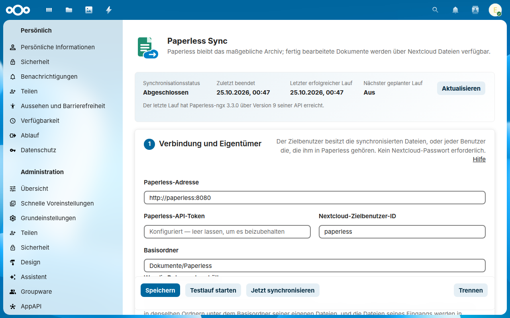
</picture>

Drei weitere Animationen zeigen die App in Dateien bei der Arbeit: [den Eingang](#nextcloud-inbox), [ein Dokument, das in einen anderen Ordner wandert](#verwendung), und [den Papierkorb](#deletion-safety).

Die [Anleitung](docs/guide.de.md#die-einstellungen-abschnitt-für-abschnitt) zeigt jeden Abschnitt der Einstellungen.

## Das Archiv nutzen

Wer Dokumente liest oder sendet, tut das allein in Nextcloud: in Dateien im Web, mit dem Desktop-Client und mit den Nextcloud-Apps für Android und iOS, ohne ein Konto von Paperless. [Das Archiv nutzen](https://dennis-otto.github.io/paperless-sync/de/use.html) ist die Seite für sie, die der App Store als Dokumentation für Benutzer verlinkt: wie du ein Dokument nach seinem Ordner, seinem Namen, seinem Text oder seinen Tags findest, was die Markierung `[P123]` bedeutet, wie du eine Datei an Paperless sendest, und Rezepte, um mit dem Handy direkt in den Eingang zu scannen, einen Ordner des Handys von selbst hochzuladen, von einem Scanner im Netzwerk zu scannen, das Archiv auf dem Computer und dem Handy offline zu halten und es mit der Familie nur zum Lesen oder als Link mit Ablaufdatum mit einer Steuerberatung zu teilen.

<picture>
  <source media="(prefers-color-scheme: dark)" srcset="docs/images/de/phone-menu-dark.png">
  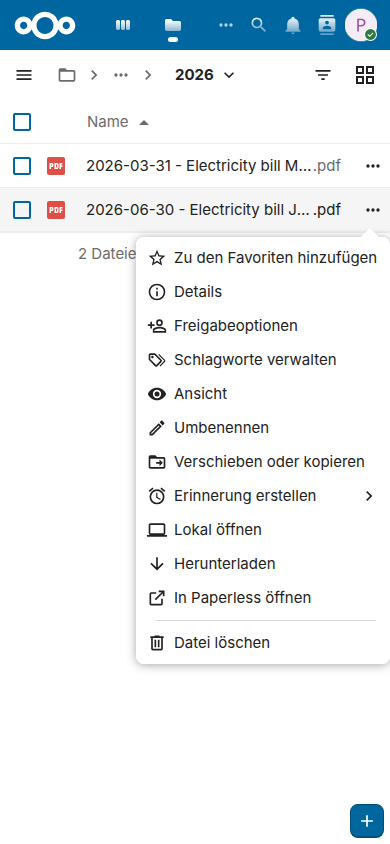
</picture>

Dateien sagt selbst, was jeder Ordner der App tut, für alle, die ihn über eine Freigabe erreichen und das hier nie lesen. Ein Hinweis über der Liste sagt im Archiv und darunter, dass der Ordner ein Spiegel von Paperless ist, wann er zuletzt aktualisiert wurde und dass Änderungen dort Paperless nicht erreichen, mit einem Link zu Paperless; im Eingang, wann seine Dateien an Paperless gehen, mit einem Link zu den fehlgeschlagenen Importen; und dort, dass der Grund jedes Fehlers in der `.error.txt` neben der Datei steht. Jede Person kann jede Art des Hinweises ausblenden, und *Was ist das für ein Ordner?* holt ihn zurück. Die Freigabe eines einzelnen Ordners unter dem Archiv zeigt keinen Hinweis, also gib den Ordner `Archiv` selbst frei ([Entscheidung 0034](docs/decisions/0034-a-note-in-files-says-what-a-folder-of-the-app-does.md)).

<picture>
  <source media="(prefers-color-scheme: dark)" srcset="docs/images/de/folder-note-dark.png">
  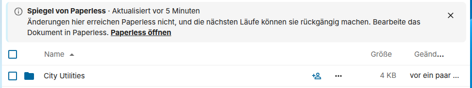
</picture>

<!-- --8<-- [start:usage] -->

## Verwendung

Dieser Teil ist für die Administration, und [Das Archiv nutzen](https://dennis-otto.github.io/paperless-sync/de/use.html) für die Menschen, die das Archiv nutzen. Öffne nach der Installation **Administrationseinstellungen → Paperless Sync**. Richte die Verbindung ein, während die Synchronisation ausgeschaltet bleibt: Das Speichern prüft sie, wenn du das Token eingibst. Starte einen Testlauf, prüfe die Zusammenfassung und schalte erst dann die geplante Synchronisation ein.

Die Standard-Pfadvorlage des Archivs ist:

```text
{{ correspondent }}/{{ document_type }}/{{ created_year }}/{{ created }} - {{ title }} [P{{ id }}]{{ extension }}
```

Sie ergibt Pfade wie:

```text
Dokumente/Paperless/Archiv/Beispiel GmbH/Rechnung/2026/2026-08-26 - Beispielrechnung [P123].pdf
```

Jeder Teil der Vorlage wird zu einem Ordner. Der Basisordner enthält neben dem Archiv den Eingangsordner, mit den Dateien für Paperless, und den Fehlerordner, mit fehlgeschlagenen Importen; der Gelöscht-Ordner im Archiv enthält die Kopien der Dokumente im Papierkorb von Paperless:

<picture>
  <source media="(prefers-color-scheme: dark)" srcset="docs/images/diagrams/the-folders-of-the-default-path-template.de.dark.svg">
  
</picture>

Feste Markierungen wie `[P123]` passen zur unabhängigen App [Paperless Unified Search](https://github.com/Dennis-Otto/paperless-unified-search).

Änderst du in Paperless den Titel, die Tags, den Korrespondenten oder den Typ eines Dokuments, wandert seine Datei an ihren neuen Pfad und behält in Nextcloud ihre Freigaben, Kommentare und Versionen, und die Desktop- und Mobil-Clients benennen sie nur um. Nur eine Änderung des Inhalts, etwa eine neue Archivversion, nachdem Paperless das Dokument neu verarbeitet hat, lädt es erneut herunter, und das Herunterladen geht in dieselbe Datei, an ihrem neuen Pfad, wenn sie einen hat, sodass die Datei ihre Freigaben, Kommentare und Favoriten behält; in einem geplanten Lauf behält Nextcloud den vorigen Inhalt als Version der Datei. Ein Lauf unterscheidet beides an den Prüfsummen der Datei: Er behält die SHA-256 und die MD5 jedes Herunterladens und vergleicht sie mit der Prüfsumme, die Paperless meldet, MD5 bis Paperless-ngx 2.x und SHA-256 seit 3.0. Für eine Datei, die eine frühere Version der App exportiert hat und von der nur die SHA-256 gespeichert ist, liest die erste Änderung unter Paperless-ngx 2.x die Datei in Nextcloud einmal, um ihre MD5 zu ergänzen, sodass auch sie ohne Herunterladen wandert. Ein Herunterladen geht in Stücken nach Nextcloud, sodass ein Dokument jeder Größe in den Speicher von PHP passt. Ein Lauf fragt Paperless nur nach den Feldern der Dokumente, die er liest, nicht nach ihrem Text, und nach der Prüfsumme eines Dokuments nur einmal je Revision, auch wenn das Dokument auf einen späteren Lauf wartet; ein Lauf über ein Archiv ohne Änderungen schreibt nichts in die Datenbank.

Hier wird in Paperless ein Dokument vom Typ Letter zu einem Contract mit neuem Titel, und der nächste Lauf verschiebt seine Kopie in den Ordner des neuen Typs und benennt sie um:

<picture>
  <source media="(prefers-color-scheme: dark)" srcset="docs/images/de/move-dark.gif">
  
</picture>

<picture>
  <source media="(prefers-color-scheme: dark)" srcset="docs/images/diagrams/how-a-run-tells-new-metadata-from-new-content.de.dark.svg">
  
</picture>

<!-- --8<-- [end:usage] -->
<!-- --8<-- [start:configuration] -->

## Konfiguration

<a id="paperless-connection"></a>

### Paperless-Verbindung

Verwende ein eigenes Dienstkonto in Paperless, das kein Superuser ist, mit nur den Berechtigungen der Funktionen, die du nutzt. In Paperless stehen sie unter *Benutzer & Gruppen*, in den Berechtigungen des Kontos:

| Funktion | Berechtigung in Paperless | Was die App damit tut |
| --- | --- | --- |
| Immer | **Anzeigen** für Dokumente, und Zugriff auf jedes zu spiegelnde Dokument, am besten als sein Eigentümer, wie unten beschrieben | listet die Dokumente auf und lädt sie herunter |
| Archivexport | **Anzeigen** für Korrespondenten, Dokumenttypen, Speicherpfade und Tags | bildet die Pfade und überspringt die ausgeschlossenen Tags |
| Gelöscht-Ordner | Eigentum an den Dokumenten, wie unten beschrieben | sieht sie sofort im Papierkorb von Paperless |
| [`{{ owner_username }}`](#variablen-der-pfadvorlage) in der Pfadvorlage | **Anzeigen** für Benutzer | findet den Benutzernamen des Eigentümers jedes Dokuments |
| Benutzerdefinierte Felder in der Pfadvorlage, oder [Metadaten neben dem Archiv](#metadaten-neben-dem-archiv) | **Anzeigen** für benutzerdefinierte Felder | liest die Namen und die Auswahlwerte der benutzerdefinierten Felder |
| Nextcloud-Eingang, oder [*An Paperless senden*](#aus-dateien-senden), standardmäßig für die Administratoren an | **Hinzufügen** für Dokumente und **Anzeigen** für Paperless-Aufgaben | lädt die Dateien hoch und erfährt, ob Paperless sie importiert hat |
| [Tags des Eingangs](#tags-des-eingangs) | **Anzeigen** für Tags, und **Hinzufügen** für Tags mit *Fehlende Tags anlegen* | findet die Tags der Dateien des Eingangs und legt die an, die Paperless fehlen |
| Verbindungs-Checkliste | **Anzeigen** für UI-Einstellungen | liest die Berechtigungen des Kontos, damit **Verbindung testen** die des Eingangs und das Eigentum an den Dokumenten prüfen kann |
| [Eigentum je Benutzer](#eigentum-je-benutzer) | **Anzeigen** für Benutzer, **Anzeigen** auf den Dokumenten jedes Benutzers, und mit dem Eingang **Ändern** für Dokumente | findet den Eigentümer jedes Dokuments, spiegelt die Dokumente jedes Benutzers, und gibt dem Dokument eines Uploads den Benutzer von Paperless seines Benutzers |
| [Dokumente, die Paperless teilt](#dokumente-die-paperless-teilt) | was das Eigentum je Benutzer braucht, und **Anzeigen** für Gruppen | findet, wer ein Dokument über eine Gruppe ansehen darf |

Beim Eigentum je Benutzer gehören die Dokumente ihren Benutzern, nicht dem Konto der App: Gib dem Konto stattdessen die Berechtigung *Anzeigen* auf ihnen, oder nimm einen Superuser, wie [das Sicherheitskonzept](https://dennis-otto.github.io/paperless-sync/security.html#per-user-ownership) erklärt. Sonst gilt:

Der Papierkorb von Paperless zeigt einem Konto nur die Dokumente, die ihm gehören, und die ohne Eigentümer: Eine Berechtigung auf einem Dokument eines anderen zählt dort nicht. Die Synchronisation funktioniert trotzdem, nur Löschungen in Paperless kommen später an, wie das Ende dieses Abschnitts zeigt. Ein Superuser sieht den ganzen Papierkorb, aber sein Token beherrscht ganz Paperless, jedes Dokument und jeden Benutzer, also nimm keinen für diese App. Damit Löschungen mit dem nächsten Lauf ankommen, kannst du das Konto der App zum Eigentümer der Dokumente machen und den Zugriff der Menschen behalten, denen sie jetzt gehören. Das ist optional und geht nicht zusammen mit dem [Eigentum je Benutzer](#eigentum-je-benutzer), das jedes Dokument dem Benutzer gibt, dem es gehört. So geht es:

- **Neue Dokumente:** Lege in Paperless einen Arbeitsablauf mit dem Auslöser *Dokument hinzugefügt* und einer Aktion *Zuweisung* an, die das Konto der App als Eigentümer zuweist und den Benutzern oder Gruppen, denen die Dokumente jetzt gehören, Rechte zum Anzeigen und Bearbeiten gibt.
- **Vorhandene Dokumente:** Wähle sie in der Dokumentliste aus, wähle *Berechtigungen*, setze das Konto der App als Eigentümer und gib denselben Benutzern oder Gruppen Rechte zum Anzeigen und Bearbeiten. Lass *Mit bestehenden Berechtigungen zusammenführen* aus: Ist es an, behält Paperless den bisherigen Eigentümer und setzt einen nur für Dokumente ohne Eigentümer. Ist es aus, ersetzt der Dialog die Berechtigungen der ausgewählten Dokumente, also nenne jeden, der Zugriff behalten soll.

Nur der Eigentümer eines Dokuments oder ein Superuser kann seinen Eigentümer ändern. Der Papierkorb von Paperless führt diese Dokumente dann für das Konto der App und für Superuser, nicht für die Menschen, denen sie vorher gehörten.

Ohne Eigentum erreicht der Papierkorb das Archiv trotzdem, nur später: Ein Dokument im Papierkorb, das das Konto nicht sehen kann, gilt als fehlend, und seine Kopie wandert nach der eingestellten Zahl vollständiger Scans in den Gelöscht-Ordner. Lass in diesem Fall *Auch Kopien von Dokumenten löschen, die ohne den Paperless-Papierkorb verschwunden sind* aus: Ist es zusammen mit dem endgültigen Löschen an, wird eine solche Kopie dann gelöscht, obwohl sich das Dokument in Paperless noch wiederherstellen lässt. Ein Testlauf zeigt einen Hinweis, wenn Dokumente fehlen, während der Papierkorb keine führt (`TRASH EMPTY` auf der Kommandozeile), und die [Verbindungs-Checkliste](#verbindungs-checkliste) zählt die Dokumente, die das Konto sieht, ohne dass sie ihm gehören.

Das API-Token wird im Anmeldedaten-Speicher von Nextcloud gespeichert und nie an den Browser zurückgegeben. Es geht nur an die Paperless-Adresse, mit der es gespeichert wurde: Um dich mit einer anderen Adresse zu verbinden, gib das Token erneut ein. Das gilt auch, wenn sich die Adresse an der Einstellungsseite vorbei ändert, mit `occ` oder der Provisioning-API von Nextcloud; die Synchronisation wartet dann auf das Token. Speichern, **Verbindung testen**, das Einrichten des Kontos und Trennen fragen nach deinem Passwort, außer du hast es in den letzten 30 Minuten bestätigt.

<a id="the-account-of-the-app"></a>

#### Das Konto der App

**Ein Konto für die App in Paperless anlegen**, in der Karte *Verbindung und Eigentümer*, richtet das Konto der App mit dem API-Token eines Paperless-Superusers ein, das du einmal eingibst:

1. Die App nimmt die Berechtigungen, die die Module des Formulars brauchen, aus der Tabelle oben, und keine weiteren; stelle also zuerst die Module ein.
2. Sie legt den Benutzer an, `nextcloud-sync`, wenn du keinen anderen Namen wählst, als keinen Superuser, mit genau diesen Berechtigungen und einem zufälligen Passwort aus 64 Zeichen, das niemand erfährt, fragt Paperless nach dem Token dieses Benutzers und speichert die Einstellungen des Formulars damit, wie **Speichern** ein eingegebenes Token speichert.
3. Sie zeigt die Verbindungs-Checkliste des neuen Kontos. Was keine Berechtigung eines Kontos geben kann, den Zugriff auf die Dokumente anderer Eigentümer, liegt bei dir: Mach das Konto zu ihrem Eigentümer, wie unten beschrieben, oder gib ihm beim Eigentum je Benutzer **Anzeigen** auf den Dokumenten jedes Benutzers.

Einen Benutzer dieses Namens, den es schon gibt, ändert die App nur, wenn du zustimmst: Die Seite fragt zuerst, und Aktualisieren gibt ihm genau diese Berechtigungen und ein neues zufälliges Passwort und nimmt ihm *Admin*, während sein Token und die Berechtigungen seiner Gruppen gleich bleiben. Einen Superuser übernimmt sie nie. Dein Token geht nur an die Paperless-Adresse des Formulars, für diese Anfragen: Die App speichert es nirgends, protokolliert es nirgends und schickt es nie an den Browser zurück, wie [das Sicherheitskonzept](https://dennis-otto.github.io/paperless-sync/security.html#the-setup-of-the-account) erklärt.

Für eine Einrichtung per Skript tut `occ paperless_sync:create-account` dasselbe mit den gespeicherten Einstellungen und gibt die Checkliste aus. Es nimmt das Token des Superusers aus einer Datei, oder mit `--admin-token-file=-` von der Standardeingabe, nie als Argument, das die Liste der Prozesse zeigen würde:

```sh
occ paperless_sync:create-account --admin-token-file=/run/secrets/paperless-admin-token
```

Ohne ein Token eines Superusers für Nextcloud legst du das Konto selbst an: in Paperless unter *Benutzer & Gruppen*, mit den Berechtigungen der Tabelle oben, dann sein Token unter *Mein Profil*, während du als dieser Benutzer angemeldet bist. Oder führe diese Befehle auf einem Rechner von dir aus, nachdem du die ersten drei Zeilen ausgefüllt hast; sie legen das Konto mit den Berechtigungen des Archivs und des Eingangs an:

<!-- account-snippet:start -->

```sh
PAPERLESS_URL='https://paperless.example.com'
SUPERUSER_TOKEN='the API token of a superuser of Paperless'
ACCOUNT='nextcloud-sync'
PASSWORD="$(head -c 32 /dev/urandom | od -An -tx1 | tr -d ' \n')"
# The token and the password go to curl in files of a private folder, never as arguments,
# which the list of processes would show.
SECRETS="$(mktemp -d)"
printf 'Authorization: Token %s\n' "${SUPERUSER_TOKEN}" > "${SECRETS}/header"
printf '{"username": "%s", "password": "%s", "is_superuser": false, "user_permissions": ["view_document", "add_document", "view_correspondent", "view_documenttype", "view_storagepath", "view_tag", "view_paperlesstask", "view_uisettings"]}' \
  "${ACCOUNT}" "${PASSWORD}" > "${SECRETS}/user.json"
printf '{"username": "%s", "password": "%s"}' "${ACCOUNT}" "${PASSWORD}" > "${SECRETS}/login.json"
if curl --fail-with-body --silent --show-error --output "${SECRETS}/answer" \
  --header @"${SECRETS}/header" --header 'Content-Type: application/json' \
  --data @"${SECRETS}/user.json" "${PAPERLESS_URL}/api/users/"; then
  curl --fail-with-body --silent --show-error --header 'Content-Type: application/json' \
    --data @"${SECRETS}/login.json" "${PAPERLESS_URL}/api/token/"
else
  # Why Paperless refused the user, such as a username that it has already.
  cat "${SECRETS}/answer" >&2
fi
rm -rf "${SECRETS}"
```

<!-- account-snippet:end -->

Der letzte Befehl gibt `{"token":"…"}` aus: Gib dieses Token in **Paperless-API-Token** ein und klicke auf **Verbindung testen**. Für die anderen Module ergänze ihre Berechtigungen in der Liste, wie die Tabelle oben sie nennt: `"add_tag"` für *Fehlende Tags anlegen*, `"view_user"` für das Eigentum je Benutzer und `{{ owner_username }}`, `"view_group"` für die Dokumente, die Paperless teilt, `"change_document"` für das Eigentum je Benutzer mit Uploads und `"view_customfield"` für benutzerdefinierte Felder.

#### Verbindungs-Checkliste

**Verbindung testen**, unter den Verbindungseinstellungen, prüft die Einstellungen des Formulars, ohne sie zu speichern, und listet auf, was es gefunden hat, mit dem, was für jede fehlgeschlagene Prüfung zu tun ist:

<!-- --8<-- [end:configuration] -->

<!-- The picture comes from tests/e2e/screenshots.mjs, with the token of an account of the mock that lacks three permissions. -->
<picture>
  <source media="(prefers-color-scheme: dark)" srcset="docs/images/de/settings-checklist-dark.png">
  
</picture>

<!-- --8<-- [start:configuration-checklist] -->

| Zeile | Was sie prüft | Wenn sie scheitert |
| --- | --- | --- |
| Paperless | Paperless antwortet unter der Adresse mit Version 9 seiner API, wie Paperless-ngx 2.16 und neuer, und nimmt das Token an | nicht gespeichert |
| Dokumente | das Konto darf Dokumente anzeigen, und wie viele es sieht; gar keine bekommen einen Hinweis | nicht gespeichert |
| Papierkorb, Korrespondenten, Dokumenttypen, Speicherpfade, Tags | mit eingeschaltetem Archivexport: das Konto darf jede Liste anzeigen; der Papierkorb bekommt einen Hinweis, wenn das Konto Dokumente sieht, die ihm nicht gehören, oder ein Superuser ist | mit dem Fehler gespeichert |
| Hochladen aus dem Eingang | mit eingeschaltetem Eingang: das Konto hat die Berechtigungen **Hinzufügen** für Dokumente und **Anzeigen** für Paperless-Aufgaben | mit dem Fehler gespeichert |
| Tags des Eingangs | mit Tags für die Dateien des Eingangs: das Konto hat die Berechtigung **Anzeigen** für Tags, und **Hinzufügen** für Tags mit *Fehlende Tags anlegen* | mit dem Fehler gespeichert |
| Nextcloud-Ordner | der Zielbenutzer darf Dateien im Basisordner anlegen | nicht gespeichert |

Der Hinweis des Papierkorbs hält nichts auf: Die Synchronisation funktioniert, nur Löschungen in Paperless kommen später in den Gelöscht-Ordner, nach den Läufen, die unter *Erforderliche aufeinanderfolgende Läufe ohne das Dokument* eingestellt sind, denn Paperless zeigt einem Konto im Papierkorb nur seine eigenen Dokumente und die ohne Eigentümer. Das Konto der App zum Eigentümer der Dokumente zu machen, ist optional und geht nicht zusammen mit dem Eigentum je Benutzer.

Ohne **Anzeigen** für UI-Einstellungen nennt Paperless der App die Berechtigungen des Kontos und seine ID nicht, also bekommen die Zeilen des Papierkorbs, des Hochladens und der Tags des Eingangs statt eines Ergebnisses einen Hinweis, der diese Berechtigung nennt. Jede Zeile hat ihren Zustand als Wort, *Bestanden*, *Hinweis* oder *Fehlgeschlagen*, neben ihrem Zeichen. Ein Fehler nennt die Ursache, etwa ein Token, das Paperless ablehnt, ein Zertifikat, dem Nextcloud nicht vertraut, eine Adresse in deinem Netzwerk oder eine Adresse ohne Paperless-API, etwa die Anmeldeseite eines Proxys, und was zu tun ist. Eine Änderung der Adresse, des Tokens, des Zielbenutzers, des Basisordners, des lokalen Netzwerks, der Module oder der Tags des Eingangs nimmt die Checkliste weg, bis zum nächsten Test.

#### Paperless im lokalen Netzwerk

Nextcloud lehnt Verbindungen zu Adressen des lokalen Netzwerks ab, etwa `http://paperless:8000` in Docker, `http://paperless.lan` oder `http://192.168.1.20:8000`, zum Schutz gegen Server-Side Request Forgery. Läuft Paperless unter einer solchen Adresse, schalte **Paperless läuft in meinem lokalen Netzwerk** ein und speichere. Nextcloud erlaubt dann eine lokale Adresse nur für die Anfragen von Paperless Sync an die gespeicherte Paperless-Adresse. Jede andere App und jede andere Anfrage bleibt geschützt, was der Systemschalter `allow_local_remote_servers` für den ganzen Server aufheben würde.

Ohne die Einstellung sagt das Speichern, was zu tun ist:

> Nextcloud sperrt Verbindungen zu lokalen Adressen wie paperless. Wenn Paperless in deinem Netzwerk läuft, schalte „Paperless läuft in meinem lokalen Netzwerk“ ein und speichere die Einstellungen.

Die Einstellung hilft auch, wenn der Name von Paperless nur in der hosts-Datei des Servers steht, etwa mit `extra_hosts` in Docker: Ohne sie schlägt Nextcloud Namen nur im DNS nach, und das Speichern sagt, dass es keinen DNS-Eintrag für den Namen gefunden hat.

Hast du für diese App früher `allow_local_remote_servers` eingeschaltet, schalte die Einstellung ein, speichere und schalte den Schalter dann mit `occ config:system:delete allow_local_remote_servers` wieder aus. [Das Sicherheitsdesign](https://dennis-otto.github.io/paperless-sync/security.html#a-paperless-in-the-local-network) erklärt auf Englisch, was die Einstellung erlaubt.

### Speichern, pausieren und trennen

Das Speichern prüft zuerst jede Einstellung. Ist die geplante Synchronisation an oder gibst du ein Token ein, führt es auch die [Verbindungs-Checkliste](#verbindungs-checkliste) aus, und der Knopf heißt **Verbindung testen und speichern**. Es lehnt Einstellungen ab, mit denen kein Lauf funktionieren kann, etwa ein Token, das Paperless ablehnt, oder einen Basisordner, in den der Zielbenutzer nicht schreiben kann, sodass der Zeitplan nie mit ihnen läuft. Eine Berechtigung, die nur einem Modul fehlt, etwa die für die Tags, wird mit den Einstellungen gespeichert, und die Checkliste nennt sie, damit du sie danach in Paperless vergeben kannst. Ist der Zeitplan aus und kein neues Token eingegeben, erreicht nichts Paperless, bis du einen Lauf startest, und der Knopf heißt **Speichern** und speichert die Einstellungen ohne den Test; **Verbindung testen** prüft sie dann, ohne zu speichern:

<picture>
  <source media="(prefers-color-scheme: dark)" srcset="docs/images/diagrams/what-saving-the-settings-tests.de.dark.svg">
  
</picture>

Um die Synchronisation zu pausieren, etwa solange Paperless nicht läuft, sein Token widerrufen oder der Zielbenutzer deaktiviert ist, schalte **Geplante Synchronisation aktivieren** aus und speichere. Ein Speichern, das scheitert, während der Zeitplan an ist, sagt das und setzt den Fokus auf diesen Schalter.

Nach einem Speichern zeigt das Formular die Einstellungen so, wie Nextcloud sie gespeichert hat: die Adresse ohne Schrägstrich am Ende, jeden ausgeschlossenen Tag und jeden Tag zum Spiegeln einmal und einen leeren Ersatznamen als `Unknown`. Solange das Formular Änderungen enthält, die nicht gespeichert sind, sagt die Leiste der Knöpfe das, und der Browser fragt, bevor du die Seite verlässt. **Testlauf starten** probiert die Änderungen dann aus, ohne sie zu speichern, und sein Bericht sagt *Testlauf ungespeicherter Einstellungen*: Eine neue Pfadvorlage, andere Ordner oder eine andere Löschregel zeigen, was sie tun würden, bevor irgendetwas sie verwendet. Er behält die gespeicherte Verbindung zu Paperless, den gespeicherten Zielbenutzer und wer die Dokumente erhält, die nur ein Speichern prüft und mit deinem Passwort bestätigt: Ein Token, das du eingibst, wartet auf das Speichern, und mit einer neuen Adresse, Einstellung zum lokalen Netzwerk, einem neuen Zielbenutzer, *Wer die Dokumente erhält*, einer neuen Tabelle oder Gruppe der Benutzer bittet dich der Testlauf, zuerst zu speichern. **Jetzt synchronisieren** verwendet nur die gespeicherten Einstellungen und wartet daher, bis du speicherst.

<picture>
  <source media="(prefers-color-scheme: dark)" srcset="docs/images/diagrams/what-a-dry-run-of-unsaved-settings-uses.de.dark.svg">
  
</picture>

**Trennen** löscht das gespeicherte API-Token und schaltet die geplante Synchronisation und **Paperless läuft in meinem lokalen Netzwerk** aus. Die übrigen Einstellungen, die synchronisierten Dateien und ihr Zustand bleiben, wie sie sind; um dich wieder zu verbinden, gib das Token ein, schalte das lokale Netzwerk wieder ein, wenn Paperless dort läuft, und speichere.

Ergebnisse und Fehler erscheinen in der Leiste der Knöpfe, die unten im Fenster bleibt. **Jetzt synchronisieren** wartet nicht auf den Lauf: Es reiht den Lauf als Hintergrundjob von Nextcloud ein und antwortet sofort, der Status sagt *In der Warteschlange*, bis die nächsten Hintergrundjobs ihn starten, innerhalb von fünf Minuten mit dem System-Cron, und die Leiste sagt, wie der Lauf endete, sobald der Status sein Ende zeigt. Ein Lauf kann so lange dauern, wie er braucht, und kein Proxy vor Nextcloud schneidet ihn ab. **Testlauf starten** antwortet mit seinem Bericht; antwortet stattdessen ein Proxy oder der Webserver für einen langen Testlauf, etwa mit *504 Gateway Time-out*, fragt die Seite nach dem Status: Solange er den Testlauf zeigt, sagt die Seite, dass er im Hintergrund weiterläuft, und folgt ihm bis zu seinem Ende; sonst nennt sie den Statuscode des Webservers, und der Status zeigt, wie er endete.

<a id="delegating-the-settings"></a>

### Die Einstellungen delegieren

Wer Paperless betreibt, ist nicht immer Administrator von Nextcloud. Ein Administrator kann dieser Person allein diese Seite geben: Füge unter **Administrationseinstellungen → Administrationsrechte** bei **Paperless Sync** eine Gruppe hinzu, oder führe diesen Befehl aus, mit deiner Gruppe anstelle von `archive-admins`:

```sh
occ admin-delegation:add 'OCA\PaperlessSync\Settings\AdminSettings' archive-admins
```

Die Mitglieder der Gruppe haben keinen Eintrag *Administrationseinstellungen* in ihrem Benutzermenü: Sie öffnen dort **Einstellungen** und finden **Paperless Sync** im Bereich *Administration* der Seitenleiste. Sie können alles tun, was die Seite bietet, mit dem eigenen Passwort, wo die Seite danach fragt, und nichts sonst in der Administration von Nextcloud.

<picture>
  <source media="(prefers-color-scheme: dark)" srcset="docs/images/diagrams/who-may-use-the-settings.de.dark.svg">
  
</picture>

Delegiere die Seite nur an Menschen, denen du die Dateien aller Benutzer und das Netzwerk des Servers anvertraust, denn das gibt sie ihnen:

- **Die Dateien aller Benutzer.** Sie wählen den Zielbenutzer oder das Eigentum je Benutzer, also wohin das Archiv geschrieben wird, und können dort das endgültige Löschen einschalten. Sie wählen auch den Eingangsordner unterhalb des Basisordners dieses Benutzers, dessen Dateien dann an Paperless gehen und, wie die Einstellungen es sagen, den Ordner verlassen.
- **Das Konto der App in Paperless.** Ihre Testläufe, Läufe und Berichte lesen Paperless mit ihrem Token und nennen Dokumente und Dateien. Sie können die Adresse und das Token ersetzen und das Geheimnis des Webhooks erstellen.
- **Das Netzwerk des Servers.** Sie können *Paperless läuft in meinem lokalen Netzwerk* einschalten und die App auf jede Adresse dort richten, sodass der Server Anfragen an Geräte sendet, die sie selbst vielleicht nicht erreichen, und Antworten im Archiv landen können.
- **Die Namen der Konten.** Die Felder des Zielbenutzers und der Gruppen bieten die Kontonamen und Anzeigenamen aller Benutzer und Gruppen von Nextcloud an, ohne ihre E-Mail-Adressen.

Alles andere bleibt bei den Administratoren, egal welche Gruppe es ist: die [Benachrichtigung über eine scheiternde Spiegelung](#benachrichtigungen), es sei denn, `notification_group` nennt die Gruppe der Mitglieder, die Einrichtungsprüfungen unter *Administration → Übersicht*, deren Warnungen die Seite auch ihnen zeigt, die Status-API, die Regeln von Flow und `occ`. Auch ein Schlüssel der Konfiguration der App lässt sich nicht an der Seite vorbei schreiben, also besteht jeder Wert dieselben Prüfungen wie bei einem Administrator. [Das Sicherheitskonzept](https://dennis-otto.github.io/paperless-sync/security.html#delegated-settings) hat die Einzelheiten.

### Zielbenutzer und Tags

Das Feld **Nextcloud-Zielbenutzer-ID** bietet die Benutzer von Nextcloud an, deren Kontoname, Anzeigename oder E-Mail-Adresse enthält, was du tippst: Wähle einen mit den Pfeiltasten und der Eingabetaste oder mit einem Klick. Es nimmt den Kontonamen, wie ihn *Konten* in der Administration auflistet, nicht den Anzeigenamen, und markiert ein deaktiviertes Konto als *deaktiviert*. Verlässt du das Feld mit einer ID, die Nextcloud nicht kennt, sagt es das sofort: *Nextcloud hat keinen Benutzer mit der ID …*. Das Speichern prüft den Zielbenutzer nur zusammen mit der Verbindung, sodass sich ein Zeitplan immer pausieren lässt; das Feld zeigt einen Tippfehler schon vorher.

Die Felder **Zusätzlich ausgeschlossene Paperless-Tags**, **Nur Dokumente mit diesen Tags spiegeln** und **Tags für jeden Import** bieten die Tags von Paperless an: Tippe einen Teil eines Namens, um sie einzugrenzen, und wähle einen aus. Jeder Tag des Felds hat einen Knopf, der ihn entfernt, und die Rücktaste im leeren Feld entfernt den letzten. Einen Tag, den Paperless noch nicht hat, kannst du ebenfalls tippen, abgeschlossen mit der Eingabetaste oder einem Komma, und ein Speichern, ein Test oder ein Testlauf nimmt auch das Getippte mit. Ein solcher Name wird als *nicht in Paperless* markiert, was auch einen Tippfehler zeigt: Ein Lauf schließt die Dokumente mit diesem Tag aus, sobald Paperless ihn hat, und gibt einem Import diesen Tag, sobald Paperless ihn hat oder, mit *Fehlende Tags anlegen*, legt ihn an. Ein Tag zum Spiegeln, den Paperless nicht hat, hält dagegen den Export an, wie [Welche Dokumente das Archiv spiegelt](#welche-dokumente-das-archiv-spiegelt) erklärt. Ein Lauf vergleicht die Namen ohne Rücksicht auf Groß- und Kleinschreibung, und das Feld ebenso: Ein Name, den du tippst, übernimmt die Schreibweise von Paperless. Die Seite liest die Tags mit der gespeicherten Adresse und dem gespeicherten Token, wie ein Lauf sie liest, also erscheinen sie, sobald die Verbindung gespeichert ist, und das Token bleibt auf dem Server. Ein Tag, dessen Name ein Komma enthält, kann in keiner der Listen stehen, weil Kommas die Namen der Einstellung trennen, also bieten die Felder ihn nicht an.

<picture>
  <source media="(prefers-color-scheme: dark)" srcset="docs/images/de/settings-tags-dark.png">
  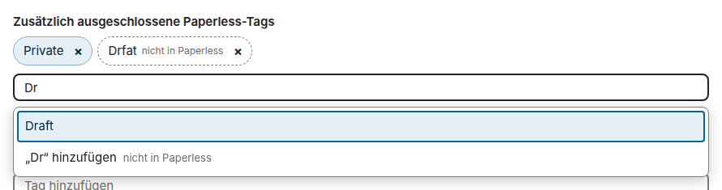
</picture>

<picture>
  <source media="(prefers-color-scheme: dark)" srcset="docs/images/diagrams/where-the-pickers-of-the-settings-take-their-names-from.de.dark.svg">
  
</picture>

### Eigentümer der Ordner

Dem eingestellten Nextcloud-Zielbenutzer gehören die synchronisierten Ordner. Die App arbeitet über die interne Dateisystem-API von Nextcloud und braucht daher weder das Passwort dieses Benutzers noch ein App-Passwort. Andere Benutzer sehen das Archiv, wenn der Zielbenutzer seinen Ordner mit ihnen teilt oder mit einer Gruppe von ihnen; teile es nur zum Lesen, und teile den Eingangsordner nur mit denen, die Dokumente an Paperless schicken dürfen.

Die App merkt sich, was sie für jeden Zielbenutzer geschrieben hat. Ein anderer Zielbenutzer beginnt ein neues Archiv, das die Läufe neu aus Paperless schreiben, und das Archiv des vorigen bleibt, wie es ist, ohne weitere Aktualisierung.

<a id="per-user-ownership"></a>

#### Eigentum je Benutzer

Haben die Dokumente deines Paperless Eigentümer, etwa in einem Haushalt oder einem Team, in dem sich jeder bei Paperless und bei Nextcloud anmeldet, findet jede Person ihre eigenen Dokumente in ihren eigenen Dateien: Stelle **Wer die Dokumente erhält** in *1 · Verbindung und Eigentümer* auf **Jeder Benutzer, die ihm in Paperless gehören**. Die Voreinstellung **Der Zielbenutzer, alle** lässt alles wie oben beschrieben. Ein Administrator verbindet weiterhin ein Paperless mit dem Token eines Kontos; niemand sonst gibt eine Adresse oder ein Token ein ([Entscheidung 0025](https://dennis-otto.github.io/paperless-sync/decisions/0025-each-user-gets-the-documents-they-own-through-one-account-of-the-app.html)).

- **Wer wer ist.** Ein Benutzer von Paperless erhält den Benutzer von Nextcloud mit derselben ID, gleich in welcher Schreibung, wie Single Sign-on wie OpenID Connect sie vergibt, also findet `Alice` in Paperless `alice` in Nextcloud. **Paperless-Benutzer mit einer anderen Nextcloud-ID** nimmt die anderen auf, einen je Zeile, etwa `jdoe = john.doe`; eine Zeile geht vor derselben ID, und ein Speichern lehnt zwei Zeilen für einen Benutzer von Paperless ab, ebenso eine, deren Benutzer von Nextcloud es nicht gibt. **Nur Mitglieder dieser Gruppe** beschränkt es auf die Mitglieder einer Gruppe von Nextcloud.
- **Keines geht verloren, nichts wird geraten.** Der Zielbenutzer erhält die Dokumente ohne Eigentümer und die, deren Eigentümer keinen Benutzer von Nextcloud hat oder nicht in der Gruppe ist. Ein Dokument, dessen Eigentümer Paperless nicht aufführt, dessen Benutzer Nextcloud nicht erreicht oder das einem von zwei Benutzern von Paperless für einen Benutzer von Nextcloud gehört, etwa `Alice` und `alice`, die keinen erhalten, bleibt, wo seine Kopie ist, bis ein Lauf es weiß.
- **Dieselben Ordner für alle.** Jeder Benutzer erhält den Archiv-, den Eingangs-, den Fehler- und den Gelöscht-Ordner unter demselben Basisordner seiner eigenen Dateien, mit derselben Pfadvorlage, und eigene Freigaben, Versionen und Suche.
- **Der Eingang macht es zu seinem.** Eine Datei im Eingang eines Benutzers geht mit dem Token der App an Paperless, und das Dokument erhält dann den Benutzer von Paperless dieses Benutzers als Eigentümer, damit es in sein Archiv zurückkommt; ebenso eine Datei, die er mit *An Paperless senden* schickt oder die eine Regel von Flow schickt. Ein Dokument, das Paperless schon hatte, behält seinen Eigentümer. Bis das Dokument seinen Eigentümer hat, nennt Paperless das Konto der App als Eigentümer, also lassen die Läufe die Dokumente des Kontos, wo sie sind, solange ein Upload wartet, und der Webhook überlässt sie dem nächsten Lauf.
- **Eine Kopie folgt ihrem Eigentümer.** Ändert sich der Eigentümer eines Dokuments in Paperless oder die Tabelle oder die Gruppe, schreibt der nächste Lauf seine Kopie in das Archiv seines neuen Benutzers und entfernt die alte, die in den Papierkorb von Nextcloud des alten Benutzers geht, wie bei einem Dokument mit einem ausgeschlossenen Tag. Das Einschalten des Eigentums je Benutzer holt die Dokumente der Benutzer ebenso aus dem Archiv des Zielbenutzers, im Rahmen der Batchgröße, und aus dem Archiv eines früheren Zielbenutzers, das ein Lauf zuvor geschrieben hat; starte also zuerst einen Testlauf: Er listet jede Änderung mit ihrem Benutzer.
- **Was jeder Benutzer sieht.** Jedes Archiv hat seinen eigenen Batch an Änderungen, seine eigenen Einträge in der Aktivität und seine eigenen Benachrichtigungen über fehlgeschlagene Importe. Der Bericht eines Laufs nennt den Benutzer jeder Zeile und zählt die Änderungen jedes Benutzers, auf der Einstellungsseite, mit `occ paperless_sync:run` und in der Status-API.

Die Verbindungs-Checkliste zeigt, wer die Dokumente von wem erhält, mit der Zahl der Dokumente jedes Benutzers von Paperless, warnt vor jedem Benutzer von Paperless, den der Zielbenutzer wegen eines Fehlers der Einstellungen erhält, und prüft den Basisordner jedes Benutzers. Das Konto des Tokens muss die Dokumente jedes Benutzers sehen, als Superuser oder mit der Berechtigung *Anzeigen* auf ihnen, und braucht *Anzeigen* für Benutzer; [das Sicherheitskonzept](https://dennis-otto.github.io/paperless-sync/security.html#per-user-ownership) erklärt, warum und wie.

<picture>
  <source media="(prefers-color-scheme: dark)" srcset="docs/images/diagrams/whose-archive-a-document-goes-to.de.dark.svg">
  
</picture>

<a id="documents-that-paperless-shares"></a>

#### Dokumente, die Paperless teilt

Paperless hat eigene Berechtigungen: Der Eigentümer eines Dokuments kann anderen Benutzern und Gruppen erlauben, es anzusehen, was Paperless *Mit mir geteilt* nennt. In einem Haushalt gehören Rechnungen, Versicherungen und Steuerunterlagen oft einer Person und sind mit der anderen geteilt. **Jeder Benutzer, die ihm in Paperless gehören oder die er ansehen darf** gibt jedem von ihnen eine Kopie und macht alles andere wie das Eigentum je Benutzer ([Entscheidung 0033](https://dennis-otto.github.io/paperless-sync/decisions/0033-each-user-also-gets-a-copy-of-what-paperless-shares-with-them.html)).

- **Wer eine Kopie erhält.** Der Eigentümer, oder der Zielbenutzer wie oben, und jeder Benutzer von Nextcloud, dessen Benutzer von Paperless das Dokument ansehen darf, selbst oder über eine Gruppe von Paperless; wer ein Dokument ändern darf, darf es auch ansehen. Die Tabelle und die Gruppe der Einstellungen entscheiden, wer das ist, wie bei einem Eigentümer. Ein Benutzer von Paperless ohne Benutzer von Nextcloud erhält keine Kopie, und der Zielbenutzer erhält keine an seiner Stelle, denn er darf das Dokument vielleicht nicht sehen. Ein Dokument ohne Eigentümer, das Paperless jedem zeigt, kommt zum Zielbenutzer und zu denen, die seine Berechtigungen nennen. Das Konto der App erhält keine Kopie dessen, was es ansehen darf, auch wenn es einen Benutzer von Nextcloud hat, denn es hat diese Berechtigung, damit ein Lauf die Dokumente lesen kann; was ihm gehört, kommt weiterhin zu diesem Benutzer, gib der App also ein eigenes Konto statt des Kontos einer Person. Ein Superuser von Paperless erhält, was ihm gehört und was die Berechtigungen nennen, nicht alles, was Paperless ihn sehen lässt.
- **Eine eigene Kopie.** Jede Kopie liegt unter demselben Pfad der Vorlage in den Dateien ihres Benutzers, mit eigenen Freigaben, Versionen und eigener Suche, und **zählt zum Kontingent dieses Benutzers**: Ein Dokument, das mit vier Personen geteilt ist, belegt den Platz von vier Dateien. Eine Änderung an einer Kopie bleibt in dieser Kopie, wie bei jeder anderen Kopie des Archivs.
- **Eine Kopie folgt der Berechtigung.** Darf ein Benutzer ein Dokument in Paperless nicht mehr ansehen, entfernt der nächste Lauf seine Kopie, die in seinen Papierkorb geht, wie bei einem Dokument mit einem ausgeschlossenen Tag; die Kopien der anderen bleiben. Ebenso, wenn du stattdessen *Jeder Benutzer, die ihm in Paperless gehören* wählst. *Der Zielbenutzer, alle* nimmt keine Kopie weg: Jede bleibt in den Dateien ihres Benutzers und wird nicht mehr aktualisiert, auch wenn ihre Berechtigung wegfällt. Um die Kopien zurückzunehmen, wähle zuerst die Option der Eigentümer und lass einen Lauf fertig werden. Ein Testlauf listet jede Änderung mit ihrem Benutzer, starte also zuerst einen.
- **Auch hier wird nichts geraten.** Sagt die Antwort von Paperless nicht, wer ein Dokument ansehen darf, oder nennt sie eine Gruppe, die Paperless nicht aufgelistet hat, erhält der Eigentümer das Dokument, jede Kopie bleibt, wo sie ist, und der Bericht zählt diese Dokumente als Fehler. Ein Dokument, dessen Eigentümer der Lauf nicht erkennt, bleibt, wo seine Kopien sind, wer auch immer es ansehen darf. Ohne die Liste der Gruppen schlägt ein Lauf fehl, bevor sich eine Kopie ändert.
- **Was es braucht.** Das Konto des Tokens braucht auch *Anzeigen* für Gruppen und *Anzeigen* für UI-Einstellungen, das jede Einrichtung ihm gibt und das seine ID nennt: Ohne eines davon schlägt ein Lauf fehl, bevor sich eine Kopie ändert. Nur diese Option fragt Paperless nach den Berechtigungen der Dokumente, was Paperless für jedes Dokument mehr Arbeit macht.

Die Verbindungs-Checkliste zeigt, wer auch wie viele Dokumente aus dem Archiv von wem erhält und wer Dokumente anderer ansehen darf, ohne eine Kopie zu erhalten; dafür liest sie bei jedem Test einmal alle Dokumente.

### Ordnernamen

Eine neue Installation schlägt die Namen ihrer Ordner und die Ersatznamen für Metadaten, die einem Dokument fehlen, in der Standardsprache von Nextcloud vor, `default_language` in seiner `config.php`. Ein Nextcloud ohne Standardsprache und eine Sprache, für die die App noch keine Übersetzung hat, bekommen die englischen Namen; eine regionale Variante, etwa `de_DE`, bekommt die ihrer Sprache:

| Einstellung | Englisch, und jede Sprache ohne Übersetzung | Deutsch: `de`, `de_DE` und die anderen Varianten |
| --- | --- | --- |
| Basisordner | `Documents/Paperless` | `Dokumente/Paperless` |
| Archivordner | `Archive` | `Archiv` |
| Eingangsordner | `Inbox` | `Eingang` |
| Fehlerordner | `Failed imports` | `Fehler` |
| Gelöscht-Ordner | `_Deleted` | `_Gelöscht` |
| Fehlender Korrespondent | `_No correspondent` | `_Ohne Korrespondent` |
| Fehlender Dokumenttyp | `_No document type` | `_Ohne Dokumenttyp` |
| Fehlendes Datum | `_No date` | `_Ohne Datum` |
| Fehlender Titel | `Untitled` | `Ohne Titel` |

Die Einstellungsseite zeigt die vorgeschlagenen Namen vor dem ersten Speichern, sodass du sie vor dem ersten Lauf ändern kannst, und das Speichern behält sie so, wie die Seite sie zeigt. Danach ändert sich ein Name nur, wenn du ihn änderst: Weder eine andere Standardsprache von Nextcloud noch ein Update benennt einen Ordner um. Die Sprache ist die von Nextcloud, nicht die des Administrators, der die Einstellungen öffnet, damit jeder Administrator und jeder geplante Lauf dieselben Namen sehen. Für die deutschen Namen auf einem Nextcloud ohne Standardsprache setze sie vor dem Speichern, mit `occ config:system:set default_language --value=de`, oder tippe die Namen ein.

Frühere Versionen haben in jeder Sprache die deutschen Namen vorgeschlagen. Eine Installation, die eine von ihnen eingerichtet hat, mit einem Zielbenutzer oder mit einem Lauf, der Kopien oder Importe hinterlassen hat, behält sie mit dem Update, auch die, die sie nie gespeichert hat, etwa nach einer Einrichtung mit `occ`, damit ihr Archiv bleibt, wo es ist:

<picture>
  <source media="(prefers-color-scheme: dark)" srcset="docs/images/diagrams/which-folder-names-an-installation-uses.de.dark.svg">
  
</picture>

Das Umbenennen des Basisordners oder des Archivordners eines Archivs in Gebrauch verschiebt seine Dateien in den nächsten Läufen, im Rahmen der Batchgröße, wie es eine neue [Pfadvorlage](#variablen-der-pfadvorlage) tut.

<a id="conflict-policy"></a>

### Dateikonflikt-Regel

Die *Dateikonflikt-Regel* entscheidet, was ein Lauf tut, wenn am Pfad eines Dokuments eine andere Datei als seine eigene Kopie liegt, etwa eine Datei, die jemand dort abgelegt hat, oder eine Kopie, die jemand in Nextcloud bearbeitet hat. Die Kopie, die die App geschrieben hat, ist nie im Weg: Ein neuer Inhalt ihres Dokuments geht in dieselbe Datei.

- **Synchronisierte Datei ersetzen**, der Standard: Der Lauf schreibt das Dokument aus Paperless in die Datei, die dort liegt, und sie bleibt dieselbe Datei mit ihren Freigaben. Nextcloud behält den vorigen Inhalt, etwa eine Bearbeitung, als Version der Datei in einem geplanten Lauf, und in einem Lauf, der mit *Jetzt synchronisieren* gestartet wurde, nur dann, wenn der Administrator, der ihn startet, der Zielbenutzer ist. Eine Datei im Weg einer Kopie, die an einen neuen Pfad wandert, wird stattdessen gelöscht und geht dorthin, wohin die [Löschungen](#löschsicherheit) des Laufs gehen.
- **Überspringen und Konflikt melden**: Der Lauf lässt eine Datei eines anderen, wie sie ist, ebenso eine Kopie, die jemand bearbeitet hat, wenn ihr Dokument einen neuen Inhalt bekommt, und meldet `Nextcloud file conflict at …` als Fehler des Dokuments, in jedem Lauf, bis die Datei weg ist, und schreibt oder verschiebt das Dokument dort nicht. Die Kopie der App, die noch den Inhalt ihres letzten Herunterladens hat, ist kein Konflikt: Der Lauf aktualisiert sie.

> [!WARNING]
> Die Dateien des Archivs sind ein Spiegel von Paperless und mit Absicht nur zum Lesen da: Nichts geht von ihnen zurück zu Paperless. Der nächste Lauf schreibt eine Kopie, die du gelöscht oder umbenannt hast, neu an ihren Pfad, und wenn sich ihr Dokument in Paperless ändert, kann ein Lauf seinen neuen Inhalt über eine Kopie schreiben, die du bearbeitet hast, oder einen Konflikt für sie melden, wenn Konflikte übersprungen werden. Bearbeite Dokumente in Paperless, und kopiere eine Datei aus dem Archiv heraus, um eine eigene Fassung zu behalten.

<a id="path-template-variables"></a>

### Variablen der Pfadvorlage

Die meisten Variablen haben die Namen, die Paperless-ngx für seine eigenen Dateinamen verwendet, also funktionieren viele Vorlagen eines Speicherpfads von Paperless hier, sobald `{{ id }}` hinzukommt. Vorlagen mit Logik von Jinja, mit `custom_fields|get_cf_value(...)` oder mit einer Variablen, die die Tabelle unten nicht nennt, funktionieren nicht. Für ein Dokument, das am 26. August 2026 erstellt und am 1. September hinzugefügt wurde:

| Variable | Wert | Beispiel |
| --- | --- | --- |
| `{{ id }}` | Die ID des Dokuments in Paperless | `123` |
| `{{ title }}` | Sein Titel | `Stromrechnung` |
| `{{ correspondent }}` | Der Name seines Korrespondenten | `Stadtwerke` |
| `{{ document_type }}` | Der Name seines Dokumenttyps | `Rechnung` |
| `{{ storage_path }}` | Der Name seines Speicherpfads in Paperless | `Haushalt` |
| `{{ owner_username }}` | Der Benutzername seines Eigentümers in Paperless | `dennis` |
| `{{ tag_list }}` | Die Namen seiner Tags, sortiert und durch Kommas getrennt | `Energie,Steuern` |
| `{{ asn }}` | Seine Archivseriennummer | `1042` |
| `{{ page_count }}` | Die Zahl seiner Seiten | `2` |
| `{{ created }}` | Das Datum des Dokuments | `2026-08-26` |
| `{{ created_year }}`, `{{ created_year_short }}` | Sein Jahr, vier- oder zweistellig | `2026`, `26` |
| `{{ created_month }}`, `{{ created_month_name }}` | Sein Monat, als Zahl oder mit seinem Namen in der Sprache von Nextcloud | `08`, `August` |
| `{{ created_day }}` | Sein Tag | `26` |
| `{{ added }}`, `{{ added_year }}`, `{{ added_month }}`, `{{ added_day }}` | Wann es zu Paperless hinzugefügt wurde | `2026-09-01`, `2026`, `09`, `01` |
| `{{ original_filename }}` | Der Name der hochgeladenen Datei, ohne ihre Endung | `scan` |
| `{{ extension }}` | Die Endung der exportierten Fassung, mit ihrem Punkt | `.pdf` |
| `{{ custom_fields.<name> }}` | Der Wert des benutzerdefinierten Felds dieses Namens | `{{ custom_fields.Rechnungsnummer }}`: `RE-2026-08` |

Die Vorlage muss `{{ id }}` enthalten. Eine Variable kann mit oder ohne Leerzeichen geschrieben werden, etwa `{{id}}`, und wird als `{{ id }}` gespeichert. Jeder Wert kommt als reiner Text in den Pfad, also bleibt ein `$1` oder ein `{{ title }}` in einem Titel, wie es ist.

Ein Wert, der einem Dokument fehlt, ist leer, etwa ein Eigentümer, Tags, eine Archivseriennummer oder ein benutzerdefiniertes Feld, und ein Ordner, den nur ein solcher Wert benennen würde, heißt `Folder`; ein fehlender Korrespondent, Dokumenttyp, ein fehlendes Datum oder ein fehlender Titel nimmt seinen Ersatznamen aus *Erweiterte Ersatznamen*. Der Name eines benutzerdefinierten Felds wird wie in Paperless geschrieben, mit seinen Leerzeichen und Großbuchstaben, und darf jedes Zeichen außer `{`, `}` und `/` enthalten. Ein Auswahlfeld gibt die Bezeichnung seiner Wahl, ein Dokumentlink die IDs der Dokumente, ein Ja-Nein-Feld `true` oder `false` und ein Geldfeld seinen Betrag so, wie Paperless ihn schreibt, etwa `EUR12.30`. `{{ created_month_name }}` nennt den Monat in der Sprache, die Nextcloud erzwingt oder als Standard hat, `force_language` oder `default_language` in seiner `config.php`, und ohne beide auf Englisch: nie in der Sprache des Administrators, der einen Lauf startet, damit die Pfade in jedem Lauf gleich sind. Eine Änderung dieser Sprache verschiebt die Dateien wie eine Änderung der Vorlage. Die Namen in der Sprache von Nextcloud brauchen die PHP-Erweiterung `intl`; ohne sie sind sie englisch, also verschiebt auch das Installieren oder Entfernen von `intl` die Dateien einer solchen Vorlage.

Die Benutzer und die benutzerdefinierten Felder von Paperless werden nur für eine Vorlage gelesen, die sie verwendet, und die Benutzer in jedem Lauf mit [Eigentum je Benutzer](#eigentum-je-benutzer). Für `{{ owner_username }}` braucht das Konto der App in Paperless die Berechtigung, Benutzer anzuzeigen, und für ein benutzerdefiniertes Feld die Berechtigung, benutzerdefinierte Felder anzuzeigen; ohne sie scheitert der Lauf, bevor eine Datei wandert, und nennt die Berechtigung. Ein benutzerdefiniertes Feld, das Paperless nicht hat, etwa eines mit einem Tippfehler oder eines, das umbenannt wurde, stoppt den Lauf ebenfalls, weil sein Wert im Pfad jedes Dokuments leer wäre.

Unter der Vorlage zeigen die Einstellungen, wohin die fünf neuesten Dokumente von Paperless mit der Vorlage kämen, die du tippst, einen Moment nachdem du aufhörst, vor dem Speichern, mit den Ersatznamen und den Schaltern der Seite und einem Hinweis für ein Dokument, das ein Lauf überspringt. Die Knöpfe unter dem Feld fügen eine Variable an der Cursorposition ein. Eine ungültige Vorlage sagt dort, warum, wie es das Speichern täte:

<picture>
  <source media="(prefers-color-scheme: dark)" srcset="docs/images/de/path-preview-dark.png">
  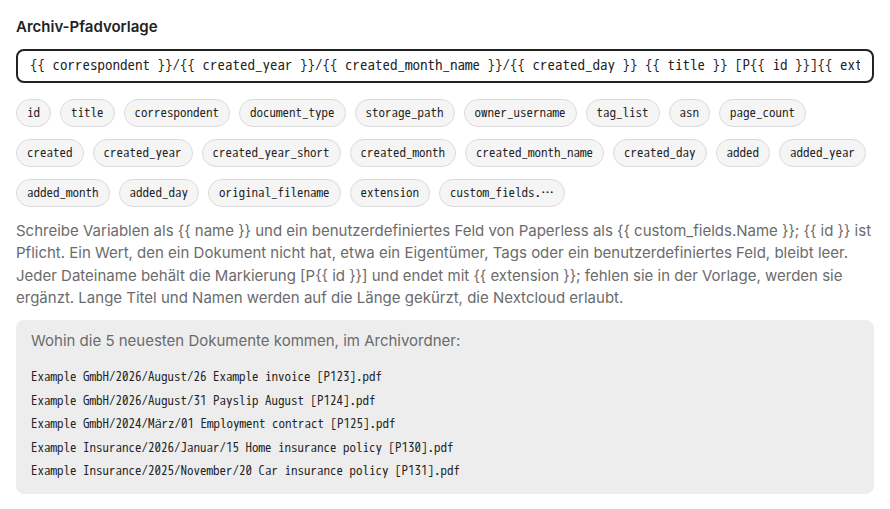
</picture>

Jeder Dateiname behält die Markierung `[P{{ id }}]` und endet mit `{{ extension }}`: Lässt der letzte Teil der Vorlage sie weg, fügt die App sie an seinem Ende an. Die Markierung hält die Pfade zweier Dokumente auseinander und bindet jede Datei an ihr Dokument.

Jeder Teil des Pfads wird für Nextcloud, macOS und Windows bereinigt: Steuerzeichen und `< > : " / \ | ? *` werden zu `_`, mehrere Leerzeichen zu einem, Leerzeichen und Punkte an den Enden fallen weg, und die Namen von Windows-Geräten, etwa `CON`, `COM1` oder `LPT¹`, bekommen ein führendes `_`.

Nextcloud nimmt Namen mit bis zu 250 Bytes an, und ein kyrillisches Zeichen braucht zwei Bytes, ein chinesisches drei und ein Emoji vier. Also hat ein Ordnername höchstens 200 Bytes und ein Dateiname höchstens 217, was Platz für den temporären Namen eines Schreibvorgangs lässt. Ein Name, der länger wäre, wird nur in seinem Freitext gekürzt: dem Titel, dem Korrespondenten, dem Dokumenttyp, dem Speicherpfad und dem ursprünglichen Dateinamen, der längste zuerst. Der Text der Vorlage, die Daten, die Markierung und die Endung bleiben ganz:

<picture>
  <source media="(prefers-color-scheme: dark)" srcset="docs/images/diagrams/how-a-part-of-the-path-is-built.de.dark.svg">
  
</picture>

<a id="which-documents-the-archive-mirrors"></a>

### Welche Dokumente das Archiv spiegelt

Das Archiv spiegelt jedes Dokument, das das Konto des Tokens in Paperless sehen darf, bis auf zwei Arten, die *3 · Strukturiertes Archiv* auslässt:

- **Dokumente im Posteingang von Paperless,** solange *Paperless-Posteingangsdokumente überspringen* an ist, wie es das von Anfang an ist, damit ein Dokument wartet, bis es fertig ist.
- **Dokumente mit einem ausgeschlossenen Tag,** einem der *Zusätzlich ausgeschlossenen Paperless-Tags*, etwa `Private`.

**Nur Dokumente mit diesen Tags spiegeln** dreht das um, für ein Archiv eines Teils von Paperless, etwa der Dokumente, die eine Familie teilt: Mit Tags in der Liste, etwa `Nextcloud`, spiegelt das Archiv nur die Dokumente, die mindestens einen davon haben, und lässt die anderen in Paperless in Ruhe. Ein ausgeschlossener Tag und der Posteingang gehen weiter vor, sodass ein Dokument mit den Tags `Nextcloud` und `Private` draußen bleibt. Leer, wie sie es von Anfang an ist, spiegelt die Liste jedes Dokument.

Ein Dokument, das das Archiv verlässt, weil es seinen letzten Tag zum Spiegeln verloren oder einen ausgeschlossenen Tag bekommen hat, verliert seine Kopie im nächsten Lauf, den der Bericht als *Ausgeschlossen* führt: Die Kopie geht, wie es die [Löschsicherheit](#löschsicherheit) beschreibt, mit den Ordnern, die sie leert, im Rahmen der [Batchgröße](#batchgröße). Bekommt das Dokument seinen Tag wieder, exportiert es der nächste Lauf wieder. Ein Testlauf zeigt, welche Kopien eine neue Liste entfernen würde, bevor du sie speicherst, und die Vorschau unter der Pfadvorlage markiert die neuesten Dokumente, die ein Lauf überspringt.

Ein Lauf vergleicht die Namen ohne Rücksicht auf Groß- und Kleinschreibung, wie bei den ausgeschlossenen Tags, und das Feld übernimmt die Schreibweise von Paperless. Jeder Tag zum Spiegeln muss ein Tag von Paperless sein: Ein Name mit einem Tippfehler, oder einer, der in Paperless umbenannt wurde, würde sonst die Kopien jedes Dokuments entfernen, das bleiben soll. Deshalb hält der Export an, bevor sich eine Datei ändert, mit *Paperless hat keinen Tag namens „…“, den „Nur Dokumente mit diesen Tags spiegeln“ nennt*, und die Vorschau unter der Pfadvorlage sagt dasselbe schon beim Tippen; der Eingang schickt seine Dateien weiter.

<picture>
  <source media="(prefers-color-scheme: dark)" srcset="docs/images/diagrams/which-documents-the-archive-mirrors.de.dark.svg">
  
</picture>

<a id="metadata-next-to-the-archive"></a>

### Metadaten neben dem Archiv

Mit *Metadaten neben das Archiv schreiben* in *3 · Strukturiertes Archiv*, das von Haus aus aus ist, schreibt jeder Lauf, was Paperless über jedes Dokument weiß, in den Ordner `.paperless` des Archivordners. Dann beschreibt sich das Archiv auch ohne Paperless selbst: wenn du zu einem anderen System wechselst, nur Nextcloud sicherst oder das Archiv jemandem ohne Konto in Paperless gibst. Dateien zeigt den Ordner, sobald *Versteckte Dateien anzeigen* in seinen Einstellungen an ist.

> [!IMPORTANT]
> Die Notizen und die benutzerdefinierten Felder der Dokumente, etwa eine private Bemerkung, eine IBAN oder eine Vertragsnummer, blieben bisher in Paperless. Mit der Einstellung kann sie in `.paperless` lesen, wer den Archivordner öffnen kann, auch über eine Freigabe oder einen öffentlichen Link des Archivordners oder eines Ordners darüber. Prüfe die Freigaben, bevor du sie einschaltest.

- **Eine Begleitdatei für jede Kopie,** `.paperless/P123.json` für das Dokument 123: sein Titel, sein Korrespondent, Dokumenttyp und Speicherpfad mit ihren Namen, seine Tags, wann es erstellt, hinzugefügt und zuletzt geändert wurde, seine Archivseriennummer, sein ursprünglicher Dateiname, MIME-Typ und seine Seitenzahl, seine Notizen mit ihren Verfassern, seine benutzerdefinierten Felder mit ihren Namen, ein Auswahlfeld mit der Bezeichnung seiner Wahl, ob die Kopie das Original oder die Archivversion ist, mit ihrer SHA-256, und die Adresse des Dokuments in Paperless.
- **Ein Verzeichnis des Archivs,** `.paperless/index.csv`, mit einer Zeile für jede Begleitdatei: die ID, der Titel, der Korrespondent, der Dokumenttyp, die Tags und die Daten, der Pfad der Kopie unterhalb des Archivordners, der Zustand des Dokuments, `active`, `trash` oder `missing`, die SHA-256 der Kopie, die Adresse in Paperless und die SHA-256 der Begleitdatei. Es ist CSV nach RFC 4180, in UTF-8 mit Byte-Order-Mark, mit Kommas zwischen den Werten: LibreOffice Calc öffnet es mit einem Doppelklick, und Excel, dessen Doppelklick eine CSV-Datei am Trennzeichen seiner Sprache teilt, im Deutschen am Semikolon, mit *Daten* → *Aus Text/CSV*, das das Komma und UTF-8 selbst erkennt. Ein Wert, den eine Tabellenkalkulation für eine Formel halten würde, einer, der mit `=`, `+`, `-` oder `@` beginnt, beginnt im Verzeichnis mit einem Apostroph, und die Begleitdatei hat ihn, wie er ist.

Die Begleitdatei eines Dokuments, hier mit der Archivversion seiner Kopie:

```json
{
    "version": 1,
    "id": 123,
    "title": "Monthly invoice",
    "correspondent": "Example GmbH",
    "document_type": "Invoice",
    "storage_path": null,
    "tags": [
        "Electricity",
        "Paid"
    ],
    "created": "2026-08-26",
    "added": "2026-08-26T10:00:00+02:00",
    "modified": "2026-09-01T09:00:00+02:00",
    "archive_serial_number": 42,
    "original_file_name": "scan.pdf",
    "mime_type": "application/pdf",
    "page_count": 2,
    "notes": [
        {
            "note": "Paid on 1 September.",
            "created": "2026-09-01T09:00:00+02:00",
            "user": "anna"
        }
    ],
    "custom_fields": [
        {
            "name": "Invoice number",
            "type": "string",
            "value": "INV-2026-08"
        }
    ],
    "file": {
        "version": "archive",
        "sha256": "9fae5fe3947195044d068993bb1c63bd15029aab64fdc4827ee6d9e08b304d84"
    },
    "url": "https://paperless.example.com/documents/123/details"
}
```

Und seine Zeile im Verzeichnis, unter den Namen der Spalten, die Prüfsummen hier gekürzt:

```csv
id,title,correspondent,document_type,tags,created,added,modified,archive_serial_number,path,state,sha256,url,metadata_sha256
123,Monthly invoice,Example GmbH,Invoice,"Electricity, Paid",2026-08-26,2026-08-26T10:00:00+02:00,2026-09-01T09:00:00+02:00,42,Example GmbH/Invoice/2026/2026-08-26 - Monthly invoice [P123].pdf,active,9fae5fe3…,https://paperless.example.com/documents/123/details,5d41402a…
```

Ein Lauf schreibt eine Begleitdatei nur, wenn sich ihr Inhalt ändert, etwa nach einer Änderung des Dokuments in Paperless oder des Namens seines Korrespondenten: Das Verzeichnis hält die SHA-256 jeder Begleitdatei, sodass ein Lauf für alle eine Datei liest. Eine Kopie im Gelöscht-Ordner behält ihre Begleitdatei, und ihre Zeile nennt ihren Pfad dort und den Zustand ihres Dokuments. Eine Begleitdatei geht mit ihrer Kopie, nach denselben Regeln der [Löschsicherheit](#löschsicherheit): wenn ein Lauf die Kopie eines Dokuments löscht, das Paperless gelöscht hat, oder die Kopie eines Dokuments mit einem ausgeschlossenen Tag entfernt.

<picture>
  <source media="(prefers-color-scheme: dark)" srcset="docs/images/diagrams/how-a-run-keeps-the-metadata-next-to-the-archive.de.dark.svg">
  
</picture>

Ein Probelauf schreibt keine Metadaten, und ein Aufruf des [Webhooks](#änderungen-in-sekunden) schreibt die Begleitdatei und die Zeile seines Dokuments sofort. Paperless schickt die Notizen der Dokumente nur, solange die Einstellung an ist, und das Konto der App braucht die Berechtigung, benutzerdefinierte Felder anzusehen: Ohne sie exportieren die Läufe die Dokumente, schreiben keine Metadaten und melden einen Fehler, `Metadata: Paperless did not list its custom fields …`. Ein Lauf schreibt höchstens so viele Begleitdateien, wie *Maximale Änderungen je Modul und Lauf* erlaubt, also schreibt der erste Lauf nach dem Einschalten die Begleitdateien so vieler Dokumente, und die nächsten Läufe schreiben den Rest. Wenn Nextcloud eine Begleitdatei nicht schreiben kann, etwa eine gesperrte, zeigt der Bericht einen Fehler, `Metadata P123: …`, und der nächste Lauf versucht sie erneut. Wenn es keine schreiben kann, etwa bei vollem Kontingent, meldet der Lauf das einmal, schreibt keine weitere Begleitdatei, behält die Zeilen derer, die er geschrieben hat, und der nächste Lauf holt sie nach; `Metadata index: …` ist ein Fehler des Verzeichnisses. Lösche `index.csv`, damit der nächste Lauf jede Begleitdatei neu schreibt. Die Einstellung auszuschalten lässt den Ordner, wie er ist.

### Tags in Nextcloud

Mit *Paperless-Tags als Nextcloud-Tags zeigen* in *3 · Strukturiertes Archiv*, standardmäßig aus, gibt jeder Lauf jeder Kopie die Tags ihres Dokuments als kollaborative Tags von Nextcloud, die Dateien *Schlagworte* nennt. Dateien filtert das Archiv dann nach ihnen, in seiner Ansicht *Schlagworte* und mit dem Filter eines Ordners, und die Suche von Nextcloud findet die Kopien nach ihnen, ohne einen Besuch in Paperless.

- **Ein Tag der App für jeden Tag von Paperless,** mit demselben Namen: Alle Benutzer sehen ihn, und nur Administratoren können ihn zuweisen, damit er im Takt mit Paperless bleibt. Ein Lauf legt einen Tag an, sobald eine Kopie ihn zum ersten Mal braucht, und die App merkt sich die IDs ihrer Tags, findet sie also auch, nachdem ein Administrator einen umbenannt hat. Die Namen dieser Tags sehen alle Benutzer der Instanz, in Dateien und seiner Auswahl der Schlagworte, auch die, die das Archiv nicht öffnen können; die Dateien selbst bleiben so privat wie ihr Ordner. Schalte die Einstellung nur ein, wenn die Namen deiner Tags in Paperless für alle in deiner Nextcloud sichtbar sein dürfen.
- **Sie folgen Paperless:** Jeder Lauf vergleicht die Tags jeder Kopie, die er exportiert, verschiebt oder unverändert vorfindet, mit denen ihres Dokuments, fügt die neuen hinzu und entfernt die, die das Dokument verloren hat, auch wenn die Kopie selbst bleibt, wie sie ist. Ein Tag, den du in Paperless umbenennst, wird zu einem Tag seines neuen Namens, und der Tag des alten Namens geht, wie der eines Tags, den du in Paperless löschst, am Ende eines Laufs über das ganze Archiv, sobald keine Datei ihn mehr hat. Eine Kopie im Gelöscht-Ordner behält die Tags, die sie hatte.
- **Fremde Tags bleiben fremd:** Ein Lauf weist nie einen Tag zu, den jemand anderes angelegt hat, und entfernt, benennt oder löscht keinen, auch keinen, den ein Benutzer an eine Kopie gehängt hat. Nextcloud hält einen Tag je Namen, gleich in welcher Schreibweise, und wenn jemand schon einen Tag mit dem Namen eines Tags von Paperless angelegt hat, etwa `Rechnung`, bleiben die Kopien ohne ihn, und der Bericht sagt es: *Nextcloud hat einen Tag namens Rechnung, den Paperless Sync nicht angelegt hat*. Benenne den Tag in Nextcloud oder in Paperless um, und der nächste Lauf gibt den Kopien ihren.

<picture>
  <source media="(prefers-color-scheme: dark)" srcset="docs/images/diagrams/how-a-copy-gets-the-tags-of-its-document.de.dark.svg">
  
</picture>

Der Bericht nennt jede Kopie, deren Tags sich ändern, etwa `TAGS P123: +Steuer 2026 -Eingang`, und ein Probelauf zeigt dasselbe, bevor du speicherst. Ein Lauf ändert die Tags von höchstens so vielen Kopien, wie *Maximale Änderungen je Modul und Lauf* erlaubt, also taggt der erste Lauf nach dem Einschalten so viele Kopien, und die nächsten Läufe taggen den Rest. Der Aktivitätsstrom aller, die eine Kopie öffnen können, zeigt jeden Tag, den ein Lauf hinzufügt oder entfernt, wie Nextcloud jede Änderung eines Tags zeigt; *System-Tags für eine Datei wurden geändert* in den persönlichen Einstellungen der Aktivität schaltet diese Einträge ab.

Nextcloud lässt nur Benutzer und die Kommandozeile Tags anlegen: Die Hintergrundjobs per Cron und `occ paperless_sync:run` legen sie an, ein Aufruf des [Webhooks](#änderungen-in-sekunden) und Hintergrundjobs per AJAX oder Webcron können es nicht. Ein solcher Lauf gibt den Kopien die Tags, die es schon gibt, und der Bericht nennt die, die auf den nächsten Lauf per Cron warten: *Nextcloud lässt nur Benutzer und die Kommandozeile Tags anlegen*. Die Einstellung auszuschalten lässt die Tags der Kopien, wie sie sind; ein Administrator löscht die Tags der App, und mit ihnen ihre Plätze an den Kopien, unter *Administrationseinstellungen* → *Grundeinstellungen* → *Kollaborative Schlagworte*.

<a id="nextcloud-inbox"></a>

### Nextcloud-Eingang

Dateien im Eingangsordner, und in seinen Unterordnern, wenn *Unterordner des Eingangs durchsuchen* an ist, gehen zu Paperless, in einem Lauf höchstens so viele, wie die Batchgröße erlaubt. Eine Datei bleibt im Eingang, bis ihre Paperless-Aufgabe Erfolg meldet:

<picture>
  <source media="(prefers-color-scheme: dark)" srcset="docs/images/diagrams/the-way-of-a-file-from-the-inbox-to-paperless.de.dark.svg">
  
</picture>

Zwei Scans im Eingang: Paperless importiert den ersten, und der zweite, den es nicht importieren konnte, wartet im Fehlerordner neben seinem Grund:

<picture>
  <source media="(prefers-color-scheme: dark)" srcset="docs/images/de/inbox-dark.gif">
  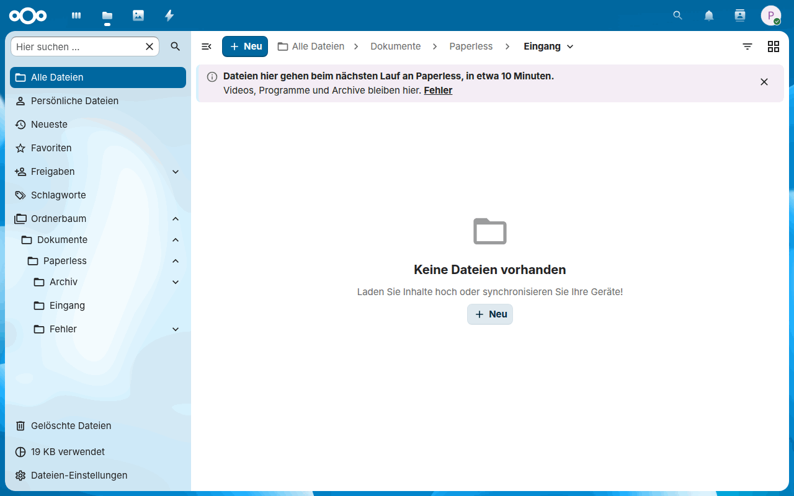
</picture>

Eine fehlgeschlagene Datei behält ihren Unterordner unterhalb des Fehlerordners, aber keine Markierung wie `[P123]` in ihrem Namen: Aus `Scan [P123].pdf` wird `Scan.pdf`, oder `Scan (2).pdf`, wenn dieser Name vergeben ist, und ihre `.error.txt` nennt ihren früheren Namen. Den Namen einer Datei wählt, wer in den Eingang schreiben darf, und für alle, die den Fehlerordner nur lesen dürfen, hielte [Paperless Unified Search](https://github.com/Dennis-Otto/paperless-unified-search) eine Datei mit Markierung für die Kopie dieses Dokuments. Ihre `.error.txt` enthält den Grund, den Paperless genannt hat, etwa einen Dateityp, den es nicht annimmt, oder *It is a duplicate of document #123* unter Paperless-ngx 2.x und unter 3.x mit `PAPERLESS_CONSUMER_DELETE_DUPLICATES`, und die ID der Paperless-Aufgabe, über die die Aufgabenliste von Paperless mehr zeigt. Paperless-ngx 2.x markiert einen fehlgeschlagenen Import zuerst ohne seinen Grund, deshalb wartet die App auf den Grund, bevor sie die Datei verschiebt. Eine Aufgabe, die Paperless abgebrochen hat, `REVOKED` in seiner Aufgabenliste, verschiebt die Datei ebenfalls dorthin. Der Bericht eines Laufs nennt das Dokument, das ein erfolgreicher Import angelegt hat: Die Einstellungsseite zeigt die Datei als *Importiert*, mit *Paperless hat die Datei als Dokument P456 importiert.*, und die Kommandozeile gibt `IMPORT SUCCESS: Dokumente/Paperless/Eingang/police.pdf -> P456` aus.

Hat Paperless die Aufgabe einer Datei einen Tag nach dem Hochladen nicht abgeschlossen, sucht der Lauf zuerst ein Dokument mit dem Inhalt der Datei, über ihre Prüfsumme. Hat Paperless eines, zählt der Import als Erfolg. Führt Paperless die Aufgabe noch, als wartend oder gestartet, ist vielleicht sein Worker ausgefallen oder seine Warteschlange lang, also kann das Dokument noch erscheinen: Die Datei wandert in den Fehlerordner, mit einem Hinweis, der das sagt, und das Nextcloud-Protokoll hat eine Warnung. Sie wird nicht erneut hochgeladen, weil Paperless-ngx 3.x ein Duplikat als zweites Dokument importiert. Führt Paperless die Aufgabe gar nicht, hat seine Warteschlange sie verloren, wie nach einem Neustart von Redis: Der Lauf meldet einen Fehler, das Nextcloud-Protokoll hat eine Warnung, und die Datei wird nach 15 Minuten erneut hochgeladen, wie nach einem fehlgeschlagenen Hochladen.

Videos, Programme und Archive gehen nie an Paperless, das sie nicht als Dokumente verwenden kann: `mp4`, `mov` oder `mkv`, `exe`, `msi`, `dmg` oder `apk`, `zip`, `7z`, `rar`, `tar.gz` oder `iso` und dergleichen, nach der Endung des Namens, gleich in welcher Schreibweise. Eine solche Datei bleibt, wo sie ist, zählt nicht zur Batchgröße und ist kein Fehler. Der Bericht jedes Laufs und jedes Probelaufs nennt sie, solange sie bleibt: auf der Einstellungsseite als *Beiseitegelegt*, mit einem Hinweis, der alle zählt und die ersten fünf nennt, und im Status und auf der Kommandozeile als `IMPORT SET ASIDE: Dokumente/Paperless/Eingang/urlaub.mp4: video` und `SET ASIDE: …`. Sie erreicht weder den Aktivitätsstrom noch die Benachrichtigungen, denn jeder Lauf würde sie wiederholen; verschiebe sie aus dem Eingang oder lösche sie, dann lässt der nächste Bericht sie weg. Die Zahl der Dateien entscheidet nichts: Ein Stapel von tausend Scans geht an Paperless wie ein einzelner, in einem Lauf höchstens so viele, wie die Batchgröße erlaubt. Ein Hochladen einer solchen Datei, das Paperless schon hat, endet noch wie zuvor, und eine Datei, die Paperless importiert hat, bleibt, wie sie ist.

Paperless kann eine Datei sofort ablehnen: eine eines Typs, den es nicht annimmt, eine leere oder eine, die zu groß für einen Proxy davor ist, etwa die 100 MB des kostenlosen Tarifs von Cloudflare. Der Bericht dieses Laufs führt die Datei einmal als *Abgelehnt*, mit dem Grund, den Paperless genannt hat (`IMPORT REJECTED` auf der Kommandozeile), und das Nextcloud-Protokoll verzeichnet es als Warnung. Die Läufe danach lassen die Datei im Eingang und überspringen sie, bis sie sich ändert; speichere sie neu, benenne sie um oder ersetze sie, um sie erneut zu übergeben.

Ist Paperless nicht erreichbar oder scheitert es mit einem Serverfehler wie `502 Bad Gateway`, lädt der Lauf keine weiteren Dateien hoch und versucht diese später erneut: nach 15 Minuten, dann jedes Mal nach doppelt so langer Zeit, höchstens einmal am Tag. Die anderen Dateien folgen in den nächsten Läufen.

<a id="tags-of-the-inbox"></a>

#### Tags des Eingangs

Eine Datei kann ihre Tags zu Paperless mitbringen, wie es der Consume-Ordner von Paperless mit `PAPERLESS_CONSUMER_SUBDIRS_AS_TAGS` tut. Mit *Unterordner werden zu Tags* bekommt eine Datei in `Eingang/Steuern/2026` die Tags *Steuern* und *2026*, und die *Tags für jeden Import*, etwa *Gescannt* und *Nextcloud*, die das Feld [aus den Tags von Paperless anbietet](#zielbenutzer-und-tags), gehen mit jeder Datei. Beides ist aus, bis du es einschaltest. Ein Name findet den Tag von Paperless mit diesem Namen, gleich in welcher Schreibweise, also findet der Ordner `steuern` den Tag *Steuern*:

<picture>
  <source media="(prefers-color-scheme: dark)" srcset="docs/images/diagrams/which-tags-a-file-of-the-inbox-gets.de.dark.svg">
  
</picture>

- **Das Konto der App findet nur die Tags, die es anzeigen darf:** die ohne Eigentümer, seine eigenen und die, die mit ihm geteilt sind. Paperless macht den Menschen, der einen Tag anlegt, zu seinem Eigentümer, also teile einen vorhandenen Tag mit dem Konto (oder entferne seinen Eigentümer), bevor du die Funktion einschaltest; sonst findet das Konto ihn nicht, und mit *Fehlende Tags anlegen* legt der Lauf einen zweiten Tag mit demselben Namen an.
- **Ein Name, zu dem das Konto keinen Tag findet,** hält die Datei nicht auf: Sie geht ohne diesen Tag, und der Bericht des Laufs sagt das einmal, in einem Hinweis auf der Einstellungsseite (`TAGS UNKNOWN: Paperless shows the account no tag named 2026, …` auf der Kommandozeile), mit einer Warnung im Nextcloud-Protokoll. Lege den Tag in Paperless an oder teile ihn mit dem Konto, und die nächsten Dateien bekommen ihn.
- **Mit *Fehlende Tags anlegen*** legt der Lauf einen solchen Tag zuerst an, mit dem Zuweisungsalgorithmus *Keiner*, damit Paperless ihn nicht von selbst einem anderen Dokument zuweist, und ohne Eigentümer, wie es der Consume-Ordner von Paperless tut, damit jedes Konto, das Tags anzeigen darf, ihn sieht, und der Bericht zeigt ihn als *Neuer Tag* (`NEW TAG: 2026` auf der Kommandozeile); die Einstellungsseite zeigt die Tags jedes Imports auch unter seiner Datei. Das Konto der App braucht die Berechtigung **Hinzufügen** für Tags; eine Datei, deren Tag Paperless nicht anlegt, wartet im Eingang und wird später erneut hochgeladen, wie nach einem fehlgeschlagenen Hochladen. Ein Testlauf nennt die Tags, die ein Lauf anlegen würde, und legt keine an.
- **Der Bericht nennt die Tags jeder Datei,** etwa `IMPORT: Dokumente/Paperless/Eingang/Steuern/2026/beleg.pdf (tags: Steuern, 2026)`, und Paperless fügt seine eigenen Posteingangs-Tags hinzu, wie bei jedem neuen Dokument.
- **Der Titel** des neuen Dokuments ist der Name der Datei ohne ihre Endung: Paperless nimmt ihn aus der Datei, wie bei jedem Hochladen.

Jeder, der in den Eingangsordner schreiben darf, kann seine Ordner benennen, also kann er mit *Fehlende Tags anlegen* auch Tags in Paperless anlegen. Schalte es für einen Eingang ein, in den nur Menschen schreiben, denen du vertraust, und nimm für den Rest die Tags für jeden Import.

<a id="send-from-files"></a>

### Aus Dateien senden

Eine Datei muss nicht über den Eingang gehen: **An Paperless senden** im Menü einer Datei oder eines Ordners in Dateien, oder einer Auswahl davon, sendet sie an Paperless, und die Datei bleibt, wo sie ist. Die Mitglieder der Gruppe in *Gruppe, die Dateien senden darf*, in *4 · Nextcloud-Eingang*, bekommen die Aktion: standardmäßig die Administratoren, die Gruppe `admin`. Die Uploads nutzen das API-Token der App, also das Paperless-Konto, das du für sie eingerichtet hast, nicht ein Konto der Person, die sendet; wähle also eine Gruppe von Menschen, denen du dieses Konto anvertraust, etwa eine für die Menschen, die die Post scannen, und lass das Feld leer, um die Aktion auszuschalten. Das Konto braucht die Berechtigungen **Hinzufügen** für Dokumente und **Anzeigen** für Paperless-Aufgaben, die die Verbindungs-Checkliste prüft, solange das Feld eine Gruppe nennt.

<picture>
  <source media="(prefers-color-scheme: dark)" srcset="docs/images/de/files-send-dark.png">
  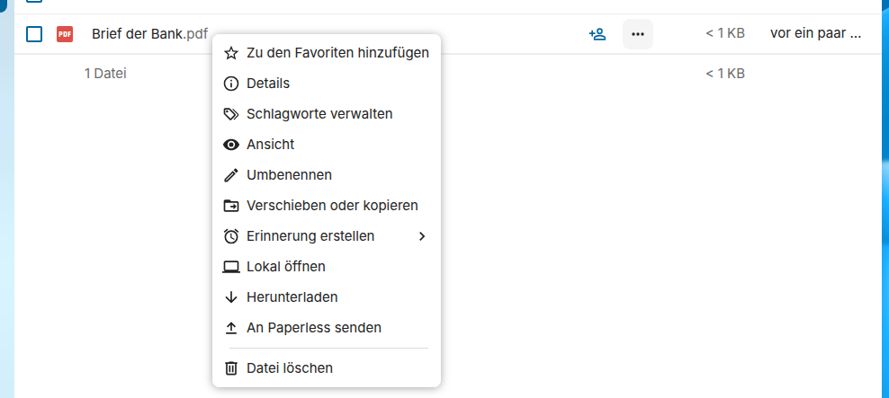
</picture>

<picture>
  <source media="(prefers-color-scheme: dark)" srcset="docs/images/diagrams/how-a-file-goes-from-files-to-paperless.de.dark.svg">
  
</picture>

- **Ein Klick antwortet sofort,** mit der Zahl der Dateien, die gehen, und derer, die schon unterwegs sind, und der Hintergrundjob der App sendet sie mit dem nächsten Cron-Lauf, den Nextcloud alle fünf Minuten startet. Eine Benachrichtigung sagt dem Absender, wie jeder Import geendet hat: *receipt.pdf ist jetzt in Paperless*, die das neue Dokument in Paperless öffnet, oder den Grund von Paperless, wenn es die Datei nicht importiert hat.
- **Ein Ordner sendet die Dateien unter ihm,** ohne versteckte, höchstens so viele in einem Klick, wie die Batchgröße erlaubt; sende die Unterordner eines größeren Ordners einzeln. Mit *Unterordner werden zu Tags* bekommt eine Datei in `Steuer/2026` unterhalb des gesendeten Ordners die Tags *Steuer* und *2026*, und jede Datei bekommt die *Tags für jeden Import*, wie aus dem [Eingang](#tags-des-eingangs).
- **Paperless bekommt jede Datei einmal:** Der Job fragt Paperless zuerst nach einem Dokument mit dem Inhalt der Datei, über ihre Prüfsumme, und hat Paperless eines, nennt es die Benachrichtigung statt eines Uploads, den Paperless-ngx 3.x als zweites Dokument importieren würde. Eine Datei, die auf ihren Upload oder ihre Aufgabe wartet, ist schon unterwegs, und ein zweiter Klick sendet sie nicht noch einmal.
- **Dateien des Archivs bleiben außen vor:** Eine Datei, deren Name eine Markierung wie `[P123]` trägt, ist schon ein Dokument von Paperless, und die Dateien des Basisordners, etwa der Eingang und das Archiv, gehören den Läufen, beim [Eigentum je Benutzer](#eigentum-je-benutzer) die des Basisordners jedes Benutzers: Verschiebe eine Datei in den Eingang, um sie von dort zu senden. Das Menü lässt die Aktion bei Dateien mit Markierung weg; ein Klick auf eine andere Datei des Basisordners antwortet, dass die Läufe sich um sie kümmern. Nextcloud prüft jeden Klick erneut, zusammen mit der Gruppe und dass die Person jede Datei lesen und herunterladen darf: Eine Freigabe, deren Besitzer nur das Ansehen erlaubt, bleibt außen vor.
- **Kann Paperless eine Datei gerade nicht annehmen,** wartet das Hochladen 15 Minuten, dann jedes Mal doppelt so lange, und gibt nach dem sechsten auf, mit einer Benachrichtigung; eine Datei, die Paperless ablehnt, etwa eine eines Typs, den es nicht nimmt, wird nicht noch einmal hochgeladen. Eine Aufgabe, die Paperless einen Tag nach dem Upload nicht beendet hat, beendet den Import mit einer Benachrichtigung, da Paperless das Dokument noch anlegen kann.

**In Paperless öffnen** steht im Menü jeder Datei, deren Name eine Markierung wie `[P123]` trägt, etwa jeder Kopie des Archivs, für alle, die die Datei sehen, auch über eine Freigabe: Es öffnet das Dokument in Paperless, unter der Paperless-URL der Einstellungen, wo Paperless nach seiner eigenen Anmeldung fragt und das Dokument nur denen zeigt, denen es das erlaubt. So erfährt jeder Benutzer von Dateien diese Adresse; die [Metadaten neben dem Archiv](#metadaten-neben-dem-archiv) nennen sie auch.

<picture>
  <source media="(prefers-color-scheme: dark)" srcset="docs/images/de/files-open-dark.png">
  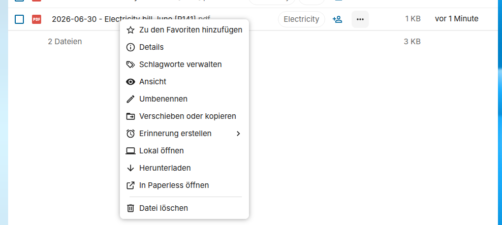
</picture>

### Durch eine Regel von Flow senden

Dateien können auch von selbst zu Paperless gehen: **An Paperless senden** ist eine Aktion von Flow, den Regeln von Nextcloud unter *Verwaltung → Ablauf*, sodass eine Regel der Administratoren jede Datei sendet, die ihre Bedingungen erfüllt, etwa jedes PDF, das ein Mitglied der Gruppe *Familie* hochlädt, oder jede Datei eines Ordners, der den Tag *An Paperless* hat. Die Datei geht wie eine aus Dateien gesendete an Paperless, mit den *Tags für jeden Import* des [Eingangs](#tags-des-eingangs) und den Tags der Regel, und bleibt, wo sie ist.

1. Wähle unter *Verwaltung → Ablauf* bei den *Verfügbaren Abläufen* **An Paperless senden**.
2. Wähle, wann die Regel läuft, etwa *Datei erstellt*, und ihre Bedingungen, etwa *Datei MIME-Typ* ist *PDF-Dokumente* und *Gruppenmitgliedschaft* ist *Familie*, oder *Kollaborativer Tag an Datei* ist *An Paperless*, was auch für den Tag eines Ordners über der Datei gilt; Flow verlangt mindestens eine.
3. Tippe die Tags von Paperless für die Dateien der Regel in *Tags in Paperless*, durch Kommas getrennt, wie das Feld sie aus Paperless vorschlägt, und speichere die Regel.

<picture>
  <source media="(prefers-color-scheme: dark)" srcset="docs/images/de/flow-rule-dark.png">
  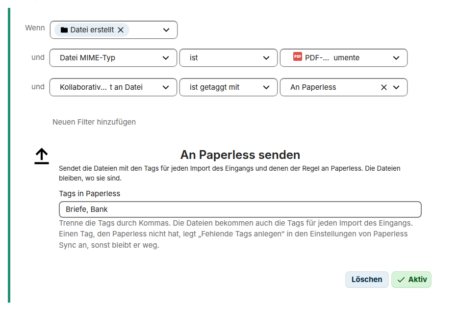
</picture>

<picture>
  <source media="(prefers-color-scheme: dark)" srcset="docs/images/diagrams/how-a-rule-of-flow-sends-a-file-to-paperless.de.dark.svg">
  
</picture>

- **Nur Administratoren legen solche Regeln an,** denn die Uploads nutzen das API-Token der App, wie aus Dateien. *Gruppe, die Dateien senden darf* ist die Gruppe der Aktion in Dateien und begrenzt keine Regel: Ihre Bedingungen wählen, wessen Dateien sie sendet. Der Hintergrundjob sendet sie mit dem nächsten Cron-Lauf, für den Eigentümer jeder Datei; eine Datei ohne Eigentümer, etwa in einem Gruppenordner, für die Person, die sie geschrieben hat. Solange die App nicht mit Paperless verbunden ist, sendet eine Regel nichts.
- **Wann die Regel läuft:** *Datei erstellt* und *Datei aktualisiert* senden eine neue oder geänderte Datei, *Datei umbenannt* und *Datei kopiert* eine Datei, die dorthin kommt, wo die Regel passt, und *Schlagwort zugewiesen* eine Datei in dem Moment, in dem jemand ihr einen Tag gibt. Eine Datei, die auf ihren Upload oder ihre Aufgabe wartet, wird nicht noch einmal eingereiht, weder durch ein zweites Ereignis noch durch eine zweite Regel; die Tags jeder Regel, die zum Ereignis passt, gehen mit ihr.
- **Die Tags der Regel** folgen den Einstellungen des [Eingangs](#tags-des-eingangs): Einen Tag, den Paperless nicht hat, legt *Fehlende Tags anlegen* an, sonst bleibt er weg. Flow speichert keinen Namen mit einem Komma oder Zeilenumbruch, die die Namen trennen, und keinen, der länger ist als die 128 Zeichen, die Paperless speichert.
- **Dateien des Archivs bleiben außen vor,** wie aus Dateien: die Dateien des Basisordners, beim Eigentum je Benutzer des Basisordners jedes Benutzers, die die Läufe schreiben, etwa die Kopien des Archivs und die Dateien des Eingangs, und jede Datei, deren Name eine Markierung wie `[P123]` hat, damit eine Regel für jedes neue PDF das Archiv nicht zurück an Paperless sendet. Eine Datei, deren Inhalt Paperless nach seiner Prüfsumme schon hat, wird nicht noch einmal hochgeladen.
- **Der Eigentümer erfährt, was ihn braucht:** eine Benachrichtigung für einen Import, den Paperless abgelehnt hat oder der gescheitert ist, nach denselben Wiederholungen wie aus Dateien. Eine Regel kann viele Dateien senden, daher kommen ein Import, der geklappt hat, ein Inhalt, den Paperless hatte, und eine Datei, die ihr Eigentümer vor ihrem Upload gelöscht hat, nur ins Protokoll von Nextcloud, auf der Stufe *info*.

<a id="deletion-safety"></a>

### Löschsicherheit

Das Verschieben von Paperless-Dokumenten in seinen Papierkorb kann in den eingestellten Ordner `_Gelöscht` gespiegelt werden, unterhalb des Datums, an dem das Dokument in den Papierkorb kam, in der Zeitzone des Zielbenutzers aus den persönlichen Einstellungen von Nextcloud oder sonst in der von Nextcloud, etwa `_Gelöscht/2026-08-27/Beispiel GmbH/Rechnung/2026/…`; behält das Papierkorb-Verhalten Archivdateien am Ort, bleibt die Kopie, wo sie ist. Das Löschen der Kopie eines Dokuments, das Paperless gelöscht hat, ist standardmäßig aus: der Schalter *Nextcloud-Kopie löschen, nachdem Paperless das Dokument endgültig gelöscht hat*. Ist es an, muss ein Dokument die eingestellte Zahl vollständiger Scans in Folge sowohl in der aktiven Paperless-API als auch in seinem Papierkorb fehlen.

Eine Kopie, die ein Lauf löscht, kommt in den Papierkorb des Zielbenutzers, *Gelöschte Dateien* in Dateien, ebenso die Ordner, die er leert: Nextcloud behält sie dort für die Aufbewahrungszeit seines Papierkorbs, und der Zielbenutzer kann sie wiederherstellen. Mit Eigentum je Benutzer ([Eigentümer der Ordner](#eigentümer-der-ordner)) kommen die Kopien jedes Benutzers in den Papierkorb dieses Benutzers. Das gilt für jeden Lauf, wer oder was ihn auch startet: einen geplanten Lauf, einen Lauf von *Jetzt synchronisieren*, einen Lauf von `occ paperless_sync:run` und den Lauf des Webhooks, auch in einem Prozess, der zuerst die Dateien eines anderen Benutzers eingerichtet hat, etwa des Administrators, der gefragt hat, oder einer anderen App. Dasselbe gilt für die Kopie, die ein ausgeschlossener Tag oder ein verlorener Tag zum Spiegeln entfernt, für eine Datei des Eingangs nach ihrem Import und für eine Datei im Weg einer Kopie, die wandert, die die [Dateikonflikt-Regel](#dateikonflikt-regel) *Synchronisierte Datei ersetzen* löscht. Eine Kopie, deren Dokument einen neuen Inhalt bekommt, bleibt dagegen dieselbe Datei, und ihr voriger Inhalt wird zu einer Version von ihr, nicht zu einer Datei im Papierkorb. Ohne die App *Gelöschte Dateien* von Nextcloud ist jede Löschung endgültig.

<picture>
  <source media="(prefers-color-scheme: dark)" srcset="docs/images/diagrams/what-happens-to-the-copy-of-a-document.de.dark.svg">
  
</picture>

Eine Rechnung kommt in Paperless in den Papierkorb und kehrt zurück:

<picture>
  <source media="(prefers-color-scheme: dark)" srcset="docs/images/de/trash-dark.gif">
  
</picture>

N ist die Zahl der *Erforderlichen aufeinanderfolgenden Läufe ohne das Dokument*, standardmäßig drei. Mit dem Papierkorb-Verhalten *Archivdatei am Ort behalten* bleibt die Kopie im Archiv, statt nach `_Gelöscht` zu wandern, und wird von dort gelöscht, wenn die Regeln es erlauben. Ein Dokument, das Paperless wiederherstellt oder wieder auflistet, behält diese Kopie ohne Herunterladen.

Welche Einstellungen von *Papierkorb und Löschsicherheit* du brauchst, Frage für Frage:

<picture>
  <source media="(prefers-color-scheme: dark)" srcset="docs/images/diagrams/which-deletion-settings-do-i-need.de.dark.svg">
  
</picture>

Die Kopie eines Dokuments, das aus Paperless verschwindet, ohne durch seinen Papierkorb zu gehen, wandert nach derselben Zahl von Scans in den Gelöscht-Ordner. Sie bleibt am Ort, wenn das Papierkorb-Verhalten Archivdateien am Ort behält, und wird gelöscht, wenn auch das direkte Löschen erlaubt ist.

Nur eine Kopie, die noch da ist, wird verschoben oder gelöscht: Ein Dokument, dessen Kopie schon weg ist oder das nie exportiert wurde, wird nur als im Papierkorb oder als fehlend markiert. Verschiebungen in den Gelöscht-Ordner und Löschungen zählen wie jede andere Änderung zur Batchgröße, auch wenn sie scheitern: Was nicht in einen Lauf passt, wartet auf den nächsten. Eine Kopie, die sich nicht verschieben oder löschen lässt, wird als Fehler ihres Dokuments gemeldet, und der Lauf macht mit den anderen weiter.

Nur ein vollständiger Scan zählt. Paperless listet seine Dokumente Seite für Seite auf, und eine Seite kann zu kurz oder leer zurückkommen, von einem Proxy vor Paperless oder einer Störung seiner Berechtigungen, oder ein Dokument kann hinzukommen oder gelöscht werden, während der Lauf die Seiten liest. Dann sähen Dokumente, die es noch gibt, gelöscht aus. Also zählt ein Scan nur, wenn jede Seite voll zurückkam, mit derselben Zahl von Paperless, und der Lauf jedes Dokument erhalten hat, das Paperless aufgelistet hat; der Lauf liest die Dokumente in der Reihenfolge ihrer IDs, sodass ein neues auf der letzten Seite hinzukommt. Nach einem unvollständigen Scan der Dokumente oder des Papierkorbs zeigt der Bericht einen Hinweis, dass die Liste von Paperless unvollständig zurückkam (`SCAN INCOMPLETE` auf der Kommandozeile), das Nextcloud-Protokoll hat eine Warnung, und der Lauf zählt kein Dokument als fehlend; der nächste vollständige Scan macht weiter. Ein Dokument, das ein Scan wieder auflistet, beginnt seine Zählung fehlender Scans neu. Die Listen der Tags, Korrespondenten, Dokumenttypen und Speicherpfade werden genauso geprüft: Kommt eine von ihnen unvollständig zurück, scheitert der Lauf, bevor er etwas im Archiv ändert, sodass ein Dokument nie mangels seines ausgeschlossenen Tags exportiert wird und nie mangels seines Korrespondenten wandert.

Auch ein vollständiger Scan ist noch kein Beweis: Wird ein Dokument gelöscht und ein anderes hinzugefügt, während der Lauf die Seiten liest, bleibt die Zahl von Paperless gleich, und die Seiten können sich so verschieben, dass ein Dokument, das es noch gibt, ohne jedes Zeichen fehlt. Bevor ein Scan ein Dokument als fehlend zählt, fragt der Lauf Paperless deshalb nach diesem Dokument allein. Hat Paperless kein solches Dokument (`404`), zählt der fehlende Scan. Hat Paperless es noch, bleibt seine Kopie, und seine Zählung fehlender Scans beginnt neu, als hätte der Scan es aufgelistet. Jede andere Antwort, etwa ein Fehler von Paperless oder eine Zeitüberschreitung, zählt für das Dokument in diesem Lauf nichts, und der Bericht nennt sie als Fehler. So wird eine Kopie erst verschoben oder gelöscht, wenn Paperless bestätigt hat, dass ihr Dokument weg ist, auch mit nur einem erforderlichen Lauf ohne das Dokument. Der Lauf fragt nur nach den Dokumenten, die ein Scan zählen würde: Eines, das nicht mehr in den Lauf passt oder das ein Lauf schon als fehlend markiert hat, kostet keine Frage, bis eine Löschung seine Kopie entfernen oder seinen Zustand vergessen würde. Ein Lauf stellt höchstens doppelt so viele Fragen, wie *Maximale Änderungen je Modul und Lauf* erlaubt, je die Hälfte für Kopien, die verschoben oder gelöscht werden, und für Zustände allein, und nach der ersten, die scheitert, keine mehr; die übrigen Dokumente zählen in diesem Lauf nichts und warten auf den nächsten.

<picture>
  <source media="(prefers-color-scheme: dark)" srcset="docs/images/diagrams/when-a-document-counts-as-missing.de.dark.svg">
  
</picture>

### Batchgröße

Die Batchgröße, *Maximale Änderungen je Modul und Lauf*, begrenzt die Änderungen eines Laufs: Exporte, Verschiebungen, das Entfernen ausgeschlossener Kopien, Verschiebungen in den Gelöscht-Ordner und Löschungen. Eine Änderung, die scheitert, nimmt ebenfalls ihren Platz ein, also lädt ein Lauf, der nicht schreiben kann, etwa einer gegen ein volles Kontingent oder einen Dateinamen, den Nextcloud ablehnt, nicht mehr Dokumente herunter, als die Batchgröße erlaubt. Ein Export, der scheitert, nimmt seinen Platz allerdings nur unter den Exporten ein, sodass Dokumente, deren Export immer wieder scheitert, nie die Verschiebungen von Dokumenten im Papierkorb oder von fehlenden Dokumenten aufhalten. Was nicht in einen Lauf passt, wartet auf den nächsten, und der Bericht zählt es als übersprungen. Das Hochladen aus dem Eingang hat einen eigenen Batch derselben Größe, sodass ein Lauf auch höchstens so viele Dateien zu Paperless hochlädt. Ebenso die Begleitdateien der [Metadaten neben dem Archiv](#metadaten-neben-dem-archiv): Ein Lauf schreibt höchstens so viele, und die [Tags in Nextcloud](#tags-in-nextcloud): Ein Lauf ändert die Tags von höchstens so vielen Kopien.

<picture>
  <source media="(prefers-color-scheme: dark)" srcset="docs/images/diagrams/how-a-run-spends-its-batch.de.dark.svg">
  
</picture>

Der Lauf nimmt die zuletzt hinzugefügten Dokumente zuerst, sodass ein neues Dokument nicht hinter einem Rückstau wartet, etwa dem ersten Export eines großen Archivs. Ein Dokument, dessen letzter Export oder letzte Verschiebung gescheitert ist, wartet hinter den anderen, das am längsten gescheiterte zuerst, sodass Dokumente, die immer wieder scheitern, den Rest nicht aufhalten. Kann Nextcloud gar keine Dateien im Archiv speichern, weil das Kontingent voll, das Archiv schreibgeschützt oder sein Speicher nicht verfügbar ist, hört der Lauf beim ersten Fehler auf zu exportieren und zu verschieben, und der Bericht zeigt einen Hinweis, dass Nextcloud keine Dateien im Archiv speichern kann (`EXPORT STOPPED` auf der Kommandozeile); die anderen Dokumente folgen im nächsten Lauf, und das Entfernen von Kopien, das Platz schafft, geht weiter. Nextcloud wendet auf die temporäre Datei eines Schreibvorgangs kein Kontingent an, also prüft die App den freien Platz vor jedem Schreiben selbst. Ein Pfad, den Nextcloud von sich aus ablehnt, etwa ein verbotener Dateiname oder ein schreibgeschützter Unterordner, betrifft nur sein Dokument. Mit der Dateikonflikt-Regel *Überspringen und Konflikt melden* wird eine Datei im Weg als Konflikt gemeldet, bevor das Dokument heruntergeladen wird, und ein Testlauf meldet ihn ebenfalls. Die eigene Kopie der App ist nicht im Weg: Der Zustand des Dokuments verzeichnet ihren Pfad, und sie hat noch den Inhalt des letzten Herunterladens, also bekommt sie den neuen Inhalt. Eine Kopie, die jemand in Nextcloud geändert hat, gilt als seine und bleibt, auch wenn das Dokument einen neuen Pfad bekommt; eine Kopie, die ein gescheitertes Schreiben unvollständig hinterlassen hat, ist noch die eigene der App und bekommt den Inhalt im nächsten Lauf.

<a id="background-jobs"></a>

### Hintergrundjobs

Die App verwendet den nativen Cron-Planer von Nextcloud. Der System-Cron muss zuverlässig laufen. Das eingestellte Intervall, von 5 Minuten bis zu einem Tag, setzt die App durch; jeder Lauf begrenzt seine Änderungen in Nextcloud und sein Hochladen zu Paperless jeweils auf die eingestellte [Batchgröße](#batchgröße). Nextcloud startet den Job der App höchstens alle fünf Minuten, also kann das Intervall nicht kürzer sein; ein Intervall unter fünf Minuten, das eine frühere Version gespeichert hat, wirkt wie fünf Minuten.

Das Intervall zählt ab dem Start oder dem Ende des letzten Laufs, je nachdem, was später ist, und es zählt nur ein Lauf, der synchronisiert: ein geplanter, einer von *Jetzt synchronisieren* oder einer von `occ paperless_sync:run`. Ein Testlauf ändert nichts, also verschiebt er den nächsten Lauf nicht; nur solange er noch läuft, wartet der nächste Lauf auf ihn, da beide die Sperre der Synchronisation brauchen.

<picture>
  <source media="(prefers-color-scheme: dark)" srcset="docs/images/diagrams/when-the-background-job-starts-a-run.de.dark.svg">
  
</picture>

*Jetzt synchronisieren* reiht einmal einen zweiten Job ein, `OCA\PaperlessSync\Cron\ManualSyncJob`, den die nächsten Hintergrundjobs ausführen. Um ihn sofort zu starten, lass einen Worker von Nextcloud für ihn laufen, etwa in einem Dienst von systemd oder einem eigenen Container: `occ background-job:worker 'OCA\PaperlessSync\Cron\ManualSyncJob'`. Für einen einzelnen Lauf führt `occ background-job:worker --once 'OCA\PaperlessSync\Cron\ManualSyncJob'` den eingereihten Job aus und kehrt zurück. Solange ein anderer Lauf die Sperre hält, etwa ein Testlauf, wartet der Job auf die nächsten Hintergrundjobs.

Ein großes Archiv braucht anfangs viele Läufe: etwa die Zahl der Dokumente geteilt durch die Batchgröße, mal das Intervall. Mit den Standardwerten, einem Batch von 100 und 5 Minuten, brauchen 5.000 Dokumente 50 Läufe, vier Stunden oder mehr. Ein größerer Batch, bis zu 1.000, macht die erste Synchronisation schneller; jeder spätere Lauf ändert nur, was sich in Paperless geändert hat. Oder importiere es in einem Zug auf der [Kommandozeile](#kommandozeile), mit `occ paperless_sync:run --unlimited`.

Die erste Synchronisation, vom Testlauf bis zum vollständigen Archiv:

<picture>
  <source media="(prefers-color-scheme: dark)" srcset="docs/images/diagrams/the-first-synchronization.de.dark.svg">
  
</picture>

<a id="changes-within-seconds"></a>

### Änderungen in Sekunden

Ein Lauf folgt dem Intervall, das mindestens 5 Minuten beträgt. Ein Arbeitsablauf von Paperless kann der App stattdessen sofort Bescheid geben: Bei *Dokument hinzugefügt* und *Dokument aktualisiert* ruft er den Webhook der App mit der ID des Dokuments auf, und die Kopie dieses Dokuments wird in Sekunden exportiert, verschoben oder entfernt, nach denselben Regeln wie in einem Lauf. Dafür läuft nichts neben Paperless, kein Container liest seinen Medienordner, und Nextcloud braucht kein Passwort: Paperless schickt die ID, und die App liest das Dokument mit ihrem eigenen Token.

<picture>
  <source media="(prefers-color-scheme: dark)" srcset="docs/images/diagrams/how-a-change-in-paperless-reaches-nextcloud-within-seconds.de.dark.svg">
  
</picture>

So richtest du ihn ein:

1. Wähle in Abschnitt 6 der Einstellungen, *Änderungen in Sekunden*, **Geheimnis erstellen** und kopiere das Geheimnis: Die Seite zeigt es nur dieses eine Mal, und Nextcloud behält nur seinen SHA-256. Kopiere auch die **Webhook-URL**, etwa `https://cloud.example.com/index.php/apps/paperless_sync/api/v1/webhook`.
2. Öffne in Paperless **Arbeitsabläufe** und füge einen Arbeitsablauf mit den Auslösern **Dokument hinzugefügt** und **Dokument aktualisiert** hinzu, mit den Filtern, die du möchtest.
3. Füge die Aktion **Webhook** hinzu: die Webhook-URL als *Webhook-URL*, *Parameter für Webhook-Inhalt verwenden* und *Webhook-Payload als JSON senden* an, und den Parameter `document` mit dem Wert `{{ doc_id }}`. Paperless-ngx 2.x kennt kein `{{ doc_id }}`: Gib ihm `{{ doc_url }}`, die Adresse des Dokuments, aus der die App die ID nimmt.
4. Füge unter *Webhook-Kopfzeilen* `Authorization` mit dem Wert `Bearer`, einem Leerzeichen und dem Geheimnis hinzu, und speichere den Arbeitsablauf.
5. Ändere in Paperless den Titel eines Dokuments: Seine Kopie wird in Sekunden verschoben, und Abschnitt 6 zeigt den letzten Aufruf, *P123 verschoben*.

<picture>
  <source media="(prefers-color-scheme: dark)" srcset="docs/images/de/settings-webhook-dark.png">
  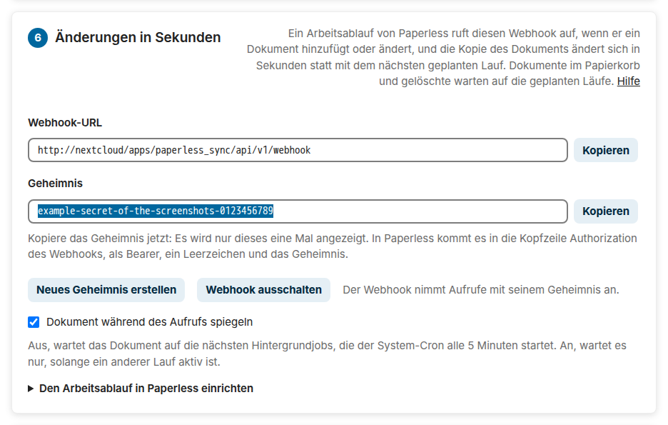
</picture>

Der Webhook nimmt `{"document": 123}` als JSON oder als Formular, und die Zahl darf Text oder die Adresse des Dokuments in Paperless sein. Er antwortet:

| Antwort | Wann |
| --- | --- |
| `200` mit `"result"`: `exported`, `moved`, `removed`, `unchanged` oder `excluded` | die Kopie des Dokuments ist aktuell; `excluded` für ein Dokument, das die Einstellungen auslassen, etwa eines im Posteingang von Paperless |
| `404` mit `"result": "missing"` | Paperless zeigt dem Konto das Dokument nicht: in seinem Papierkorb, gelöscht oder neu und noch nicht gespeichert; Paperless versucht es nach etwa 1, 2 und 4 Sekunden noch einmal, was ein neues Dokument erwischt, und den Papierkorb übernehmen die geplanten Läufe |
| `202` mit `"result": "queued"` | das Dokument wartet auf die nächsten Hintergrundjobs: Ein anderer Lauf hält die Sperre, oder *Dokument während des Aufrufs spiegeln* ist aus |
| `400` | der Aufruf nennt kein Dokument |
| `401` | das Geheimnis fehlt oder ist falsch |
| `429` | Nextcloud lehnt die Adresse von Paperless bis zu 30 Minuten lang ab, nach mehr als zehn Aufrufen mit falschem Geheimnis oder nach mehr als 120 Aufrufen in einer Minute |
| `409` mit `"result": "off"` | die geplante Synchronisation oder der Export ist aus, oder Paperless ist nicht verbunden |
| `500` mit `"result": "failed"` | die Kopie ist fehlgeschlagen, etwa wegen einer Datei im Weg; einen fehlgeschlagenen Aufruf versucht Paperless noch dreimal |

Mit *Dokument während des Aufrufs spiegeln* an, dem Standard, ändert sich die Kopie, während Paperless auf die Antwort wartet. Paperless gibt nach fünf Sekunden auf, etwa bei einem großen Download, und der Lauf wird trotzdem fertig. Aus, wartet jedes Dokument auf die nächsten Hintergrundjobs, die der System-Cron alle 5 Minuten startet, im Job `OCA\PaperlessSync\Cron\DocumentSyncJob`; Nextcloud reiht ihn für jedes Dokument einmal ein, wie oft Paperless auch aufruft, und solange ein anderer Lauf aktiv ist, versucht er es eine Minute später noch einmal. Ein Aufruf ändert nichts, solange die geplante Synchronisation aus ist, so wie bevor der erste Testlauf geprüft wurde.

Der Papierkorb, gelöschte Dokumente und der Posteingang bleiben bei den geplanten Läufen, die ganz Paperless sehen: Ein Dokument, das Paperless nicht zeigt, wartet auf die fehlenden Scans, die die [Löschsicherheit](#löschsicherheit) verlangt, also lass die geplante Synchronisation an. Ein Aufruf des Webhooks ist kein Lauf des Status: Die Einstellungsseite, die Status-API und der Zeitplan behalten den letzten Lauf, sodass Aufrufe nie den geplanten Lauf zurückhalten, der Dokumente im Papierkorb findet. Der Aktivitätenstrom des Zielbenutzers, oder beim Eigentum je Benutzer der jedes Benutzers, zeigt die Änderungen eines Aufrufs wie die eines Laufs.

Der Webhook ist die eine Adresse der App, die ohne Anmeldung bei Nextcloud antwortet. Ein Aufruf ohne das Geheimnis bekommt `401`, und der Brute-Force-Schutz von Nextcloud verzögert die nächsten Aufrufe dieser Adresse, bis zu 25 Sekunden, bis er sie nach mehr als zehn Fehlversuchen bis zu 30 Minuten lang ablehnt; solange die Aufrufe nur langsamer sind, beendet ein Aufruf mit dem Geheimnis die Verzögerung, und `occ security:bruteforce:reset <Adresse>` beendet eine Ablehnung sofort. Jede Adresse darf 120-mal in der Minute aufrufen. **Neues Geheimnis erstellen** ersetzt das Geheimnis sofort, und **Webhook ausschalten** löscht es. [Sicherheit](https://dennis-otto.github.io/paperless-sync/security.html#the-webhook-of-paperless) hat die Einzelheiten.

<!-- --8<-- [end:configuration-checklist] -->

## Status, Bericht und Protokoll

<!-- --8<-- [start:status] -->
Jeder Lauf hinterlässt sein Ergebnis an fünf Stellen, auch ein geplanter Lauf, dem niemand zugesehen hat:

<picture>
  <source media="(prefers-color-scheme: dark)" srcset="docs/images/diagrams/where-the-outcome-of-a-run-goes.de.dark.svg">
  
</picture>

Oben auf der Einstellungsseite steht, wie der letzte Lauf endete, wann er fertig war, der letzte Lauf ohne Fehler, ungefähr der nächste geplante Lauf, da die Hintergrundjobs von Nextcloud ihn ein paar Minuten nach dem Intervall starten, und darunter das Paperless, das der letzte Lauf erreicht hat: seine Version, wie Paperless sie nennt, und die Version seiner API, die die App verwendet, etwa *Der letzte Lauf hat Paperless-ngx 3.3.0 über Version 9 seiner API erreicht.* Ein Lauf, der gescheitert ist oder mit Fehlern einzelner Dokumente endete, zeigt sie in einem Kasten darunter, den Fehler, der den Lauf gestoppt hat, zuerst, und der Bericht des letzten Laufs folgt auf die Knöpfe. Beides bleibt nach einem Neuladen, auch für einen geplanten Lauf. Ein Lauf von *Jetzt synchronisieren* ist *In der Warteschlange*, bis die Hintergrundjobs ihn starten. Ein Lauf, der endete, ohne zu sagen wie, weil PHP ihn gestoppt hat, etwa bei einem Neustart des Servers, ist *Unterbrochen*, sobald die Sperre des Laufs in Nextcloud weg ist und der Lauf 15 Minuten lang kein Lebenszeichen gegeben hat: Ein aktiver Lauf schreibt jede Minute eines; der nächste Lauf macht dort weiter, wo er aufgehört hat. Solange ein Lauf eingereiht oder aktiv ist, fragt die Seite nach seinem Status, nach jeder Änderung des Zustands zuerst jede Sekunde, dann alle fünf Sekunden und nach fünf Minuten alle dreißig Sekunden.
<!-- --8<-- [end:status] -->

<picture>
  <source media="(prefers-color-scheme: dark)" srcset="docs/images/de/status-error-dark.png">
  
</picture>

<!-- --8<-- [start:status-report] -->
Der Bericht zeigt in der Sprache des Administrators, was der Lauf geändert hat, oder in einem Testlauf ändern würde, dessen Überschrift *Testlauf – nichts wurde geändert* sagt. Seine Zahlen zeigen die Arten von Änderungen, die vorkamen, und ein Satz die Dokumente, die unverändert blieben, und die, die der Lauf übersprungen hat, etwa für einen späteren Lauf oder wegen eines ausgeschlossenen Tags. Jede Änderung hat ein Abzeichen ihrer Art: rot für Fehler, fehlgeschlagene und abgelehnte Importe, bernsteinfarben für Löschungen, das Entfernen ausgeschlossener Kopien, Verschiebungen in den Gelöscht-Ordner und Hinweise wie einen unvollständigen Scan, grün für abgeschlossene Importe. Die Fehler kommen zuerst, dann die Hinweise, dann die Änderungen in der Reihenfolge des Laufs, und ein Filter über der Liste zeigt die Änderungen einer Art. Ein Administrator, der auch der Zielbenutzer ist und die Dateien daher öffnen darf, öffnet den Ordner einer Datei, die der Lauf geschrieben, verschoben oder am Ort gelassen hat, mit einem Klick auf ihren Pfad. **Bericht kopieren** kopiert die Überschrift, die Zahlen und die Zeilen auf Englisch, wie `occ paperless_sync:run` sie ausgibt, etwa `EXPORT P12: Dokumente/Paperless/…`, für einen Fehlerbericht. Die Fehler, die die App erklärt, etwa ein Zielbenutzer, den Nextcloud nicht kennt, oder ein volles Kontingent, stehen ebenfalls in der Sprache des Administrators, im Bericht und im Status darüber, während das Protokoll und die Kommandozeile sie auf Englisch behalten; die Gründe von Paperless und die übrigen Meldungen von Paperless und Nextcloud bleiben in den Worten, in denen der Lauf sie bekommen hat.

<picture>
  <source media="(prefers-color-scheme: dark)" srcset="docs/images/diagrams/how-the-report-shows-a-change.de.dark.svg">
  
</picture>

Der Bericht zählt jede Änderung und listet bis zu 100 Zeilen davon auf. Ein Lauf mit mehr Zeilen listet seine Fehler, Löschungen, das Entfernen ausgeschlossener Kopien, Verschiebungen in den Gelöscht-Ordner und fehlgeschlagene Importe zuerst auf, an Stelle von Exporten, Verschiebungen und Importen, und sagt, wie viele Zeilen er auslässt, sodass ein Testlauf nie eine Löschung hinter hundert Importen versteckt; `SCAN INCOMPLETE` und `EXPORT STOPPED` bleiben immer. Der Status behält die ersten 50 Fehler des Laufs und zählt die übrigen.

Das Nextcloud-Protokoll hat eine Warnung, mit der ID des Dokuments und seinem Pfad, wenn ein Fehler eines Dokuments zum ersten Mal auftritt oder sich ändert; ein Fehler, der in jedem Lauf wiederkommt, wird einmal protokolliert. Ein Lauf, der als Ganzes scheitert, wird als Fehler protokolliert.
<!-- --8<-- [end:status-report] -->

### Aktivität

<!-- --8<-- [start:activity] -->
Die App *Aktivität* von Nextcloud erzählt dem Zielbenutzer, oder beim [Eigentum je Benutzer](#eigentum-je-benutzer) jedem Benutzer, was Paperless Sync getan hat, in der Sprache des Benutzers, auch bei einem geplanten Lauf, dem niemand zugesehen hat:

<picture>
  <source media="(prefers-color-scheme: dark)" srcset="docs/images/diagrams/what-the-activity-stream-shows.de.dark.svg">
  
</picture>

- **Ein Lauf, der etwas geändert hat,** hat einen Eintrag, der seine Änderungen zählt und seine ersten fünf Dateien verlinkt: *Paperless Sync hat 6 Dokumente hinzugefügt oder aktualisiert und 1 Dokument nach _Gelöscht verschoben: a.pdf, b.pdf, c.pdf, d.pdf, e.pdf und 2 weitere*. Ein Link führt auch dann zu seiner Datei, wenn die Datei inzwischen wieder gewandert ist. Der Eintrag öffnet den Archivordner, dessen Reiter *Aktivität* in *Dateien* die Läufe auflistet.
- **Eine Datei des Eingangs, die Paperless importiert hat,** hat einen Eintrag mit einem Link zu ihrem neuen Dokument in Paperless: *scan.pdf wurde als P123 in Paperless importiert*. Der Link beginnt mit der gespeicherten Paperless-Adresse, also öffnet er sich nur dort, wo auch der Browser diese Adresse erreicht, nicht für einen Namen innerhalb von Docker wie `http://paperless:8000`.
- **Eine Datei, die Paperless nicht importieren konnte,** hat einen Eintrag mit dem Grund von Paperless und einem Link zur Datei im Fehlerordner, und **eine Datei, die Paperless abgelehnt hat,** hat einmal einen mit dem Grund: Die Datei bleibt im Eingang, bis sie sich ändert.

Ein Testlauf und ein Lauf ohne Änderungen fügen keinen Eintrag hinzu. Der Filter *Paperless Sync* in der Navigation der App Aktivität zeigt nur die Einträge der App, und in den persönlichen Einstellungen unter *Aktivität* kann sich jeder Benutzer sie auch per E-Mail oder als Benachrichtigungen schicken lassen, was bis dahin aus ist. Die eigenen Einträge der App *Dateien* von Nextcloud erzählen diese Geschichte nicht: Sie lassen die Dateien eines Laufs von Hand aus und zeigen die eines geplanten Laufs als Änderungen eines *entfernten Kontos*.
<!-- --8<-- [end:activity] -->

<a id="being-notified"></a>

### Benachrichtigungen

<!-- --8<-- [start:notifications] -->
Eine Spiegelung, die stehen bleibt, ist der schlimmste Fehler einer Sicherung, und niemand schaut jeden Tag auf die Einstellungsseite. Paperless Sync sagt es von selbst, an drei Stellen, ohne einen weiteren Dienst:

<picture>
  <source media="(prefers-color-scheme: dark)" srcset="docs/images/diagrams/when-the-administrators-hear-of-a-failing-mirror.de.dark.svg">
  
</picture>

- **Benachrichtigungen.** Drei Läufe in Folge, die fehlgeschlagen oder mit Fehlern abgeschlossen sind, oder weniger, sobald der erste von ihnen vor einem Tag geendet hat, etwa bei einem Intervall von einem Tag, schicken jedem Administrator eine Benachrichtigung mit den ersten 200 Zeichen des Fehlers und einem Link zu den Einstellungen: *Paperless Sync ist 3 Mal in Folge fehlgeschlagen*. Sie kommt einmal für die ganze Reihe, auch per E-Mail oder als Push-Benachrichtigung der Nextcloud-Apps, wo der Benutzer diese eingeschaltet hat, und der nächste erfolgreiche Lauf entfernt sie. Zwei fehlgeschlagene Läufe, etwa während eines Neustarts von Paperless, benachrichtigen niemanden. Der Zielbenutzer, oder beim Eigentum je Benutzer der Benutzer, dessen Eingang die Datei hatte, bekommt eine Benachrichtigung für jede Datei des Eingangs, die Paperless nicht importieren konnte oder abgelehnt hat, mit ihrem Grund, und ebenso der Eigentümer einer Datei, die eine [Regel von Flow](#durch-eine-regel-von-flow-senden) gesendet hat. Ein Testlauf benachrichtigt niemanden.
- **Einrichtungsprüfungen.** *Administration → Übersicht* und `occ setupchecks` zeigen zwei Prüfungen der App. *Paperless Sync* ist ein Fehler, wenn der letzte Lauf gescheitert ist, und eine Warnung, wenn er mit Fehlern abgeschlossen ist oder wenn drei Intervalle lang kein Lauf erfolgreich war, mindestens eine Stunde, etwa wenn die Hintergrundjobs stehen geblieben sind, und ein Hinweis mit einem Link zu den Einstellungen, solange ihnen die Adresse von Paperless, sein Token oder der Zielbenutzer fehlt, wie auf einer neuen Installation oder nach **Trennen**. *Hintergrundjob von Paperless Sync* warnt, wenn geplante Läufe an sind, Nextcloud seine Hintergrundjobs aber mit AJAX oder Webcron ausführt, die sie nur starten, während jemand Nextcloud benutzt. Die Einstellungsseite zeigt ihre Warnungen oben.
- **Die Status-API** gibt einer Überwachung, etwa Uptime Kuma oder Home Assistant, den Zustand der Spiegelung. Nur Administratoren dürfen sie lesen; gib der Überwachung ein App-Passwort eines Administrators, aus *Persönliche Einstellungen → Sicherheit*, hier in der Variablen `APP_PASSWORD`:

```sh
curl --user "admin:$APP_PASSWORD" --header "OCS-APIRequest: true" \
  "https://cloud.example.com/ocs/v2.php/apps/paperless_sync/api/v1/status?format=json"
```

Sie antwortet, mit gekürzten Zahlen in `summary`:

```json
{"ocs": {"meta": {"status": "ok", "statuscode": 200, "message": "OK"}, "data": {
  "healthy": false, "health": "failed", "enabled": true, "state": "failed",
  "lastStarted": 1787911200, "lastEnded": 1787911205, "lastSuccess": 1787900400, "nextRun": 1787912100,
  "error": "Paperless answered 401: Invalid token.", "failedRuns": 3, "failingSince": 1787909405,
  "summary": {"dryRun": false, "exported": 0, "errors": 0}, "users": [],
  "paperlessVersion": "", "paperlessApiVersion": ""}}}
```

`health` ist `unconfigured`, solange den Einstellungen die Adresse von Paperless, sein Token oder der Zielbenutzer fehlt, sodass kein Lauf starten kann, dann `failed` oder `errors`, solange der letzte Lauf gescheitert oder mit Fehlern abgeschlossen ist, auch einer von Hand, während geplante Läufe aus sind, dann `off`, solange sie aus sind, `waiting` vor dem ersten erfolgreichen Lauf, `stale`, wie es die Einrichtungsprüfung nennt, oder `ok`; `healthy` ist false für `failed`, `errors` und `stale`. Die Zeiten sind Unix-Zeitstempel, `summary` enthält die Zahlen des letzten Laufs, auch eines Testlaufs, `users` mit [Eigentum je Benutzer](#eigentum-je-benutzer) die Zahlen jedes Benutzers nach seiner ID, etwa `{"alice": {"exported": 2, …}}`, und `error` den Fehler des letzten Laufs der Reihe, der gescheitert ist. In Uptime Kuma schlägt ein Monitor vom Typ *HTTP(s) - Json Query* mit dieser Adresse, dem Header `{"OCS-APIRequest": "true"}`, Basic-Authentifizierung, der Abfrage `ocs.data.healthy` und dem erwarteten Wert `true` Alarm. In Home Assistant tut ein RESTful Binary Sensor dasselbe:

```yaml
rest:
  - resource: https://cloud.example.com/ocs/v2.php/apps/paperless_sync/api/v1/status?format=json
    headers:
      OCS-APIRequest: "true"
    authentication: basic
    username: admin
    password: !secret nextcloud_app_password
    scan_interval: 300
    binary_sensor:
      - name: Paperless Sync Problem
        device_class: problem
        value_template: "{{ not value_json.ocs.data.healthy }}"
```

Die Benachrichtigung einer scheiternden Spiegelung geht an die Gruppe `admin`. Eine andere Gruppe, etwa eine für die Menschen, die sich um das Archiv kümmern, bekommt sie an ihrer Stelle mit `occ config:app:set paperless_sync notification_group --value=archive-admins`; eine Gruppe, die es nicht gibt, überlässt sie den Administratoren, mit einer Warnung im Protokoll.
<!-- --8<-- [end:notifications] -->

## Kommandozeile

<!-- --8<-- [start:command-line] -->
Das `occ` von Nextcloud führt die App aus der Shell aus, für Skripte, eigene Cron-Jobs und Überwachung, etwa in einer Docker- oder All-in-One-Installation: `docker exec --user www-data nextcloud php occ …`, oder `docker exec --user www-data nextcloud-aio-nextcloud php occ …` für All-in-One.

| Befehl | Was er tut |
| --- | --- |
| `occ paperless_sync:run` | Ein Lauf jetzt, in der Shell, so lange er dauert, mit seinem Bericht. Er macht höchstens so viele Änderungen wie die Batchgröße der Einstellungen, wie ein geplanter Lauf. |
| `occ paperless_sync:run --dry-run` | Die Änderungen, die ein Lauf machen würde, ohne sie zu machen. |
| `occ paperless_sync:run --batch-size=1000` | Ein Lauf mit eigener Batchgröße; `--unlimited` macht jede fällige Änderung, etwa für den ersten Import eines großen Archivs. |
| `occ paperless_sync:status` | Der Status des letzten Laufs, wie ihn die Einstellungsseite zeigt, mit seinem Bericht. `--exit-code` sagt mit dem Exit-Code, wie er endete, für eine Prüfung einer Überwachung. |
| `occ paperless_sync:create-account --admin-token-file=FILE` | Legt das Konto der App in Paperless mit dem Token eines Superusers aus der Datei an, oder mit `-` von der Standardeingabe, mit den Berechtigungen der Module der gespeicherten Einstellungen, speichert sein Token und gibt die Verbindungs-Checkliste aus; `--username` benennt das Konto, `--update` aktualisiert einen Benutzer, den es schon gibt. Es endet mit 0, wenn jede Prüfung bestanden ist, mit 1, wenn eine Prüfung fehlschlug, und mit 2, wenn es fehlschlug, ohne gespeichertes Token. [Das Konto der App](#the-account-of-the-app) hat die Einzelheiten. |
| `occ paperless_sync:forget 123 P124` | Die nächsten Läufe laden diese Dokumente erneut herunter und schreiben jedes an die Stelle seiner Kopie, etwa nachdem eine Kopie beschädigt wurde; `--all` für jede Kopie, etwa nach einem Vorfall des Speichers. Eine Kopie behält ihren Pfad, ihre Datei-ID, ihre Freigaben und ihre Versionen, und eine Bearbeitung in Nextcloud bekommt wieder den Inhalt von Paperless. |

`--output=json` gibt den Bericht eines Laufs oder den Status als das JSON aus, das die Einstellungsseite liest, in einer Zeile, und `--output=json_pretty` eingerückt; Meldungen über Fehler gehen auf die Standardfehlerausgabe. Ein Lauf auf der Kommandozeile zählt im Status und im Protokoll wie jeder andere Lauf und hält dieselbe Sperre, also läuft er nie neben einem geplanten Lauf oder einem von *Jetzt synchronisieren*.

| Exit-Code | `paperless_sync:run` | `paperless_sync:status --exit-code` | `paperless_sync:forget` |
| --- | --- | --- | --- |
| 0 | Der Lauf ist abgeschlossen. | Der letzte Lauf ist abgeschlossen, oder noch keiner hat geendet. | Jedes Dokument wurde vergessen. |
| 1 | Er ist mit Fehlern einzelner Dokumente oder Dateien abgeschlossen; sein Bericht listet sie auf. | Er ist mit Fehlern abgeschlossen. | Einige der Dokumente haben keine Kopie. |
| 2 | Er ist gescheitert oder nicht gestartet: eine ungültige Option, eine unvollständige Konfiguration oder ein unerreichbares Paperless. | Er ist gescheitert oder wurde unterbrochen. | Er ist gescheitert. |
| 3 | Ein anderer Lauf ist aktiv. | — | Ein Lauf ist aktiv. |

Der erste Import eines großen Archivs in einem Zug: Ein Lauf ohne Grenze kann Stunden dauern. Nextcloud lässt die Sperre eines Laufs nach einer Stunde verfallen (`filelocking.ttl` in `config.php`), aber der Lauf gibt jede Minute ein Lebenszeichen, das geplante Läufe und die von *Jetzt synchronisieren* davon abhält, neben ihm zu starten.

```sh
occ paperless_sync:run --dry-run --unlimited   # wie viele Änderungen fällig sind
occ paperless_sync:run --unlimited             # alle machen
```

Wie ein Lauf von Hand startet, auf der Seite und auf der Kommandozeile:

<picture>
  <source media="(prefers-color-scheme: dark)" srcset="docs/images/diagrams/how-a-run-by-hand-starts.de.dark.svg">
  
</picture>
<!-- --8<-- [end:command-line] -->

## FAQ und Fehlerbehebung

Die [FAQ](https://dennis-otto.github.io/paperless-sync/de/faq.html) beantworten die häufigen Fragen, etwa was mit einer Bearbeitung einer gespiegelten Datei geschieht, wohin gelöschte Dateien gehen und wie lange die erste Synchronisation dauert. Die [Fehlerbehebung](https://dennis-otto.github.io/paperless-sync/de/troubleshooting.html) führt von einer Fehlermeldung, einem Lauf, der scheitert, oder einer Datei, die fehlt, zu ihrer Ursache und ihrer Lösung.

<!-- --8<-- [start:help] -->

## Hilfe und Feedback

- **Eine Frage** zur Einrichtung, oder ob die App etwas kann: Frag in den [Q&A-Diskussionen](https://github.com/Dennis-Otto/paperless-sync/discussions/categories/q-a), wo die Antwort für die nächste Person bleibt, die fragt; Englisch hilft den meisten Lesern, Deutsch ist willkommen.
- **Ein Fehler**: Öffne einen [Fehlerbericht](https://github.com/Dennis-Otto/paperless-sync/issues/new?template=bug_report.yml) mit den Versionen der App und von Nextcloud. Melde eine Sicherheitslücke stattdessen [vertraulich](https://github.com/Dennis-Otto/paperless-sync/security/advisories/new).
- **Eine Idee**: Schlag sie in einem [Funktionswunsch](https://github.com/Dennis-Otto/paperless-sync/issues/new?template=feature_request.yml) vor.
- **Wenn die App dir hilft**: [Bewerte sie im Nextcloud App Store](https://apps.nextcloud.com/apps/paperless_sync), damit andere sie finden, gib dem [Repository](https://github.com/Dennis-Otto/paperless-sync) einen Stern oder [unterstütze seine Entwicklung](https://github.com/sponsors/Dennis-Otto).

<!-- --8<-- [end:help] -->

## Entwicklung

Beiträge sind willkommen. [CONTRIBUTING.md](CONTRIBUTING.md) sagt, wie eine Änderung hineinkommt, und [Development](docs/development.md), wie man die App baut, prüft und testet: `scripts/check.sh`, mit ESLint für das JavaScript, die End-to-End-Tests in Docker gegen jede unterstützte Version von Nextcloud, die auch messen, wie viel des JavaScripts sie ausführen, die Bilder der Dokumentation, die Bots aktuell halten, die Website und den Release-Prozess. [Automation](docs/automation.md) zeigt die Bots, die die App prüfen, veröffentlichen und pflegen. Eine Prüfung, die scheitert, auch die End-to-End-Tests und die anderen Prüfungen dieser App, sagt auf dem Pull Request, was sie gefunden hat und wie man es behebt, auch auf einem Pull Request aus einem Fork, und behebt es selbst, wo ein Befehl es kann, etwa beim Coding-Standard. Das Projekt folgt [GOVERNANCE.md](GOVERNANCE.md), [SUPPORT.md](SUPPORT.md) und dem [Verhaltenskodex](CODE_OF_CONDUCT.md); diese Seiten sind auf Englisch. Eine Änderung an `README.md` oder an einer Seite der Website mit deutscher Fassung ändert auch die deutsche, etwa diese Datei, und `scripts/check.sh` prüft, dass beide dieselben Überschriften, Ausschnitte und Diagramme haben.

## Qualität und Sicherheit

[](https://github.com/Dennis-Otto/paperless-sync/actions/workflows/ci.yml)
[](https://github.com/Dennis-Otto/paperless-sync/actions/workflows/e2e.yml)
[](https://github.com/Dennis-Otto/paperless-sync/actions/workflows/secret-scan.yml)
[](https://github.com/Dennis-Otto/paperless-sync/actions/workflows/codeql.yml)
[](https://github.com/Dennis-Otto/paperless-sync/actions/workflows/sbom.yml)
[](https://scorecard.dev/viewer/?uri=github.com/Dennis-Otto/paperless-sync)
[](https://www.bestpractices.dev/projects/15277)
[](https://api.reuse.software/info/github.com/Dennis-Otto/paperless-sync)

Eine Änderung erreicht `main` nur, wenn die Unit-Tests, die jede Zeile der App ausführen, bestehen, zusammen mit Psalm, CodeQL, dem Secret-Scan, der Prüfung der Abhängigkeiten, der Lizenzprüfung jeder Datei und, wenn die Änderung die App betreffen kann, den End-to-End-Tests in Docker gegen jede unterstützte Version von Nextcloud. Jede Woche führen Vertragstests die App gegen ein echtes Paperless-ngx 2.x und 3.x aus, dessen aufgezeichnete Antworten die Unit-Tests lesen. Jedes Release ist signiert, mit einer SBOM und signierter Build-Provenienz, und wird danach im App Store geprüft; [Automation](docs/automation.md) zeigt jeden Workflow dahinter. Das [Sicherheitsdesign](docs/security.md) sagt, was die App schützt und wie; melde eine Sicherheitslücke [vertraulich](https://github.com/Dennis-Otto/paperless-sync/security/advisories/new).

## Lizenz

[AGPL-3.0-or-later](LICENSE)
