<!-- The first screen. The badges of the version in the App Store and of the versions of
Nextcloud read appinfo/info.xml on main, so that they follow every release and every
raise of max-version by the upstream bot; scripts/check-project.sh checks that they do. -->
<div align="center">


# Paperless Sync

**Your Paperless-ngx archive as an always-current folder tree in Nextcloud Files — plus an inbox from Nextcloud into Paperless.**

[](https://apps.nextcloud.com/apps/paperless_sync)
[](#requirements)
[](LICENSE)
[](https://dennis-otto.github.io/paperless-sync/)

[**Get it from the App Store**](https://apps.nextcloud.com/apps/paperless_sync) · [Requirements](#requirements) · [Quick start](#quick-start) · [Documentation](https://dennis-otto.github.io/paperless-sync/) · [FAQ](https://dennis-otto.github.io/paperless-sync/faq.html) · [Troubleshooting](https://dennis-otto.github.io/paperless-sync/troubleshooting.html) · [Help](#help-and-feedback) · [Changelog](CHANGELOG.md)


</div>

Paperless Sync is a native Nextcloud app. It writes the finished documents of Paperless-ngx into a folder tree in the files of a Nextcloud user, by correspondent, document type and year, and keeps the tree current: a new title renames a file, a new correspondent moves it, and the Paperless trash has a folder of its own. Files that you put into an inbox folder in Nextcloud go the other way, to Paperless. Paperless remains the source of truth, and Nextcloud gives you the documents in Files, in its desktop and mobile clients, in its viewer and in shares.

Unlike a mount of the media folder of Paperless or a script that copies over WebDAV, Paperless Sync runs inside Nextcloud as one of its background jobs: it needs no extra container and no stored Nextcloud password, the copies are real files of Nextcloud with versions, shares and search, an edit in Nextcloud never reaches the originals in Paperless, and a copy whose document leaves Paperless is deleted only when you turn permanent deletion on, after complete scans of Paperless confirm that the document is gone. [How it compares](https://dennis-otto.github.io/paperless-sync/alternatives.html) sets every way to connect Paperless and Nextcloud side by side, with guides to move over from a mount or from the WebDAV container.

The [documentation website](https://dennis-otto.github.io/paperless-sync/) has this guide, together with the [FAQ](https://dennis-otto.github.io/paperless-sync/faq.html), the [troubleshooting](https://dennis-otto.github.io/paperless-sync/troubleshooting.html) page, the [comparison with the alternatives](https://dennis-otto.github.io/paperless-sync/alternatives.html), the [architecture](docs/architecture.md), the [security design](docs/security.md), the [automation](docs/automation.md), the [decisions](docs/decisions/README.md) and the [roadmap](docs/roadmap.md).

<sub>💛 If Paperless Sync works for you, [rate it in the App Store](https://apps.nextcloud.com/apps/paperless_sync) so that others find it, or [support its development](https://github.com/sponsors/Dennis-Otto).</sub>

<!-- --8<-- [start:how-it-works] -->

## How it works

<picture>
  <source media="(prefers-color-scheme: dark)" srcset="docs/images/diagrams/how-paperless-sync-moves-documents.dark.svg">
  
</picture>

At the configured interval, Nextcloud's cron starts a run of the app inside Nextcloud. It reads the finished documents of Paperless and writes each one into the archive in the files of the configured Nextcloud target user, at the path that the path template builds from its metadata; other users see the archive when that user shares it with them. When the metadata changes in Paperless, the file moves; when a document goes to the Paperless trash, its copy goes to `_Deleted`. Files that someone puts into `Inbox` go the other way, to Paperless.

<!-- --8<-- [end:how-it-works] -->
<!-- --8<-- [start:requirements] -->

## Requirements

<!-- On the website, the hook in .github/mkdocs_project.py writes the versions of appinfo/info.xml into the fields. -->

- **Nextcloud <span data-app="nextcloud">33–35</span>**, with the system cron for its background jobs, as Nextcloud recommends: *Administration settings → Basic settings → Background jobs → Cron*. Every run of the app is one of these jobs.
- **PHP <span data-app="php">8.2+</span>** on the Nextcloud server.
- **Paperless-ngx 2.16 or newer, 3.x included**. Every request of the app asks for version 9 of the Paperless API, which these versions serve, so that a new default of Paperless can't change the answers that the app reads; the settings page names the version of Paperless that the last run reached. Paperless needs an address that the Nextcloud server reaches over HTTP or HTTPS; for an address of your local network, such as `http://paperless:8000` in Docker or `http://192.168.1.20:8000`, turn on the setting [Paperless runs in my local network](#paperless-in-your-local-network).
- **A Paperless account for the app**, with an API token, that isn't a superuser. It needs to view and download the documents to mirror, to view their correspondents, document types, storage paths and tags, and to add documents for the inbox; owning the documents lets it mirror the Paperless trash right away. [Paperless connection](#paperless-connection) lists the exact permissions, and **Test connection** checks them.
- **Room in the files of the target user**, the Nextcloud user who owns the archive: the archive counts against the quota of that user.

| Tested with | Versions | How |
| --- | --- | --- |
| Nextcloud | <span data-app="nextcloud">33–35</span>, the current release of each | the end-to-end tests in Docker, every night and in every change of the app, on SQLite, PostgreSQL, MariaDB and S3 object storage |
| Paperless-ngx | 2.20, the last release of 2.x, and the current release of 3.x | the [contract tests](https://github.com/Dennis-Otto/paperless-sync/blob/main/tests/e2e/README.md#contract-tests-against-a-real-paperless-ngx) against a real Paperless in Docker, every week and in every change of how the app talks to Paperless |

<!-- --8<-- [end:requirements] -->
<!-- --8<-- [start:quick-start-section] -->

## Quick start

<!-- --8<-- [start:quick-start] -->

1. Install **Paperless Sync** from the [Nextcloud App Store](https://apps.nextcloud.com/apps/paperless_sync) under *Apps*, or with `occ app:install paperless_sync`. Nextcloud's system cron must run.
2. In Paperless-ngx, create a dedicated account for the app under *Users & Groups*, not a superuser, with the permission **View** for Documents, Correspondents, Document Types, Storage Paths, Tags and UI Settings, and, if you use the inbox, **Add** for Documents and **View** for Paperless Tasks. Make it the owner of the documents to mirror, so that their trash reaches the archive right away, and create its API token under *My Profile*.
3. In Nextcloud, open **Administration settings → Paperless Sync**. Enter the Paperless URL, the token and the Nextcloud user who owns the archive, and click **Test connection**: the checklist below it shows every permission that the account lacks, and what to grant. For a Paperless at an address of your network, such as `http://paperless:8000`, turn on **Paperless runs in my local network** first. Leave synchronization disabled, and save; saving runs the same checks.
4. Start a **dry run** and read its summary: it lists what a run would change, without changing anything.
5. Enable synchronization and save. Nextcloud's cron runs it at the configured interval, and the documents appear in `Documents/Paperless/Archive` of that user.

<!-- --8<-- [end:quick-start] -->
<!-- --8<-- [end:quick-start-section] -->
<!-- --8<-- [start:features] -->

## Features

### Archive

- A folder tree in the files of the configured Nextcloud user, by correspondent, document type and year, from a [path template](#path-template-variables) that you can change, with base, archive, inbox, error and deleted folders of your choice
- Variables with the names that Paperless-ngx uses for its own file names, such as the archive serial number, the owner, the tags, the name of the month and custom fields, and a preview under the template that shows where the newest documents go while you type, before you save
- The archive PDF of each document, or its original file
- Renames and moves when the metadata changes in Paperless, and no empty folders left behind
- Each copy stays the same file in Nextcloud: a new content of its document, such as a new archive version, updates it in place, so its shares, public links, comments, tags, favorites and versions stay with it
- Documents in the Paperless inbox wait until they are finished, and a document that gets a tag you exclude, or the inbox tag again, stays out, its copy removed
- A stable marker such as `[P123]` in every file name, which [Paperless Unified Search](https://github.com/Dennis-Otto/paperless-unified-search) understands

### Inbox

- Files in an inbox folder of Nextcloud, and in its subfolders if you like, go to Paperless as new documents
- The app follows the Paperless task of each file: after a success, it removes the file or keeps it, as you choose; after a failure, it moves the file to the error folder, next to the reason
- When Paperless can't take a file now, the upload waits and tries again, from 15 minutes up to a day

### Safety

- Synchronization stays off until you turn it on, and a dry run lists every change that a run would make, without making it
- The Paperless trash is mirrored into a folder of its own; permanent deletion is off by default and, when on, waits for the set number of complete scans of Paperless in a row
- A conflict policy for a file in the way: replace it, or skip it and report the conflict; the app's own copies are never in the way
- No WebDAV credentials and no password of a Nextcloud user: the app writes through Nextcloud's filesystem API
- The Paperless API token stays in Nextcloud's credentials manager, never reaches the browser and goes only to the address saved with it
- A Paperless in your local network, such as `http://paperless:8000`, without turning off Nextcloud's protection against server-side request forgery for the whole server

### Operations

- Nextcloud's cron runs it at the interval that you set, and the batch size limits the changes of one run
- Runs on demand and dry runs from the settings, each with a report of its changes and errors, and the status of the last run; a dry-run tries changes of the settings before you save them
- The [Activity stream](#activity) of the target user tells what each run changed, with links to its files, and every import, with a link to the new document in Paperless
- In English and German: the settings, their messages and the Activity stream follow the language of Nextcloud, and the times the locale of your personal settings
- Signed releases: the same package in the Nextcloud App Store and on GitHub, with an SBOM and signed build provenance

<!-- --8<-- [end:features] -->

## Screenshots

Following the quick start: a dry-run lists every file that a run would write, move or delete, without changing anything, and *Synchronize now* makes the changes.


A few days later, a dry-run shows every kind of change at once: new documents, a new title, a document in the Paperless trash, one with an excluded tag and a finished import from the inbox.

<picture>
  <source media="(prefers-color-scheme: dark)" srcset="docs/images/report-dark.png">
  
</picture>

The archive in Files, one folder per correspondent, document type and year, with the ID of each document in its name:

<picture>
  <source media="(prefers-color-scheme: dark)" srcset="docs/images/archive-dark.png">
  
</picture>

The settings of the app in the administration settings of Nextcloud:

<picture>
  <source media="(prefers-color-scheme: dark)" srcset="docs/images/settings-dark.png">
  
</picture>

The [guide](https://dennis-otto.github.io/paperless-sync/guide.html#the-settings-section-by-section) shows every section of the settings.

<!-- --8<-- [start:usage] -->

## Usage

After installation, open **Administration settings → Paperless Sync**. Configure the connection while synchronization remains disabled: saving tests it when you enter the token. Run a dry-run, review the summary, and only then enable scheduled synchronization.

The default archive path template is:

```text
{{ correspondent }}/{{ document_type }}/{{ created_year }}/{{ created }} - {{ title }} [P{{ id }}]{{ extension }}
```

This produces paths such as:

```text
Documents/Paperless/Archive/Example GmbH/Invoice/2026/2026-08-26 - Example invoice [P123].pdf
```

Each part of the template becomes a folder. The base folder holds the inbox folder, with the files for Paperless, and the error folder, with failed imports, next to the archive; the deleted folder in the archive holds the copies of the documents in the Paperless trash:

<picture>
  <source media="(prefers-color-scheme: dark)" srcset="docs/images/diagrams/the-folders-of-the-default-path-template.dark.svg">
  
</picture>

Stable markers such as `[P123]` are compatible with the independent [Paperless Unified Search](https://github.com/Dennis-Otto/paperless-unified-search) app.

When you change the title, the tags, the correspondent or the type of a document in Paperless, its file moves to its new path and keeps its shares, comments and versions in Nextcloud, and the desktop and mobile clients only rename it. Only a change of the content, such as a new archive version after Paperless processed the document again, downloads it again, and the download goes into the same file, at its new path if it has one, so the file keeps its shares, comments and favorites; in a scheduled run, Nextcloud keeps the previous content as a version of the file. A run tells the two apart by the checksums of the file: it keeps the SHA-256 and the MD5 of every download and compares them with the checksum that Paperless reports, MD5 up to Paperless-ngx 2.x and SHA-256 since 3.0. For a file that an earlier version of the app exported, which has only its SHA-256 saved, the first change on Paperless-ngx 2.x reads the file in Nextcloud once to add its MD5, so that it moves without a download too. A download goes to Nextcloud in chunks, so a document of any size fits into the memory of PHP. A run asks Paperless only for the fields of the documents that it reads, not for their text, and for the checksum of a document once for each revision, also when the document waits for a later run; a run over an archive without changes writes nothing to the database.

<picture>
  <source media="(prefers-color-scheme: dark)" srcset="docs/images/diagrams/how-a-run-tells-new-metadata-from-new-content.dark.svg">
  
</picture>

<!-- --8<-- [end:usage] -->
<!-- --8<-- [start:configuration] -->

## Configuration

### Paperless connection

Use a dedicated Paperless service account that isn't a superuser, with only the permissions of the features you use. In Paperless, they are under *Users & Groups*, in the permissions of the account:

| Feature | Permission in Paperless | What the app does with it |
| --- | --- | --- |
| Always | **View** for Documents, and access to every document to mirror, best as its owner, as below | lists and downloads the documents |
| Archive export | **View** for Correspondents, Document Types, Storage Paths and Tags | builds the paths and skips the excluded tags |
| Deleted folder | ownership of the documents, as below | sees them in the trash of Paperless right away |
| Nextcloud inbox | **Add** for Documents, and **View** for Paperless Tasks | uploads the files of the inbox, and learns whether Paperless imported them |
| Connection checklist | **View** for UI Settings | reads the permissions of the account, so that **Test connection** can check those of the inbox and the ownership of the documents |

The Paperless trash shows an account only the documents that it owns and those without an owner: a permission granted on a document of someone else doesn't count there. A superuser sees the whole trash, but its token controls all of Paperless, every document and every user, so don't use one for this app. Make the account of the app the owner of the documents instead, and keep the access of the people who own them now:

- **New documents:** add a workflow in Paperless with the trigger *Document Added* and an action *Assignment* that assigns the account of the app as the owner and gives view and edit permissions to the users or groups who own the documents now.
- **Existing documents:** select them in the document list, choose *Permissions*, set the account of the app as the owner, and give view and edit permissions to the same users or groups. Leave *Merge with existing permissions* off: with it on, Paperless keeps the current owner and sets one only for documents without an owner. Off, the dialog replaces the permissions of the selected documents, so list everyone who should keep access.

Only the owner of a document or a superuser can change its owner. The Paperless trash then lists these documents for the account of the app and for superusers, not for the people who owned them before.

Without ownership, the trash still reaches the archive, only later: a document in the trash that the account can't see counts as missing, and its copy moves to the deleted folder after the configured number of complete scans. Keep *Also delete copies of documents that disappeared without passing the Paperless trash* off in that case: with it and permanent deletion both on, such a copy is deleted then, although the document can still be restored in Paperless. A dry-run says `TRASH EMPTY` when documents go missing while the trash lists none, and the [connection checklist](#connection-checklist) counts the documents that the account sees without owning them.

The API token is stored in Nextcloud's credentials manager and never returned to the browser. It goes only to the Paperless URL that it was saved with: to connect to another URL, enter the token again. This holds also when the URL changes past the settings page, with `occ` or Nextcloud's provisioning API; synchronization then waits for the token. Saving the settings, **Test connection** and disconnecting ask for your password, unless you confirmed it in the last 30 minutes.

#### Connection checklist

**Test connection**, below the connection settings, checks the settings of the form without saving them, and lists what it found, with what to do for every check that fails:

<!-- --8<-- [end:configuration] -->

<!-- The picture comes from tests/e2e/screenshots.mjs, with the token of an account of the mock that lacks three permissions. -->
<picture>
  <source media="(prefers-color-scheme: dark)" srcset="docs/images/settings-checklist-dark.png">
  
</picture>

<!-- --8<-- [start:configuration-checklist] -->

| Line | What it checks | When it fails |
| --- | --- | --- |
| Paperless | Paperless answers at the URL with version 9 of its API, as Paperless-ngx 2.16 and newer do, and takes the token | not saved |
| Documents | the account may view documents, and how many it sees; none at all gets a note | not saved |
| Trash, Correspondents, Document types, Storage paths, Tags | with the archive export on: the account may view each list; the trash gets a note when the account sees documents that it doesn't own, or is a superuser | saved with the failure |
| Upload from the inbox | with the inbox on: the account has the permissions **Add** for Documents and **View** for Paperless Tasks | saved with the failure |
| Nextcloud folder | the target user may create files in the base folder | not saved |

Without **View** for UI Settings, Paperless doesn't tell the app the permissions of the account and its ID, so the lines of the trash and of the upload get a note that names this permission instead of a result. Each line has its state as a word, *Passed*, *Note* or *Failed*, next to its sign. A failure names the cause, such as a token that Paperless refuses, a certificate that Nextcloud doesn't trust, an address in your network, or a URL without a Paperless API, such as the login page of a proxy, and what to do. A change of the URL, the token, the target user, the base folder, the local network or the modules takes the checklist away, until the next test.

#### Paperless in your local network

Nextcloud refuses connections to addresses of the local network, such as `http://paperless:8000` in Docker, `http://paperless.lan` or `http://192.168.1.20:8000`, to protect against server-side request forgery. When Paperless runs at such an address, turn on **Paperless runs in my local network** and save. Nextcloud then allows a local address for the requests of Paperless Sync to the saved Paperless URL only. Every other app and request stays protected, which the system switch `allow_local_remote_servers` would undo for the whole server.

Without the setting, saving says what to do:

> Nextcloud blocks connections to local addresses such as paperless. If Paperless runs in your network, turn on "Paperless runs in my local network" and save the settings.

The setting also helps when the name of Paperless is set only in the hosts file of the server, such as with `extra_hosts` in Docker: without it, Nextcloud looks names up only in the DNS, and saving says that it found no DNS record for the name.

If you turned on `allow_local_remote_servers` for this app before, turn on the setting, save, and then turn the switch off again with `occ config:system:delete allow_local_remote_servers`. [The security design](https://dennis-otto.github.io/paperless-sync/security.html#a-paperless-in-the-local-network) explains what the setting allows.

### Saving, pausing and disconnecting

Saving checks every setting first. When scheduled synchronization is on, or when you enter a token, it also runs the [connection checklist](#connection-checklist), and the button says **Test connection and save**. It refuses settings with which no run can work, such as a token that Paperless refuses or a base folder that the target user can't write, so that the schedule never runs with them. A permission that only one module lacks, such as the one for the tags, is saved with the settings, and the checklist names it, so that you can grant it in Paperless afterwards. With the schedule off and no new token, nothing reaches Paperless until you start a run, and the button says **Save** and stores the settings without the test; **Test connection** checks them then without saving:

<picture>
  <source media="(prefers-color-scheme: dark)" srcset="docs/images/diagrams/what-saving-the-settings-tests.dark.svg">
  
</picture>

To pause synchronization, such as while Paperless is down, its token is revoked or the target user is disabled, uncheck **Enable scheduled synchronization** and save. A save that fails while the schedule is on says so and moves the focus to that switch.

After a save, the form shows the settings as Nextcloud stored them: the URL without a slash at its end, each excluded tag once, and an empty fallback name as `Unknown`. While the form holds changes that aren't saved, the bar of the buttons says so, and the browser asks before you leave the page. **Run dry-run** then tries the changes without saving them, and its report says *Dry-run of unsaved settings*: a new path template, other folders or another deletion policy show what they would do before anything uses them. It keeps the saved connection to Paperless and the saved target user, which only a save tests and confirms with your password: a token that you enter waits for the save, and with a new URL, local network setting or target user, the dry-run asks you to save first. **Synchronize now** uses the saved settings only, so it waits until you save.

<picture>
  <source media="(prefers-color-scheme: dark)" srcset="docs/images/diagrams/what-a-dry-run-of-unsaved-settings-uses.dark.svg">
  
</picture>

**Disconnect** deletes the stored API token and turns off scheduled synchronization and **Paperless runs in my local network**. The other settings, the synchronized files and their state stay as they are; to connect again, enter the token, turn the local network on again if Paperless runs there, and save.

Results and errors appear in the bar of the buttons, which stays at the bottom of the window. When a proxy or the web server answers for a long run by hand, such as with *504 Gateway Time-out*, the page asks for the status: while it shows the run, the page says that the run continues in the background and follows it until it ends; otherwise it names the status code of the web server, and the status shows how the run ended.

### Folder ownership

The configured Nextcloud target user owns the synchronized folders. The app operates through Nextcloud's internal filesystem API and therefore does not need that user's password or an app password. Other users see the archive when the target user shares its folder with them, or with a group of them; share it read-only, and share the inbox folder only with those who may send documents to Paperless.

The app remembers what it wrote for each target user. Another target user starts a new archive, which the runs write anew from Paperless, and the archive of the previous one stays as it is, no longer updated.

### Folder names

A new installation proposes the names of its folders, and the fallback names for metadata that a document lacks, in the default language of Nextcloud, `default_language` in its `config.php`. A Nextcloud without one, and a language that the app has no translation for yet, get the English names; a regional variant, such as `de_DE`, gets those of its language:

| Setting | English, and every language without a translation | German: `de`, `de_DE` and the other variants |
| --- | --- | --- |
| Base folder | `Documents/Paperless` | `Dokumente/Paperless` |
| Archive folder | `Archive` | `Archiv` |
| Inbox folder | `Inbox` | `Eingang` |
| Error folder | `Failed imports` | `Fehler` |
| Deleted folder | `_Deleted` | `_Gelöscht` |
| Missing correspondent | `_No correspondent` | `_Ohne Korrespondent` |
| Missing document type | `_No document type` | `_Ohne Dokumenttyp` |
| Missing date | `_No date` | `_Ohne Datum` |
| Missing title | `Untitled` | `Ohne Titel` |

The settings page shows the proposed names before the first save, so you can change them before the first run, and saving keeps them as the page shows them. Afterwards, a name changes only when you change it: neither another default language of Nextcloud nor an update renames a folder. The language is that of Nextcloud, not that of the administrator who opens the settings, so that every administrator and every scheduled run see the same names. For the German names on a Nextcloud without a default language, set it before you save, with `occ config:system:set default_language --value=de`, or type them.

Earlier versions proposed the German names in every language. An installation that one of them set up, with a target user or with a run that left copies or imports behind, keeps them with the update, also those that it never saved, such as after a setup with `occ`, so that its archive stays where it is:

<picture>
  <source media="(prefers-color-scheme: dark)" srcset="docs/images/diagrams/which-folder-names-an-installation-uses.dark.svg">
  
</picture>

Renaming the base folder or the archive folder of an archive in use moves its files in the next runs, within the batch size, as a new [path template](https://dennis-otto.github.io/paperless-sync/faq.html#can-i-change-the-path-template-later) does.

### Conflict policy

The *File conflict policy* decides what a run does when a file other than its own copy is at the path of a document, such as a file that someone put there, or a copy that someone edited in Nextcloud. The copy that the app wrote is never in the way: a new content of its document goes into the same file.

- **Replace synchronized file**, the default: the run writes the document from Paperless into the file that is there, which stays the same file with its shares. Nextcloud keeps the previous content, such as an edit, as a version of the file in a scheduled run, and in a run started with *Synchronize now* only when the administrator who starts it is the target user. A file in the way of a copy that moves to a new path is deleted instead, and goes where the [deletions](#deletion-safety) of the run go.
- **Skip and report conflict**: the run leaves a file of someone else as it is, and a copy that someone edited when its document gets a new content, and reports `Nextcloud file conflict at …` as an error of the document, in every run until the file is gone, and doesn't write or move the document there. The copy of the app, which still has the content of its last download, is no conflict: the run updates it.

> [!WARNING]
> The files of the archive are a mirror of Paperless, and they are read-only by intent: nothing goes back from them to Paperless. The next run writes a copy that you deleted or renamed anew at its path, and when its document changes in Paperless, a run may write its new content over a copy that you edited, or report a conflict for it when conflicts are skipped. Edit documents in Paperless, and copy a file out of the archive to keep a version of your own.

### Path template variables

Most variables have the names that Paperless-ngx uses for its own file names, so many templates of a storage path of Paperless work here once `{{ id }}` is added. Templates with logic of Jinja, with `custom_fields|get_cf_value(...)` or with a variable that the table below doesn't list don't. For a document created on 26 August 2026 and added on 1 September:

| Variable | Value | Example |
| --- | --- | --- |
| `{{ id }}` | The ID of the document in Paperless | `123` |
| `{{ title }}` | Its title | `Electricity bill` |
| `{{ correspondent }}` | The name of its correspondent | `City Utilities` |
| `{{ document_type }}` | The name of its document type | `Invoice` |
| `{{ storage_path }}` | The name of its storage path in Paperless | `Household` |
| `{{ owner_username }}` | The user name of its owner in Paperless | `dennis` |
| `{{ tag_list }}` | The names of its tags, sorted and separated by commas | `Energy,Taxes` |
| `{{ asn }}` | Its archive serial number | `1042` |
| `{{ page_count }}` | The number of its pages | `2` |
| `{{ created }}` | The date of the document | `2026-08-26` |
| `{{ created_year }}`, `{{ created_year_short }}` | Its year, in four or two digits | `2026`, `26` |
| `{{ created_month }}`, `{{ created_month_name }}` | Its month, as a number or by its name in the language of Nextcloud | `08`, `August` |
| `{{ created_day }}` | Its day | `26` |
| `{{ added }}`, `{{ added_year }}`, `{{ added_month }}`, `{{ added_day }}` | When it was added to Paperless | `2026-09-01`, `2026`, `09`, `01` |
| `{{ original_filename }}` | The name of the uploaded file, without its extension | `scan` |
| `{{ extension }}` | The extension of the exported version, with its dot | `.pdf` |
| `{{ custom_fields.<name> }}` | The value of the custom field of that name | `{{ custom_fields.Invoice number }}`: `INV-2026-08` |

The template must contain `{{ id }}`. A variable may be written with or without spaces, such as `{{id}}`, and is saved as `{{ id }}`. Every value goes into the path as plain text, so a `$1` or a `{{ title }}` in a title stays as it is.

A value that a document lacks is empty, such as an owner, tags, an archive serial number or a custom field, and a folder that only such a value would name is called `Folder`; a missing correspondent, document type, date or title takes its fallback name from *Advanced fallback names*. The name of a custom field is written as in Paperless, with its spaces and capitals, and may hold any character but `{`, `}` and `/`. A select field gives the label of its choice, a document link the IDs of the documents, a yes or no field `true` or `false`, and a monetary field its amount as Paperless writes it, such as `EUR12.30`. `{{ created_month_name }}` names the month in the language that Nextcloud forces or has as its default, `force_language` or `default_language` in its `config.php`, and in English without either: never in the language of the administrator who starts a run, so the paths are the same in every run. A change of that language moves the files, like a change of the template. The names in the language of Nextcloud need PHP's `intl` extension; without it they are English, so installing or removing `intl` also moves the files of such a template.

The users and the custom fields of Paperless are read only for a template that uses them. For `{{ owner_username }}`, the account of the app needs the permission to view users in Paperless, and for a custom field the permission to view custom fields; without it, the run fails before a file moves and names the permission. A custom field that Paperless doesn't have, such as one with a typo or one that was renamed, stops the run too, because its value would be empty in the path of every document.

Under the template, the settings show where the five newest documents of Paperless would go with the template that you type, a moment after you stop, before you save, with the fallback names and the switches of the page and a note for a document that a run skips. The buttons under the field put a variable in at the cursor. An invalid template says why there, as saving would:

<picture>
  <source media="(prefers-color-scheme: dark)" srcset="docs/images/path-preview-dark.png">
  
</picture>

Every file name keeps the marker `[P{{ id }}]` and ends with `{{ extension }}`: when the last part of the template leaves them out, the app adds them at its end. The marker keeps the paths of two documents apart and ties each file to its document.

Each part of the path is cleaned for Nextcloud, macOS and Windows: control characters and `< > : " / \ | ? *` become `_`, runs of spaces become one, spaces and dots at the ends go, and the names of Windows devices, such as `CON`, `COM1` or `LPT¹`, get a leading `_`.

Nextcloud accepts names of up to 250 bytes, and a character of Cyrillic takes two bytes, of Chinese three and an emoji four. So a folder name has at most 200 bytes and a file name at most 217, which leaves room for the temporary name of a write. A name that would be longer is shortened in its free text alone: the title, the correspondent, the document type, the storage path and the original file name, the longest first. The text of the template, the dates, the marker and the extension stay whole:

<picture>
  <source media="(prefers-color-scheme: dark)" srcset="docs/images/diagrams/how-a-part-of-the-path-is-built.dark.svg">
  
</picture>

### Nextcloud inbox

Files in the inbox folder, and in its subfolders when *Scan inbox subfolders* is on, go to Paperless, at most as many in one run as the batch size allows. A file stays in the inbox until its Paperless task reports success:

<picture>
  <source media="(prefers-color-scheme: dark)" srcset="docs/images/diagrams/the-way-of-a-file-from-the-inbox-to-paperless.dark.svg">
  
</picture>

A failed file keeps its subfolder below the error folder. Its `.error.txt` has the reason that Paperless gave, such as a file type that it doesn't take, or *It is a duplicate of document #123* on Paperless-ngx 2.x and on 3.x with `PAPERLESS_CONSUMER_DELETE_DUPLICATES`, and the ID of the Paperless task, by which the task list of Paperless shows more. A task that Paperless cancelled, `REVOKED` in its task list, moves the file there too. The report of a run names the document that a successful import created, such as `IMPORT SUCCESS: Documents/Paperless/Inbox/police.pdf -> P456`.

When Paperless has not finished the task of a file a day after the upload, the run first looks for a document with the content of the file, by its checksum. If Paperless has one, the import counts as a success. If Paperless still lists the task, as pending or started, its worker may be down or its queue long, so the document may still appear: the file moves to the error folder, with a note that says so, and the Nextcloud log has a warning. It isn't uploaded again, because Paperless-ngx 3.x imports a duplicate as a second document. If Paperless doesn't list the task at all, its queue lost it, as after a restart of Redis: the run reports an error, the Nextcloud log has a warning, and the file is uploaded again after 15 minutes, as after a failed upload.

Paperless may refuse a file right away: one of a type it doesn't take, an empty one, or one too large for a proxy in front of it, such as the 100 MB of the free plan of Cloudflare. The report of that run lists the file once as `IMPORT REJECTED`, with the reason that Paperless gave, and the Nextcloud log records it as a warning. The runs after it leave the file in the inbox and skip it until it changes; save it anew, rename or replace it to submit it again.

When Paperless can't be reached, or fails with a server error such as `502 Bad Gateway`, the run uploads no further files and tries this one again later: after 15 minutes, then after twice as long each time, at most once a day. The other files follow in the next runs.

### Deletion safety

Moving Paperless documents to its trash can be mirrored into the configured `_Deleted` folder, below the date on which the document went to the trash, in the time zone of the target user from the personal settings of Nextcloud, or else in that of Nextcloud, such as `_Deleted/2026-08-27/Example GmbH/Invoice/2026/…`; when the trash behavior keeps archive files in place, the copy stays where it is. Deleting the copy of a document that Paperless deleted is disabled by default. When enabled, a document must be absent from both the active Paperless API and its trash for the configured number of consecutive complete scans.

A copy that a scheduled run deletes goes to the trash bin of the target user, *Deleted files* in Files, as do the folders that it empties: Nextcloud keeps them there for the retention of its trash bin, and the target user can restore them. A run started with *Synchronize now* deletes them for good instead, which [#119](https://github.com/Dennis-Otto/paperless-sync/issues/119) tracks. The same holds for the copy that an excluded tag removes, for an inbox file after its import and for a file in the way of a copy that moves, which the [conflict policy](#conflict-policy) *Replace synchronized file* deletes. A copy whose document gets a new content stays the same file instead, and its previous content becomes a version of it, not a file in the trash bin. Without the app *Deleted files* of Nextcloud, every deletion is for good.

<picture>
  <source media="(prefers-color-scheme: dark)" srcset="docs/images/diagrams/what-happens-to-the-copy-of-a-document.dark.svg">
  
</picture>

N is the number of *Required consecutive missing scans*, three by default. With the trash behavior *Keep archive file in place*, the copy stays in the archive instead of moving to `_Deleted`, and it is deleted from there when the rules allow it. A document that Paperless restores, or lists again, keeps that copy without a download.

The copy of a document that disappears from Paperless without passing through its trash moves to the deleted folder after the same number of scans. It stays in place when the trash behavior keeps archive files in place, and it is deleted when direct deletion is allowed as well.

Only a copy that is still there is moved or deleted: a document whose copy is already gone, or that was never exported, is only marked as trashed or missing. Moves to the deleted folder and deletions count against the batch size like every other change, also when they fail: what does not fit into a run waits for the next one. A copy that cannot be moved or deleted is reported as an error of its document, and the run carries on with the others.

Only a complete scan counts. Paperless lists its documents page by page, and a page may come back short or empty, from a proxy in front of Paperless or a glitch of its permissions, or a document may be added or deleted while the run reads the pages. Then documents that still exist would look deleted. So a scan counts only when every page came back full, with the same count of Paperless, and the run received every document that Paperless listed; the run reads the documents in the order of their IDs, so that a new one joins the last page. After an incomplete scan of the documents or of the trash, the report says `SCAN INCOMPLETE`, the Nextcloud log has a warning, and the run counts no document as missing; the next complete scan carries on. A document that a scan lists again starts its count of missing scans anew. The lists of tags, correspondents, document types and storage paths are checked the same way: when one of them comes back incomplete, the run fails before it changes anything in the archive, so that a document is never exported for want of its excluded tag, and never moves for want of its correspondent.

<picture>
  <source media="(prefers-color-scheme: dark)" srcset="docs/images/diagrams/when-a-document-counts-as-missing.dark.svg">
  
</picture>

### Batch size

The batch size limits the changes of one run: exports, moves, removals of excluded copies, moves to the deleted folder and deletions. A change that fails takes its place as well, so a run that can't write, such as one against a full quota or a file name that Nextcloud refuses, downloads no more documents than the batch size allows. An export that fails takes its place only among the exports, though, so documents whose export keeps failing never hold up the moves of trashed or missing documents. What doesn't fit into a run waits for the next one, and the report counts it as skipped. Uploads from the inbox have a batch of the same size of their own, so a run uploads at most that many files to Paperless as well.

<picture>
  <source media="(prefers-color-scheme: dark)" srcset="docs/images/diagrams/how-a-run-spends-its-batch.dark.svg">
  
</picture>

The run takes the most recently added documents first, so a new document doesn't wait behind a backlog, such as the first export of a large archive. A document whose last export or move failed waits behind the others, the one that failed longest ago first, so documents that keep failing don't hold up the rest. When Nextcloud can't store files in the archive at all, because the quota is full or the archive is read-only or its storage unavailable, the run stops exporting and moving at the first failure and reports `EXPORT STOPPED`; the other documents follow in the next run, and removing copies, which frees space, goes on. Nextcloud applies no quota to the temporary file of a write, so the app checks the free space before every write itself. A path that Nextcloud refuses on its own, such as a forbidden file name or a read-only subfolder, concerns only its document. With the conflict policy *Skip and report conflict*, a file in the way is reported as a conflict before the document is downloaded, and a dry-run reports it too. The app's own copy of a document is not in the way: the state of the document records its path, and it still has the content of the last download, so it gets the new content. A copy that someone changed in Nextcloud counts as theirs and stays, also when the document gets a new path; a copy that a failed write left incomplete is still the app's own and gets the content in the next run.

### Background jobs

The app uses Nextcloud's native cron scheduler. System cron must run reliably. The configured interval, from 5 minutes to a day, is enforced by the app; each run limits its changes in Nextcloud, and its uploads to Paperless, to the configured [batch size](#batch-size) each. Nextcloud starts the job of the app every five minutes at most, so the interval can't be shorter; an interval below five minutes that an earlier version saved acts as five minutes.

The interval counts from the start or the end of the last run, whichever is later, and only a run counts that synchronizes: a scheduled one or one started with *Synchronize now*. A dry-run changes nothing, so it doesn't move the next run; only while it is still running, the next run waits for it, as both need the lock of the synchronization.

<picture>
  <source media="(prefers-color-scheme: dark)" srcset="docs/images/diagrams/when-the-background-job-starts-a-run.dark.svg">
  
</picture>

A large archive takes many runs at first: about the number of documents divided by the batch size, times the interval. With the defaults, a batch of 100 and 5 minutes, 5,000 documents take 50 runs, four hours or more. A larger batch, up to 1,000, makes the first synchronization faster; every later run changes only what changed in Paperless.

<!-- --8<-- [end:configuration-checklist] -->

## Status, report and log

<!-- --8<-- [start:status] -->
Every run leaves its outcome in four places, also a scheduled run that nobody watched:

<picture>
  <source media="(prefers-color-scheme: dark)" srcset="docs/images/diagrams/where-the-outcome-of-a-run-goes.dark.svg">
  
</picture>

The top of the settings page shows how the last run ended, when it finished, the last run without errors, roughly the next scheduled run, as Nextcloud's background jobs start it a few minutes after the interval, and below them the Paperless that the last run reached: its version, as Paperless names it, and the version of its API that the app uses, such as *The last run reached Paperless-ngx 3.3.0 through version 9 of its API.* A run that failed, or ended with errors of single documents, shows them in a box below, the error that stopped the run first, and the report of the last run follows the buttons. Both stay after a reload, for a scheduled run too. While a run is active, the page asks for its status every five seconds.
<!-- --8<-- [end:status] -->

<picture>
  <source media="(prefers-color-scheme: dark)" srcset="docs/images/status-error-dark.png">
  
</picture>

<!-- --8<-- [start:status-report] -->
The report counts every change and lists up to 100 lines of them. A run with more lines lists its errors, deletions, removals of excluded copies, moves to the deleted folder and failed imports first, in place of exports, moves and imports, and says how many lines it leaves out, so that a dry-run never hides a deletion behind a hundred imports; `SCAN INCOMPLETE` and `EXPORT STOPPED` always stay. The status keeps the first 50 errors of the run and counts the others.

The Nextcloud log has a warning, with the ID of the document and its path, when an error of a document first occurs or changes; an error that comes back in every run is logged once. A run that fails as a whole is logged as an error.
<!-- --8<-- [end:status-report] -->

### Activity

<!-- --8<-- [start:activity] -->
The *Activity* app of Nextcloud tells the target user what Paperless Sync did, in the language of the user, also in a scheduled run that nobody watched:

<picture>
  <source media="(prefers-color-scheme: dark)" srcset="docs/images/diagrams/what-the-activity-stream-shows.dark.svg">
  
</picture>

- **A run that changed something** has one entry, which counts its changes and links its first five files: *Paperless Sync added or updated 6 documents and moved 1 document to _Deleted: a.pdf, b.pdf, c.pdf, d.pdf, e.pdf and 2 more*. A link leads to its file also after the file moved again. The entry opens the archive folder, whose *Activity* tab in *Files* lists the runs.
- **A file of the inbox that Paperless imported** has an entry with a link to its new document in Paperless: *scan.pdf was imported into Paperless as P123*. The link starts with the saved Paperless URL, so it opens only where the browser reaches that address too, not for a name inside Docker such as `http://paperless:8000`.
- **A file that Paperless failed to import** has an entry with the reason of Paperless and a link to the file in the error folder, and **a file that Paperless refused** has one with the reason, once: the file stays in the inbox until it changes.

A dry-run and a run without changes add no entry. The filter *Paperless Sync* in the navigation of the Activity app shows the entries alone, and in the personal settings under *Activity*, each user can have them sent by mail or as notifications as well, which is off until then. Nextcloud's own entries of the *Files* app don't tell this story: they leave out the files of a run by hand, and they show those of a scheduled run as changes of a *remote account*.
<!-- --8<-- [end:activity] -->

## FAQ and troubleshooting

The [FAQ](https://dennis-otto.github.io/paperless-sync/faq.html) answers the common questions, such as what happens to an edit of a mirrored file, where deleted files go and how long the first synchronization takes. [Troubleshooting](https://dennis-otto.github.io/paperless-sync/troubleshooting.html) leads from an error message, a run that fails or a file that is missing to its cause and its fix.

<!-- --8<-- [start:help] -->

## Help and feedback

- **A question** about the set-up, or whether the app can do something: ask in the [Q&A discussions](https://github.com/Dennis-Otto/paperless-sync/discussions/categories/q-a), where the answer stays for the next person who asks.
- **A bug**: open a [bug report](https://github.com/Dennis-Otto/paperless-sync/issues/new?template=bug_report.yml) with the versions of the app and of Nextcloud. Report a vulnerability [privately](https://github.com/Dennis-Otto/paperless-sync/security/advisories/new) instead.
- **An idea**: suggest it in a [feature request](https://github.com/Dennis-Otto/paperless-sync/issues/new?template=feature_request.yml).
- **If it works for you**: [rate it in the Nextcloud App Store](https://apps.nextcloud.com/apps/paperless_sync), so that others find it, star the [repository](https://github.com/Dennis-Otto/paperless-sync), or [support its development](https://github.com/sponsors/Dennis-Otto).

<!-- --8<-- [end:help] -->

## Development

Contributions are welcome. [CONTRIBUTING.md](CONTRIBUTING.md) says how a change gets in, and [Development](docs/development.md) how to build, check and test the app: `scripts/check.sh`, the end-to-end tests in Docker against every supported Nextcloud version, the pictures of the documentation, the website and the release process. [Automation](docs/automation.md) shows the bots that check, release and look after the app. The project follows [GOVERNANCE.md](GOVERNANCE.md), [SUPPORT.md](SUPPORT.md) and the [code of conduct](CODE_OF_CONDUCT.md).

## Quality and security

[](https://github.com/Dennis-Otto/paperless-sync/actions/workflows/ci.yml)
[](https://github.com/Dennis-Otto/paperless-sync/actions/workflows/e2e.yml)
[](https://github.com/Dennis-Otto/paperless-sync/actions/workflows/secret-scan.yml)
[](https://github.com/Dennis-Otto/paperless-sync/actions/workflows/codeql.yml)
[](https://github.com/Dennis-Otto/paperless-sync/actions/workflows/sbom.yml)
[](https://scorecard.dev/viewer/?uri=github.com/Dennis-Otto/paperless-sync)
[](https://www.bestpractices.dev/projects/15277)
[](https://api.reuse.software/info/github.com/Dennis-Otto/paperless-sync)

A change reaches `main` only when the unit tests, which run every line of the app, pass, together with Psalm, CodeQL, the secret scan, the dependency review, the license check of every file and, when the change can affect the app, the end-to-end tests in Docker against every supported Nextcloud version. Every week, contract tests run the app against a real Paperless-ngx 2.x and 3.x, whose recorded answers the unit tests read. Every release is signed, with an SBOM and signed build provenance, and checked in the App Store afterwards; [Automation](docs/automation.md) shows every workflow behind it. The [security design](docs/security.md) says what the app protects and how; report a vulnerability [privately](https://github.com/Dennis-Otto/paperless-sync/security/advisories/new).

## License

[AGPL-3.0-or-later](LICENSE)
