<!-- The first screen. The badges of the version in the App Store and of the versions of
Nextcloud read appinfo/info.xml on main, so that they follow every release and every
raise of max-version by the upstream bot; scripts/check-project.sh checks that they do. -->
<div align="center">


# Paperless Sync

**Your Paperless-ngx archive as an always-current folder tree in Nextcloud Files — plus an inbox from Nextcloud into Paperless.**

[](https://apps.nextcloud.com/apps/paperless_sync)
[](#requirements)
[](LICENSE)
[](https://dennis-otto.github.io/paperless-sync/)

[**Get it from the App Store**](https://apps.nextcloud.com/apps/paperless_sync) · [Requirements](#requirements) · [Quick start](#quick-start) · [Documentation](https://dennis-otto.github.io/paperless-sync/) · [FAQ](https://dennis-otto.github.io/paperless-sync/faq.html) · [Troubleshooting](https://dennis-otto.github.io/paperless-sync/troubleshooting.html) · [Help](#help-and-feedback) · [Changelog](CHANGELOG.md) · [Deutsch](README.de.md)

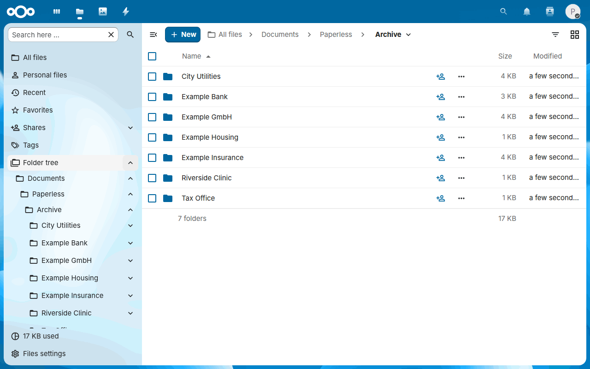

</div>

Paperless Sync is a native Nextcloud app. It writes the finished documents of Paperless-ngx into a folder tree in the files of a Nextcloud user, by correspondent, document type and year, and keeps the tree current: a new title renames a file, a new correspondent moves it, and the Paperless trash has a folder of its own. Files that you put into an inbox folder in Nextcloud go the other way, to Paperless. Paperless remains the source of truth, and Nextcloud gives you the documents in Files, in its desktop and mobile clients, in its viewer and in shares.

Unlike a mount of the media folder of Paperless or a script that copies over WebDAV, Paperless Sync runs inside Nextcloud as one of its background jobs: it needs no extra container and no stored Nextcloud password, the copies are real files of Nextcloud with versions, shares and search, an edit in Nextcloud never reaches the originals in Paperless, and a copy whose document leaves Paperless is deleted only when you turn permanent deletion on, after complete scans of Paperless confirm that the document is gone. [How it compares](https://dennis-otto.github.io/paperless-sync/alternatives.html) sets every way to connect Paperless and Nextcloud side by side, with guides to move over from a mount or from the WebDAV container.

The [documentation website](https://dennis-otto.github.io/paperless-sync/) has this guide, together with the [FAQ](https://dennis-otto.github.io/paperless-sync/faq.html), the [troubleshooting](https://dennis-otto.github.io/paperless-sync/troubleshooting.html) page, the [comparison with the alternatives](https://dennis-otto.github.io/paperless-sync/alternatives.html), the [architecture](docs/architecture.md), the [security design](docs/security.md), the [automation](docs/automation.md), the [decisions](docs/decisions/README.md) and the [roadmap](docs/roadmap.md).

<sub>💛 If Paperless Sync works for you, [rate it in the App Store](https://apps.nextcloud.com/apps/paperless_sync) so that others find it, or [support its development](https://github.com/sponsors/Dennis-Otto).</sub>

<!-- --8<-- [start:how-it-works] -->

## How it works

<picture>
  <source media="(prefers-color-scheme: dark)" srcset="docs/images/diagrams/how-paperless-sync-moves-documents.dark.svg">
  
</picture>

At the configured interval, Nextcloud's cron starts a run of the app inside Nextcloud. It reads the finished documents of Paperless and writes each one into the archive in the files of the configured Nextcloud target user, at the path that the path template builds from its metadata; other users see the archive when that user shares it with them. When the metadata changes in Paperless, the file moves; when a document goes to the Paperless trash, its copy goes to `_Deleted`. Files that someone puts into `Inbox` go the other way, to Paperless.

<!-- --8<-- [end:how-it-works] -->
<!-- --8<-- [start:requirements] -->

## Requirements

<!-- On the website, the hook in .github/mkdocs_project.py writes the versions of appinfo/info.xml into the fields. -->

- **Nextcloud <span data-app="nextcloud">33–35</span>**, with the system cron for its background jobs, as Nextcloud recommends: *Administration settings → Basic settings → Background jobs → Cron*. Every run of the app is one of these jobs.
- **PHP <span data-app="php">8.2+</span>** on the Nextcloud server.
- **Paperless-ngx 2.16 or newer, 3.x included**. Every request of the app asks for version 9 of the Paperless API, which these versions serve, so that a new default of Paperless can't change the answers that the app reads; the settings page names the version of Paperless that the last run reached. Paperless needs an address that the Nextcloud server reaches over HTTP or HTTPS; for an address of your local network, such as `http://paperless:8000` in Docker or `http://192.168.1.20:8000`, turn on the setting [Paperless runs in my local network](#paperless-in-your-local-network).
- **A Paperless account for the app**, with an API token, that isn't a superuser. It needs to view and download the documents to mirror, to view their correspondents, document types, storage paths and tags, and to add documents for the inbox; owning the documents lets it mirror the Paperless trash right away. [Paperless connection](#paperless-connection) lists the exact permissions, and **Test connection** checks them.
- **Room in the files of the target user**, the Nextcloud user who owns the archive: the archive counts against the quota of that user.

| Tested with | Versions | How |
| --- | --- | --- |
| Nextcloud | <span data-app="nextcloud">33–35</span>, the current release of each | the end-to-end tests in Docker, every night and in every change of the app, on SQLite, PostgreSQL, MariaDB and S3 object storage |
| Paperless-ngx | 2.20, the last release of 2.x, and the current release of 3.x | the [contract tests](https://github.com/Dennis-Otto/paperless-sync/blob/main/tests/e2e/README.md#contract-tests-against-a-real-paperless-ngx) against a real Paperless in Docker, every week and in every change of how the app talks to Paperless |

<!-- --8<-- [end:requirements] -->
<!-- --8<-- [start:quick-start-section] -->

## Quick start

<!-- --8<-- [start:quick-start] -->

1. Install **Paperless Sync** from the [Nextcloud App Store](https://apps.nextcloud.com/apps/paperless_sync) under *Apps*, or with `occ app:install paperless_sync`. Nextcloud's system cron must run.
2. In Nextcloud, open **Administration settings → Paperless Sync**. Enter the Paperless URL, pick the Nextcloud user who owns the archive from the users that the field offers, and turn on the modules that you want, such as the inbox. For a Paperless at an address of your network, such as `http://paperless:8000`, turn on **Paperless runs in my local network**. Leave synchronization disabled.
3. Open **Create an account for the app in Paperless**, enter the API token of a Paperless superuser, from *My Profile* in its menu, and click **Create the account and save**. The app creates the user `nextcloud-sync`, no superuser, with only the permissions that your modules need and a random password, saves the settings with the token of that user, never with yours, and shows the connection checklist. Then make the account the owner of the documents to mirror, so that their trash reaches the archive right away, as the checklist says. To keep the token of your superuser out of Nextcloud, create the account by hand, as *The account of the app* under *Configuration* describes, enter its token in **Paperless API token** and click **Test connection** instead.
4. Start a **dry run** and read its summary: it lists what a run would change, without changing anything.
5. Enable synchronization and save. Nextcloud's cron runs it at the configured interval, and the documents appear in `Documents/Paperless/Archive` of that user.

<!-- --8<-- [end:quick-start] -->
<!-- --8<-- [end:quick-start-section] -->
<!-- --8<-- [start:features] -->

## Features

### Archive

- A folder tree in the files of the configured Nextcloud user, or [of each user, with the documents that they own in Paperless](#per-user-ownership), by correspondent, document type and year, from a [path template](#path-template-variables) that you can change, with base, archive, inbox, error and deleted folders of your choice
- Variables with the names that Paperless-ngx uses for its own file names, such as the archive serial number, the owner, the tags, the name of the month and custom fields, and a preview under the template that shows where the newest documents go while you type, before you save
- The archive PDF of each document, or its original file
- Renames and moves when the metadata changes in Paperless, and no empty folders left behind
- Each copy stays the same file in Nextcloud: a new content of its document, such as a new archive version, updates it in place, so its shares, public links, comments, tags, favorites and versions stay with it
- Documents in the Paperless inbox wait until they are finished, and a document that gets a tag you exclude, or the inbox tag again, stays out, its copy removed; or the archive [mirrors only the documents with the tags that you choose](#which-documents-the-archive-mirrors), such as `Nextcloud`
- A stable marker such as `[P123]` in every file name, which [Paperless Unified Search](https://github.com/Dennis-Otto/paperless-unified-search) understands
- Optional [metadata next to the archive](#metadata-next-to-the-archive): a JSON file for each document with its tags, notes, custom fields and dates, and an index of the whole archive as CSV, so that the archive describes itself also without Paperless
- Optional [tags of Paperless as tags of Nextcloud](#tags-in-nextcloud) on the copies, which follow every change in Paperless, so that Files filters and searches the archive by them; the tags that people make in Nextcloud stay theirs

### Inbox

- Files in an inbox folder of Nextcloud, and in its subfolders if you like, go to Paperless as new documents
- Each file can bring its tags: one for each of its subfolders, as the consume folder of Paperless does with `PAPERLESS_CONSUMER_SUBDIRS_AS_TAGS`, and tags for every import; the app creates the tags that Paperless lacks if you let it
- The app follows the Paperless task of each file: after a success, it removes the file or keeps it, as you choose; after a failure, it moves the file to the error folder, next to the reason
- When Paperless can't take a file now, the upload waits and tries again, from 15 minutes up to a day

### Files

- [Send to Paperless](#send-from-files) in the menu of a file or a folder in Files: the members of a group that you choose, the administrators by default, send it with the tags of the inbox, it stays where it is, and a notification tells them when Paperless has it, with a link to the new document
- [Rules of Flow](#send-by-a-rule-of-flow) that send files on their own, such as every PDF that a member of a group uploads, with tags of their own; only the administrators make them
- *Open in Paperless* in the menu of every copy of the archive opens its document in Paperless
- A file whose content Paperless has already isn't uploaded again, so Paperless-ngx 3.x makes no duplicate; the sender learns the document that has it

### Safety

- Synchronization stays off until you turn it on, and a dry run lists every change that a run would make, without making it: it takes the plan of a run, change by change, in the same batch
- The Paperless trash is mirrored into a folder of its own; permanent deletion is off by default and, when on, waits for the set number of complete scans of Paperless in a row
- A conflict policy for a file in the way: replace it, or skip it and report the conflict; the app's own copies are never in the way
- No WebDAV credentials and no password of a Nextcloud user: the app writes through Nextcloud's filesystem API
- The Paperless API token stays in Nextcloud's credentials manager, never reaches the browser and goes only to the address saved with it
- A Paperless in your local network, such as `http://paperless:8000`, without turning off Nextcloud's protection against server-side request forgery for the whole server

### Operations

- Nextcloud's cron runs it at the interval that you set, and the batch size limits the changes of one run
- [Changes within seconds](#changes-within-seconds): a workflow of Paperless calls the webhook of the app when it adds or changes a document, and its copy changes at once, without a container next to Paperless, its media folder or a password of Nextcloud
- Runs on demand and dry runs from the settings, each with a report of its changes and errors in the language of the administrator, errors first, with a filter for each kind of change, links to the files and a button that copies it for a bug report, and the status of the last run; a dry-run tries changes of the settings before you save them, and a run on demand runs as a background job, so no proxy cuts it off
- [Pickers in the settings](#target-user-and-tags) offer the users of Nextcloud for the target user and the tags of Paperless for the excluded tags, the tags to mirror and the tags of every import, and mark a user or a tag that doesn't exist, so that a typo shows before the first run
- The [Activity stream](#activity) of the target user tells what each run changed, with links to its files, and every import, with a link to the new document in Paperless
- In English and German: the settings, their messages, their *Help* links to the guide and the Activity stream follow the language of Nextcloud, and the times the locale of your personal settings
- [Notifications, setup checks and a status API](#being-notified) tell the administrators when the mirror keeps failing or has stopped, also in Uptime Kuma or Home Assistant
- [`occ` commands](#command-line) for scripts, cron jobs and monitoring: a run or a dry-run with a batch size of its own or none, the status, and copies written again, with JSON output and exit codes
- Signed releases: the same package in the Nextcloud App Store and on GitHub, with an SBOM and signed build provenance

<!-- --8<-- [end:features] -->

## Screenshots

Following the quick start: a dry-run lists every file that a run would write, move or delete, without changing anything, and *Synchronize now* makes the changes.


A few days later, a dry-run shows every kind of change at once: new documents, a new title, a document in the Paperless trash, one with an excluded tag and a finished import from the inbox.

<picture>
  <source media="(prefers-color-scheme: dark)" srcset="docs/images/report-dark.png">
  
</picture>

The archive in Files, one folder per correspondent, document type and year, with the ID of each document in its name:

<picture>
  <source media="(prefers-color-scheme: dark)" srcset="docs/images/archive-dark.png">
  
</picture>

The settings of the app in the administration settings of Nextcloud:

<picture>
  <source media="(prefers-color-scheme: dark)" srcset="docs/images/settings-dark.png">
  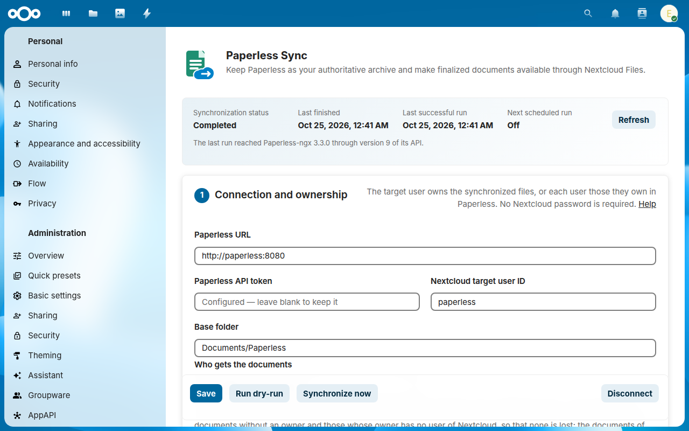
</picture>

The [guide](https://dennis-otto.github.io/paperless-sync/guide.html#the-settings-section-by-section) shows every section of the settings.

## Using the archive

Everyone who reads or sends documents does so in Nextcloud alone: in Files on the web, with the desktop client and with the Nextcloud apps for Android and iOS, without an account of Paperless. [Using the archive](https://dennis-otto.github.io/paperless-sync/use.html) is the page for them, which the App Store links as the documentation for users: how to find a document by its folder, its name, its text or its tags, what the marker `[P123]` means, how to send a file to Paperless, and recipes to scan with the phone straight into the inbox, upload a folder of the phone on its own, scan from a scanner on the network, keep the archive offline on the computer and the phone, and share it read-only with the family or as a link with an expiration date with a tax adviser.

<picture>
  <source media="(prefers-color-scheme: dark)" srcset="docs/images/phone-menu-dark.png">
  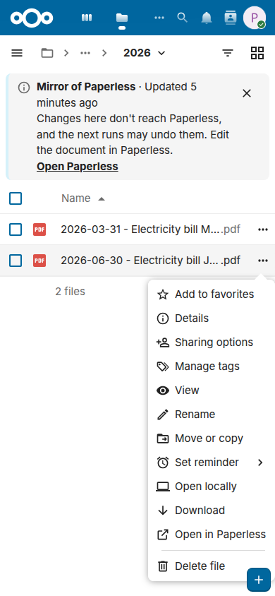
</picture>

<!-- --8<-- [start:usage] -->

## Usage

This part is for the administrator, and [Using the archive](https://dennis-otto.github.io/paperless-sync/use.html) for the people who use the archive. After installation, open **Administration settings → Paperless Sync**. Configure the connection while synchronization remains disabled: saving tests it when you enter the token. Run a dry-run, review the summary, and only then enable scheduled synchronization.

The default archive path template is:

```text
{{ correspondent }}/{{ document_type }}/{{ created_year }}/{{ created }} - {{ title }} [P{{ id }}]{{ extension }}
```

This produces paths such as:

```text
Documents/Paperless/Archive/Example GmbH/Invoice/2026/2026-08-26 - Example invoice [P123].pdf
```

Each part of the template becomes a folder. The base folder holds the inbox folder, with the files for Paperless, and the error folder, with failed imports, next to the archive; the deleted folder in the archive holds the copies of the documents in the Paperless trash:

<picture>
  <source media="(prefers-color-scheme: dark)" srcset="docs/images/diagrams/the-folders-of-the-default-path-template.dark.svg">
  
</picture>

Stable markers such as `[P123]` are compatible with the independent [Paperless Unified Search](https://github.com/Dennis-Otto/paperless-unified-search) app.

When you change the title, the tags, the correspondent or the type of a document in Paperless, its file moves to its new path and keeps its shares, comments and versions in Nextcloud, and the desktop and mobile clients only rename it. Only a change of the content, such as a new archive version after Paperless processed the document again, downloads it again, and the download goes into the same file, at its new path if it has one, so the file keeps its shares, comments and favorites; in a scheduled run, Nextcloud keeps the previous content as a version of the file. A run tells the two apart by the checksums of the file: it keeps the SHA-256 and the MD5 of every download and compares them with the checksum that Paperless reports, MD5 up to Paperless-ngx 2.x and SHA-256 since 3.0. For a file that an earlier version of the app exported, which has only its SHA-256 saved, the first change on Paperless-ngx 2.x reads the file in Nextcloud once to add its MD5, so that it moves without a download too. A download goes to Nextcloud in chunks, so a document of any size fits into the memory of PHP. A run asks Paperless only for the fields of the documents that it reads, not for their text, and for the checksum of a document once for each revision, also when the document waits for a later run; a run over an archive without changes writes nothing to the database.

<picture>
  <source media="(prefers-color-scheme: dark)" srcset="docs/images/diagrams/how-a-run-tells-new-metadata-from-new-content.dark.svg">
  
</picture>

<!-- --8<-- [end:usage] -->
<!-- --8<-- [start:configuration] -->

## Configuration

### Paperless connection

Use a dedicated Paperless service account that isn't a superuser, with only the permissions of the features you use. In Paperless, they are under *Users & Groups*, in the permissions of the account:

| Feature | Permission in Paperless | What the app does with it |
| --- | --- | --- |
| Always | **View** for Documents, and access to every document to mirror, best as its owner, as below | lists and downloads the documents |
| Archive export | **View** for Correspondents, Document Types, Storage Paths and Tags | builds the paths and skips the excluded tags |
| Deleted folder | ownership of the documents, as below | sees them in the trash of Paperless right away |
| [`{{ owner_username }}`](#path-template-variables) in the path template | **View** for Users | finds the user name of the owner of each document |
| Custom fields in the path template, or [metadata next to the archive](#metadata-next-to-the-archive) | **View** for Custom Fields | reads the names and the choices of the custom fields |
| Nextcloud inbox, or [*Send to Paperless*](#send-from-files), which is on for the administrators by default | **Add** for Documents, and **View** for Paperless Tasks | uploads the files, and learns whether Paperless imported them |
| [Tags of the inbox](#tags-of-the-inbox) | **View** for Tags, and **Add** for Tags with *Create missing tags* | finds the tags of the files of the inbox, and creates those that Paperless lacks |
| Connection checklist | **View** for UI Settings | reads the permissions of the account, so that **Test connection** can check those of the inbox and the ownership of the documents |
| [Per-user ownership](#per-user-ownership) | **View** for Users, **View** on the documents of every user, and with the inbox **Change** for Documents | finds the owner of each document, mirrors the documents of every user, and gives the document of an upload the user of Paperless of its user |

With per-user ownership, the documents belong to their users, not to the account of the app: give the account the permission *View* on them instead, or use a superuser, as [the security design](https://dennis-otto.github.io/paperless-sync/security.html#per-user-ownership) explains. Otherwise:

The Paperless trash shows an account only the documents that it owns and those without an owner: a permission granted on a document of someone else doesn't count there. A superuser sees the whole trash, but its token controls all of Paperless, every document and every user, so don't use one for this app. Make the account of the app the owner of the documents instead, and keep the access of the people who own them now:

- **New documents:** add a workflow in Paperless with the trigger *Document Added* and an action *Assignment* that assigns the account of the app as the owner and gives view and edit permissions to the users or groups who own the documents now.
- **Existing documents:** select them in the document list, choose *Permissions*, set the account of the app as the owner, and give view and edit permissions to the same users or groups. Leave *Merge with existing permissions* off: with it on, Paperless keeps the current owner and sets one only for documents without an owner. Off, the dialog replaces the permissions of the selected documents, so list everyone who should keep access.

Only the owner of a document or a superuser can change its owner. The Paperless trash then lists these documents for the account of the app and for superusers, not for the people who owned them before.

Without ownership, the trash still reaches the archive, only later: a document in the trash that the account can't see counts as missing, and its copy moves to the deleted folder after the configured number of complete scans. Keep *Also delete copies of documents that disappeared without passing the Paperless trash* off in that case: with it and permanent deletion both on, such a copy is deleted then, although the document can still be restored in Paperless. A dry-run shows a notice when documents go missing while the trash lists none (`TRASH EMPTY` on the command line), and the [connection checklist](#connection-checklist) counts the documents that the account sees without owning them.

The API token is stored in Nextcloud's credentials manager and never returned to the browser. It goes only to the Paperless URL that it was saved with: to connect to another URL, enter the token again. This holds also when the URL changes past the settings page, with `occ` or Nextcloud's provisioning API; synchronization then waits for the token. Saving the settings, **Test connection**, the setup of the account and disconnecting ask for your password, unless you confirmed it in the last 30 minutes.

#### The account of the app

**Create an account for the app in Paperless**, in the card *Connection and ownership*, sets up the account of the app with the API token of a Paperless superuser, which you enter once:

1. The app takes the permissions that the modules of the form need from the table above, and no more, so set the modules first.
2. It creates the user, `nextcloud-sync` unless you choose another name, as no superuser, with exactly these permissions and a random password of 64 characters that nobody learns, asks Paperless for the token of that user, and saves the settings of the form with it, as **Save** saves a typed token.
3. It shows the connection checklist of the new account. What no permission of an account can give, the access to the documents of other owners, is up to you: make the account their owner, as below, or with per-user ownership give it **View** on the documents of every user.

A user of that name that exists already changes only when you agree: the page asks first, and an update gives it exactly these permissions and a new random password and takes away *Admin*, while its token and the permissions of its groups stay the same. A superuser is never taken over. Your token goes only to the Paperless URL of the form, for these requests: the app stores it nowhere, logs it nowhere and never sends it back to the browser, as [the security design](https://dennis-otto.github.io/paperless-sync/security.html#the-setup-of-the-account) explains.

For a scripted setup, `occ paperless_sync:create-account` does the same with the saved settings, and prints the checklist. It takes the token of the superuser from a file, or with `--admin-token-file=-` from standard input, never as an argument, which the list of processes would show:

```sh
occ paperless_sync:create-account --admin-token-file=/run/secrets/paperless-admin-token
```

Without a token of a superuser for Nextcloud, create the account yourself: in Paperless under *Users & Groups*, with the permissions of the table above, then its token under *My Profile* while you are signed in as that user. Or run these commands on a machine of yours, after you filled in the first three lines; they create the account with the permissions of the archive and the inbox:

<!-- account-snippet:start -->

```sh
PAPERLESS_URL='https://paperless.example.com'
SUPERUSER_TOKEN='the API token of a superuser of Paperless'
ACCOUNT='nextcloud-sync'
PASSWORD="$(head -c 32 /dev/urandom | od -An -tx1 | tr -d ' \n')"
# The token and the password go to curl in files of a private folder, never as arguments,
# which the list of processes would show.
SECRETS="$(mktemp -d)"
printf 'Authorization: Token %s\n' "${SUPERUSER_TOKEN}" > "${SECRETS}/header"
printf '{"username": "%s", "password": "%s", "is_superuser": false, "user_permissions": ["view_document", "add_document", "view_correspondent", "view_documenttype", "view_storagepath", "view_tag", "view_paperlesstask", "view_uisettings"]}' \
  "${ACCOUNT}" "${PASSWORD}" > "${SECRETS}/user.json"
printf '{"username": "%s", "password": "%s"}' "${ACCOUNT}" "${PASSWORD}" > "${SECRETS}/login.json"
if curl --fail-with-body --silent --show-error --output "${SECRETS}/answer" \
  --header @"${SECRETS}/header" --header 'Content-Type: application/json' \
  --data @"${SECRETS}/user.json" "${PAPERLESS_URL}/api/users/"; then
  curl --fail-with-body --silent --show-error --header 'Content-Type: application/json' \
    --data @"${SECRETS}/login.json" "${PAPERLESS_URL}/api/token/"
else
  # Why Paperless refused the user, such as a username that it has already.
  cat "${SECRETS}/answer" >&2
fi
rm -rf "${SECRETS}"
```

<!-- account-snippet:end -->

The last command prints `{"token":"…"}`: enter that token in **Paperless API token**, and click **Test connection**. For the other modules, add their permissions to the list, as the table above names them: `"add_tag"` for *Create missing tags*, `"view_user"` for per-user ownership and `{{ owner_username }}`, `"change_document"` for per-user ownership with uploads, and `"view_customfield"` for custom fields.

#### Connection checklist

**Test connection**, below the connection settings, checks the settings of the form without saving them, and lists what it found, with what to do for every check that fails:

<!-- --8<-- [end:configuration] -->

<!-- The picture comes from tests/e2e/screenshots.mjs, with the token of an account of the mock that lacks three permissions. -->
<picture>
  <source media="(prefers-color-scheme: dark)" srcset="docs/images/settings-checklist-dark.png">
  
</picture>

<!-- --8<-- [start:configuration-checklist] -->

| Line | What it checks | When it fails |
| --- | --- | --- |
| Paperless | Paperless answers at the URL with version 9 of its API, as Paperless-ngx 2.16 and newer do, and takes the token | not saved |
| Documents | the account may view documents, and how many it sees; none at all gets a note | not saved |
| Trash, Correspondents, Document types, Storage paths, Tags | with the archive export on: the account may view each list; the trash gets a note when the account sees documents that it doesn't own, or is a superuser | saved with the failure |
| Upload from the inbox | with the inbox on: the account has the permissions **Add** for Documents and **View** for Paperless Tasks | saved with the failure |
| Tags of the inbox | with tags for the files of the inbox: the account has the permission **View** for Tags, and **Add** for Tags with *Create missing tags* | saved with the failure |
| Nextcloud folder | the target user may create files in the base folder | not saved |

Without **View** for UI Settings, Paperless doesn't tell the app the permissions of the account and its ID, so the lines of the trash, of the upload and of the tags of the inbox get a note that names this permission instead of a result. Each line has its state as a word, *Passed*, *Note* or *Failed*, next to its sign. A failure names the cause, such as a token that Paperless refuses, a certificate that Nextcloud doesn't trust, an address in your network, or a URL without a Paperless API, such as the login page of a proxy, and what to do. A change of the URL, the token, the target user, the base folder, the local network, the modules or the tags of the inbox takes the checklist away, until the next test.

#### Paperless in your local network

Nextcloud refuses connections to addresses of the local network, such as `http://paperless:8000` in Docker, `http://paperless.lan` or `http://192.168.1.20:8000`, to protect against server-side request forgery. When Paperless runs at such an address, turn on **Paperless runs in my local network** and save. Nextcloud then allows a local address for the requests of Paperless Sync to the saved Paperless URL only. Every other app and request stays protected, which the system switch `allow_local_remote_servers` would undo for the whole server.

Without the setting, saving says what to do:

> Nextcloud blocks connections to local addresses such as paperless. If Paperless runs in your network, turn on "Paperless runs in my local network" and save the settings.

The setting also helps when the name of Paperless is set only in the hosts file of the server, such as with `extra_hosts` in Docker: without it, Nextcloud looks names up only in the DNS, and saving says that it found no DNS record for the name.

If you turned on `allow_local_remote_servers` for this app before, turn on the setting, save, and then turn the switch off again with `occ config:system:delete allow_local_remote_servers`. [The security design](https://dennis-otto.github.io/paperless-sync/security.html#a-paperless-in-the-local-network) explains what the setting allows.

### Saving, pausing and disconnecting

Saving checks every setting first. When scheduled synchronization is on, or when you enter a token, it also runs the [connection checklist](#connection-checklist), and the button says **Test connection and save**. It refuses settings with which no run can work, such as a token that Paperless refuses or a base folder that the target user can't write, so that the schedule never runs with them. A permission that only one module lacks, such as the one for the tags, is saved with the settings, and the checklist names it, so that you can grant it in Paperless afterwards. With the schedule off and no new token, nothing reaches Paperless until you start a run, and the button says **Save** and stores the settings without the test; **Test connection** checks them then without saving:

<picture>
  <source media="(prefers-color-scheme: dark)" srcset="docs/images/diagrams/what-saving-the-settings-tests.dark.svg">
  
</picture>

To pause synchronization, such as while Paperless is down, its token is revoked or the target user is disabled, uncheck **Enable scheduled synchronization** and save. A save that fails while the schedule is on says so and moves the focus to that switch.

After a save, the form shows the settings as Nextcloud stored them: the URL without a slash at its end, each excluded tag and each tag to mirror once, and an empty fallback name as `Unknown`. While the form holds changes that aren't saved, the bar of the buttons says so, and the browser asks before you leave the page. **Run dry-run** then tries the changes without saving them, and its report says *Dry-run of unsaved settings*: a new path template, other folders or another deletion policy show what they would do before anything uses them. It keeps the saved connection to Paperless, the saved target user and who gets the documents, which only a save tests and confirms with your password: a token that you enter waits for the save, and with a new URL, local network setting, target user, *Who gets the documents*, table or group of users, the dry-run asks you to save first. **Synchronize now** uses the saved settings only, so it waits until you save.

<picture>
  <source media="(prefers-color-scheme: dark)" srcset="docs/images/diagrams/what-a-dry-run-of-unsaved-settings-uses.dark.svg">
  
</picture>

**Disconnect** deletes the stored API token and turns off scheduled synchronization and **Paperless runs in my local network**. The other settings, the synchronized files and their state stay as they are; to connect again, enter the token, turn the local network on again if Paperless runs there, and save.

Results and errors appear in the bar of the buttons, which stays at the bottom of the window. **Synchronize now** doesn't wait for the run: it queues the run as a background job of Nextcloud and answers at once, the status says *Queued* until the next background jobs start it, within five minutes with the system cron, and the bar says how the run ended once the status shows its end. A run can so take as long as it needs, and no proxy in front of Nextcloud cuts it off. **Run dry-run** answers with its report; when a proxy or the web server answers for a long dry-run instead, such as with *504 Gateway Time-out*, the page asks for the status: while it shows the dry-run, the page says that it continues in the background and follows it until it ends; otherwise it names the status code of the web server, and the status shows how it ended.

### Target user and tags

The field **Nextcloud target user ID** offers the users of Nextcloud whose account name, display name or e-mail address holds what you type: pick one with the arrow keys and Enter, or with a click. It takes the account name, as *Accounts* in the administration lists it, not the display name, and marks a disabled account as *disabled*. When you leave the field with an ID that Nextcloud doesn't know, it says so at once: *Nextcloud has no user with the ID …*. Saving tests the target user only together with the connection, so that a schedule can always be paused; the field shows a typo before that.

The fields **Additional excluded Paperless tags**, **Only mirror documents with these tags** and **Tags for every import** offer the tags of Paperless: type a part of a name to narrow them down, and pick one. Each tag of the field has a button that removes it, and Backspace in the empty field removes the last one. A tag that Paperless doesn't have yet can be typed too, ended with Enter or a comma, and a save, a test or a dry-run takes what you typed as well. Such a name is marked *not in Paperless*, which also shows a typo: a run excludes the documents with that tag once Paperless has it, and gives an import that tag once Paperless has it or, with *Create missing tags*, creates it. A tag to mirror that Paperless doesn't have stops the export instead, as [Which documents the archive mirrors](#which-documents-the-archive-mirrors) explains. A run compares the names without regard to case, and so does the field: a name that you type takes the spelling of Paperless. The page reads the tags with the saved URL and token, as a run reads them, so they appear once the connection is saved, and the token stays on the server. A tag whose name holds a comma can't be in any of the lists, because commas separate the names of the setting, so the fields don't offer it.

<picture>
  <source media="(prefers-color-scheme: dark)" srcset="docs/images/settings-tags-dark.png">
  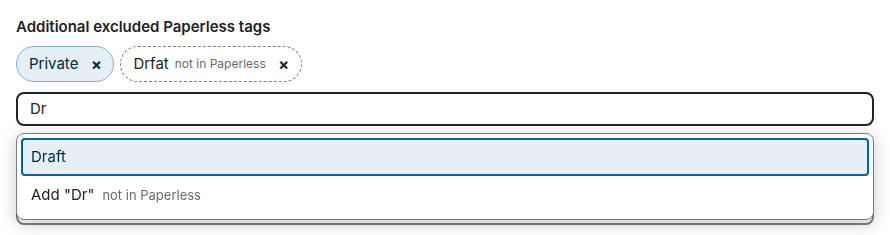
</picture>

<picture>
  <source media="(prefers-color-scheme: dark)" srcset="docs/images/diagrams/where-the-pickers-of-the-settings-take-their-names-from.dark.svg">
  
</picture>

### Folder ownership

The configured Nextcloud target user owns the synchronized folders. The app operates through Nextcloud's internal filesystem API and therefore does not need that user's password or an app password. Other users see the archive when the target user shares its folder with them, or with a group of them; share it read-only, and share the inbox folder only with those who may send documents to Paperless.

The app remembers what it wrote for each target user. Another target user starts a new archive, which the runs write anew from Paperless, and the archive of the previous one stays as it is, no longer updated.

#### Per-user ownership

When the documents of your Paperless have owners, such as in a household or a team where everyone signs in to Paperless and to Nextcloud, each person can find their own documents in their own files: set **Who gets the documents** in *1 · Connection and ownership* to **Each user, those they own in Paperless**. The default, **The target user, all of them**, keeps everything as described above. One administrator still connects one Paperless with the token of one account; nobody else enters a URL or a token ([decision 0025](https://dennis-otto.github.io/paperless-sync/decisions/0025-each-user-gets-the-documents-they-own-through-one-account-of-the-app.html)).

- **Who is who.** A user of Paperless gets the user of Nextcloud with the same ID, whatever its case, as single sign-on such as OpenID Connect gives them, so `Alice` in Paperless finds `alice` in Nextcloud. **Paperless users with another Nextcloud ID** takes the others, one on each line, such as `jdoe = john.doe`; a line wins over the same ID, and a save refuses two lines for one user of Paperless, or one whose user of Nextcloud doesn't exist. **Only members of this group** limits it to the members of one group of Nextcloud.
- **None is lost, nothing is guessed.** The target user gets the documents without an owner and those whose owner has no user of Nextcloud or isn't in the group. A document whose owner Paperless doesn't list, whose user's folder Nextcloud can't reach, or of two users of Paperless for one user of Nextcloud, such as `Alice` and `alice`, which get neither, stays where its copy is until a run can tell.
- **The same folders for everyone.** Each user gets the archive, the inbox, the error and the deleted folder below the same base folder of their own files, with the same path template, and shares, versions and search of their own.
- **The inbox makes it theirs.** A file in the inbox of a user goes to Paperless with the token of the app, and the document then gets the user of Paperless of that user as its owner, so that it comes back into their archive; so does a file that they send with *Send to Paperless* or that a rule of Flow sends. A document that Paperless had already keeps its owner. Until the document has its owner, Paperless names the account of the app as its owner, so the runs leave the documents of the account where they are while an upload waits, and the webhook leaves them to the next run.
- **A copy follows its owner.** When the owner of a document changes in Paperless, or the table or the group changes, the next run writes its copy into the archive of its new user and removes the old one, which goes to the trash bin of Nextcloud of the old user, as for a document with an excluded tag. Turning per-user ownership on moves the documents of the users out of the archive of the target user in the same way, within the batch size, and out of the archive of an earlier target user that a run wrote before, so run a dry-run first: it lists each change with its user.
- **What each user sees.** Each archive has its own batch of changes, its own entries in the Activity stream and its own notifications of failed imports. The report of a run names the user of each line and counts the changes of each user, on the settings page, with `occ paperless_sync:run` and in the status API.

The connection checklist shows who gets the documents of whom, with the number of documents of each user of Paperless, warns of every user of Paperless that the target user gets for a mistake of the settings, and checks the base folder of each user. The account of the token must see the documents of every user, as a superuser, or with the permission *View* on them, and needs *View* for Users; [the security design](https://dennis-otto.github.io/paperless-sync/security.html#per-user-ownership) explains why and how.

<picture>
  <source media="(prefers-color-scheme: dark)" srcset="docs/images/diagrams/whose-archive-a-document-goes-to.dark.svg">
  
</picture>

### Folder names

A new installation proposes the names of its folders, and the fallback names for metadata that a document lacks, in the default language of Nextcloud, `default_language` in its `config.php`. A Nextcloud without one, and a language that the app has no translation for yet, get the English names; a regional variant, such as `de_DE`, gets those of its language:

| Setting | English, and every language without a translation | German: `de`, `de_DE` and the other variants |
| --- | --- | --- |
| Base folder | `Documents/Paperless` | `Dokumente/Paperless` |
| Archive folder | `Archive` | `Archiv` |
| Inbox folder | `Inbox` | `Eingang` |
| Error folder | `Failed imports` | `Fehler` |
| Deleted folder | `_Deleted` | `_Gelöscht` |
| Missing correspondent | `_No correspondent` | `_Ohne Korrespondent` |
| Missing document type | `_No document type` | `_Ohne Dokumenttyp` |
| Missing date | `_No date` | `_Ohne Datum` |
| Missing title | `Untitled` | `Ohne Titel` |

The settings page shows the proposed names before the first save, so you can change them before the first run, and saving keeps them as the page shows them. Afterwards, a name changes only when you change it: neither another default language of Nextcloud nor an update renames a folder. The language is that of Nextcloud, not that of the administrator who opens the settings, so that every administrator and every scheduled run see the same names. For the German names on a Nextcloud without a default language, set it before you save, with `occ config:system:set default_language --value=de`, or type them.

Earlier versions proposed the German names in every language. An installation that one of them set up, with a target user or with a run that left copies or imports behind, keeps them with the update, also those that it never saved, such as after a setup with `occ`, so that its archive stays where it is:

<picture>
  <source media="(prefers-color-scheme: dark)" srcset="docs/images/diagrams/which-folder-names-an-installation-uses.dark.svg">
  
</picture>

Renaming the base folder or the archive folder of an archive in use moves its files in the next runs, within the batch size, as a new [path template](https://dennis-otto.github.io/paperless-sync/faq.html#can-i-change-the-path-template-later) does.

### Conflict policy

The *File conflict policy* decides what a run does when a file other than its own copy is at the path of a document, such as a file that someone put there, or a copy that someone edited in Nextcloud. The copy that the app wrote is never in the way: a new content of its document goes into the same file.

- **Replace synchronized file**, the default: the run writes the document from Paperless into the file that is there, which stays the same file with its shares. Nextcloud keeps the previous content, such as an edit, as a version of the file in a scheduled run, and in a run started with *Synchronize now* only when the administrator who starts it is the target user. A file in the way of a copy that moves to a new path is deleted instead, and goes where the [deletions](#deletion-safety) of the run go.
- **Skip and report conflict**: the run leaves a file of someone else as it is, and a copy that someone edited when its document gets a new content, and reports `Nextcloud file conflict at …` as an error of the document, in every run until the file is gone, and doesn't write or move the document there. The copy of the app, which still has the content of its last download, is no conflict: the run updates it.

> [!WARNING]
> The files of the archive are a mirror of Paperless, and they are read-only by intent: nothing goes back from them to Paperless. The next run writes a copy that you deleted or renamed anew at its path, and when its document changes in Paperless, a run may write its new content over a copy that you edited, or report a conflict for it when conflicts are skipped. Edit documents in Paperless, and copy a file out of the archive to keep a version of your own.

### Path template variables

Most variables have the names that Paperless-ngx uses for its own file names, so many templates of a storage path of Paperless work here once `{{ id }}` is added. Templates with logic of Jinja, with `custom_fields|get_cf_value(...)` or with a variable that the table below doesn't list don't. For a document created on 26 August 2026 and added on 1 September:

| Variable | Value | Example |
| --- | --- | --- |
| `{{ id }}` | The ID of the document in Paperless | `123` |
| `{{ title }}` | Its title | `Electricity bill` |
| `{{ correspondent }}` | The name of its correspondent | `City Utilities` |
| `{{ document_type }}` | The name of its document type | `Invoice` |
| `{{ storage_path }}` | The name of its storage path in Paperless | `Household` |
| `{{ owner_username }}` | The user name of its owner in Paperless | `dennis` |
| `{{ tag_list }}` | The names of its tags, sorted and separated by commas | `Energy,Taxes` |
| `{{ asn }}` | Its archive serial number | `1042` |
| `{{ page_count }}` | The number of its pages | `2` |
| `{{ created }}` | The date of the document | `2026-08-26` |
| `{{ created_year }}`, `{{ created_year_short }}` | Its year, in four or two digits | `2026`, `26` |
| `{{ created_month }}`, `{{ created_month_name }}` | Its month, as a number or by its name in the language of Nextcloud | `08`, `August` |
| `{{ created_day }}` | Its day | `26` |
| `{{ added }}`, `{{ added_year }}`, `{{ added_month }}`, `{{ added_day }}` | When it was added to Paperless | `2026-09-01`, `2026`, `09`, `01` |
| `{{ original_filename }}` | The name of the uploaded file, without its extension | `scan` |
| `{{ extension }}` | The extension of the exported version, with its dot | `.pdf` |
| `{{ custom_fields.<name> }}` | The value of the custom field of that name | `{{ custom_fields.Invoice number }}`: `INV-2026-08` |

The template must contain `{{ id }}`. A variable may be written with or without spaces, such as `{{id}}`, and is saved as `{{ id }}`. Every value goes into the path as plain text, so a `$1` or a `{{ title }}` in a title stays as it is.

A value that a document lacks is empty, such as an owner, tags, an archive serial number or a custom field, and a folder that only such a value would name is called `Folder`; a missing correspondent, document type, date or title takes its fallback name from *Advanced fallback names*. The name of a custom field is written as in Paperless, with its spaces and capitals, and may hold any character but `{`, `}` and `/`. A select field gives the label of its choice, a document link the IDs of the documents, a yes or no field `true` or `false`, and a monetary field its amount as Paperless writes it, such as `EUR12.30`. `{{ created_month_name }}` names the month in the language that Nextcloud forces or has as its default, `force_language` or `default_language` in its `config.php`, and in English without either: never in the language of the administrator who starts a run, so the paths are the same in every run. A change of that language moves the files, like a change of the template. The names in the language of Nextcloud need PHP's `intl` extension; without it they are English, so installing or removing `intl` also moves the files of such a template.

The users and the custom fields of Paperless are read only for a template that uses them, and the users in every run of [per-user ownership](#per-user-ownership). For `{{ owner_username }}`, the account of the app needs the permission to view users in Paperless, and for a custom field the permission to view custom fields; without it, the run fails before a file moves and names the permission. A custom field that Paperless doesn't have, such as one with a typo or one that was renamed, stops the run too, because its value would be empty in the path of every document.

Under the template, the settings show where the five newest documents of Paperless would go with the template that you type, a moment after you stop, before you save, with the fallback names and the switches of the page and a note for a document that a run skips. The buttons under the field put a variable in at the cursor. An invalid template says why there, as saving would:

<picture>
  <source media="(prefers-color-scheme: dark)" srcset="docs/images/path-preview-dark.png">
  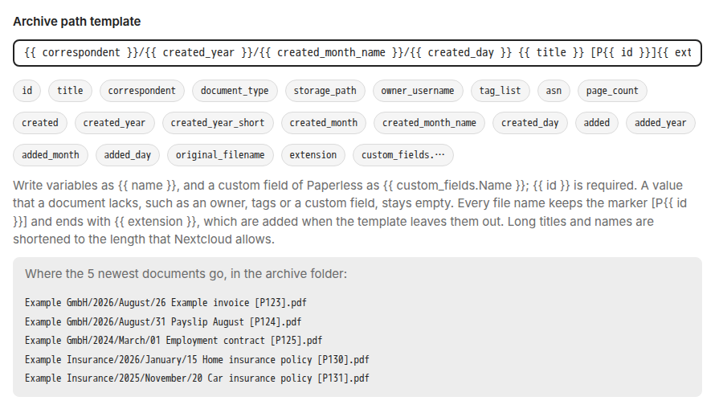
</picture>

Every file name keeps the marker `[P{{ id }}]` and ends with `{{ extension }}`: when the last part of the template leaves them out, the app adds them at its end. The marker keeps the paths of two documents apart and ties each file to its document.

Each part of the path is cleaned for Nextcloud, macOS and Windows: control characters and `< > : " / \ | ? *` become `_`, runs of spaces become one, spaces and dots at the ends go, and the names of Windows devices, such as `CON`, `COM1` or `LPT¹`, get a leading `_`.

Nextcloud accepts names of up to 250 bytes, and a character of Cyrillic takes two bytes, of Chinese three and an emoji four. So a folder name has at most 200 bytes and a file name at most 217, which leaves room for the temporary name of a write. A name that would be longer is shortened in its free text alone: the title, the correspondent, the document type, the storage path and the original file name, the longest first. The text of the template, the dates, the marker and the extension stay whole:

<picture>
  <source media="(prefers-color-scheme: dark)" srcset="docs/images/diagrams/how-a-part-of-the-path-is-built.dark.svg">
  
</picture>

### Which documents the archive mirrors

The archive mirrors every document that the account of the token may view in Paperless, but two kinds, which *3 · Structured archive* leaves out:

- **Documents in the inbox of Paperless,** while *Skip Paperless inbox documents* is on, as it is by default, so that a document waits until it is finished.
- **Documents with an excluded tag,** one of *Additional excluded Paperless tags*, such as `Private`.

**Only mirror documents with these tags** turns this around, for an archive of a part of Paperless, such as the documents that a family shares: with tags in the list, such as `Nextcloud`, the archive mirrors only the documents that have at least one of them, and leaves the others in Paperless alone. An excluded tag and the inbox still win, so a document tagged both `Nextcloud` and `Private` stays out. Empty, as it is by default, the list mirrors every document.

A document that leaves the archive, because it lost its last tag to mirror or got an excluded tag, loses its copy in the next run, which the report lists as *Excluded*: the copy goes as the [deletion safety](#deletion-safety) describes, with the folders that it empties, within the [batch size](#batch-size). When the document gets its tag again, the next run exports it again. A dry-run shows which copies a new list would remove before you save it, and the preview under the path template marks the newest documents that a run skips.

A run compares the names without regard to case, as for the excluded tags, and the field takes the spelling of Paperless. Every tag to mirror must be a tag of Paperless: a name with a typo, or one renamed in Paperless, would otherwise remove the copies of every document that should stay. So the export stops before a file changes, with *Paperless has no tag named "…", which "Only mirror documents with these tags" names*, and the preview under the path template says the same while you type; the inbox goes on sending its files.

<picture>
  <source media="(prefers-color-scheme: dark)" srcset="docs/images/diagrams/which-documents-the-archive-mirrors.dark.svg">
  
</picture>

### Metadata next to the archive

With *Write metadata next to the archive* in *3 · Structured archive*, which is off by default, every run writes what Paperless knows of each document into the folder `.paperless` of the archive folder. The archive then describes itself also without Paperless: when you move to another system, keep a backup of Nextcloud alone, or hand the archive to someone without an account in Paperless. Files shows the folder once *Show hidden files* is on in its settings.

> [!IMPORTANT]
> The notes and the custom fields of the documents, such as a private remark, an IBAN or a contract number, stayed in Paperless until now. With the setting on, everyone who can open the archive folder can read them in `.paperless`, also through a share or a public link of the archive folder or of a folder above it. Check the shares before you turn it on.

- **A sidecar for each copy,** `.paperless/P123.json` for the document 123: its title, its correspondent, document type and storage path by their names, its tags, when it was created, added and last changed, its archive serial number, original file name, MIME type and number of pages, its notes with their authors, its custom fields by their names, a select field with the label of its choice, whether the copy is the original or the archive version, with its SHA-256, and the address of the document in Paperless.
- **One index of the archive,** `.paperless/index.csv`, with a row for each sidecar: the ID, the title, the correspondent, the document type, the tags and the dates, the path of the copy below the archive folder, the state of the document, `active`, `trash` or `missing`, the SHA-256 of the copy, the address in Paperless and the SHA-256 of the sidecar. It is CSV after RFC 4180, in UTF-8 with a byte order mark, with commas between the values: LibreOffice Calc opens it with a double-click, and Excel, whose double-click splits a CSV by the separator of its language, such as the semicolon in German, with *Data* → *From Text/CSV*, which finds the comma and UTF-8 by itself. A value that a spreadsheet would take for a formula, one that starts with `=`, `+`, `-` or `@`, starts with an apostrophe in the index, and the sidecar has it as it is.

The sidecar of a document, here with the archive version of its copy:

```json
{
    "version": 1,
    "id": 123,
    "title": "Monthly invoice",
    "correspondent": "Example GmbH",
    "document_type": "Invoice",
    "storage_path": null,
    "tags": [
        "Electricity",
        "Paid"
    ],
    "created": "2026-08-26",
    "added": "2026-08-26T10:00:00+02:00",
    "modified": "2026-09-01T09:00:00+02:00",
    "archive_serial_number": 42,
    "original_file_name": "scan.pdf",
    "mime_type": "application/pdf",
    "page_count": 2,
    "notes": [
        {
            "note": "Paid on 1 September.",
            "created": "2026-09-01T09:00:00+02:00",
            "user": "anna"
        }
    ],
    "custom_fields": [
        {
            "name": "Invoice number",
            "type": "string",
            "value": "INV-2026-08"
        }
    ],
    "file": {
        "version": "archive",
        "sha256": "9fae5fe3947195044d068993bb1c63bd15029aab64fdc4827ee6d9e08b304d84"
    },
    "url": "https://paperless.example.com/documents/123/details"
}
```

And its row in the index, below the names of the columns, with the checksums shortened here:

```csv
id,title,correspondent,document_type,tags,created,added,modified,archive_serial_number,path,state,sha256,url,metadata_sha256
123,Monthly invoice,Example GmbH,Invoice,"Electricity, Paid",2026-08-26,2026-08-26T10:00:00+02:00,2026-09-01T09:00:00+02:00,42,Example GmbH/Invoice/2026/2026-08-26 - Monthly invoice [P123].pdf,active,9fae5fe3…,https://paperless.example.com/documents/123/details,5d41402a…
```

A run writes a sidecar only when its content changes, such as after a change of the document in Paperless or of the name of its correspondent: the index keeps the SHA-256 of every sidecar, so a run reads one file for all of them. A copy in the deleted folder keeps its sidecar, and its row names its path there and the state of its document. A sidecar goes with its copy, under the same rules of [deletion safety](#deletion-safety): when a run deletes the copy of a document that Paperless deleted, or removes the copy of a document with an excluded tag.

<picture>
  <source media="(prefers-color-scheme: dark)" srcset="docs/images/diagrams/how-a-run-keeps-the-metadata-next-to-the-archive.dark.svg">
  
</picture>

A dry-run writes no metadata, and a call of the [webhook](#changes-within-seconds) writes the sidecar and the row of its document at once. Paperless sends the notes of the documents only while the setting is on, and the account of the app needs the permission to view custom fields: without it, the runs export the documents, write no metadata and report an error, `Metadata: Paperless did not list its custom fields …`. A run writes at most as many sidecars as *Maximum changes per module and run* allows, so the first run after you turn the setting on writes the sidecars of that many documents, and the next runs write the rest. When Nextcloud can't write a sidecar, such as one that is locked, the report shows an error, `Metadata P123: …`, and the next run tries it again. When it can't write any, such as with a full quota, the run reports it once and writes no further sidecar, keeps the rows of those it wrote, and the next run catches up; `Metadata index: …` is an error of the index. Delete `index.csv` to have the next run write every sidecar again. Turning the setting off leaves the folder as it is.

### Tags in Nextcloud

With *Show Paperless tags as Nextcloud tags* in *3 · Structured archive*, which is off by default, every run gives each copy the tags of its document as collaborative tags of Nextcloud. Files then filters the archive by them, in its view *Tags* and with the filter of a folder, and the search of Nextcloud finds the copies by them, without a visit to Paperless.

- **One tag of the app for each tag of Paperless,** of the same name: every user sees it, and only administrators can assign it, so that it stays in step with Paperless. A run makes a tag the first time that a copy needs it, and the app keeps the IDs of its tags, so it finds them also after an administrator renamed one. The names of these tags are visible to every user of the instance, in Files and its tag picker, also to users who can't open the archive; the files themselves stay as private as their folder. Turn the setting on only when the names of your Paperless tags may be seen by everyone on your Nextcloud.
- **They follow Paperless:** each run compares the tags of every copy that it exports, moves or finds unchanged with those of its document, adds the new ones and removes those that the document lost, also when the copy itself stays as it is. A tag that you rename in Paperless becomes a tag of its new name, and the tag of the old name, like that of a tag that you delete in Paperless, goes at the end of a run of the whole archive, once no file has it. A copy in the deleted folder keeps the tags that it had.
- **The tags of others stay theirs:** a run never assigns, removes, renames or deletes a tag that someone else made, also none that a user put on a copy. Nextcloud keeps one tag of a name, whatever its case, so when someone made a tag with the name of a tag of Paperless already, such as `Invoice`, the copies go without it, and the report says so: *Nextcloud has a tag named Invoice that Paperless Sync did not make*. Rename the tag in Nextcloud or in Paperless, and the next run gives the copies theirs.

<picture>
  <source media="(prefers-color-scheme: dark)" srcset="docs/images/diagrams/how-a-copy-gets-the-tags-of-its-document.dark.svg">
  
</picture>

The report lists each copy whose tags change, such as `TAGS P123: +Tax 2026 -Inbox`, and a dry-run shows the same before you save. A run changes the tags of at most as many copies as *Maximum changes per module and run* allows, so the first run after you turn the setting on tags that many copies, and the next runs tag the rest. The Activity stream of everyone who can open a copy shows each tag that a run adds or removes, as Nextcloud shows every change of a tag; *System tags for a file have been modified* in the personal settings of Activity turns these entries off.

Nextcloud lets only users and the command line create tags: the background jobs by cron and `occ paperless_sync:run` create them, a call of the [webhook](#changes-within-seconds) and background jobs by AJAX or Webcron can't. Such a run gives the copies the tags that exist already, and the report names those that wait for the next run by cron: *Nextcloud lets only users and the command line create tags*. Turning the setting off leaves the tags of the copies as they are; an administrator deletes the tags of the app, and with them their places on the copies, under *Administration settings* → *Basic settings* → *Collaborative tags*.

### Nextcloud inbox

Files in the inbox folder, and in its subfolders when *Scan inbox subfolders* is on, go to Paperless, at most as many in one run as the batch size allows. A file stays in the inbox until its Paperless task reports success:

<picture>
  <source media="(prefers-color-scheme: dark)" srcset="docs/images/diagrams/the-way-of-a-file-from-the-inbox-to-paperless.dark.svg">
  
</picture>

A failed file keeps its subfolder below the error folder. Its `.error.txt` has the reason that Paperless gave, such as a file type that it doesn't take, or *It is a duplicate of document #123* on Paperless-ngx 2.x and on 3.x with `PAPERLESS_CONSUMER_DELETE_DUPLICATES`, and the ID of the Paperless task, by which the task list of Paperless shows more. Paperless-ngx 2.x marks a failed import first without its reason, so the app waits for the reason before it moves the file. A task that Paperless cancelled, `REVOKED` in its task list, moves the file there too. The report of a run names the document that a successful import created: the settings page shows the file as *Imported*, with *Paperless imported it as document P456*, and the command line prints `IMPORT SUCCESS: Documents/Paperless/Inbox/police.pdf -> P456`.

When Paperless has not finished the task of a file a day after the upload, the run first looks for a document with the content of the file, by its checksum. If Paperless has one, the import counts as a success. If Paperless still lists the task, as pending or started, its worker may be down or its queue long, so the document may still appear: the file moves to the error folder, with a note that says so, and the Nextcloud log has a warning. It isn't uploaded again, because Paperless-ngx 3.x imports a duplicate as a second document. If Paperless doesn't list the task at all, its queue lost it, as after a restart of Redis: the run reports an error, the Nextcloud log has a warning, and the file is uploaded again after 15 minutes, as after a failed upload.

Paperless may refuse a file right away: one of a type it doesn't take, an empty one, or one too large for a proxy in front of it, such as the 100 MB of the free plan of Cloudflare. The report of that run lists the file once as *Refused*, with the reason that Paperless gave (`IMPORT REJECTED` on the command line), and the Nextcloud log records it as a warning. The runs after it leave the file in the inbox and skip it until it changes; save it anew, rename or replace it to submit it again.

When Paperless can't be reached, or fails with a server error such as `502 Bad Gateway`, the run uploads no further files and tries this one again later: after 15 minutes, then after twice as long each time, at most once a day. The other files follow in the next runs.

#### Tags of the inbox

A file can bring its tags to Paperless, as the consume folder of Paperless does with `PAPERLESS_CONSUMER_SUBDIRS_AS_TAGS`. With *Subfolders become tags*, a file in `Inbox/Taxes/2026` gets the tags *Taxes* and *2026*, and *Tags for every import*, such as *Scanned* and *Nextcloud*, which the field [offers from the tags of Paperless](#target-user-and-tags), go with every file. Both are off until you turn them on. A name finds the tag of Paperless with that name, whatever its case, so the folder `taxes` finds the tag *Taxes*:

<picture>
  <source media="(prefers-color-scheme: dark)" srcset="docs/images/diagrams/which-tags-a-file-of-the-inbox-gets.dark.svg">
  
</picture>

- **The account of the app finds only the tags it may view:** those without an owner, its own, and those shared with it. Paperless makes the person who creates a tag its owner, so share an existing tag with the account (or remove its owner) before you turn the feature on; otherwise the account doesn't find it, and with *Create missing tags* the run makes a second tag of the same name.
- **A name that the account finds no tag of** doesn't stop the file: it goes without that tag, and the report of the run says so once, in a notice on the settings page (`TAGS UNKNOWN: Paperless shows the account no tag named 2026, …` on the command line), with a warning in the Nextcloud log. Create the tag in Paperless or share it with the account, and the next files get it.
- **With *Create missing tags*,** the run creates such a tag first, with the matching algorithm *None*, so that Paperless assigns it to no other document on its own, and without an owner, as the consume folder of Paperless does, so that every account that may view tags sees it, and the report shows it as *New tag* (`NEW TAG: 2026` on the command line); the settings page shows the tags of each import below its file too. The account of the app needs the permission **Add** for Tags; a file whose tag Paperless doesn't create waits in the inbox and is uploaded again later, as after a failed upload. A dry-run names the tags that a run would create, and creates none.
- **The report names the tags of each file,** such as `IMPORT: Documents/Paperless/Inbox/Taxes/2026/receipt.pdf (tags: Taxes, 2026)`, and Paperless adds its own inbox tags, as to every new document.
- **The title** of the new document is the name of the file without its extension: Paperless takes it from the file, as for every upload.

Everyone who may write to the inbox folder can name its folders, so with *Create missing tags* they can add tags to Paperless as well. Turn it on for an inbox that only people you trust write to, and use the tags for every import for the rest.

### Send from Files

A file needn't go through the inbox: **Send to Paperless** in the menu of a file or a folder in Files, or of a selection of them, sends it to Paperless, and the file stays where it is. The members of the group in *Group that may send files*, in *4 · Nextcloud inbox*, get the action: the administrators, the group `admin`, by default. The uploads use the API token of the app, the account of Paperless that you set up for it, not an account of the person who sends, so choose a group of people whom you trust with that account, such as one for the people who scan the mail, and leave the field empty to turn the action off. The account needs the permissions **Add** for Documents and **View** for Paperless Tasks, which the connection checklist tests while the field names a group.

<picture>
  <source media="(prefers-color-scheme: dark)" srcset="docs/images/files-send-dark.png">
  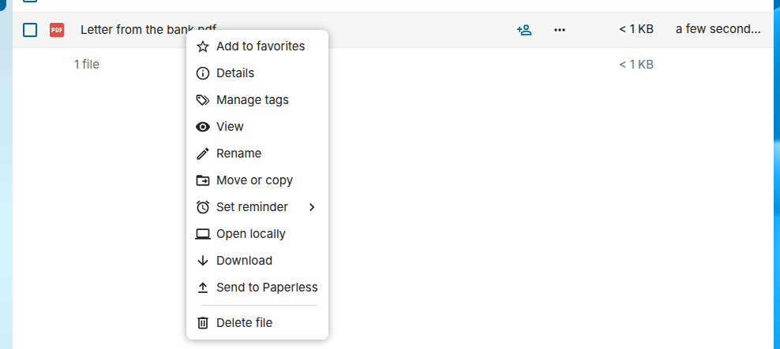
</picture>

<picture>
  <source media="(prefers-color-scheme: dark)" srcset="docs/images/diagrams/how-a-file-goes-from-files-to-paperless.dark.svg">
  
</picture>

- **A click answers at once,** with how many files go and how many are on their way already, and the background job of the app sends them with the next run of cron, which Nextcloud starts every five minutes. A notification tells the sender how each import ended: *receipt.pdf is in Paperless now*, which opens the new document in Paperless, or the reason of Paperless when it didn't import the file.
- **A folder sends the files below it,** without hidden ones, at most as many in one click as the batch size allows; for a larger folder, send its subfolders one at a time. With *Subfolders become tags*, a file in `Taxes/2026` below the sent folder gets the tags *Taxes* and *2026*, and every file gets the *Tags for every import*, as from the [inbox](#tags-of-the-inbox).
- **Paperless gets each file once:** the job first asks Paperless for a document with the content of the file, by its checksum, and when Paperless has one, the notification names it instead of an upload that Paperless-ngx 3.x would import as a second document. A file that waits for its upload or its task is on its way already, and a second click doesn't send it again.
- **Files of the archive stay out:** a file whose name has a marker such as `[P123]` is a document of Paperless already, and the files of the base folder, such as the inbox and the archive, belong to the runs, with [per-user ownership](#per-user-ownership) those of the base folder of every user: move a file into the inbox to send it from there. The menu leaves the action out for files with a marker; a click on another file of the base folder answers that the runs look after it. Nextcloud checks every click again, together with the group and that the person may read and download each file: a share whose owner allows viewing only stays out.
- **When Paperless can't take a file now,** the upload waits 15 minutes, then twice as long each time, and gives up after the sixth, with a notification; a file that Paperless refuses, such as one of a type that it doesn't take, isn't uploaded again. A task that Paperless has not finished a day after the upload ends the import with a notification, as Paperless may still create the document.

**Open in Paperless** is in the menu of every file whose name has a marker such as `[P123]`, such as every copy of the archive, for everyone who can see the file, also through a share: it opens the document in Paperless, at the Paperless URL of the settings, where Paperless asks for its own login and shows the document only to whom it allows. So every user of Files learns that address; the [metadata next to the archive](#metadata-next-to-the-archive) names it too.

<picture>
  <source media="(prefers-color-scheme: dark)" srcset="docs/images/files-open-dark.png">
  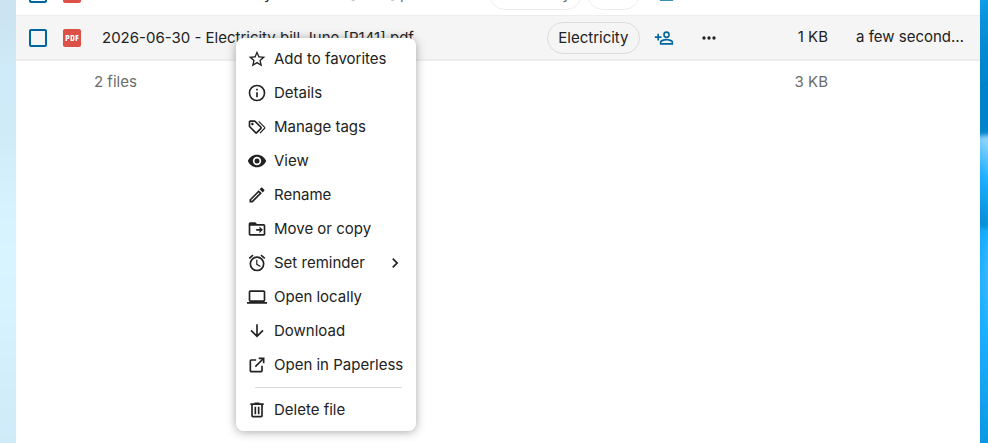
</picture>

### Send by a rule of Flow

Files can also go to Paperless on their own: **Send to Paperless** is an operation of Flow, the rules of Nextcloud in *Administration → Flow*, so that a rule of the administrators sends every file that matches its conditions, such as every PDF that a member of the group *Family* uploads, or every file of a folder that has the tag *To Paperless*. The file goes to Paperless as one sent from Files, with the *Tags for every import* of the [inbox](#tags-of-the-inbox) and the tags of the rule, and stays where it is.

1. In *Administration → Flow*, choose **Send to Paperless** among the *Available flows*.
2. Choose when the rule runs, such as *File created*, and its conditions, such as *File MIME type* is *PDF documents* and *Group membership* is *Family*, or *File system tag* is *To Paperless*, which also counts for the tag of a folder above the file; Flow asks for at least one.
3. Type the tags of Paperless for the files of the rule into *Tags in Paperless*, separated by commas, as the field suggests them from Paperless, and save the rule.

<picture>
  <source media="(prefers-color-scheme: dark)" srcset="docs/images/flow-rule-dark.png">
  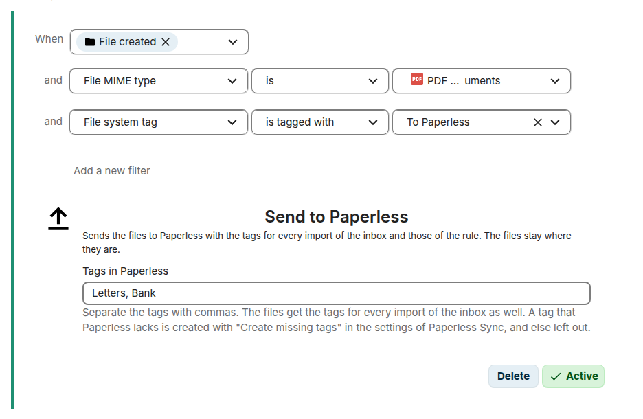
</picture>

<picture>
  <source media="(prefers-color-scheme: dark)" srcset="docs/images/diagrams/how-a-rule-of-flow-sends-a-file-to-paperless.dark.svg">
  
</picture>

- **Only administrators make such rules,** as the uploads use the API token of the app, as from Files. *Group that may send files* is the group of the action in Files and doesn't limit a rule: its conditions choose whose files it sends. The background job sends them with the next run of cron, for the owner of each file; a file without one, as in a group folder, for the user who wrote it. While the app isn't connected to Paperless, a rule sends nothing.
- **When the rule runs:** *File created* and *File updated* send a new or a changed file, *File renamed* and *File copied* a file that comes to where the rule matches, and *Tag assigned* a file the moment that someone gives it a tag. A file that waits for its upload or for its task isn't queued again, not by a second event and not by a second rule; the tags of every rule that matches the event go with it.
- **The tags of the rule** follow the settings of the [inbox](#tags-of-the-inbox): a tag that Paperless lacks is created with *Create missing tags* and else left out. Flow refuses to save a name with a comma or a line break, which separate the names, or one longer than the 128 characters that Paperless keeps.
- **Files of the archive stay out,** as from Files: the files of the base folder, with per-user ownership of every user's, which the runs write, such as the copies of the archive and the files of the inbox, and every file whose name has a marker such as `[P123]`, so that a rule for every new PDF doesn't send the archive back to Paperless. A file whose content Paperless has already, by its checksum, isn't uploaded again.
- **The owner hears of what needs them:** a notification for an import that Paperless refused or that failed, after the same retries as from Files. A rule may send many files, so an import that worked, a content that Paperless had and a file that its owner deleted before its upload go into the log of Nextcloud alone, at the level *info*.

### Deletion safety

Moving Paperless documents to its trash can be mirrored into the configured `_Deleted` folder, below the date on which the document went to the trash, in the time zone of the target user from the personal settings of Nextcloud, or else in that of Nextcloud, such as `_Deleted/2026-08-27/Example GmbH/Invoice/2026/…`; when the trash behavior keeps archive files in place, the copy stays where it is. Deleting the copy of a document that Paperless deleted is disabled by default: the switch *Delete the Nextcloud copy after Paperless deletes the document for good*. When enabled, a document must be absent from both the active Paperless API and its trash for the configured number of consecutive complete scans.

A copy that a run deletes goes to the trash bin of the target user, *Deleted files* in Files, as do the folders that it empties: Nextcloud keeps them there for the retention of its trash bin, and the target user can restore them. With per-user ownership ([folder ownership](#folder-ownership)), the copies of each user go to the trash bin of that user. That holds for every run, whoever or whatever starts it: a scheduled run, a run of *Synchronize now*, a run of `occ paperless_sync:run` and the run of the webhook, also in a process that set up the files of another user first, such as of the administrator who asked or of another app. The same holds for the copy that an excluded tag or a lost tag to mirror removes, for an inbox file after its import and for a file in the way of a copy that moves, which the [conflict policy](#conflict-policy) *Replace synchronized file* deletes. A copy whose document gets a new content stays the same file instead, and its previous content becomes a version of it, not a file in the trash bin. Without the app *Deleted files* of Nextcloud, every deletion is for good.

<picture>
  <source media="(prefers-color-scheme: dark)" srcset="docs/images/diagrams/what-happens-to-the-copy-of-a-document.dark.svg">
  
</picture>

N is the number of *Required consecutive missing scans*, three by default. With the trash behavior *Keep archive file in place*, the copy stays in the archive instead of moving to `_Deleted`, and it is deleted from there when the rules allow it. A document that Paperless restores, or lists again, keeps that copy without a download.

The copy of a document that disappears from Paperless without passing through its trash moves to the deleted folder after the same number of scans. It stays in place when the trash behavior keeps archive files in place, and it is deleted when direct deletion is allowed as well.

Only a copy that is still there is moved or deleted: a document whose copy is already gone, or that was never exported, is only marked as trashed or missing. Moves to the deleted folder and deletions count against the batch size like every other change, also when they fail: what does not fit into a run waits for the next one. A copy that cannot be moved or deleted is reported as an error of its document, and the run carries on with the others.

Only a complete scan counts. Paperless lists its documents page by page, and a page may come back short or empty, from a proxy in front of Paperless or a glitch of its permissions, or a document may be added or deleted while the run reads the pages. Then documents that still exist would look deleted. So a scan counts only when every page came back full, with the same count of Paperless, and the run received every document that Paperless listed; the run reads the documents in the order of their IDs, so that a new one joins the last page. After an incomplete scan of the documents or of the trash, the report shows a notice that the list of Paperless came back incomplete (`SCAN INCOMPLETE` on the command line), the Nextcloud log has a warning, and the run counts no document as missing; the next complete scan carries on. A document that a scan lists again starts its count of missing scans anew. The lists of tags, correspondents, document types and storage paths are checked the same way: when one of them comes back incomplete, the run fails before it changes anything in the archive, so that a document is never exported for want of its excluded tag, and never moves for want of its correspondent.

A complete scan is still no proof: when one document is deleted and another one is added while the run reads the pages, the count of Paperless stays the same, and the pages can shift so that a document that still exists is left out without a sign. So before a scan counts a document as missing, the run asks Paperless for that document alone. When Paperless has no such document (`404`), the missing scan counts. When Paperless still has it, its copy stays, and its count of missing scans starts anew, as if the scan had listed it. Any other answer, such as an error of Paperless or a timeout, counts nothing for the document in this run, and the report names it as an error. So a copy moves or is deleted only after Paperless has confirmed its document gone, also with one required missing scan. The run asks only for the documents that a scan would count: one that doesn't fit into the run, or that a run has marked missing already, costs no question, until a deletion would remove its copy or forget it. A run asks at most twice as many questions as *Maximum changes per module and run* allows, one share for copies to move or delete and one for states alone, and none after the first that fails; the other documents count nothing in that run and wait for the next.

<picture>
  <source media="(prefers-color-scheme: dark)" srcset="docs/images/diagrams/when-a-document-counts-as-missing.dark.svg">
  
</picture>

### Batch size

The batch size limits the changes of one run: exports, moves, removals of excluded copies, moves to the deleted folder and deletions. A change that fails takes its place as well, so a run that can't write, such as one against a full quota or a file name that Nextcloud refuses, downloads no more documents than the batch size allows. An export that fails takes its place only among the exports, though, so documents whose export keeps failing never hold up the moves of trashed or missing documents. What doesn't fit into a run waits for the next one, and the report counts it as skipped. Uploads from the inbox have a batch of the same size of their own, so a run uploads at most that many files to Paperless as well. So do the sidecars of the [metadata next to the archive](#metadata-next-to-the-archive): a run writes at most that many, and the [tags in Nextcloud](#tags-in-nextcloud): a run changes the tags of at most that many copies.

<picture>
  <source media="(prefers-color-scheme: dark)" srcset="docs/images/diagrams/how-a-run-spends-its-batch.dark.svg">
  
</picture>

The run takes the most recently added documents first, so a new document doesn't wait behind a backlog, such as the first export of a large archive. A document whose last export or move failed waits behind the others, the one that failed longest ago first, so documents that keep failing don't hold up the rest. When Nextcloud can't store files in the archive at all, because the quota is full or the archive is read-only or its storage unavailable, the run stops exporting and moving at the first failure and the report shows a notice that Nextcloud cannot store files in the archive (`EXPORT STOPPED` on the command line); the other documents follow in the next run, and removing copies, which frees space, goes on. Nextcloud applies no quota to the temporary file of a write, so the app checks the free space before every write itself. A path that Nextcloud refuses on its own, such as a forbidden file name or a read-only subfolder, concerns only its document. With the conflict policy *Skip and report conflict*, a file in the way is reported as a conflict before the document is downloaded, and a dry-run reports it too. The app's own copy of a document is not in the way: the state of the document records its path, and it still has the content of the last download, so it gets the new content. A copy that someone changed in Nextcloud counts as theirs and stays, also when the document gets a new path; a copy that a failed write left incomplete is still the app's own and gets the content in the next run.

### Background jobs

The app uses Nextcloud's native cron scheduler. System cron must run reliably. The configured interval, from 5 minutes to a day, is enforced by the app; each run limits its changes in Nextcloud, and its uploads to Paperless, to the configured [batch size](#batch-size) each. Nextcloud starts the job of the app every five minutes at most, so the interval can't be shorter; an interval below five minutes that an earlier version saved acts as five minutes.

The interval counts from the start or the end of the last run, whichever is later, and only a run counts that synchronizes: a scheduled one, one of *Synchronize now* or one of `occ paperless_sync:run`. A dry-run changes nothing, so it doesn't move the next run; only while it is still running, the next run waits for it, as both need the lock of the synchronization.

<picture>
  <source media="(prefers-color-scheme: dark)" srcset="docs/images/diagrams/when-the-background-job-starts-a-run.dark.svg">
  
</picture>

*Synchronize now* queues a second job, `OCA\PaperlessSync\Cron\ManualSyncJob`, once, which the next background jobs run. To start it at once, run a worker of Nextcloud for it, such as in a service of systemd or a container of its own: `occ background-job:worker 'OCA\PaperlessSync\Cron\ManualSyncJob'`. For a single run, `occ background-job:worker --once 'OCA\PaperlessSync\Cron\ManualSyncJob'` runs the queued job and returns. While another run holds the lock, such as a dry-run, the job waits for the next background jobs.

A large archive takes many runs at first: about the number of documents divided by the batch size, times the interval. With the defaults, a batch of 100 and 5 minutes, 5,000 documents take 50 runs, four hours or more. A larger batch, up to 1,000, makes the first synchronization faster; every later run changes only what changed in Paperless. Or import it in one go on the [command line](#command-line), with `occ paperless_sync:run --unlimited`.

### Changes within seconds

A run follows the interval, 5 minutes at the shortest. A workflow of Paperless can tell the app at once instead: on *Document Added* and *Document Updated*, it calls the webhook of the app with the ID of the document, and the copy of that document is exported, moved or removed within seconds, by the same rules as in a run. Nothing runs next to Paperless for it, no container reads its media folder, and Nextcloud needs no password: Paperless sends the ID, and the app reads the document with its own token.

<picture>
  <source media="(prefers-color-scheme: dark)" srcset="docs/images/diagrams/how-a-change-in-paperless-reaches-nextcloud-within-seconds.dark.svg">
  
</picture>

To set it up:

1. In section 6 of the settings, *Changes within seconds*, choose **Create secret** and copy the secret: the page shows it this once, and Nextcloud keeps only its SHA-256. Copy the **Webhook URL** as well, such as `https://cloud.example.com/index.php/apps/paperless_sync/api/v1/webhook`.
2. In Paperless, open **Workflows** and add a workflow with the triggers **Document Added** and **Document Updated**, with the filters you like.
3. Add the action **Webhook**: the webhook URL as *Webhook url*, *Use parameters for webhook body* and *Send webhook payload as JSON* on, and the parameter `document` with the value `{{ doc_id }}`. Paperless-ngx 2.x has no `{{ doc_id }}`: give it `{{ doc_url }}`, the address of the document, from which the app takes the ID.
4. Under *Webhook headers*, add `Authorization` with the value `Bearer`, a space and the secret, and save the workflow.
5. Change the title of a document in Paperless: its copy moves within seconds, and section 6 shows the last call, *P123 moved*.

<picture>
  <source media="(prefers-color-scheme: dark)" srcset="docs/images/settings-webhook-dark.png">
  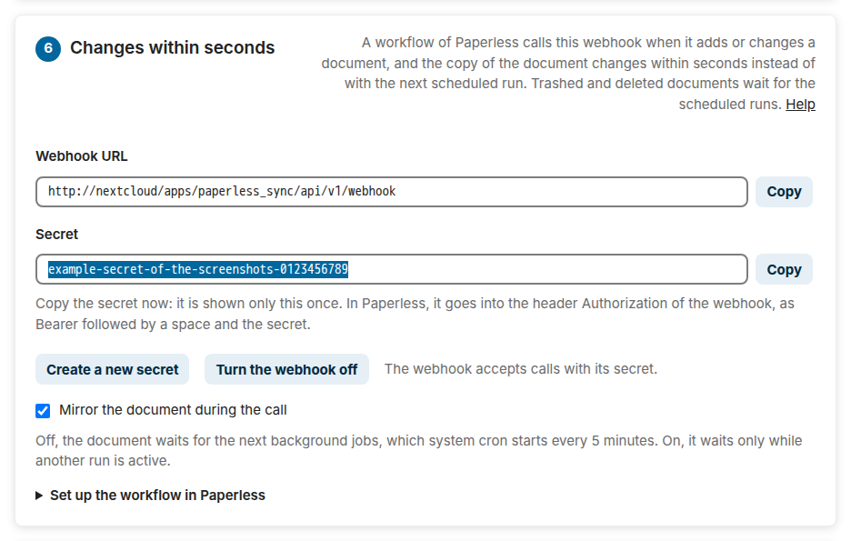
</picture>

The webhook takes `{"document": 123}` as JSON or as a form, and the number may be text or the address of the document in Paperless. It answers:

| Answer | When |
| --- | --- |
| `200` with `"result"`: `exported`, `moved`, `removed`, `unchanged` or `excluded` | the copy of the document is current; `excluded` for a document that the settings leave out, such as one in the inbox of Paperless |
| `404` with `"result": "missing"` | Paperless doesn't show the document to the account: in its trash, deleted, or new and not committed yet; Paperless tries again after about 1, 2 and 4 seconds, which catches a new document, and the scheduled runs handle the trash |
| `202` with `"result": "queued"` | the document waits for the next background jobs: another run holds the lock, or *Mirror the document during the call* is off |
| `400` | the call names no document |
| `401` | the secret is missing or wrong |
| `429` | Nextcloud refuses the address of Paperless for up to 30 minutes after more than ten calls with a wrong secret, or after more than 120 calls a minute |
| `409` with `"result": "off"` | scheduled synchronization or the export is off, or Paperless is not connected |
| `500` with `"result": "failed"` | the copy failed, such as for a file in the way; Paperless tries a call that failed three more times |

With *Mirror the document during the call* on, the default, the copy changes while Paperless waits for the answer. Paperless gives up after five seconds, as for a large download, and the run finishes all the same. Off, every document waits for the next background jobs, which system cron starts every 5 minutes, in the job `OCA\PaperlessSync\Cron\DocumentSyncJob`; Nextcloud queues it once for each document, however often Paperless calls, and while another run is active, it tries again a minute later. A call changes nothing while scheduled synchronization is off, as before the first dry-run was reviewed.

The trash, deleted documents and the inbox stay with the scheduled runs, which see the whole of Paperless: a document that Paperless doesn't show waits for the missing scans that [deletion safety](#deletion-safety) asks for, so keep scheduled synchronization on. A call of the webhook is no run of the status: the settings page, the status API and the schedule keep the last run, so that calls never hold back the scheduled run that finds trashed documents. The Activity stream of the target user, or with per-user ownership of each user, shows the changes of a call as those of a run.

The webhook is the one address of the app that answers without a login of Nextcloud. A call without the secret gets `401`, and Nextcloud's brute-force protection delays the next calls of that address, up to 25 seconds, until it refuses them for up to 30 minutes after more than ten failures; while the calls are only slower, a call with the secret ends the delay, and `occ security:bruteforce:reset <address>` ends a refusal at once. Every address may call 120 times a minute. **Create a new secret** replaces the secret at once, and **Turn the webhook off** deletes it. [Security](https://dennis-otto.github.io/paperless-sync/security.html#the-webhook-of-paperless) has the details.

<!-- --8<-- [end:configuration-checklist] -->

## Status, report and log

<!-- --8<-- [start:status] -->
Every run leaves its outcome in five places, also a scheduled run that nobody watched:

<picture>
  <source media="(prefers-color-scheme: dark)" srcset="docs/images/diagrams/where-the-outcome-of-a-run-goes.dark.svg">
  
</picture>

The top of the settings page shows how the last run ended, when it finished, the last run without errors, roughly the next scheduled run, as Nextcloud's background jobs start it a few minutes after the interval, and below them the Paperless that the last run reached: its version, as Paperless names it, and the version of its API that the app uses, such as *The last run reached Paperless-ngx 3.3.0 through version 9 of its API.* A run that failed, or ended with errors of single documents, shows them in a box below, the error that stopped the run first, and the report of the last run follows the buttons. Both stay after a reload, for a scheduled run too. A run of *Synchronize now* is *Queued* until the background jobs start it. A run that ended without saying how, because PHP stopped it, such as on a restart of the server, is *Interrupted* once Nextcloud's lock of the run is gone and the run gave no sign of life for 15 minutes: an active run writes one every minute; the next run continues where it stopped. While a run is queued or active, the page asks for its status, after each change of the state every second at first, then every five seconds, and after five minutes every thirty seconds.
<!-- --8<-- [end:status] -->

<picture>
  <source media="(prefers-color-scheme: dark)" srcset="docs/images/status-error-dark.png">
  
</picture>

<!-- --8<-- [start:status-report] -->
The report shows in the language of the administrator what the run changed, or would change in a dry-run, whose heading says *Dry-run — nothing was changed*. Its counts show the kinds of changes that happened, and a sentence the documents that stayed unchanged and those that the run skipped, such as for a later run or for an excluded tag. Each change has a badge of its kind: red for errors, failed and refused imports, amber for deletions, removals of excluded copies, moves to the deleted folder and notices such as an incomplete scan, green for finished imports. The errors come first, then the notices, then the changes in the order of the run, and a filter above the list shows the changes of one kind. An administrator who is also the target user, and so may open the files, opens the folder of a file that the run wrote, moved or left in place with a click on its path. **Copy report** copies the heading, the counts and the lines in English, as `occ paperless_sync:run` prints them, such as `EXPORT P12: Documents/Paperless/…`, for a bug report. The errors that the app explains, such as a target user that Nextcloud doesn't know or a full quota, are in the language of the administrator too, in the report and in the status above it, while the log and the command line keep them in English; the reasons of Paperless and the other messages of Paperless and Nextcloud stay in the words in which the run got them.

<picture>
  <source media="(prefers-color-scheme: dark)" srcset="docs/images/diagrams/how-the-report-shows-a-change.dark.svg">
  
</picture>

The report counts every change and lists up to 100 lines of them. A run with more lines lists its errors, deletions, removals of excluded copies, moves to the deleted folder and failed imports first, in place of exports, moves and imports, and says how many lines it leaves out, so that a dry-run never hides a deletion behind a hundred imports; `SCAN INCOMPLETE` and `EXPORT STOPPED` always stay. The status keeps the first 50 errors of the run and counts the others.

The Nextcloud log has a warning, with the ID of the document and its path, when an error of a document first occurs or changes; an error that comes back in every run is logged once. A run that fails as a whole is logged as an error.
<!-- --8<-- [end:status-report] -->

### Activity

<!-- --8<-- [start:activity] -->
The *Activity* app of Nextcloud tells the target user, or with [per-user ownership](#per-user-ownership) each user, what Paperless Sync did, in the language of the user, also in a scheduled run that nobody watched:

<picture>
  <source media="(prefers-color-scheme: dark)" srcset="docs/images/diagrams/what-the-activity-stream-shows.dark.svg">
  
</picture>

- **A run that changed something** has one entry, which counts its changes and links its first five files: *Paperless Sync added or updated 6 documents and moved 1 document to _Deleted: a.pdf, b.pdf, c.pdf, d.pdf, e.pdf and 2 more*. A link leads to its file also after the file moved again. The entry opens the archive folder, whose *Activity* tab in *Files* lists the runs.
- **A file of the inbox that Paperless imported** has an entry with a link to its new document in Paperless: *scan.pdf was imported into Paperless as P123*. The link starts with the saved Paperless URL, so it opens only where the browser reaches that address too, not for a name inside Docker such as `http://paperless:8000`.
- **A file that Paperless failed to import** has an entry with the reason of Paperless and a link to the file in the error folder, and **a file that Paperless refused** has one with the reason, once: the file stays in the inbox until it changes.

A dry-run and a run without changes add no entry. The filter *Paperless Sync* in the navigation of the Activity app shows the entries alone, and in the personal settings under *Activity*, each user can have them sent by mail or as notifications as well, which is off until then. Nextcloud's own entries of the *Files* app don't tell this story: they leave out the files of a run by hand, and they show those of a scheduled run as changes of a *remote account*.
<!-- --8<-- [end:activity] -->

### Being notified

<!-- --8<-- [start:notifications] -->
A mirror that stops is the worst failure of a backup, and nobody looks at the settings page every day. Paperless Sync says so on its own, in three places, without another service:

<picture>
  <source media="(prefers-color-scheme: dark)" srcset="docs/images/diagrams/when-the-administrators-hear-of-a-failing-mirror.dark.svg">
  
</picture>

- **Notifications.** Three runs in a row that failed or completed with errors, or fewer once the first of them ended a day ago, as with an interval of a day, send every administrator one notification, with the first 200 characters of the error and a link to the settings: *Paperless Sync failed 3 times in a row*. It comes once for the whole row, also by mail or as a push notification of the Nextcloud apps where the user has turned those on, and the next successful run removes it. Two failed runs, such as during a restart of Paperless, notify nobody. The target user, or with per-user ownership the user whose inbox held the file, gets a notification for each file of the inbox that Paperless could not import or refused, with its reason, and so does the owner of a file that a [rule of Flow](#send-by-a-rule-of-flow) sent. A dry-run notifies nobody.
- **Setup checks.** *Administration → Overview* and `occ setupchecks` show two checks of the app. *Paperless Sync* is an error when the last run failed, a warning when it completed with errors or when no run succeeded for three intervals, at least an hour, as when the background jobs stopped. *Paperless Sync background job* warns when scheduled runs are on but Nextcloud runs its background jobs with AJAX or Webcron, which start them only while someone uses Nextcloud. The settings page shows their warnings on top.
- **The status API** gives a monitor, such as Uptime Kuma or Home Assistant, the health of the mirror. Only administrators may read it; give the monitor an app password of an administrator, from *Personal settings → Security*, here in the variable `APP_PASSWORD`:

```sh
curl --user "admin:$APP_PASSWORD" --header "OCS-APIRequest: true" \
  "https://cloud.example.com/ocs/v2.php/apps/paperless_sync/api/v1/status?format=json"
```

It answers, with the counts of `summary` shortened:

```json
{"ocs": {"meta": {"status": "ok", "statuscode": 200, "message": "OK"}, "data": {
  "healthy": false, "health": "failed", "enabled": true, "state": "failed",
  "lastStarted": 1787911200, "lastEnded": 1787911205, "lastSuccess": 1787900400, "nextRun": 1787912100,
  "error": "Paperless answered 401: Invalid token.", "failedRuns": 3, "failingSince": 1787909405,
  "summary": {"dryRun": false, "exported": 0, "errors": 0}, "users": [],
  "paperlessVersion": "", "paperlessApiVersion": ""}}}
```

`health` is `failed` or `errors` while the last run failed or completed with errors, also one by hand while scheduled runs are off, then `off` while they are off, `waiting` before the first successful run, `stale` as the setup check names it, or `ok`; `healthy` is false for `failed`, `errors` and `stale`. The times are Unix timestamps, `summary` holds the counts of the last run, also of a dry-run, `users` with [per-user ownership](#per-user-ownership) the counts of each user by their ID, such as `{"alice": {"exported": 2, …}}`, and `error` the error of the last run of the row that failed. In Uptime Kuma, a monitor of the type *HTTP(s) - Json Query* with this URL, the header `{"OCS-APIRequest": "true"}`, basic authentication, the query `ocs.data.healthy` and the expected value `true` raises an alarm. In Home Assistant, a RESTful binary sensor does the same:

```yaml
rest:
  - resource: https://cloud.example.com/ocs/v2.php/apps/paperless_sync/api/v1/status?format=json
    headers:
      OCS-APIRequest: "true"
    authentication: basic
    username: admin
    password: !secret nextcloud_app_password
    scan_interval: 300
    binary_sensor:
      - name: Paperless Sync problem
        device_class: problem
        value_template: "{{ not value_json.ocs.data.healthy }}"
```

The notification of a failing mirror goes to the group `admin`. Another group, such as one for the people who look after the archive, gets it in its place with `occ config:app:set paperless_sync notification_group --value=archive-admins`; a group that doesn't exist leaves it to the administrators, with a warning in the log.
<!-- --8<-- [end:notifications] -->

## Command line

<!-- --8<-- [start:command-line] -->
Nextcloud's `occ` runs the app from the shell, for scripts, cron jobs of your own and monitoring, such as in a Docker or All-in-One installation: `docker exec --user www-data nextcloud php occ …`, or `docker exec --user www-data nextcloud-aio-nextcloud php occ …` for All-in-One.

| Command | What it does |
| --- | --- |
| `occ paperless_sync:run` | A run now, in the shell, as long as it takes, with its report. It makes at most as many changes as the batch size of the settings, as a scheduled run does. |
| `occ paperless_sync:run --dry-run` | The changes that a run would make, without making them. |
| `occ paperless_sync:run --batch-size=1000` | A run with a batch size of its own; `--unlimited` makes every change that is due, such as for the first import of a large archive. |
| `occ paperless_sync:status` | The status of the last run, as the settings page shows it, with its report. `--exit-code` tells by the exit code how it ended, for a check of a monitoring. |
| `occ paperless_sync:create-account --admin-token-file=FILE` | Creates the account of the app in Paperless with the token of a superuser in the file, or with `-` from standard input, with the permissions of the modules of the saved settings, stores its token and prints the connection checklist; `--username` names the account, `--update` updates a user that exists. It exits with 0 when every check passed, 1 when a check failed, and 2 when it failed, with no token stored. [The account of the app](#the-account-of-the-app) has the details. |
| `occ paperless_sync:forget 123 P124` | The next runs download these documents again and write each in place of its copy, such as after a copy was damaged; `--all` for every copy, such as after an incident of the storage. A copy keeps its path, its file ID, its shares and its versions, and an edit in Nextcloud gets the content of Paperless again. |

`--output=json` prints the report of a run, or the status, as the JSON that the settings page reads, on one line, and `--output=json_pretty` indented; messages about failures go to standard error. A run on the command line counts in the status and the log as any other run, and holds the same lock, so it never runs beside a scheduled run or one of *Synchronize now*.

| Exit code | `paperless_sync:run` | `paperless_sync:status --exit-code` | `paperless_sync:forget` |
| --- | --- | --- | --- |
| 0 | The run completed. | The last run completed, or none has ended yet. | Every document was forgotten. |
| 1 | It completed with errors of single documents or files; its report lists them. | It completed with errors. | Some of the documents have no copy. |
| 2 | It failed or didn't start: an option that isn't valid, an incomplete configuration, or Paperless out of reach. | It failed or was interrupted. | It failed. |
| 3 | Another run is active. | — | A run is active. |

The first import of a large archive in one go: a run without a limit can take hours. Nextcloud lets the lock of a run expire after an hour (`filelocking.ttl` in `config.php`), but the run gives a sign of life every minute, which keeps scheduled runs and those of *Synchronize now* from starting beside it.

```sh
occ paperless_sync:run --dry-run --unlimited   # how many changes are due
occ paperless_sync:run --unlimited             # make them all
```

How a run by hand starts, on the page and on the command line:

<picture>
  <source media="(prefers-color-scheme: dark)" srcset="docs/images/diagrams/how-a-run-by-hand-starts.dark.svg">
  
</picture>
<!-- --8<-- [end:command-line] -->

## FAQ and troubleshooting

The [FAQ](https://dennis-otto.github.io/paperless-sync/faq.html) answers the common questions, such as what happens to an edit of a mirrored file, where deleted files go and how long the first synchronization takes. [Troubleshooting](https://dennis-otto.github.io/paperless-sync/troubleshooting.html) leads from an error message, a run that fails or a file that is missing to its cause and its fix.

<!-- --8<-- [start:help] -->

## Help and feedback

- **A question** about the set-up, or whether the app can do something: ask in the [Q&A discussions](https://github.com/Dennis-Otto/paperless-sync/discussions/categories/q-a), where the answer stays for the next person who asks.
- **A bug**: open a [bug report](https://github.com/Dennis-Otto/paperless-sync/issues/new?template=bug_report.yml) with the versions of the app and of Nextcloud. Report a vulnerability [privately](https://github.com/Dennis-Otto/paperless-sync/security/advisories/new) instead.
- **An idea**: suggest it in a [feature request](https://github.com/Dennis-Otto/paperless-sync/issues/new?template=feature_request.yml).
- **If it works for you**: [rate it in the Nextcloud App Store](https://apps.nextcloud.com/apps/paperless_sync), so that others find it, star the [repository](https://github.com/Dennis-Otto/paperless-sync), or [support its development](https://github.com/sponsors/Dennis-Otto).

<!-- --8<-- [end:help] -->

## Development

Contributions are welcome. [CONTRIBUTING.md](CONTRIBUTING.md) says how a change gets in, and [Development](docs/development.md) how to build, check and test the app: `scripts/check.sh`, the end-to-end tests in Docker against every supported Nextcloud version, the pictures of the documentation, which bots keep current, the website and the release process. [Automation](docs/automation.md) shows the bots that check, release and look after the app. A check that fails, the end-to-end tests and the other checks of this app included, says on the pull request what it found and how to fix it, also on a pull request from a fork, and fixes itself where a command can, such as the coding standard. The project follows [GOVERNANCE.md](GOVERNANCE.md), [SUPPORT.md](SUPPORT.md) and the [code of conduct](CODE_OF_CONDUCT.md). A change of `README.md`, or of a page of the website with a German version, changes the German one too, such as [README.de.md](README.de.md), and `scripts/check.sh` checks that both have the same headings, snippets and diagrams.

## Quality and security

[](https://github.com/Dennis-Otto/paperless-sync/actions/workflows/ci.yml)
[](https://github.com/Dennis-Otto/paperless-sync/actions/workflows/e2e.yml)
[](https://github.com/Dennis-Otto/paperless-sync/actions/workflows/secret-scan.yml)
[](https://github.com/Dennis-Otto/paperless-sync/actions/workflows/codeql.yml)
[](https://github.com/Dennis-Otto/paperless-sync/actions/workflows/sbom.yml)
[](https://scorecard.dev/viewer/?uri=github.com/Dennis-Otto/paperless-sync)
[](https://www.bestpractices.dev/projects/15277)
[](https://api.reuse.software/info/github.com/Dennis-Otto/paperless-sync)

A change reaches `main` only when the unit tests, which run every line of the app, pass, together with Psalm, CodeQL, the secret scan, the dependency review, the license check of every file and, when the change can affect the app, the end-to-end tests in Docker against every supported Nextcloud version. Every week, contract tests run the app against a real Paperless-ngx 2.x and 3.x, whose recorded answers the unit tests read. Every release is signed, with an SBOM and signed build provenance, and checked in the App Store afterwards; [Automation](docs/automation.md) shows every workflow behind it. The [security design](docs/security.md) says what the app protects and how; report a vulnerability [privately](https://github.com/Dennis-Otto/paperless-sync/security/advisories/new).

## License

[AGPL-3.0-or-later](LICENSE)
