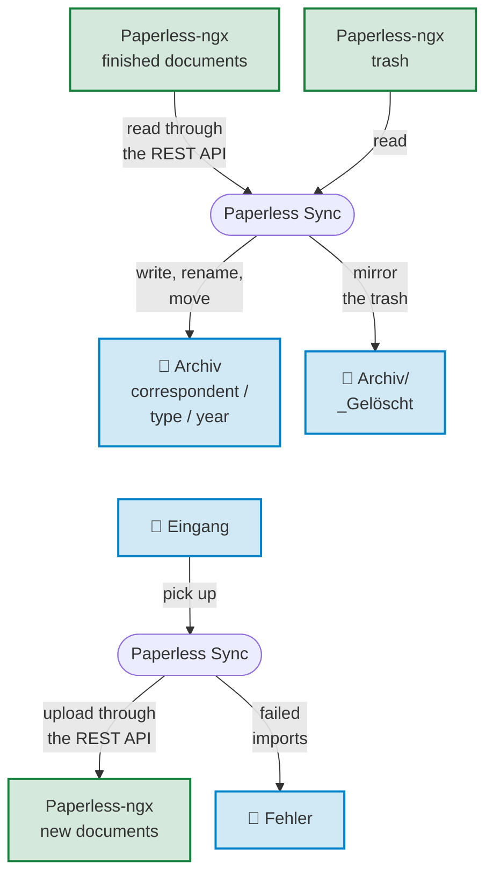
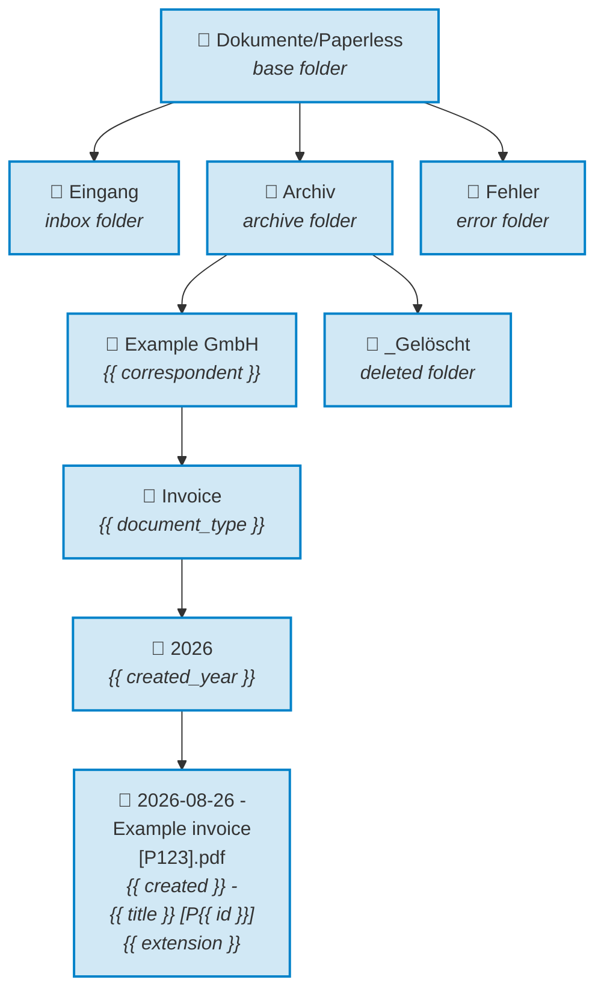
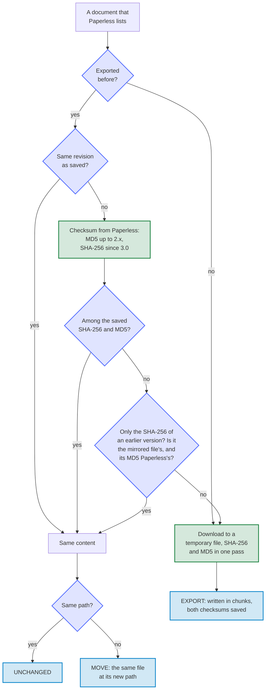
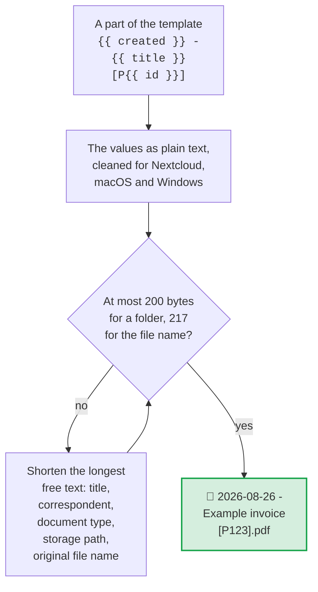
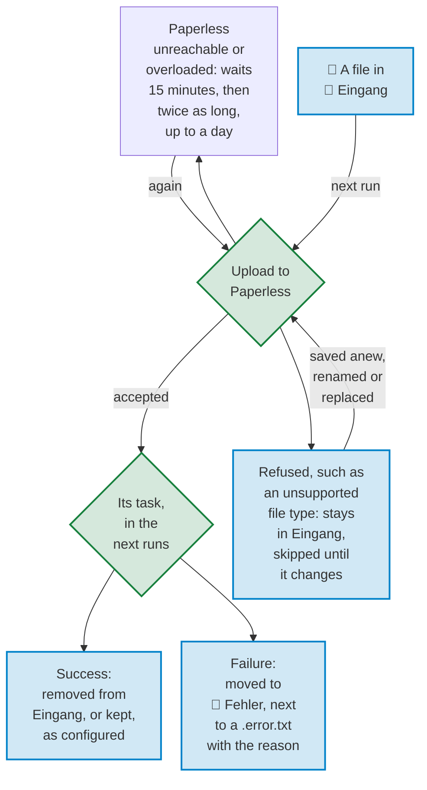
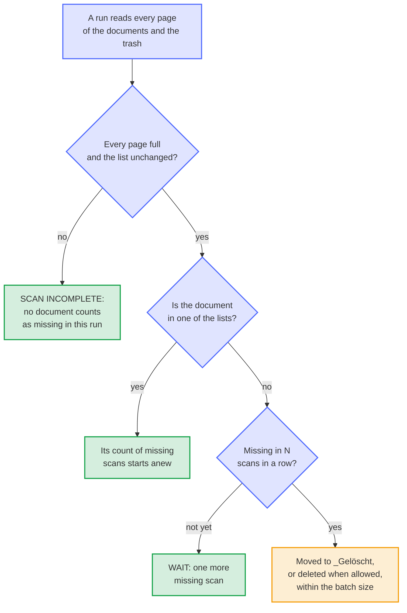
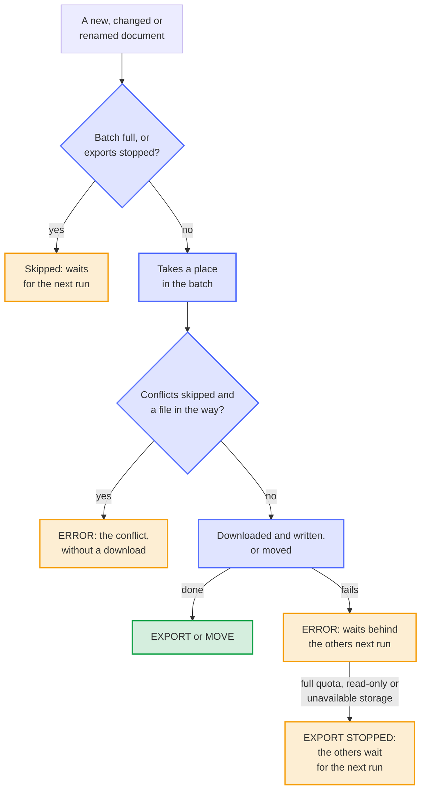
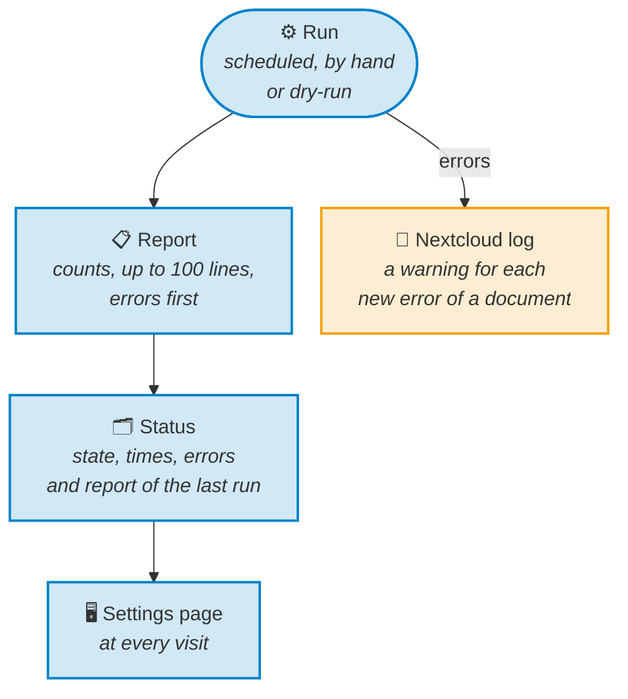

<!-- The first screen. The badges of the version in the App Store and of the versions of
Nextcloud read appinfo/info.xml on main, so that they follow every release and every
raise of max-version by the upstream bot; scripts/check-project.sh checks that they do. -->
<div align="center">


# Paperless Sync

**Your Paperless-ngx archive as an always-current folder tree in Nextcloud Files — plus an inbox from Nextcloud into Paperless.**

[](https://apps.nextcloud.com/apps/paperless_sync)
[](#requirements)
[](LICENSE)
[](https://dennis-otto.github.io/paperless-sync/)

[**Get it from the App Store**](https://apps.nextcloud.com/apps/paperless_sync) · [Requirements](#requirements) · [Quick start](#quick-start) · [Documentation](https://dennis-otto.github.io/paperless-sync/) · [Help](#help-and-feedback) · [Changelog](CHANGELOG.md)


</div>

Paperless Sync is a native Nextcloud app. It writes the finished documents of Paperless-ngx into a folder tree in the files of a Nextcloud user, by correspondent, document type and year, and keeps the tree current: a new title renames a file, a new correspondent moves it, and the Paperless trash has a folder of its own. Files that you put into an inbox folder in Nextcloud go the other way, to Paperless. Paperless remains the source of truth, and Nextcloud gives you the documents in Files, in its desktop and mobile clients, in its viewer and in shares.

Unlike a mount of the media folder of Paperless or a script that copies over WebDAV, Paperless Sync runs inside Nextcloud as one of its background jobs: it needs no extra container and no stored Nextcloud password, the copies are real files of Nextcloud with versions, shares and search, an edit in Nextcloud never reaches the originals in Paperless, and a copy whose document leaves Paperless is deleted only when you turn permanent deletion on, after complete scans of Paperless confirm that the document is gone.

The [documentation website](https://dennis-otto.github.io/paperless-sync/) has this guide, together with the [architecture](docs/architecture.md), the [security design](docs/security.md), the [decisions](docs/decisions/README.md) and the [roadmap](docs/roadmap.md).

<sub>💛 If Paperless Sync works for you, [rate it in the App Store](https://apps.nextcloud.com/apps/paperless_sync) so that others find it, or [support its development](https://github.com/sponsors/Dennis-Otto).</sub>

<!-- --8<-- [start:how-it-works] -->

## How it works



At the configured interval, Nextcloud's cron starts a run of the app inside Nextcloud. It reads the finished documents of Paperless and writes each one into the archive in the files of the configured Nextcloud target user, at the path that the path template builds from its metadata; other users see the archive when that user shares it with them. When the metadata changes in Paperless, the file moves; when a document goes to the Paperless trash, its copy goes to `_Gelöscht`. Files that someone puts into `Eingang` go the other way, to Paperless.

<!-- --8<-- [end:how-it-works] -->
<!-- --8<-- [start:requirements] -->

## Requirements

<!-- On the website, the hook in .github/mkdocs_project.py writes the versions of appinfo/info.xml into the fields. -->

- **Nextcloud <span data-app="nextcloud">33–35</span>**, with the system cron for its background jobs, as Nextcloud recommends: *Administration settings → Basic settings → Background jobs → Cron*. Every run of the app is one of these jobs.
- **PHP <span data-app="php">8.2+</span>** on the Nextcloud server.
- **Paperless-ngx 2.10 or newer, 3.x included**; 2.10 is the first version with a trash, which the app mirrors. Paperless needs an address that the Nextcloud server reaches over HTTP or HTTPS; for an address of your local network, such as `http://paperless:8000` in Docker or `http://192.168.1.20:8000`, turn on the setting [Paperless runs in my local network](#paperless-in-your-local-network).
- **A Paperless account for the app**, with an API token. It needs to view and download the documents to mirror, to see them in the trash for the deleted folder, and the permission `documents.add_document` for the inbox; [Paperless connection](#paperless-connection) has the details.

<!-- --8<-- [end:requirements] -->
<!-- --8<-- [start:quick-start-section] -->

## Quick start

<!-- --8<-- [start:quick-start] -->

1. Install **Paperless Sync** from the [Nextcloud App Store](https://apps.nextcloud.com/apps/paperless_sync) under *Apps*, or with `occ app:install paperless_sync`. Nextcloud's system cron must run.
2. In Paperless-ngx, create a dedicated account with view and download access to the documents to mirror, and an API token for it.
3. In Nextcloud, open **Administration settings → Paperless Sync**. Enter the Paperless URL, the token and the Nextcloud user who owns the archive, leave synchronization disabled, and save; saving tests the connection to Paperless and the folder in Nextcloud. For a Paperless at an address of your network, such as `http://paperless:8000`, turn on **Paperless runs in my local network** first.
4. Start a **dry run** and read its summary: it lists what a run would change, without changing anything.
5. Enable synchronization and save. Nextcloud's cron runs it at the configured interval, and the documents appear in `Dokumente/Paperless/Archiv` of that user.

<!-- --8<-- [end:quick-start] -->
<!-- --8<-- [end:quick-start-section] -->
<!-- --8<-- [start:features] -->

## Features

### Archive

- A folder tree in the files of the configured Nextcloud user, by correspondent, document type and year, from a [path template](#path-template-variables) that you can change, with base, archive, inbox, error and deleted folders of your choice
- The archive PDF of each document, or its original file
- Renames and moves when the metadata changes in Paperless, and no empty folders left behind
- Documents in the Paperless inbox wait until they are finished, and a document that gets a tag you exclude, or the inbox tag again, stays out, its copy removed
- A stable marker such as `[P123]` in every file name, which [Paperless Unified Search](https://github.com/Dennis-Otto/paperless-unified-search) understands

### Inbox

- Files in an inbox folder of Nextcloud, and in its subfolders if you like, go to Paperless as new documents
- The app follows the Paperless task of each file: after a success, it removes the file or keeps it, as you choose; after a failure, it moves the file to the error folder, next to the reason
- When Paperless can't take a file now, the upload waits and tries again, from 15 minutes up to a day

### Safety

- Synchronization stays off until you turn it on, and a dry run lists every change that a run would make, without making it
- The Paperless trash is mirrored into a folder of its own; permanent deletion is off by default and, when on, waits for the set number of complete scans of Paperless in a row
- A conflict policy for a file in the way: replace it, or skip it and report the conflict
- No WebDAV credentials and no password of a Nextcloud user: the app writes through Nextcloud's filesystem API
- The Paperless API token stays in Nextcloud's credentials manager, never reaches the browser and goes only to the address saved with it
- A Paperless in your local network, such as `http://paperless:8000`, without turning off Nextcloud's protection against server-side request forgery for the whole server

### Operations

- Nextcloud's cron runs it at the interval that you set, and the batch size limits the changes of one run
- Runs on demand and dry runs from the settings, each with a report of its changes and errors, and the status of the last run
- Signed releases: the same package in the Nextcloud App Store and on GitHub, with an SBOM and signed build provenance

<!-- --8<-- [end:features] -->

## Screenshots

Following the quick start: a dry-run lists every file that a run would write, move or delete, without changing anything, and *Synchronize now* makes the changes.


A few days later, a dry-run shows every kind of change at once: new documents, a new title, a document in the Paperless trash, one with an excluded tag and a finished import from the inbox.

<picture>
  <source media="(prefers-color-scheme: dark)" srcset="docs/images/report-dark.png">
  
</picture>

The archive in Files, one folder per correspondent, document type and year, with the ID of each document in its name:

<picture>
  <source media="(prefers-color-scheme: dark)" srcset="docs/images/archive-dark.png">
  
</picture>

The settings of the app in the administration settings of Nextcloud:

<picture>
  <source media="(prefers-color-scheme: dark)" srcset="docs/images/settings-dark.png">
  
</picture>

The [guide](https://dennis-otto.github.io/paperless-sync/guide.html#the-settings-section-by-section) shows every section of the settings.

<!-- --8<-- [start:usage] -->

## Usage

After installation, open **Administration settings → Paperless Sync**. Configure and test the connection while synchronization remains disabled. Run a dry-run, review the summary, and only then enable scheduled synchronization.

The default archive path template is:

```text
{{ correspondent }}/{{ document_type }}/{{ created_year }}/{{ created }} - {{ title }} [P{{ id }}]{{ extension }}
```

This produces paths such as:

```text
Dokumente/Paperless/Archiv/Example GmbH/Invoice/2026/2026-08-26 - Example invoice [P123].pdf
```

Each part of the template becomes a folder. The base folder holds the inbox folder, with the files for Paperless, and the error folder, with failed imports, next to the archive; the deleted folder in the archive holds the copies of the documents in the Paperless trash:



Stable markers such as `[P123]` are compatible with the independent [Paperless Unified Search](https://github.com/Dennis-Otto/paperless-unified-search) app.

When you change the title, the tags, the correspondent or the type of a document in Paperless, its file moves to its new path and keeps its shares, comments and versions in Nextcloud, and the desktop and mobile clients only rename it. Only a change of the content, such as a new archive version after Paperless processed the document again, downloads it again. A run tells the two apart by the checksums of the file: it keeps the SHA-256 and the MD5 of every download and compares them with the checksum that Paperless reports, MD5 up to Paperless-ngx 2.x and SHA-256 since 3.0. For a file that an earlier version of the app exported, which has only its SHA-256 saved, the first change on Paperless-ngx 2.x reads the file in Nextcloud once to add its MD5, so that it moves without a download too. A download goes to Nextcloud in chunks, so a document of any size fits into the memory of PHP.



<!-- --8<-- [end:usage] -->
<!-- --8<-- [start:configuration] -->

## Configuration

### Paperless connection

Use a dedicated Paperless service account. It needs view and download access to every document that should be exported. Enable `documents.add_document` only when Nextcloud inbox import is used. Trash synchronization requires visibility of the corresponding trashed documents.

The API token is stored in Nextcloud's credentials manager and never returned to the browser. It goes only to the Paperless URL that it was saved with: to connect to another URL, enter the token again. This holds also when the URL changes past the settings page, with `occ` or Nextcloud's provisioning API; synchronization then waits for the token. Saving the settings and disconnecting ask for your password, unless you confirmed it in the last 30 minutes.

#### Paperless in your local network

Nextcloud refuses connections to addresses of the local network, such as `http://paperless:8000` in Docker, `http://paperless.lan` or `http://192.168.1.20:8000`, to protect against server-side request forgery. When Paperless runs at such an address, turn on **Paperless runs in my local network** and save. Nextcloud then allows a local address for the requests of Paperless Sync to the saved Paperless URL only. Every other app and request stays protected, which the system switch `allow_local_remote_servers` would undo for the whole server.

Without the setting, saving says what to do:

> Nextcloud blocks connections to local addresses such as paperless. If Paperless runs in your network, turn on "Paperless runs in my local network" and save the settings.

The setting also helps when the name of Paperless is set only in the hosts file of the server, such as with `extra_hosts` in Docker: without it, Nextcloud looks names up only in the DNS, and saving says that it found no DNS record for the name.

If you turned on `allow_local_remote_servers` for this app before, turn on the setting, save, and then turn the switch off again with `occ config:system:delete allow_local_remote_servers`. [The security design](https://dennis-otto.github.io/paperless-sync/security.html#a-paperless-in-the-local-network) explains what the setting allows.

### Folder ownership

The configured Nextcloud target user owns the synchronized folders. The app operates through Nextcloud's internal filesystem API and therefore does not need that user's password or an app password.

### Path template variables

- `{{ id }}`
- `{{ title }}`
- `{{ correspondent }}`
- `{{ document_type }}`
- `{{ storage_path }}`
- `{{ created }}`, `{{ created_year }}`, `{{ created_month }}`
- `{{ added }}`, `{{ added_year }}`
- `{{ original_filename }}`
- `{{ extension }}`

The template must contain `{{ id }}`. A variable may be written with or without spaces, such as `{{id}}`, and is saved as `{{ id }}`. Every value goes into the path as plain text, so a `$1` or a `{{ title }}` in a title stays as it is.

Every file name keeps the marker `[P{{ id }}]` and ends with `{{ extension }}`: when the last part of the template leaves them out, the app adds them at its end. The marker keeps the paths of two documents apart and ties each file to its document.

Each part of the path is cleaned for Nextcloud, macOS and Windows: control characters and `< > : " / \ | ? *` become `_`, runs of spaces become one, spaces and dots at the ends go, and the names of Windows devices, such as `CON`, `COM1` or `LPT¹`, get a leading `_`.

Nextcloud accepts names of up to 250 bytes, and a character of Cyrillic takes two bytes, of Chinese three and an emoji four. So a folder name has at most 200 bytes and a file name at most 217, which leaves room for the temporary name of a write. A name that would be longer is shortened in its free text alone: the title, the correspondent, the document type, the storage path and the original file name, the longest first. The text of the template, the dates, the marker and the extension stay whole:



### Nextcloud inbox

Files in the inbox folder, and in its subfolders when *Scan inbox subfolders* is on, go to Paperless, at most as many in one run as the batch size allows. A file stays in the inbox until its Paperless task reports success:



A failed file keeps its subfolder below the error folder.

Paperless may refuse a file right away: one of a type it doesn't take, an empty one, or one too large for a proxy in front of it, such as the 100 MB of the free plan of Cloudflare. The report of that run lists the file once as `IMPORT REJECTED`, with the reason that Paperless gave, and the Nextcloud log records it as a warning. The runs after it leave the file in the inbox and skip it until it changes; save it anew, rename or replace it to submit it again.

When Paperless can't be reached, or fails with a server error such as `502 Bad Gateway`, the run uploads no further files and tries this one again later: after 15 minutes, then after twice as long each time, at most once a day. The other files follow in the next runs.

### Deletion safety

Moving Paperless documents to its trash can be mirrored into the configured `_Gelöscht` folder; when the trash behavior keeps archive files in place, the copy stays where it is. Permanent Nextcloud deletion is disabled by default. When enabled, a document must be absent from both the active Paperless API and its trash for the configured number of consecutive complete scans.

```mermaid
stateDiagram-v2
    direction TB
    accTitle: What happens to the copy of a document
    accDescr: An exported document is in the archive. Moved to the trash in Paperless, or gone from Paperless without the trash for N complete scans, its copy moves to _Gelöscht; restored in Paperless, it moves back to the archive. Deleted for good in Paperless, the copy in _Gelöscht is deleted in Nextcloud after N complete scans, when permanent deletion is on. A copy in the archive whose document is gone from Paperless without the trash for N complete scans is deleted directly when permanent and direct deletion are on.
    state "In the archive" as archive
    state "In _Gelöscht" as deleted
    state "Deleted in Nextcloud" as gone
    [*] --> archive: exported
    archive --> deleted: moved to the trash<br>in Paperless, or gone<br>without the trash<br>for N complete scans
    deleted --> archive: restored<br>in Paperless
    deleted --> gone: deleted for good<br>in Paperless, after<br>N complete scans, with<br>permanent deletion on
    archive --> gone: gone without the trash<br>for N complete scans,<br>with permanent and<br>direct deletion on
```



N is the number of *Required consecutive missing scans*, three by default. With the trash behavior *Keep archive file in place*, the copy stays in the archive instead of moving to `_Gelöscht`, and it is deleted from there when the rules allow it.

The copy of a document that disappears from Paperless without passing through its trash moves to the deleted folder after the same number of scans. It stays in place when the trash behavior keeps archive files in place, and it is deleted when direct deletion is allowed as well.

Only a copy that is still there is moved or deleted: a document whose copy is already gone, or that was never exported, is only marked as trashed or missing. Moves to the deleted folder and deletions count against the batch size like every other change, also when they fail: what does not fit into a run waits for the next one. A copy that cannot be moved or deleted is reported as an error of its document, and the run carries on with the others.

Only a complete scan counts. Paperless lists its documents page by page, and a page may come back short or empty, from a proxy in front of Paperless or a glitch of its permissions, or a document may be added or deleted while the run reads the pages. Then documents that still exist would look deleted. So a scan counts only when every page came back full, with the same count of Paperless, and the run received every document that Paperless listed; the run reads the documents in the order of their IDs, so that a new one joins the last page. After an incomplete scan of the documents or of the trash, the report says `SCAN INCOMPLETE`, the Nextcloud log has a warning, and the run counts no document as missing; the next complete scan carries on. A document that a scan lists again starts its count of missing scans anew. The lists of tags, correspondents, document types and storage paths are checked the same way: when one of them comes back incomplete, the run fails before it changes anything in the archive, so that a document is never exported for want of its excluded tag, and never moves for want of its correspondent.



### Batch size

The batch size limits the changes of one run: exports, moves, removals of excluded copies, moves to the deleted folder and deletions. A change that fails takes its place as well, so a run that can't write, such as one against a full quota or a file name that Nextcloud refuses, downloads no more documents than the batch size allows. An export that fails takes its place only among the exports, though, so documents whose export keeps failing never hold up the moves of trashed or missing documents. What doesn't fit into a run waits for the next one, and the report counts it as skipped. Uploads from the inbox have a batch of the same size of their own, so a run uploads at most that many files to Paperless as well.



The run takes the most recently added documents first, so a new document doesn't wait behind a backlog, such as the first export of a large archive. A document whose last export or move failed waits behind the others, the one that failed longest ago first, so documents that keep failing don't hold up the rest. When Nextcloud can't store files in the archive at all, because the quota is full or the archive is read-only or its storage unavailable, the run stops exporting and moving at the first failure and reports `EXPORT STOPPED`; the other documents follow in the next run, and removing copies, which frees space, goes on. Nextcloud applies no quota to the temporary file of a write, so the app checks the free space before every write itself. A path that Nextcloud refuses on its own, such as a forbidden file name or a read-only subfolder, concerns only its document. With the conflict policy *Skip and report conflict*, a file in the way is reported as a conflict before the document is downloaded, and a dry-run reports it too.

### Background jobs

The app uses Nextcloud's native cron scheduler. System cron must run reliably. The configured interval is enforced by the app; each run limits its changes in Nextcloud, and its uploads to Paperless, to the configured [batch size](#batch-size) each.

<!-- --8<-- [end:configuration] -->

## Status, report and log

<!-- --8<-- [start:status] -->
Every run leaves its outcome in three places, also a scheduled run that nobody watched:



The top of the settings page shows how the last run ended, when it finished, the last run without errors and, roughly, the next scheduled run: Nextcloud's background jobs start it, so it follows a few minutes after the interval. A run that failed, or ended with errors of single documents, shows them in a box below, the error that stopped the run first, and the report of the last run follows the buttons. Both stay after a reload, for a scheduled run too. While a run is active, the page asks for its status every five seconds.
<!-- --8<-- [end:status] -->

<picture>
  <source media="(prefers-color-scheme: dark)" srcset="docs/images/status-error-dark.png">
  
</picture>

<!-- --8<-- [start:status-report] -->
The report counts every change and lists up to 100 lines of them. A run with more lines lists its errors, deletions, removals of excluded copies, moves to the deleted folder and failed imports first, in place of exports, moves and imports, and says how many lines it leaves out, so that a dry-run never hides a deletion behind a hundred imports; `SCAN INCOMPLETE` and `EXPORT STOPPED` always stay. The status keeps the first 50 errors of the run and counts the others.

The Nextcloud log has a warning, with the ID of the document and its path, when an error of a document first occurs or changes; an error that comes back in every run is logged once. A run that fails as a whole is logged as an error.
<!-- --8<-- [end:status-report] -->
<!-- --8<-- [start:help] -->

## Help and feedback

- **A question** about the set-up, or whether the app can do something: ask in the [Q&A discussions](https://github.com/Dennis-Otto/paperless-sync/discussions/categories/q-a), where the answer stays for the next person who asks.
- **A bug**: open a [bug report](https://github.com/Dennis-Otto/paperless-sync/issues/new?template=bug_report.yml) with the versions of the app and of Nextcloud. Report a vulnerability [privately](https://github.com/Dennis-Otto/paperless-sync/security/advisories/new) instead.
- **An idea**: suggest it in a [feature request](https://github.com/Dennis-Otto/paperless-sync/issues/new?template=feature_request.yml).
- **If it works for you**: [rate it in the Nextcloud App Store](https://apps.nextcloud.com/apps/paperless_sync), so that others find it, star the [repository](https://github.com/Dennis-Otto/paperless-sync), or [support its development](https://github.com/sponsors/Dennis-Otto).

<!-- --8<-- [end:help] -->

## Development

Contributions are welcome. [CONTRIBUTING.md](CONTRIBUTING.md) says how a change gets in, and [Development](docs/development.md) how to build, check and test the app: `scripts/check.sh`, the end-to-end tests in Docker against every supported Nextcloud version, the pictures of the documentation, the website and the release process. The project follows [GOVERNANCE.md](GOVERNANCE.md), [SUPPORT.md](SUPPORT.md) and the [code of conduct](CODE_OF_CONDUCT.md).

## Quality and security

[](https://github.com/Dennis-Otto/paperless-sync/actions/workflows/ci.yml)
[](https://github.com/Dennis-Otto/paperless-sync/actions/workflows/e2e.yml)
[](https://github.com/Dennis-Otto/paperless-sync/actions/workflows/secret-scan.yml)
[](https://github.com/Dennis-Otto/paperless-sync/actions/workflows/codeql.yml)
[](https://github.com/Dennis-Otto/paperless-sync/actions/workflows/sbom.yml)
[](https://scorecard.dev/viewer/?uri=github.com/Dennis-Otto/paperless-sync)
[](https://www.bestpractices.dev/projects/15277)
[](https://api.reuse.software/info/github.com/Dennis-Otto/paperless-sync)

A change reaches `main` only when the unit tests, which run every line of the app, pass, together with Psalm, CodeQL, the secret scan, the dependency review, the license check of every file and, when the change can affect the app, the end-to-end tests in Docker against every supported Nextcloud version. Every release is signed, with an SBOM and signed build provenance. The [security design](docs/security.md) says what the app protects and how; report a vulnerability [privately](https://github.com/Dennis-Otto/paperless-sync/security/advisories/new).

## License

[AGPL-3.0-or-later](LICENSE)
