# The demo of Paperless Sync

See Paperless Sync at work in a few minutes, on your machine, without a Nextcloud or a Paperless-ngx of your own. Everything in it is made up, and nothing leaves your machine except the downloads of the images and of the app.

You need Docker 25 or newer with Compose 2.20.2 or newer, which the health checks of the demo ask for: Docker Engine on Linux, or Docker Desktop on Windows or macOS. The containers take about 1.5 GB of memory and 4 GB of disk.

```sh
git clone https://github.com/Dennis-Otto/paperless-sync.git
cd paperless-sync
docker compose -f demo/compose.yaml up
```

The first start downloads the images and takes a few minutes; the setup alone takes about a minute. Then the command says where everything is, with the password that it made for this demo, and returns. The demo keeps running in Docker:

| What | Address | User |
| --- | --- | --- |
| The archive in Nextcloud Files | <http://localhost:8580/apps/files/files?dir=/Documents/Paperless/Archive> | `demo` |
| The settings of the app | <http://localhost:8580/settings/admin/paperless_sync> | `admin` |
| Paperless-ngx | <http://localhost:8581> | `admin` |

All three use one password, which stays in `demo/.env`. Git ignores that file.

## What it starts

<picture>
  <source media="(prefers-color-scheme: dark)" srcset="../docs/images/diagrams/what-the-demo-starts.dark.svg">
  
</picture>

- **The documents** are the 15 synthetic documents of a household, from [`tests/e2e/showcase.py`](../tests/e2e/showcase.py). One of them is still in the inbox of Paperless, so the archive has 14: remove the tag *Inbox* in Paperless, and the next run brings it.
- **The app** comes from the App Store, as for you later. The container `init` creates its account in Paperless through the API, as *Create an account for the app in Paperless* does, and connects it with the user `demo` as the owner of the archive. It starts a dry run first, then turns on synchronization and starts the first run.
- **Every port stays on `127.0.0.1`**, and no password is written in a file of this repository: the container `secrets` makes them on the first start.

## Things to try

1. Open the archive as `demo`, and go through a correspondent, a type and a year to a document.
2. In Paperless, change the title of a document. Then, as `admin`, click **Synchronize now** in the settings of the app: within seconds, its copy has the new name and keeps its file ID.
3. Put a PDF into `Documents/Paperless/Inbox` of the user `demo`. The next run sends it to Paperless. Remove its tag *Inbox* there, as for the scan that is waiting, and the next run brings it into the archive.
4. Move a document to the trash in Paperless, and see its copy move to the folder `_Deleted` of the archive.

The [guide](https://dennis-otto.github.io/paperless-sync/guide.html) explains every setting that you see.

## Stop it

```sh
docker compose -f demo/compose.yaml down
docker compose -f demo/compose.yaml down --volumes
```

The first command stops the demo and keeps its data for the next `up`; the second removes the data as well. `demo/.env` stays, and the next start uses its password again; delete that file for a new one.

## Change it

Other ports, when something else listens on 8580 or 8581, come from the environment or from lines in `demo/.env`:

```sh
DEMO_NEXTCLOUD_PORT=9080 DEMO_PAPERLESS_PORT=9081 docker compose -f demo/compose.yaml up
```

Choose the port of Paperless before the first start, or run `docker compose -f demo/compose.yaml down --volumes` first: the app keeps the address of Paperless from the setup, and a new address needs the setup again.

The app of your checkout instead of that of the App Store, to try a change:

```sh
docker compose -f demo/compose.yaml -f demo/compose.local.yaml up
```

On Linux with SELinux, the `:z` of the folders in `demo/compose.yaml` lets the containers read them. `docker compose -f demo/compose.yaml logs` shows the logs of every container, as `up` only shows those of the setup.

## How it stays working

`bash tests/e2e/demo.sh` starts the demo as above and fails unless the archive has every document and the password signs in. The end-to-end tests run it [every Monday](../tests/e2e/README.md#the-demo), with the app from the App Store and with that of the checkout, and in every pull request that changes the demo. Renovate keeps the images in `demo/compose.yaml` current by their digests.

This demo is no setup for your documents: use the [quick start](../README.md#quick-start) for those.
