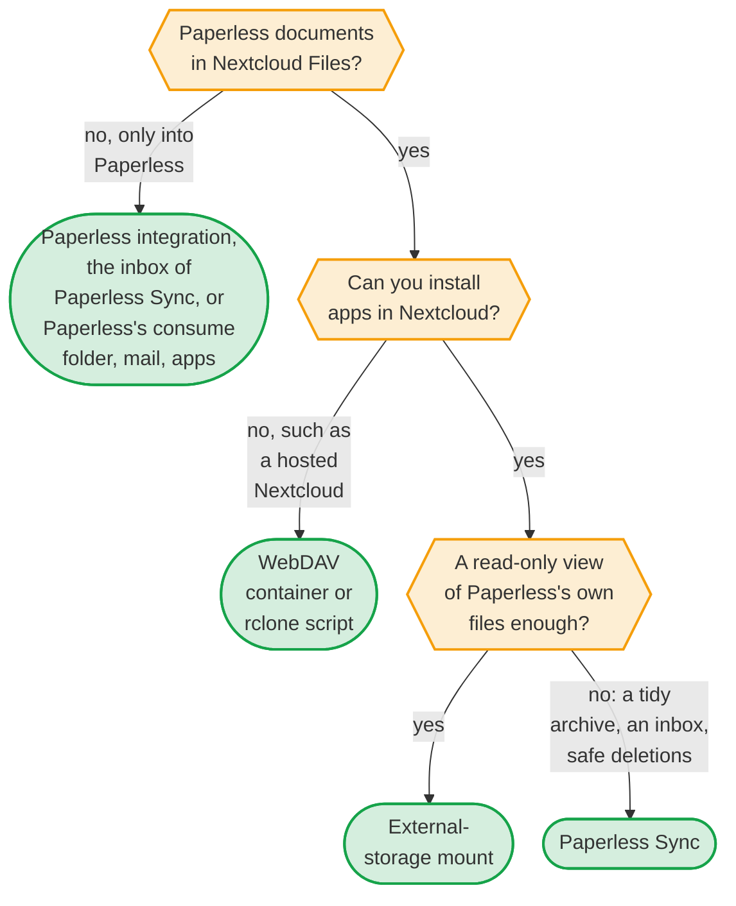
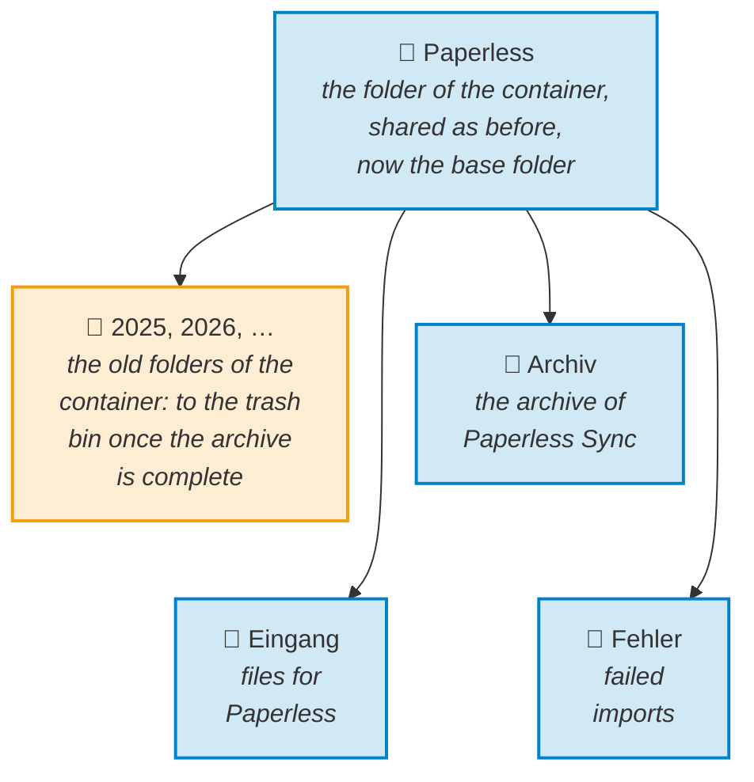

<!-- The comparison as of the date below. When a release of Paperless Sync changes a row
of the table, such as a faster way than the interval or a new way into Paperless, change
the row with it; the sources at the end say where the facts of the others come from. -->

<!-- The title of the front matter is the one that search engines and the browser tab show; the navigation calls the page Compare. -->
<!-- markdownlint-disable-next-line MD025 -->
# Paperless-ngx and Nextcloud: the ways to connect them

[← README](https://github.com/Dennis-Otto/paperless-sync) · [Guide](guide.md) · [Automation](automation.md) · [Architecture](architecture.md)

Paperless-ngx keeps your documents, and Nextcloud is where you work with your files, on the web, on the desktop and on the phone. Six ways bring the two together, and they solve different problems: some bring the documents of Paperless into Nextcloud, some bring files into Paperless, and some go well together. This page compares them as they are in October 2026, helps you choose, and shows how to move to Paperless Sync from a mount of the media folder or from the WebDAV container, without duplicates.

## Which one fits?

## The options at a glance

| | [Paperless Sync](#paperless-sync) | [Paperless integration](#nextclouds-paperless-integration) | [WebDAV container](#the-webdav-container-paperless-nextcloud-sync) | [rclone script](#an-rclone-or-webdav-script) | [Mount](#an-external-storage-mount-of-the-media-folder) | [Paperless itself](#paperlesss-own-ways-in) |
| --- | --- | --- | --- | --- | --- | --- |
| **Direction** | Paperless → Nextcloud, and an inbox folder → Paperless | Nextcloud → Paperless | Paperless → Nextcloud | Paperless → Nextcloud | Paperless's own files, shown in Nextcloud | into Paperless |
| **Runs** | inside Nextcloud, as a background job | inside Nextcloud, when a user clicks | in a privileged container next to Paperless | as a scheduled job on the Paperless server | inside Nextcloud | inside Paperless |
| **Reads Paperless through** | its REST API, with a token | its REST API, with a token | its media folder, read-only | its media folder | its media folder, local or over SMB or SFTP | — |
| **Nextcloud password stored** | none | none | a password or app password of an account | an app password, in `rclone.conf` | none for a local folder | — |
| **Folders** | its own path template: correspondent, type, year or any metadata | — | Paperless's `PAPERLESS_FILENAME_FORMAT` | Paperless's `PAPERLESS_FILENAME_FORMAT` | Paperless's `PAPERLESS_FILENAME_FORMAT` | — |
| **New title or correspondent** | the file is renamed or moved, and keeps its shares, comments and versions | — | followed, as Paperless renames its file | a new upload, the old file deleted | seen at the next scan, as a new file without the shares of the old one | — |
| **Delay** | the interval, 5 minutes by default, once the document has left the Paperless inbox | a click | seconds | the schedule of the job | until Nextcloud scans the folder | — |
| **Document deleted in Paperless** | its copy moves to a folder of its own, and is deleted only when you allow it, after complete scans confirm it | — | deleted at once | deleted at once by `rclone sync` | gone at once | — |
| **Preview of the changes** | a dry run | — | — | `--dry-run` | — | — |
| **Edits in Nextcloud** | stay in the copy until its document changes in Paperless, never reach Paperless | — | overwritten at its next start | overwritten at the next run | change Paperless's own files, unless the mount is read-only | — |
| **Paperless on another server** | yes, over HTTP or HTTPS | yes | needs its media folder | needs its media folder | over SMB or SFTP | — |
| **Users** | one archive of one Nextcloud user, shared with others | every user with a token of their own | one account, shared with others | one account, shared with others | the users and groups of the mount | — |
| **Needs** | Nextcloud 33–35 with system cron, and its admin | a Paperless token for every user | Docker, FUSE and a privileged container | rclone and a scheduler | the app External storage support, with sharing turned on | — |
| **Maintained by** | Dennis Otto, with signed releases | Nextcloud GmbH, "with limited effort" | Flo-R1der | you | Nextcloud | the Paperless-ngx team |

## When to choose what

### Paperless Sync

Choose it when you want the finished documents of Paperless as a tidy archive in Nextcloud, by correspondent, type and year or any path from their metadata, that keeps itself current, and when files from Nextcloud should go to Paperless too. It runs inside Nextcloud: no container, no access to the media folder of Paperless, no Nextcloud password, and Paperless may run on another server. Every copy stays the same file in Nextcloud, with its shares, comments and versions, when its document gets a new title or a new content. A deletion in Paperless never takes a copy with it at once: the copy moves to a folder of its own and is deleted only when you allow it and complete scans of Paperless confirm it. A dry run shows every change before it happens. The [guide](guide.md) has the details.

It is not the right choice when:

- you can't install apps in your Nextcloud, such as a Nextcloud of a provider: the [WebDAV container](#the-webdav-container-paperless-nextcloud-sync) and [rclone](#an-rclone-or-webdav-script) work over WebDAV;
- a document must be in Nextcloud within seconds: a run follows the interval, 5 minutes by default, and Nextcloud's cron, and by default a document comes only once it has left the inbox of Paperless;
- your Nextcloud is older than the versions in the [requirements](guide.md#requirements);
- every user should have an archive of their own Paperless account: one Nextcloud user owns the archive and shares it, and [#84](https://github.com/Dennis-Otto/paperless-sync/issues/84) asks for more;
- a second copy of every document is too much for the disk: the archive is a copy, as PDF/A or the original file.

### Nextcloud's Paperless integration

The app [Paperless integration](https://apps.nextcloud.com/apps/integration_paperless) of Nextcloud GmbH adds the action *Upload to Paperless* to the Files app. Every user enters the address of Paperless and an API token of their own in their personal settings and sends the files they select. It brings nothing from Paperless into Nextcloud, and its README says that it is maintained with limited effort.

Choose it when people with their own Paperless accounts send single files now and then. It goes well with Paperless Sync: the integration sends a file by hand, the inbox of Paperless Sync takes whatever lands in a folder, and Paperless Sync brings the finished documents back.

### The WebDAV container paperless-nextcloud-sync

[paperless-nextcloud-sync](https://github.com/Flo-R1der/paperless-nextcloud-sync) by Flo-R1der is a Docker container next to Paperless. It reads the media folder of Paperless, mounts a folder of Nextcloud over WebDAV with FUSE, for which the container runs privileged, and copies every change within seconds, with a file watcher. The folders are those of `PAPERLESS_FILENAME_FORMAT`. It needs the password or an app password of a Nextcloud account, and a file that leaves the media folder leaves Nextcloud at once; at its start, it also deletes every file of its folder that Paperless doesn't have.

Choose it when you can't install apps in Nextcloud, when your cloud is ownCloud, OpenCloud or another WebDAV service, or when seconds count.

### An rclone or WebDAV script

A scheduled `rclone sync` on the Paperless server copies the media folder to Nextcloud over WebDAV, and so does a script with `rsync` to a WebDAV mount. It is all in your hands: any cloud that rclone knows, any schedule, `--dry-run` for a preview, and `rclone copy` in place of `rclone sync` when nothing should be deleted. The folders are those of `PAPERLESS_FILENAME_FORMAT`, a renamed document is a new upload, and the app password is in `rclone.conf`.

Choose it when you want to write and look after the script yourself.

### An external-storage mount of the media folder

Nextcloud's app External storage support mounts the media folder of Paperless, `documents/archive` or `documents/originals`, as a folder for users and groups: a local folder when both run on one server, or a share over SMB or SFTP. There is no copy, because Nextcloud shows the files of Paperless itself. That is also the catch. Paperless warns that a file moved or renamed by hand in its media folder is reported missing, so mount it read-only. And Nextcloud learns of what Paperless changes only when it scans the folder: when someone opens it, or with `occ files_external:scan` from a cron job. Until then, the desktop clients miss a change deep in the tree, and a file that Paperless renames, for a new title, comes back as a new file, without the shares, tags and comments of the old one. The folders are those of `PAPERLESS_FILENAME_FORMAT`; without it, the files are named by their number, such as `0000123.pdf`.

Choose it when both run on one server, a read-only view is enough, and a second copy would take too much disk space.

### Paperless's own ways in

To get documents into Paperless, Paperless has its consume folder, which takes every file put into it, the mail fetcher, which takes the attachments of mails by rules, the upload in its web interface, and the apps for phones of its community, listed in the [wiki of Paperless-ngx](https://github.com/paperless-ngx/paperless-ngx/wiki/Related-Projects). They go with every option above.

The inbox of Paperless Sync is a consume folder in Nextcloud: a file that reaches it from the desktop or mobile app of Nextcloud, a share or a scanner that saves to Nextcloud goes to Paperless, without a mount of the consume folder, and a failed import lands in an error folder, next to the reason.

### Together

- **Paperless Sync and [Paperless Unified Search](https://github.com/Dennis-Otto/paperless-unified-search)**: the search of Nextcloud finds the text that Paperless recognized in a document and opens its copy in the archive.
- **Paperless Sync and the Paperless integration**: single files by hand with the integration, folders with the inbox of Paperless Sync.
- **Paperless Sync and Paperless's mail fetcher and apps**: a document that reaches Paperless any way appears in Nextcloud with the next run.

## Move to Paperless Sync

Both guides end with one copy of every finished document, in the folders that people know, and the old way switched off. By default, Paperless Sync leaves out the documents that are still in the inbox of Paperless and those with an excluded tag, and every run counts them as skipped; the mount and the container show them, so each guide has a step to decide about them.

### From an external-storage mount

The mount shows the files of Paperless in the folders of `PAPERLESS_FILENAME_FORMAT`. Paperless Sync builds the same folders from the metadata of Paperless, so keep the mount until its archive is complete:

1. **Look up the format.** Find `PAPERLESS_FILENAME_FORMAT` in the configuration of Paperless, such as `docker-compose.env`, and see whether the mount shows `documents/archive`, the PDF/A versions, or `documents/originals`.
2. **Write the path template.** Take the format and translate its placeholders with the table below. End the last part with a space and `[P{{ id }}]{{ extension }}`: every file name of Paperless Sync carries the marker of its document, and Paperless adds the extension on its own. The format `{{ created_year }}/{{ correspondent }}/{{ title }}` becomes the template `{{ created_year }}/{{ correspondent }}/{{ title }} [P{{ id }}]{{ extension }}`.
3. **Set the names of missing values.** Paperless names a missing correspondent or document type `none`, unless `PAPERLESS_FILENAME_FORMAT_REMOVE_NONE` is on. To keep these folders, write `none` into *Missing correspondent* and *Missing document type*.
4. **Choose the file and the folder.** Choose the archive PDF for `documents/archive` or the original file for `documents/originals`. Choose a base folder of the target user outside the mount: never one inside it, where the app would write into the media folder of Paperless.
5. **Start a dry run** and compare its paths with those of the mount. Change the template until they match, as far as the table allows; Paperless replaces some characters, such as `:`, with `-`, Paperless Sync with `_`.
6. **Turn synchronization on.** A run makes at most as many changes as the batch size, 100 by default, so a large archive comes in several runs; for the first export, you may raise the batch size up to 1,000.
7. **Decide about the inbox.** The mount shows every document, also those still in the inbox of Paperless. Paperless Sync leaves them out while *Skip Paperless inbox documents* is on, as it is by default, and also leaves out the documents with one of the *Additional excluded Paperless tags*; every run counts them as skipped. If the users of the mount should keep seeing them, finish them in Paperless, or turn the setting off and remove the tags that they should see from that list.
8. **Share the archive** with the users and groups of the mount, read-only if they shouldn't change the copies, once the status shows a run without errors and a dry run exports nothing more: then the archive holds every document that the settings let in, and the skipped ones are those of step 7.
9. **Remove the mount** under *Administration settings → External storage*. That removes only the mount; the files of Paperless stay as they are.

| `PAPERLESS_FILENAME_FORMAT` | Paperless Sync |
| --- | --- |
| `{{ title }}`, `{{ correspondent }}`, `{{ document_type }}` | the same |
| `{{ created }}`, `{{ created_year }}`, `{{ created_month }}` | the same |
| `{{ added }}`, `{{ added_year }}` | the same |
| `{{ doc_pk }}` | `{{ id }}`, without the leading zeros: `123`, not `0000123` |
| `{{ original_name }}` | `{{ original_filename }}` |
| a document with a [storage path](https://docs.paperless-ngx.com/advanced_usage/#storage-paths), which Paperless files by the template of that path | none yet: `{{ storage_path }}` puts only the name of the storage path in, as one folder |
| `{{ created_day }}`, the names of months, `{{ asn }}`, `{{ tag_list }}`, `{{ owner_username }}`, custom fields and Jinja logic | none yet: use `{{ created }}` for the full date, or leave them out |

### From paperless-nextcloud-sync

The container copies the media folder of Paperless into a folder of a Nextcloud account, which that account has shared with others. Paperless Sync takes that folder over as its base folder, so that every share keeps working, and builds its archive inside. It can't take over the old files in place: every file name of Paperless Sync carries the marker of its document, such as `[P123]`, so no path of the archive is that of an old file, and the old folders go once the archive is complete:

1. **Stop the container** and remove it from the Compose file of Paperless. At every start, it deletes the files of its folder that the media folder of Paperless doesn't have, so it would delete the archive of Paperless Sync. Its folder and its shares stay as they are.
2. **Choose the account and the folder.** In the settings of Paperless Sync, the target user is the account of `WEBDRIVE_USER`, and the base folder is the folder of `WEBDRIVE_URL`, the part after `/remote.php/dav/files/<user>/`, such as `Paperless`.
3. **Write the path template** for the folders of `PAPERLESS_FILENAME_FORMAT`, as in steps 2 and 3 [from a mount](#from-an-external-storage-mount), and choose the archive PDF when the container read `documents/archive`, as its README suggests.
4. **Start a dry run**, then turn synchronization on. The archive grows in `Archiv`, next to the old folders, in as many runs as the batch size needs.
5. **Decide about the inbox**, as in step 7 [from a mount](#from-an-external-storage-mount): the container copied every document, also those that Paperless Sync leaves out: by default those still in the inbox of Paperless, and those with an excluded tag.
6. **Delete the old folders** once the status shows a run without errors and a dry run exports nothing more: everything in the base folder but `Archiv`, `Eingang` and `Fehler`. They go to the trash bin of the account, from where you can restore them, and every document in the archive is left with one copy.
7. **Open the inbox to others**, if they should send files to Paperless: a read-only share of the base folder doesn't let them, so share `Eingang` with them with permission to upload.

## Sources

Checked on 13 October 2026:

- [The Nextcloud App Store](https://apps.nextcloud.com/apps/integration_paperless) and the [repository of the Paperless integration](https://github.com/nextcloud/integration_paperless): version 1.0.14, its action *Upload to Paperless*, the settings of each user and its state of maintenance.
- [The repository of paperless-nextcloud-sync](https://github.com/Flo-R1der/paperless-nextcloud-sync): its README, with a comparison of its own, and its scripts `sync_full.sh` and `sync_live.sh`.
- [File name handling](https://docs.paperless-ngx.com/advanced_usage/#file-name-handling) and [adding documents](https://docs.paperless-ngx.com/usage/#adding-documents-to-paperless-ngx) in the documentation of Paperless-ngx.
- [External storage](https://docs.nextcloud.com/server/latest/admin_manual/configuration_files/external_storage_configuration_gui.html) in the administration manual of Nextcloud, and the documentation of [rclone sync](https://rclone.org/commands/rclone_sync/).

A fact that changed? [Open an issue](https://github.com/Dennis-Otto/paperless-sync/issues/new?template=bug_report.yml) or a pull request, and the page follows.
