# Architecture

[← README](https://github.com/Dennis-Otto/paperless-sync) · [Security design](security.md) · [Roadmap](roadmap.md) · [Releases](releases.md)

Paperless Sync is a Nextcloud app in PHP. It runs inside Nextcloud, reads Paperless-ngx through its REST API and writes files through Nextcloud's file API. It has no server, daemon or port of its own.

## Components

How a run starts, and which systems it reaches:

<picture>
  <source media="(prefers-color-scheme: dark)" srcset="images/diagrams/how-a-run-starts-and-what-it-reaches.dark.svg">
  
</picture>

Where the app keeps its data in Nextcloud:

<picture>
  <source media="(prefers-color-scheme: dark)" srcset="images/diagrams/where-the-app-keeps-its-data.dark.svg">
  
</picture>

| Component | Files | What it does |
| --- | --- | --- |
| Settings page | `lib/Settings/`, `lib/Service/GettingStarted.php`, `templates/settings.php`, `js/settings.js` | The page under *Administration settings → Paperless Sync*: the configuration, a test of the connection, a dry run, a run by hand and the status of the last run. Until the first successful run, a getting-started checklist leads through five steps (connect, owner, dry run, schedule, first run), each done, next or to do as the server stores it, with an estimate of the first synchronization from the documents of the last dry run |
| Controllers | `lib/Controller/` | The routes of the settings page: save, reset, run and status. A dry run runs in the request; a run is queued as a background job, answered with `202 Accepted`. Nextcloud lets only administrators call them and checks the CSRF token of every request, but for the webhook |
| Webhook | `lib/Controller/WebhookController.php`, `lib/Service/WebhookService.php`, `lib/Cron/DocumentSyncJob.php` | The public route that a workflow of Paperless calls with the ID of a document it added or changed, with a secret of its own, whose SHA-256 alone the credentials manager keeps; the run of that document, during the call or as a queued background job, and the last call for the settings page ([decision 0019](decisions/0019-changes-from-paperless-through-its-workflow-webhook.md)) |
| Connection checklist and the account of the app | `lib/Service/ConnectionChecklist.php`, `lib/Service/AccountPermissions.php`, `lib/Service/AccountSetup.php`, `lib/Model/ConnectionCheck.php` | The lines of *Test connection*, of a save that tests and of the setup of the account: the checks of Paperless, of the users in per-user ownership and of the base folder. One table of the permissions that the modules need, which the checklist checks and the setup grants, and the setup itself, which creates or updates the account of the app with the token of a superuser of Paperless, used for its requests alone ([decision 0027](decisions/0027-the-account-of-the-app-from-one-token-of-a-superuser.md)) |
| Configuration | `lib/Service/ConfigService.php`, `lib/Model/SyncConfig.php` | Checks every setting and stores it in the app configuration of Nextcloud; the API token goes to Nextcloud's credentials manager |
| Paperless client | `lib/Service/PaperlessApiService.php`, `lib/Service/PaperlessClientFactory.php`, `lib/Model/PaperlessConnection.php` | Reads documents, their metadata, tags and the trash, downloads files, uploads the files of the inbox and follows their tasks, through Nextcloud's HTTP client, in version 9 of the Paperless API ([decision 0012](decisions/0012-ask-for-version-9-of-the-paperless-api.md)). The factory makes a client for one connection, a URL with its token and whether it may be in the local network; the client never reads the settings, so every request of a run goes where the run started ([decision 0020](decisions/0020-one-connection-to-paperless-for-each-run.md)) |
| Path templates | `lib/Service/PathTemplateService.php` | Turns the metadata of a document into its path, such as `Example GmbH/Invoice/2026/2026-08-26 - Example invoice [P123].pdf`, with every part cleaned for Nextcloud, macOS and Windows |
| Metadata next to the archive | `lib/Service/MetadataSidecars.php` | When the settings ask for it, what Paperless knows of each document, as `.paperless/P123.json` in the archive folder, and the index `.paperless/index.csv`, whose SHA-256 of each sidecar lets a run write only the sidecars whose content changed; a sidecar goes with its copy, under the rules of deletion safety |
| Tags in Nextcloud | `lib/Service/SystemTagService.php`, `lib/Service/ArchiveTags.php` | When the settings ask for it, the tags of each document as collaborative tags of Nextcloud on its copy, visible to every user and assigned by administrators alone: a run adds and removes only the tags that the app made, whose IDs the config of the app keeps, and deletes one whose tag of Paperless is gone once no file has it ([decision 0024](decisions/0024-the-tags-of-paperless-as-tags-of-nextcloud-that-the-app-alone-changes.md)) |
| Ownership | `lib/Service/OwnerMapping.php`, `lib/Model/Owners.php` | In per-user ownership, which user of Nextcloud gets the documents of each user of Paperless: the one of the table of the settings, or else the one with the same ID, whatever its case, within the group of the settings, and the target user for the rest; nothing is guessed, so two users of Paperless for one user of Nextcloud get neither, and their documents stay where their copies are, as do those of the account of the app while an upload waits for its owner. It gives the connection checklist its lines of the users, and the inbox, *Send to Paperless* and a rule of Flow the owner of the documents of their uploads ([decision 0025](decisions/0025-each-user-gets-the-documents-they-own-through-one-account-of-the-app.md)) |
| Storage | `lib/Service/NextcloudStorageService.php`, `lib/Service/UserFilesystem.php` | Creates folders and writes, moves and deletes files below the base folder of the target user, through Nextcloud's file API: a new file next to its path first, an existing one in place. Each change runs in the filesystem of its user, so that what it deletes goes into that user's trash bin, whoever starts the run ([decision 0026](decisions/0026-every-change-of-files-in-the-filesystem-of-their-user.md)) |
| Synchronization | `lib/Service/SyncService.php` | One run: first the inbox, then the export with moves and renames, the trash and the guarded deletion; a lock and the signs of life of a run, which outlast an expired lock, keep two runs apart. The run of one document, which the webhook asks for, takes the way of the export alone, with a batch of one. In per-user ownership, a run reads Paperless once and goes through the inbox and the archive of each user who gets documents, or who has copies that leave, each with a batch, a report, Activity entries and notifications of its own, which the report of the run takes in. It forgets the content of copies, so that the next runs write them again |
| Plans and executors | `lib/Service/ExportPlanner.php`, `lib/Service/ImportPlanner.php`, `lib/Service/ExportExecutor.php`, `lib/Service/ImportExecutor.php`, `lib/Service/InboxFileTypes.php`, `lib/Service/SyncBatch.php`, `lib/Model/Plan/` | What a run does with each document and each file of the inbox, and how: the planners read Paperless, the archive, the inbox and the states, change none of them, and plan one action at a time, such as an export, a move or an upload; the executors make the change of each action, or only report it in a dry-run. The batch counts the places of the changes the same way in both kinds of run ([decision 0022](decisions/0022-a-dry-run-takes-the-plan-of-a-run.md)) |
| State | `lib/Service/SyncStateRepository.php`, `lib/Service/ExportStates.php`, `lib/Migration/` | Three tables in Nextcloud's database: `paperless_sync_export` with the path, the SHA-256 and MD5 checksums, the checksum that Paperless reported for the revision and the missing runs of every exported document, `paperless_sync_import` with every file of the inbox and its Paperless task, or the refusal of Paperless, or the failed attempts and the time of the next one, and `paperless_sync_send` with every file sent from Files whose import has not ended, by its user and file ID |
| Background jobs | `lib/Cron/SyncJob.php`, `lib/Cron/ManualSyncJob.php`, `lib/Cron/DocumentSyncJob.php` | Start a run from Nextcloud's cron: the scheduled one when synchronization is enabled and the configured interval has passed, the queued one of *Synchronize now* once, and the run of a document that the webhook queued |
| Commands | `lib/Command/` | `occ paperless_sync:run`, `paperless_sync:status`, `paperless_sync:forget` and `paperless_sync:create-account`: a run or a dry run in the shell, with a batch size of its own or none, the status of the last run, copies to write again, and the account of the app in Paperless, as text or JSON, with exit codes |
| Status | `lib/Service/StatusService.php`, `lib/Model/SyncReport.php` | The start, the end, the state, the summary, the error and the report of the latest run, the end of the last successful run, and the time of the next scheduled run, and for the getting-started checklist the last completed dry run with its documents and whether the connection checklist last passed with the saved token and URL; the report lists errors and deletions first, each change as a line in English for the command line and as an entry of its kind, document and file, which the settings page shows in the language of the administrator, and every error in English with its record, its text and values, which the settings page translates (`lib/Model/RunError.php`, `lib/Service/StatusTranslation.php`) |
| Activity | `lib/Activity/` | The entries of the target user in Nextcloud's Activity app, with the setting and the filter of the app there: after a run that changed something, one entry with the counts of its changes and the IDs and paths of its first five files, and one entry for each import that Paperless finished, failed or refused. The entries keep IDs and paths; the provider puts them into words in the language of the reader when the Activity app shows them |
| Files | `js/files.js`, `css/files.css`, `lib/Listener/LoadAdditionalScriptsListener.php`, `lib/Controller/FileActionController.php`, `lib/Controller/FolderInfoController.php`, `lib/Service/FileActions.php`, `lib/Service/FolderInfo.php`, `lib/Service/SendService.php`, `lib/Cron/SendJob.php` | *Send to Paperless* and *Open in Paperless* in the menu of Files, a script without a build that registers both in the registry of `@nextcloud/files` 4 ([0023](decisions/0023-file-actions-in-files-without-a-build.md)), and the note above the list of a folder of the app, for which the route `/api/v1/folder-info` names the folders that the user sees ([0033](decisions/0033-a-note-in-files-says-what-a-folder-of-the-app-does.md)). The route `/api/v1/send` checks the group of the setting, that the user may read each file and that none is in the base folder, and queues the files; `SendJob` uploads them with every run of cron, unless Paperless has their content, follows their tasks and notifies the sender of each end |
| Flow | `js/flow.js`, `lib/Listener/FlowListener.php`, `lib/Operation/SendToPaperless.php` | *Send to Paperless* as an operation of Flow for the rules of the administrators, with a form without a build for the tags of a rule, a custom element that Flow shows with the operation of the rule as its attribute `model-value`. The operation checks the tags when Flow saves a rule; on each event of a rule that matches, it queues the file for its owner with the tags of every matching rule, unless the app is not connected or the file is in the base folder, has a marker or waits already, and `SendJob` sends it as one from Files. The owner hears of an import that Paperless refused or that failed, not of one that worked |
| Notifications and health | `lib/Notification/`, `lib/SetupChecks/`, `lib/Controller/StatusApiController.php` | The status counts the runs in a row, not dry-runs, that failed or completed with errors. After the third, or a day after the first, every administrator, or the group of the app setting `notification_group`, gets one notification, which the next success removes; the target user gets one for each import that failed or was refused. Two setup checks of Administration → Overview, whose warnings the settings page shows too, and the admin-only OCS route `/api/v1/status` for monitors report the same health; a new installation, or one after Disconnect, is `unconfigured`, an info note with a link to the settings instead of a green tick |

## Data flow

One run, from the background job to the status:

<picture>
  <source media="(prefers-color-scheme: dark)" srcset="images/diagrams/one-run-of-the-synchronization.dark.svg">
  
</picture>

1. Nextcloud's cron starts the background job every five minutes. It runs only when synchronization is enabled and the configured interval has passed since the last run that synchronized; a dry-run counts only while it is still running. An administrator can start a dry run on the settings page, which runs in the request, and a run, which the page queues as a background job of its own, `ManualSyncJob`, that the next background jobs start; the page follows it through the status. `occ paperless_sync:run` starts a run or a dry run in the shell, with the batch size of the settings, another or none ([decision 0018](decisions/0018-runs-by-hand-in-background-jobs.md)).
2. The run takes a lock, reads its settings and its connection to Paperless together, with one decryption of the API token, checks that the app is configured, and tests the connection to Paperless and the base folder in Nextcloud. It keeps that connection to its end: settings saved during the run reach the next run, as the picture below the steps shows.
3. **Inbox:** the files of the inbox folder are uploaded to Paperless, at most as many as the batch size allows. Each file goes up from a copy in Nextcloud's temporary folder, so that the request has a `Content-Length` also when the file lies on object storage, with the tags of its subfolders and those for every import, which the run looks up once among the tags of Paperless and creates when it may (`lib/Service/InboxTags.php`). Their tasks are followed in the next runs: after success the file is deleted or kept, as configured, and the report names the new document; after a failure, a duplicate or a task that Paperless revoked, it moves to the error folder, next to a text file with the reason and the ID of the task. A task that Paperless has not finished a day after the upload ends by the content of the file: a document with its checksum in Paperless is a success; a task that Paperless still lists, unfinished, moves the file to the error folder, because Paperless-ngx 3.x would import a second upload as a duplicate; a task that Paperless doesn't list sends the file to the wait of a failed upload, after which it goes up again. A file that Paperless refuses at once, with `400`, `413`, `415` or `422`, is remembered with its ETag and skipped until it changes. Any other failure, such as a timeout or a `5xx`, ends the uploads of the run, and the file waits for its next attempt: 15 minutes, doubled after each failure, at most a day.
4. **Export:** every document gets its path from the path template. A new document is downloaded to a temporary file, which goes on to Nextcloud as it is, in chunks; one pass over it computes its SHA-256 and MD5 checksums, so that no document is in memory as a whole. A document with a new revision in Paperless is compared by the checksum that Paperless reports, MD5 up to Paperless-ngx 2.x and SHA-256 since 3.0: when it is one of the saved two, a document whose metadata changed moves to its new path; otherwise the document is downloaded, and its file moves to its new path, if it has one, and gets the new content in place. A copy at the path of a document with its content stays as it is, also when the document comes back from the Paperless trash or after it was missing. A file that an earlier version exported has only its SHA-256 saved; when Paperless reports an MD5, one read of the mirrored file adds it, as long as the file still has that SHA-256. Documents in the Paperless inbox and documents with an excluded tag are skipped, and their mirrored copies removed. Every change takes its place in the batch, also one that fails, and failed exports take their places only among the exports. The most recently added documents come first, documents whose last change failed after the others. Before every write, the app checks the free space, because Nextcloud applies no quota to the temporary file of a write; a full quota, an archive that is no longer writable or an unavailable storage ends the exports and moves of the run at its first failure.
5. **Trash and deletion:** a document in the Paperless trash moves to the deleted folder. A document that is missing from both the API and the trash for the configured number of complete runs in a row moves to the deleted folder too, and is deleted only when permanent and direct deletion are enabled. A scan is complete when every page came back full, with the same count of Paperless, and the run received every document that Paperless listed, read in the order of their IDs; after an incomplete scan, no document counts as missing. Before a complete scan counts a document as missing, the run asks Paperless for that document alone, because pages that shift while the run reads them can leave out one that still exists: only `404` counts, a document that Paperless still has starts its count anew, and an error counts nothing for its document in this run.
6. Empty folders are pruned, the state is saved, and the status records the report. The Activity stream of the target user gets an entry for the changes of the run and one for each import result, also when the run failed after its first changes. A run that failed or completed with errors counts towards the notification of the administrators, and a failed or refused import notifies the target user. A dry run does all of this without writing anything, and adds no entry and no notification.

The connection of a run, from its start to its end:

<picture>
  <source media="(prefers-color-scheme: dark)" srcset="images/diagrams/one-connection-to-paperless-for-the-whole-run.dark.svg">
  
</picture>

### A dry-run takes the plan of a run

A dry-run and a run take one way through the steps 3 to 5: the planners decide what happens to each document and each file of the inbox, and only the executors tell the two apart ([decision 0022](decisions/0022-a-dry-run-takes-the-plan-of-a-run.md)).

<picture>
  <source media="(prefers-color-scheme: dark)" srcset="images/diagrams/how-a-dry-run-and-a-run-share-one-plan.dark.svg">
  
</picture>

- **`ExportPlanner`** plans the export: for each active document whether its copy stays, waits for a later run, or is exported or moved, with the conflicts that stop it; for each document in the trash and each one that Paperless no longer lists whether its copy moves to the deleted folder, is deleted or waits for its missing scans, after it has asked Paperless for each document that a scan would count as missing. When the batch is full, a document with a new path waits without a question to Paperless or a read of its copy; one that keeps its path is still asked once for the checksum of its revision, which its state keeps for a later run.
- **`ImportPlanner`** plans the inbox: how the uploads of earlier runs ended, by their tasks in Paperless, which files go to Paperless next, and which stay aside for their type, by `InboxFileTypes`.
- **`ExportExecutor`** and **`ImportExecutor`** apply each action: a run writes, moves and deletes the files, uploads them and saves the states; a dry-run reports the same lines and changes nothing. An error concerns only its document or file, and the state keeps it, so that the log has it once.
- **`SyncBatch`** holds the places of the changes. The plan is lazy: it plans each document once the executor has applied the one before, so a failed export leaves its place to the next document, and after a full quota the other exports and moves wait for the next run. A dry-run counts each change as if it succeeded, so it shows the batch of a run in which nothing fails.

A new kind of change is a new action of a planner, which its executor applies, or reports in a dry-run; a planner never asks which kind of run it plans. A test runs a dry-run and the run after it for each kind of change and compares their reports.

## Tests

Three kinds of tests check the app: unit tests, which `scripts/check.sh` runs before every push, end-to-end tests in Docker, and mutation tests, which check the unit tests themselves.

<picture>
  <source media="(prefers-color-scheme: dark)" srcset="images/diagrams/the-synchronization-in-the-unit-tests.dark.svg">
  
</picture>

- **Unit tests** in `tests/Unit` run every line of `lib/`; `scripts/check.sh` fails when one runs in no test. The synchronization runs as in Nextcloud, against doubles in memory behind the same interfaces. The doubles are strict, so that a test sees what a mistake of the app would do: the files keep each user apart and record every call with its user, the state keeps each owner apart, Paperless serves an original that differs from the archived version and records every download, every connection that a run takes and every test of it, and Nextcloud's clock stands still until a test sets or advances it, so that no test depends on the time it runs at.
- **End-to-end tests** in `tests/e2e` run the app in every supported version of Nextcloud, in Docker, against a mock of Paperless-ngx ([decision 0005](decisions/0005-end-to-end-tests-where-they-can-fail.md)).
- **Mutation tests** change the code of `lib/` in more than six thousand small ways with [Infection](https://infection.github.io/) and run the unit tests against each change, a mutant. A mutant that no test notices shows a line that the tests run but don't check. The workflow *Mutation* runs them every week, with the configuration of `infection.json5` in the root of the repository, and reports the score, the MSI: the share of the mutants that the tests noticed.

<picture>
  <source media="(prefers-color-scheme: dark)" srcset="images/diagrams/the-mutation-tests.dark.svg">
  
</picture>

| Measured | Mutants | Noticed | Not noticed | MSI |
| --- | ---: | ---: | ---: | ---: |
| 2026-10-14, before [#114](https://github.com/Dennis-Otto/paperless-sync/issues/114) | 2,287 | 2,005 | 282 | 87.7 % |
| 2026-10-14, after [#114](https://github.com/Dennis-Otto/paperless-sync/issues/114) | 2,295 | 2,205 | 90 | 96.1 % |
| 2026-10-24, before [#271](https://github.com/Dennis-Otto/paperless-sync/issues/271) | 6,378 | 5,864 | 514 | 91.9 % |
| 2026-10-25, after [#271](https://github.com/Dennis-Otto/paperless-sync/issues/271), without the 71 equivalent mutants of `infection.json5` | 6,727 | 6,337 | 390 | 94.2 % |

No mutant of the deletion guards of [decision 0004](decisions/0004-delete-only-what-is-confirmed.md) survives, nor one of per-user ownership of [decision 0025](decisions/0025-each-user-gets-the-documents-they-own-through-one-account-of-the-app.md) that would give a document to the wrong user, upload the inbox of a user who gets no documents, or skip the test of the base folder in the run of one document ([#271](https://github.com/Dennis-Otto/paperless-sync/issues/271)). Most of the others change nothing that the app does: a `break` in place of the `continue` at the end of a loop, a cast of a value that is a string already, the default of a key that every row has, or a limit of the wait between uploads that the wait of a day caps anyway. `infection.json5` lists those of per-user ownership, of the inbox and of *Send to Paperless*, each by the line it changes and with the reason, so that a change of the line brings it back; the run shows them as ignored and leaves them out of the score.

The same run on your computer, with PHP 8.3 and the version and checksum of Infection from `.github/workflows/mutation.yml`; the reports go to the ignored folder `build/`, and `--filter=lib/Service/SendService.php` runs the mutants of one file:

```sh
mkdir -p build
curl -fsSL -o build/infection.phar https://github.com/infection/infection/releases/download/0.35.6/infection.phar
echo "3fd4216875260b8e47c48ec1a92473f500d88bd36d8ffec21cc0d24e18d7f0ea  build/infection.phar" | sha256sum --check --strict
php build/infection.phar --threads=max --with-uncovered --no-progress
```

## Design decisions

- **Paperless is the source of truth.** Nextcloud gets a mirror; the app sends no change of the mirrored files back to Paperless.
- **The marker `[P<ID>]`** in every file name ties a file to its document, so a renamed document is found again, and [Paperless Unified Search](https://github.com/Dennis-Otto/paperless-unified-search) can open it. The app adds it to a template that leaves it out, and it shortens only the free text of a name that would be too long, never the marker. A file of the inbox is named by whoever may write there, so it loses every marker on its way to the error folder, where it could otherwise pass for the copy of a document.
- **No WebDAV and no password of Nextcloud.** The app writes through Nextcloud's file API in the name of the target user.
- **Mirrored files keep their identity.** Nextcloud ties shares, public links, comments, tags, favorites and versions to the ID of a file, so the copy of a document stays the same file: a change of the metadata moves it, and a change of the content writes it in place with `File::putContent()`, under Nextcloud's exclusive lock. The versions app keeps the previous content as a version in every run: it looks for the file among the files of the user who is logged in, and a run never runs in the request of a user, since *Synchronize now* queues a background job ([decision 0018](decisions/0018-runs-by-hand-in-background-jobs.md)). Only a new file is written to a temporary `.part` file first and moved into place. The trade-off: on local storage, a write in place that fails halfway, such as on a disk that runs full, leaves the file incomplete until the next run writes it again; the document is complete in a temporary file of the server by then, so the window is as short as a local copy. With the conflict policy *Skip and report conflict*, the app's own copy is no conflict: the state records its path, and the file still has the content of the last download, or the state marks it as being written, so that a copy that a failed write left incomplete is written again. A copy that someone changed stays, also when its document moves to a new path ([decision 0010](decisions/0010-mirrored-files-keep-their-identity.md)).
- **Both checksums of every download.** The database keeps the SHA-256 and the MD5 of every file, so that the checksums of Paperless-ngx 2 and 3 both tell a change of the metadata, which moves the file, from a change of the content ([decision 0009](decisions/0009-checksums-of-paperless-2-and-3.md)).
- **One connection for each run.** A run reads its settings and the API token once, at its start, and reaches Paperless through a client of that connection alone, so a save during the run never mixes two Paperless in one run and the token is decrypted once, not with every request ([decision 0020](decisions/0020-one-connection-to-paperless-for-each-run.md)).
- **Bounded and resumable runs.** The batch size limits the changes of one run, failed ones included, and the state lets the next run continue where it stopped.
- **A dry-run takes the plan of a run.** The planners decide what happens to each document and file and change nothing, and the executors apply each action or, in a dry-run, only report it, so a dry-run shows the changes of the run that follows it ([decision 0022](decisions/0022-a-dry-run-takes-the-plan-of-a-run.md)).
- **A run costs what changed.** A run asks Paperless for the documents with only the fields that it reads, listed in `PaperlessApiService::DOCUMENT_FIELDS`, so their text, notes and permissions stay in Paperless; a test fails when the code reads a field of a document that the list leaves out, such as a new variable of the path template. It asks for the checksum of a document once for each revision: when the batch is full, a document with a new path waits without the request, and the state keeps the checksum with its revision for one that waits at its path or whose change fails. The run reads the state of every export once, at its start, and writes a state only when one of its values changes, so a run over an archive without changes writes nothing to the database. The settings and the status are lazy keys of the app configuration, which Nextcloud loads when the app asks for them, not with every request of every user.
- **Only Paperless confirms a deletion.** A page that came back short or empty, or a list that changed while the run read it, makes no document count as missing, and a complete scan counts a document as missing only after Paperless has answered `404` for it alone ([decision 0004](decisions/0004-delete-only-what-is-confirmed.md)).
- **Safe by default.** Synchronization is off until a configuration works, and permanent deletion is off until an administrator turns it on.
