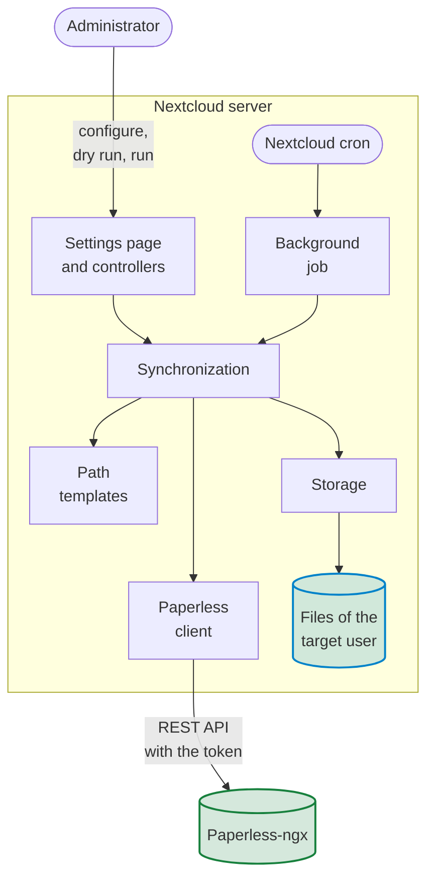
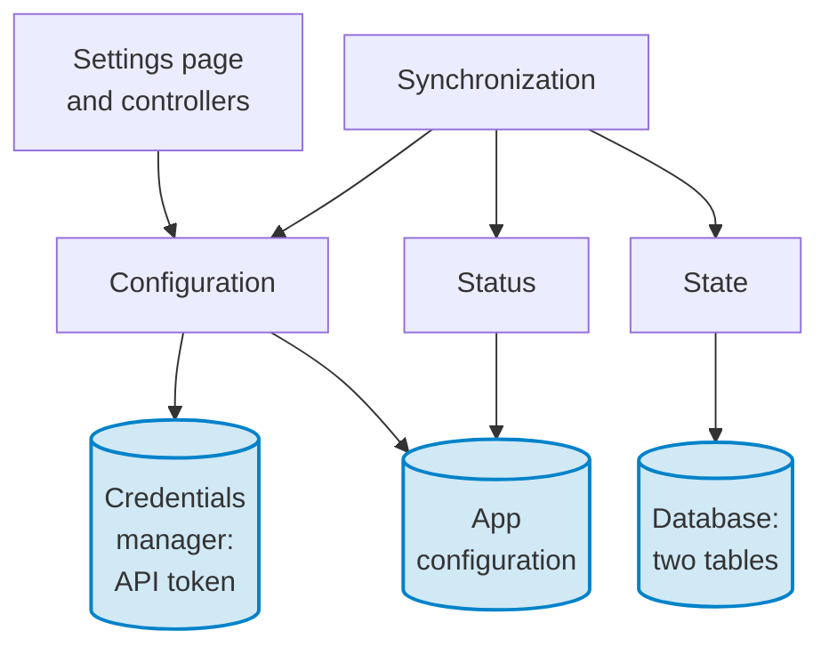
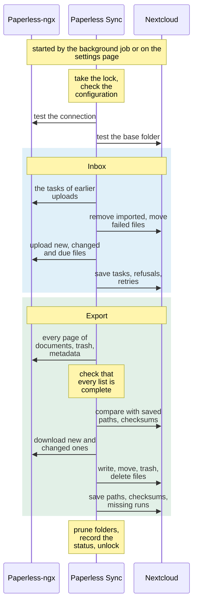

# Architecture

[← README](https://github.com/Dennis-Otto/paperless-sync) · [Security design](security.md) · [Roadmap](roadmap.md) · [Releases](releases.md)

Paperless Sync is a Nextcloud app in PHP. It runs inside Nextcloud, reads Paperless-ngx through its REST API and writes files through Nextcloud's file API. It has no server, daemon or port of its own.

## Components

How a run starts, and which systems it reaches:

Where the app keeps its data in Nextcloud:

| Component | Files | What it does |
| --- | --- | --- |
| Settings page | `lib/Settings/`, `templates/settings.php`, `js/settings.js` | The page under *Administration settings → Paperless Sync*: the configuration, a test of the connection, a dry run, a run by hand and the status of the last run |
| Controllers | `lib/Controller/` | The routes of the settings page: save, reset, run and status. Nextcloud lets only administrators call them and checks the CSRF token of every request |
| Configuration | `lib/Service/ConfigService.php`, `lib/Model/SyncConfig.php` | Checks every setting and stores it in the app configuration of Nextcloud; the API token goes to Nextcloud's credentials manager |
| Paperless client | `lib/Service/PaperlessApiService.php` | Reads documents, their metadata, tags and the trash, downloads files, uploads the files of the inbox and follows their tasks, through Nextcloud's HTTP client |
| Path templates | `lib/Service/PathTemplateService.php` | Turns the metadata of a document into its path, such as `Example GmbH/Invoice/2026/2026-08-26 - Example invoice [P123].pdf`, with every part cleaned for Nextcloud, macOS and Windows |
| Storage | `lib/Service/NextcloudStorageService.php` | Creates folders and writes, moves and deletes files below the base folder of the target user, through Nextcloud's file API |
| Synchronization | `lib/Service/SyncService.php` | One run: first the inbox, then the export with moves and renames, the trash and the guarded deletion; a lock keeps two runs apart |
| State | `lib/Service/SyncStateRepository.php`, `lib/Migration/` | Two tables in Nextcloud's database: `paperless_sync_export` with the path, the SHA-256 and MD5 checksums and the missing runs of every exported document, and `paperless_sync_import` with every file of the inbox and its Paperless task, or the refusal of Paperless, or the failed attempts and the time of the next one |
| Background job | `lib/Cron/SyncJob.php` | Starts a run from Nextcloud's cron when synchronization is enabled and the configured interval has passed |
| Status | `lib/Service/StatusService.php`, `lib/Model/SyncReport.php` | The start, the end, the state, the summary, the error and the report of the latest run, the end of the last successful run, and the time of the next scheduled run; the report lists errors and deletions first |

## Data flow

One run, from the background job to the status:

1. Nextcloud's cron starts the background job every five minutes. It runs only when synchronization is enabled and the configured interval has passed. An administrator can start a run or a dry run on the settings page as well.
2. The run takes a lock, checks that the app is configured, and tests the connection to Paperless and the base folder in Nextcloud.
3. **Inbox:** the files of the inbox folder are uploaded to Paperless, at most as many as the batch size allows. Each file goes up from a copy in Nextcloud's temporary folder, so that the request has a `Content-Length` also when the file lies on object storage. Their tasks are followed in the next runs: after success the file is deleted or kept, as configured; after a failure it moves to the error folder, next to a text file with the reason. A file that Paperless refuses at once, with `400`, `413`, `415` or `422`, is remembered with its ETag and skipped until it changes. Any other failure, such as a timeout or a `5xx`, ends the uploads of the run, and the file waits for its next attempt: 15 minutes, doubled after each failure, at most a day.
4. **Export:** every document gets its path from the path template. A new document is downloaded to a temporary file, which goes on to Nextcloud as it is, in chunks; one pass over it computes its SHA-256 and MD5 checksums, so that no document is in memory as a whole. A document with a new revision in Paperless is compared by the checksum that Paperless reports, MD5 up to Paperless-ngx 2.x and SHA-256 since 3.0: when it is one of the saved two, a document whose metadata changed moves to its new path; otherwise the document is downloaded and written again. A file that an earlier version exported has only its SHA-256 saved; when Paperless reports an MD5, one read of the mirrored file adds it, as long as the file still has that SHA-256. Documents in the Paperless inbox and documents with an excluded tag are skipped, and their mirrored copies removed. Every change takes its place in the batch, also one that fails, and failed exports take their places only among the exports. The most recently added documents come first, documents whose last change failed after the others. Before every write, the app checks the free space, because Nextcloud applies no quota to the temporary file of a write; a full quota, an archive that is no longer writable or an unavailable storage ends the exports and moves of the run at its first failure.
5. **Trash and deletion:** a document in the Paperless trash moves to the deleted folder. A document that is missing from both the API and the trash for the configured number of complete runs in a row moves to the deleted folder too, and is deleted only when permanent and direct deletion are enabled. A scan is complete when every page came back full, with the same count of Paperless, and the run received every document that Paperless listed, read in the order of their IDs; after an incomplete scan, no document counts as missing.
6. Empty folders are pruned, the state is saved, and the status records the report. A dry run does all of this without writing anything.

## Design decisions

- **Paperless is the source of truth.** Nextcloud gets a mirror; the app sends no change of the mirrored files back to Paperless.
- **The marker `[P<ID>]`** in every file name ties a file to its document, so a renamed document is found again, and [Paperless Unified Search](https://github.com/Dennis-Otto/paperless-unified-search) can open it. The app adds it to a template that leaves it out, and it shortens only the free text of a name that would be too long, never the marker.
- **No WebDAV and no password of Nextcloud.** The app writes through Nextcloud's file API in the name of the target user.
- **Both checksums of every download.** The database keeps the SHA-256 and the MD5 of every file, so that the checksums of Paperless-ngx 2 and 3 both tell a change of the metadata, which moves the file, from a change of the content ([decision 0009](decisions/0009-checksums-of-paperless-2-and-3.md)).
- **Bounded and resumable runs.** The batch size limits the changes of one run, failed ones included, and the state lets the next run continue where it stopped.
- **Only complete scans confirm a deletion.** A page that came back short or empty, or a list that changed while the run read it, makes no document count as missing ([decision 0004](decisions/0004-delete-only-what-is-confirmed.md)).
- **Safe by default.** Synchronization is off until a configuration works, and permanent deletion is off until an administrator turns it on.
