# Development

How to build, check and test Paperless Sync, where the pictures and the look of the website come from, and how a change becomes a release. [CONTRIBUTING.md](https://github.com/Dennis-Otto/paperless-sync/blob/main/CONTRIBUTING.md) has the rules for a change: its tests, the sign-off of every commit and the title of its pull request.

<picture>
  <source media="(prefers-color-scheme: dark)" srcset="images/diagrams/the-way-of-a-change-into-a-release.dark.svg">
  
</picture>

## Set-up

You need PHP 8.3+ for the tools (the app itself runs on the PHP that `appinfo/info.xml` names), Composer, Node.js and Docker; the dev container in `.devcontainer/` has them ready, for VS Code and for GitHub Codespaces.

```bash
composer install
bash scripts/check.sh
bash tests/e2e/run.sh
```

`scripts/check.sh` runs the checks of the CI: Composer, `appinfo/info.xml` against the schema of the App Store, PHP syntax, the coding standard, Psalm, PHPUnit, the package that krankerl builds, which `scripts/check-package.sh` compares file by file with the runtime files of the commit ([what the package holds](releases.md#what-the-package-holds)), and the checks of this app alone in `scripts/check-project.sh`: the version of Playwright in the end-to-end tests, the rules of `tests/e2e/affected.sh`, the pipes of the shell scripts, none of which may hand a download to a program, such as `curl … | bash`, which Scorecard would report on `main` as a download that runs without a pinned hash, the icon of the website, the tests of its hook, the versions in the README, the outline of the [German pages](#in-english-and-german), the same description of the app on GitHub, on the website and in `composer.json`, an [area label](automation.md#a-pull-request) for every file of the app and of its unit tests, an explanation for the [PR coach](automation.md#a-pull-request) of every check of this app, the tests of `scripts/check-package.sh`, and the JavaScript and the [translations](#translations). When a check fails, it says what it found and how to fix it, here and on the pull request; a new check of this app comes with its explanation in `.github/checks.project.toml`, with the commands that fix what it finds or the reason why none can, and `tests/coach/test_checks_project.py` fails without one.

## Tests

Unit tests cover path generation, state transitions, export, metadata moves, exclusions, trash handling, guarded deletion, with permanent deletion off and without direct deletion too, incomplete scans of Paperless, the batch size with failing writes, inbox success and failure, dry-run behavior, and release version management. The plans of the export and the inbox have tables of their own, one line for each action, and the tests of the executors and of the synchronization run each kind of change as a dry-run and as a run and compare the two reports ([Architecture](architecture.md#a-dry-run-takes-the-plan-of-a-run)). `scripts/check.sh` fails when a line of `lib/` runs in no test. The doubles of the tests are strict and Nextcloud's clock stands still in them, and mutation tests check every week that the tests notice a change of the code; [Architecture](architecture.md#tests) shows how, with the score and the way to run them on your computer.

`tests/package/test_check_package.sh` tests the check of the release package in a throwaway repository, in a few seconds and without krankerl: the package of a small app passes, packed as krankerl packs it and again as the release workflow packs it after signing, and every package that lacks a runtime file, holds a stray, changed or linked one, or the wrong signature fails with the difference. `scripts/check-project.sh` runs it.

The Docker end-to-end suite mounts this checkout into real Nextcloud containers and uses a deterministic Paperless API mock. It configures the app, runs dry-runs, exports, moves, the trash and its restore, conflicts, documents that vanish, guarded deletion and the inbox, and starts the background job as system cron would. At its end, Chromium checks the settings, the actions of the app in Files and the form of its rule in Flow with axe-core against WCAG 2.1 AA, in the light and the dark theme, at 1280 and at 320 pixels, where the settings must fit without scrolling sideways, and walks the settings with the keyboard alone: every control in the order of the page, with a focus that shows and that the bar of the buttons never covers. `run-all.sh` runs it against the current release of every Nextcloud version from `min-version` to `max-version` in `appinfo/info.xml`, side by side, and the newest of them also on PostgreSQL, and on MariaDB with S3 object storage; `run.sh` runs it against one version, on SQLite by default:

```bash
bash tests/e2e/run-all.sh
bash tests/e2e/run.sh
E2E_DATABASE=mysql E2E_OBJECTSTORE=s3 bash tests/e2e/run.sh
```

CI runs `run-all.sh` on every push to `main`, every night, and in every pull request that can affect the app; a pull request that changes only the documentation, other workflows or the version of a release passes the check at once. PostgreSQL, MariaDB and S3 run in a job of their own, a required check as well, on every push to `main`, every night, and in a pull request that changes the migrations, the state, the files in Nextcloud, the uploads to Paperless or the tests. The contract tests start a real Paperless-ngx instead of the mock, the last release of 2.x or the current release of 3.x, check every answer that the app reads, run the app against it, and record the answers as the fixtures of the unit tests in `tests/fixtures/`; CI runs them every Monday and in every pull request that changes how the app talks to Paperless:

```bash
bash tests/e2e/run-contract.sh 3
CONTRACT_RECORD=1 bash tests/e2e/run-contract.sh 2
```

See [`tests/e2e/README.md`](https://github.com/Dennis-Otto/paperless-sync/blob/main/tests/e2e/README.md) for details and [`tests/e2e/MANUAL_ACCEPTANCE_TESTS.md`](https://github.com/Dennis-Otto/paperless-sync/blob/main/tests/e2e/MANUAL_ACCEPTANCE_TESTS.md) for the release matrix.

## Pictures

The pictures of the documentation and of the App Store come from the same Docker setup, with a synthetic household archive, once with Nextcloud in English, for `docs/images/` and `screenshots/`, and once in German, for `docs/images/de/`, which the German pages show; take them anew after a change of the interface:

```bash
bash tests/e2e/screenshots.sh        # English and German
bash tests/e2e/screenshots.sh de     # German only
```

You rarely need to: two runs draw the same pixels, since the pictures show a frozen story, with the moments of its runs, an example secret of the webhook and fixed data instead of the clock, and bots keep them current. A pull request that changes the app or the story, any file of `.github/screenshots-paths.txt`, gets the *Visual check*: it renders the pictures of both languages side by side and comments with every picture that looks different and the share of its changed pixels, and its artifact holds each one before and after, with the changed pixels in red. It only reports. After the merge, after every release and every week, the screenshot bot renders the pictures of `main` with `scripts/screenshots.sh`, and when pixels changed, it opens *docs: update the screenshots*, which merges itself once every check passes. The section *The screenshot bot and the visual check* of [tests/e2e/README.md](https://github.com/Dennis-Otto/paperless-sync/blob/main/tests/e2e/README.md) has the details.

<picture>
  <source media="(prefers-color-scheme: dark)" srcset="images/diagrams/how-the-pictures-stay-current.dark.svg">
  
</picture>

## The README and the website

The first screen of the README shows the version in the App Store and the versions of Nextcloud in badges that read `appinfo/info.xml` on `main`, so that they follow every release and every raise of `max-version` by the upstream bot without an edit. `scripts/check-project.sh` fails when one of them reads anything else, and when a version in the text of the README, of the home page or of the [comparison](alternatives.md), such as `<span data-app="nextcloud">33–35</span>`, names another lowest version or more than `appinfo/info.xml`; text that still names a lower `max-version` after the upstream bot raised it only gets a note, so that the pull request of the bot passes on its own.

The [website](index.md) takes its look from the app. The icon of the app is its logo, its favicon and the logo of its preview cards, from a copy in `docs/images/app.svg` that `scripts/check-project.sh` keeps equal to `img/app.svg`. `docs/stylesheets/brand.css` holds the colors of the icon, in shades that pass WCAG AA in the light and the dark palette. A link to the home page shows the social preview of the repository, `.github/social-preview.png`, which `bash scripts/social-preview.sh` renders from `.github/social-preview.html`. The versions of Nextcloud and PHP on the website come from `appinfo/info.xml` through the hook `.github/mkdocs_project.py`, which writes them into the fields such as `<span data-app="php">8.2+</span>` of every page, those of the requirements that the guide takes from the README included; GitHub shows the text of the fields as written:

<picture>
  <source media="(prefers-color-scheme: dark)" srcset="images/diagrams/where-the-website-of-paperless-sync-takes-its-look-from.dark.svg">
  
</picture>

The same hook shows an alert of GitHub, a quote that begins with `[!NOTE]`, `[!TIP]`, `[!IMPORTANT]`, `[!WARNING]` or `[!CAUTION]`, as an admonition of the website. So a page, or a part of the README that the website takes by a snippet, writes an alert once for both, such as the warning about edits of the archive in the [conflict policy](guide.md#conflict-policy).

The App Store links the documentation that `<documentation>` in `appinfo/info.xml` names: [Using the archive](use.md) for the people who use the archive, and the guide for administrators. The App Store takes them from the release, so after the build `scripts/check-site.sh`, which the check *docs* runs with the folder of the website, fails when an address of the website in `info.xml` leads to no page, or to no element with the id of its anchor; run it yourself with `bash scripts/check-site.sh site` after `mkdocs build`.

### In English and German

The README and the pages that administrators and the people who use the archive read first have a German twin: `README.de.md`, and `docs/index.de.md`, `docs/guide.de.md`, `docs/use.de.md`, `docs/faq.de.md` and `docs/troubleshooting.de.md` next to their English pages. A language switch leads between the READMEs, and on the website, which MkDocs builds in English and, with the plugin `i18n` of `mkdocs.yml`, in German in `de/`, the switch in the header keeps the page; a page without a German twin shows in English there. The German guide takes its snippets from `README.de.md`, as the English one from `README.md`, and a German page shows the German diagrams, `docs/diagrams/NAME.de.mmd` for `NAME.mmd`, in the words of the settings page in German, from `l10n/de.json`.

<picture>
  <source media="(prefers-color-scheme: dark)" srcset="images/diagrams/how-the-german-documentation-stays-in-step.dark.svg">
  
</picture>

So a change of an English page changes its German twin in the same pull request. `scripts/check-project.sh` fails when the two part: it compares their outlines, the headings with their levels, the snippet markers and includes, and the diagrams, in order, and names the first entry where they part, with the line in both files. Run it alone with `bash scripts/check-project.sh`. The hook `.github/mkdocs_project.py` titles an alert of a German page in German, such as *Warnung*, and leads the path of a picture of HTML, such as a screenshot, to its file from the German pages in `de/` and from the snippets of the README alike. An English page that links to a heading of a German twin, such as `guide.md#requirements`, finds it on the German website through an anchor above the German heading, `<a id="requirements"></a>`, and `mkdocs build --strict` names one that is missing. The same anchors let the *Help* links of the settings and the links of the setup checks open the German guide for an administrator whose Nextcloud speaks German (`AppConstants::guide`): each part that the app links to has its English anchor above its German heading, such as `<a id="being-notified"></a>`, which `tests/Unit/Settings/AdminSettingsTest.php` checks. The German pages and `README.de.md` show the screenshots of the German interface, from `docs/images/de/`, which `bash tests/e2e/screenshots.sh de` takes, and the English pages those of the English interface.

## Code

The app ID is `paperless_sync` and the PHP namespace is `OCA\PaperlessSync`. Psalm analyzes the PHP code, CodeQL scans the JavaScript, and the SBOM workflow continuously inventories dependencies. The [architecture](architecture.md) describes the parts of the app, and the [decisions](decisions/README.md) why it works as it does.

## Translations

Paperless Sync speaks English and German. The settings page, its messages and the connection checklist follow the language that Nextcloud has for the administrator, the Activity stream that of the target user, and the times on the page the locale of the personal settings. The German texts are in `l10n/de.json`, which PHP reads, and in its copy `l10n/de.js` for the browser.

`node scripts/check-l10n.mjs`, which `scripts/check-project.sh` runs, compares them with the code, so that no message stays English on a German page:

<picture>
  <source media="(prefers-color-scheme: dark)" srcset="images/diagrams/what-the-check-of-the-translations-finds.dark.svg">
  t() and ->n() in templates and lib, and the texts that lib translates later, of a ConnectionCheck, an InvalidSettingException and the errors that a run keeps, with the constants that they name. It compares them with the German catalog l10n/de.json. A text that the catalog lacks, or a German text with other placeholders than its English one, fails the check with the place in the code; it needs German words. A text that no code translates, a text twice, or an l10n/de.js that differs from l10n/de.json fails as well, and node scripts/check-l10n.mjs --fix drops the text and writes l10n/de.js anew. Otherwise the check passes.">
</picture>

- **A text that the code translates** is the first argument of `translate()` and `translatePlural()` in `js/`, of `$l->t()` and `$l->n()` in `templates/` and `lib/`, and a text that `lib/` translates later, when it knows the language of the reader: the message and the hint of a `ConnectionCheck`, the text of an `InvalidSettingException`, and the text of an error that a run keeps, a `RunError`, a `RunException` or a `FullStorageException`. Write it as a string at that place, or as a class constant that the call names, such as `self::STATUS_HINT`, never as a variable: the check can't read it, so it fails with the file and the line, and `--fix` then changes nothing, instead of dropping the German words of a text that looks unused.
- **A missing text** fails with its file and line, and **a German text whose placeholders differ** from those of its English one, `{name}` in JavaScript, `%s` or `%1$s` in PHP, `%n` in a plural, fails with both texts: PHP stops at a placeholder without its value, and one that is missing loses it.
- **A text that no code translates any more, a text twice and an `l10n/de.js` that differs** fail as well; `node scripts/check-l10n.mjs --fix` removes them and writes `l10n/de.js` from `l10n/de.json`.

A new text is English in the code; add it with its German words to `l10n/de.json`, in the terms of the settings page, such as *Basisordner* for *Base folder*, and run `node scripts/check-l10n.mjs --fix`. A message about a setting names it by its label in quotes, and an `InvalidSettingException` names the setting as well, so that the page moves the focus there.

A run, also a scheduled one, has no reader when it writes its errors, so it keeps each in English, as the log, `occ paperless_sync:status` and the status API show it, together with its record: the English text with `%s` or `%1$s` for its values, the values and the setting that it names. The settings page translates the records when it reads the status, through `StatusTranslation`: in the status that it opens with (`AdminSettings::getForm()`), in that of `SyncController::status()` and in the answer of a dry-run. Write an error of a run as `new RunError('Tags P%1$s: %2$s', [(string)$id, RunError::of($exception)])`, never by joining strings: `RunError::of()` keeps the text of an exception that the app wrote, such as an `InvalidSettingException`, and takes the message of Paperless or of Nextcloud as it came, which no translation changes. A status of an earlier version, which kept the English text alone, shows as it is. The unit tests read the German of `l10n/de.json` through `tests/Doubles/GermanTranslations.php`, and fail on a text that it lacks.

## Release process

The protected `main` branch requires the checks of the CI, the Docker end-to-end tests against every supported Nextcloud version, the dependency review, CodeQL, the secret scan, the licenses of every file (REUSE), the sign-off of every commit and a Conventional Commit title. Renovate keeps the dependencies, the actions and the images current, and Dependabot the Features of the dev container; routine updates merge on their own once every check passes. [Automation](automation.md) shows every workflow and bot, and when it runs.

The release bot keeps a pull request for the next release. Its version follows from the titles of the merged pull requests, and what they wrote under *Unreleased* in `CHANGELOG.md` becomes its notes. Merging it publishes the release: the package, checked before and after signing with the app's certificate, its detached signature, an SPDX SBOM and signed build provenance, then the same package in the Nextcloud App Store, verified afterwards as users can verify it. See [the release guide](releases.md).

Project decisions and support expectations are documented in [GOVERNANCE.md](https://github.com/Dennis-Otto/paperless-sync/blob/main/GOVERNANCE.md), [SUPPORT.md](https://github.com/Dennis-Otto/paperless-sync/blob/main/SUPPORT.md), and [CODE_OF_CONDUCT.md](https://github.com/Dennis-Otto/paperless-sync/blob/main/CODE_OF_CONDUCT.md).
