# FAQ

[← README](https://github.com/Dennis-Otto/paperless-sync/blob/main/README.de.md) · [Anleitung](guide.de.md) · [Fehlerbehebung](troubleshooting.de.md)

Die Fragen, die aufkommen, wenn Paperless Sync auf ein echtes Archiv trifft, mit kurzen Antworten und Links zu den Einzelheiten. Eine Fehlermeldung oder ein Lauf, der scheitert, ist ein Fall für die [Fehlerbehebung](troubleshooting.de.md).

## Paperless und deine Dokumente

### Ändert Paperless Sync jemals etwas in Paperless?

An keinem Dokument, das schon da ist. Die App liest die Dokumente, ihre Dateien und Prüfsummen, den Papierkorb, die Tags, Korrespondenten, Dokumenttypen und Speicherpfade, und sie bearbeitet, taggt, verschiebt oder löscht nie ein Dokument von Paperless. Sie schreibt nur beim Hochladen der Dateien des Eingangsordners, jede als neues Dokument mit den Tags, die du für sie gewählt hast, und, mit *Fehlende Tags anlegen*, einen neuen Tag für einen Namen, den Paperless nicht hat; sie liest die Aufgabe von Paperless, die jedem Hochladen folgt. Ist der Eingang aus, braucht das Konto der App keine Berechtigung über das Anzeigen hinaus.

### Erreichen meine Änderungen in Nextcloud Paperless?

Nein. Paperless ist die Quelle des Archivs, und die App schickt nichts daraus zurück: keine Bearbeitung, keine Umbenennung, keine Löschung. Eine Synchronisation in beide Richtungen ist [nicht geplant](roadmap.md#not-planned). Der einzige Weg nach Paperless ist der Eingangsordner, dessen Dateien zu neuen Dokumenten werden.

### Was braucht das Paperless-Konto der App?

Ein eigenes Konto mit einem API-Token, das die zu spiegelnden Dokumente anzeigen und herunterladen kann; gehören sie ihm auch, erreicht ihr Papierkorb den Gelöscht-Ordner sofort. Der Eingang braucht zusätzlich die Berechtigungen `documents.add_document` und `documents.view_paperlesstask`, und seine Tags `documents.view_tag`, mit `documents.add_tag`, um die fehlenden anzulegen; das Konto findet nur Tags ohne Eigentümer, seine eigenen und die, die mit ihm geteilt sind, also teile vorhandene Tags zuerst mit ihm. **Verbindung testen** in den Einstellungen prüft jede Berechtigung und nennt jede, die dem Konto fehlt; mit **Anzeigen** für UI-Einstellungen zählt es auch die Dokumente, die das Konto sieht, die ihm aber nicht gehören. Nimm keinen Superuser: Er sähe den ganzen Papierkorb, aber sein Token beherrscht ganz Paperless. Die [Anleitung](guide.de.md#paperless-verbindung) zeigt, wie du das Konto zum Eigentümer machst, ohne den Menschen, denen die Dokumente jetzt gehören, den Zugriff zu nehmen, und das [Sicherheitsdesign](security.md) erklärt, warum ein eigenes Konto.

## Das Archiv in Nextcloud

### Was passiert, wenn ich eine gespiegelte Datei bearbeite?

Die Dateien des Archivs sind ein Spiegel von Paperless und mit Absicht nur zum Lesen da. Eine Bearbeitung bleibt, solange ihr Dokument in Paperless gleich bleibt. Ändert sich das Dokument dort, kann ein Lauf die Datei neu aus Paperless schreiben, je nach Änderung, und die [Dateikonflikt-Regel](guide.de.md#dateikonflikt-regel) entscheidet über deine Bearbeitung:

- **Synchronisierte Datei ersetzen**, der Standard: Der Lauf schreibt den Inhalt von Paperless in dieselbe Datei, sodass ihre Freigaben und Versionen bleiben. Deine Bearbeitung bleibt als frühere Version erhalten, unter *Versionen* in den Details der Datei, in jedem Lauf: *Jetzt synchronisieren* läuft als Hintergrundjob, wie ein geplanter Lauf.
- **Überspringen und Konflikt melden:** Deine Bearbeitung bleibt, und jeder Lauf meldet einen Konflikt für das Dokument, bis du die Datei löschst oder verschiebst; solange bleibt die Kopie veraltet. Eine Kopie, die niemand bearbeitet hat, ist kein Konflikt, und der Lauf aktualisiert sie.

Eine Kopie, die du umbenennst oder verschiebst, bleibt, wo du sie hingelegt hast, als eigene Datei, und der nächste Lauf schreibt das Dokument neu an seinen Pfad; eine, die du löschst, kommt auf dieselbe Weise zurück. Um eine eigene Fassung zu behalten, kopiere die Datei aus dem Archiv heraus, und bearbeite Dokumente in Paperless.

### Wohin gehen gelöschte Dateien?

Das hängt davon ab, was sie löscht:

| Was geschieht | Wohin die Kopie geht |
| --- | --- |
| Das Dokument kommt in den Papierkorb von Paperless | In den Gelöscht-Ordner, unterhalb des Datums des Papierkorbs in der Zeitzone des Zielbenutzers, etwa `_Gelöscht/2026-08-27/Beispiel GmbH/Rechnung/2026/…`, oder es bleibt mit dem Papierkorb-Verhalten *Archivdatei am Ort behalten* im Archiv |
| Es wird in Paperless wiederhergestellt | Zurück ins Archiv |
| Es wird in Paperless endgültig gelöscht | Nach der eingestellten Zahl vollständiger Scans in Nextcloud gelöscht, nur wenn *Nextcloud-Kopie löschen, nachdem Paperless das Dokument endgültig gelöscht hat* an ist; sonst bleibt es im Gelöscht-Ordner |
| Es bekommt einen ausgeschlossenen Tag oder wieder den Posteingangs-Tag | Im nächsten Lauf in Nextcloud gelöscht |
| Es verliert seinen letzten [Tag zum Spiegeln](guide.de.md#welche-dokumente-das-archiv-spiegelt) | Im nächsten Lauf in Nextcloud gelöscht |
| Du löschst es in Nextcloud | In deinen Papierkorb, und der nächste Lauf schreibt es neu |
| Eine Datei des Eingangs nach ihrem Import | In Nextcloud gelöscht, wenn *Quelldatei nach erfolgreichem Import entfernen* an ist |

Jede Kopie, die die App in Nextcloud löscht, und jeder Ordner, den sie leert, nimmt diesen Weg:

<picture>
  <source media="(prefers-color-scheme: dark)" srcset="images/diagrams/where-a-copy-goes-that-paperless-sync-deletes.de.dark.svg">
  
</picture>

Nur der Zielbenutzer sieht diesen Papierkorb, unter *Gelöschte Dateien* in *Dateien*; mit Eigentum je Benutzer hat jeder Benutzer die Kopien seiner eigenen Dokumente in seinem. Nextcloud leert ihn nach seiner Aufbewahrungszeit, standardmäßig 30 Tage, oder früher, wenn das Kontingent des Benutzers den Platz braucht. Die [Löschsicherheit](guide.de.md#löschsicherheit) beschreibt, wann die App überhaupt löscht.

### Kann ich die Pfadvorlage später ändern?

Ja. Die nächsten Läufe verschieben jede Datei an den Pfad der neuen Vorlage, im Rahmen der Batchgröße, ohne sie erneut herunterzuladen, also zeigt ein großes Archiv eine Weile das alte und das neue Schema nebeneinander: 5.000 Dokumente brauchen mit einem Batch von 100 50 Läufe. Die Vorschau unter der Vorlage zeigt die neuen Pfade der neuesten Dokumente, während du tippst, und ein Testlauf vor dem Speichern probiert die neue Vorlage aus und listet eine Verschiebung für jede Datei auf. Die App entfernt die Ordner, die die Verschiebungen leer hinterlassen, wenn *Leere Ordner nach Verschiebungen und Löschungen entfernen* an ist. Ein neuer Archiv- oder Basisordner verschiebt die Dateien des Archivs ebenfalls, aber nicht die Kopien im Gelöscht-Ordner, und die alten Ordner bleiben zurück; entferne sie, sobald die Verschiebungen fertig sind. Teile den Archivordner, den die Vorlage nicht ändert, statt der Ordner, die sie bildet: Ein Ordner, den eine Verschiebung leert, verschwindet mit seinen Freigaben. Eine Freigabe des Basisordners würde auch den Eingangs- und den Fehlerordner einschließen.

### Können mehrere Benutzer das Archiv sehen?

Ja, über Nextcloud: Der Zielbenutzer teilt den Ordner des Archivs mit ihnen oder mit einer Gruppe von ihnen, wie es [Entscheidung 0002](decisions/0002-the-filesystem-api-of-nextcloud.md) vorsieht. Teile es nur zum Lesen, da nichts von dort zu Paperless zurückgeht und ein Lauf eine bearbeitete Kopie ersetzen oder eine gelöschte neu schreiben kann; teile den Eingangsordner nur mit denen, die Dokumente an Paperless schicken dürfen. Mit dem [Eigentum je Benutzer](guide.de.md#eigentum-je-benutzer) erhält stattdessen jeder Benutzer ein eigenes Archiv, mit den Dokumenten, die seinem Benutzer von Paperless gehören.

### Kann ich die Kopien nach ihren Tags finden?

Ja, mit den [Tags in Nextcloud](guide.de.md#tags-in-nextcloud). Jede Kopie trägt dann die Tags ihres Dokuments als kollaborative Tags von Nextcloud, also filtert Dateien das Archiv nach ihnen, in seiner Ansicht *Schlagworte*, und die Suche von Nextcloud findet die Kopien nach ihnen; alle, die eine Kopie öffnen können, auch über eine Freigabe, sehen ihre Tags. Die Namen der Tags selbst sehen alle Benutzer von Nextcloud, auch die, die das Archiv nicht öffnen können, also schalte die Einstellung nur ein, wenn die Namen deiner Tags in Paperless für alle sichtbar sein dürfen. Sie folgen jeder Änderung in Paperless mit dem nächsten Lauf, auch der eines Dokuments, dessen Kopie bleibt, wie sie ist, und nur Administratoren können sie zuweisen, damit niemand sie versehentlich an eine Kopie hängt. Die Tags, die Leute in Nextcloud anlegen, bleiben ihre, auch an den Kopien: Die Läufe ändern oder entfernen sie nie.

### Kann jeder Benutzer seine eigenen Dokumente erhalten?

Ja, wenn die Dokumente deines Paperless Eigentümer haben: Stelle *Wer die Dokumente erhält* auf *Jeder Benutzer, die ihm in Paperless gehören*. Jeder Benutzer von Nextcloud erhält dann die Dokumente des Benutzers von Paperless mit derselben ID, gleich in welcher Schreibung, wie Single Sign-on sie vergibt, oder des Benutzers, den die Tabelle *Paperless-Benutzer mit einer anderen Nextcloud-ID* nennt, in seinen eigenen Dateien; die Dateien seines Eingangs werden in Paperless seine, und der Zielbenutzer erhält nur die Dokumente, die sonst niemand erhält. Ein Administrator verbindet Paperless weiterhin mit einem Token, dessen Konto die Dokumente jedes Benutzers sehen muss. [Eigentum je Benutzer](guide.de.md#eigentum-je-benutzer) hat die Einzelheiten.

### Kann ich den Zielbenutzer ändern?

Ja, aber die App merkt sich, was sie für jeden Zielbenutzer geschrieben hat. Ein anderer Zielbenutzer beginnt ein neues Archiv, das die Läufe neu aus Paperless schreiben, und das Archiv des vorigen Benutzers bleibt, wie es ist, ohne weitere Aktualisierung. Um ein Archiv einem anderen Benutzer zu geben, teile es stattdessen mit ihm, oder lösche das alte, sobald das neue vollständig ist.

### Zählt das Archiv zu einem Kontingent?

Ja, die Dateien gehören dem Zielbenutzer, also gilt das Kontingent dieses Benutzers. Ist es voll, hört der Lauf beim ersten Fehler auf zu schreiben und zeigt einen Hinweis, dass Nextcloud keine Dateien im Archiv speichern kann (`EXPORT STOPPED` auf der Kommandozeile); er macht weiter, sobald wieder Platz ist.

### Funktioniert es mit Objektspeicher wie S3?

Ja. Die App schreibt über die Datei-API von Nextcloud, die verbirgt, wo die Dateien liegen, also verwenden das Archiv und der Eingang den primären Speicher von Nextcloud, lokal oder Objektspeicher wie S3, wie jede andere Datei. Version 0.1.10 hat das Hochladen von Dateien des Eingangs aus Objektspeicher repariert, und [#93](https://github.com/Dennis-Otto/paperless-sync/issues/93) verfolgt, S3 in die End-to-End-Tests aufzunehmen.

## Einrichtung und Betrieb

### Wie lange dauert die erste Synchronisation?

Etwa die Zahl der Dokumente geteilt durch die Batchgröße, mal das Intervall: Mit den Standardwerten, einem Batch von 100 und 5 Minuten, brauchen 5.000 Dokumente 50 Läufe, vier Stunden oder mehr. Ein größerer Batch, bis zu 1.000, macht es schneller; dann lädt jeder Lauf mehr auf einmal herunter. Jeder Lauf nimmt die Dokumente, die Paperless zuletzt hinzugefügt hat, zuerst, sodass neue Dokumente nicht hinter dem Rückstau warten, und sein Bericht zählt die Dokumente, die auf den nächsten Lauf warten, als übersprungen. Jeder spätere Lauf ändert nur, was sich in Paperless geändert hat.

Um ein großes Archiv in einem Zug zu importieren, lass die geplante Synchronisation aus und führe auf dem Server `occ paperless_sync:run --unlimited` aus: Es macht jede fällige Änderung, so lange es dauert, und die [Kommandozeile](guide.de.md#kommandozeile) erklärt den Rest.

### Wie oft läuft es?

Im Intervall der Einstellungen, standardmäßig 5 Minuten und höchstens ein Tag, als Hintergrundjob von Nextcloud. Nextcloud startet diesen Job höchstens alle fünf Minuten und nur, wenn sein System-Cron läuft, also beträgt das Intervall mindestens fünf Minuten. Ein Lauf, der noch beschäftigt ist, hält den nächsten zurück. *Jetzt synchronisieren* reiht einen Lauf ein, den die nächsten Hintergrundjobs starten, innerhalb von fünf Minuten oder sofort mit einem Worker für ihn ([Hintergrundjobs](guide.de.md#hintergrundjobs)), und das Intervall zählt dann ab ihm; `occ paperless_sync:run` führt sofort einen in der Shell aus. Mit dem [Webhook](guide.de.md#änderungen-in-sekunden) bringt ein Arbeitsablauf von Paperless jedes neue oder geänderte Dokument in Sekunden, zwischen den Läufen. Ein Testlauf zeigt, was ein Lauf ändern würde, ohne es zu ändern, und verschiebt den nächsten Lauf nicht. Einstellungen, die du speicherst, während ein Lauf beschäftigt ist, gelten ab dem nächsten Lauf: Der laufende Lauf endet mit den Einstellungen und dem Paperless, mit denen er begonnen hat.

### Kann eine Änderung Nextcloud in Sekunden erreichen?

Ja, mit einem Arbeitsablauf von Paperless, der bei *Dokument hinzugefügt* und *Dokument aktualisiert* den Webhook der App aufruft: Die Kopie des Dokuments ändert sich dann in Sekunden, nach denselben Regeln wie in einem Lauf, ohne einen Container neben Paperless, seinen Medienordner oder ein Passwort von Nextcloud. Abschnitt 6 der Einstellungen hat die Adresse und das Geheimnis, und [Änderungen in Sekunden](guide.de.md#änderungen-in-sekunden) die Schritte in Paperless. Dokumente im Papierkorb und gelöschte warten weiter auf die geplanten Läufe, die die fehlenden Scans zählen, die die Löschsicherheit verlangt.

### Gibt es eine Kommandozeile?

Ja: `occ paperless_sync:run`, `occ paperless_sync:status` und `occ paperless_sync:forget`, mit JSON-Ausgabe und Exit-Codes für Skripte und Überwachung. Die [Kommandozeile](guide.de.md#kommandozeile) beschreibt sie.

### Kann ich mehrere Paperless-Instanzen verbinden?

Nein, ein Nextcloud-Server verbindet sich mit einem Paperless, mit einem Zielbenutzer, oder mit dem [Eigentum je Benutzer](guide.de.md#eigentum-je-benutzer) einem Archiv für jeden Benutzer. Ob sich mehr lohnen, ist eine Frage für einen [Funktionswunsch](https://github.com/Dennis-Otto/paperless-sync/issues/new?template=feature_request.yml).

### Funktioniert Paperless unter einem Unterpfad oder hinter einem Reverse Proxy?

Ja. Gib die Adresse ein, unter der du Paperless im Browser öffnest, mit seinem Unterpfad, etwa `https://example.com/paperless`. Der Proxy muss die Anfragen an `/api/` mit ihrem Token durchreichen, ohne eigene Anmeldung, und Uploads annehmen, die so groß sind wie die Dateien des Eingangs. Die [Fehlerbehebung](troubleshooting.de.md#hinter-einem-reverse-proxy) hat die Einzelheiten.

### Funktioniert Paperless in Docker oder in meinem Heimnetz?

Ja, mit der Einstellung **Paperless läuft in meinem lokalen Netzwerk**, die die Adresse von Paperless nur für die Anfragen dieser App erlaubt, ohne den Schutz von Nextcloud gegen Server-Side Request Forgery für alles andere abzuschalten. Die [Anleitung](guide.de.md#paperless-im-lokalen-netzwerk) erklärt sie.

## Andere Apps und Entfernen

### Wie hängt es mit Paperless Unified Search zusammen?

[Paperless Unified Search](https://github.com/Dennis-Otto/paperless-unified-search) ist eine eigene App desselben Autors, die die Volltextsuche von Paperless in die Suche von Nextcloud bringt und ein Ergebnis in der Datei des Archivs öffnet. Sie findet ein Dokument für einen Benutzer, der seine Datei öffnen kann, über die Markierung `[P123]` im Namen, also entscheiden die Freigaben des Archivs, wer was findet. Paperless Sync funktioniert ohne sie, und es schreibt die Dateien mit den Markierungen, nach denen Paperless Unified Search sucht.

### Überlebt mein Archiv Paperless?

Ja, mit den [Metadaten neben dem Archiv](guide.de.md#metadaten-neben-dem-archiv). Die Kopien sind gewöhnliche Dateien, die jedes Programm öffnet, und der Ordner `.paperless` des Archivs fügt hinzu, was Paperless über jedes Dokument weiß: eine JSON-Datei mit seinem Titel, Korrespondenten, Dokumenttyp, seinen Tags, Notizen, benutzerdefinierten Feldern und Daten, und ein Verzeichnis des ganzen Archivs als CSV, das eine Tabellenkalkulation öffnet und ein Skript liest. So behält eine Sicherung von Nextcloud allein die Dokumente mit ihren Metadaten, und ein Wechsel zu einem anderen System beginnt bei ihnen, ohne einen Export aus Paperless.

### Wie deinstalliere ich Paperless Sync?

1. Wähle **Trennen** in seinen Einstellungen, was das API-Token löscht und den Zeitplan und **Paperless läuft in meinem lokalen Netzwerk** ausschaltet. Die übrigen Einstellungen bleiben für eine spätere Verbindung, bis du die Einträge der App unten löschst.
2. Entferne die App unter *Apps* oder mit `occ app:remove paperless_sync`.

Paperless bleibt, wie es ist, und das Archiv bleibt als gewöhnliche Dateien in den Dateien des Zielbenutzers, die du behalten, verschieben oder löschen kannst. Nextcloud lässt die beiden Tabellen der App in seiner Datenbank, `paperless_sync_export` und `paperless_sync_import`, mit dem Präfix deiner Installation, etwa `oc_`: Eine spätere Installation macht mit ihnen weiter. Um sie endgültig zu entfernen, löscht ein Administrator der Datenbank beide Tabellen und auch die Einträge der App, die Nextcloud sagen, dass die Tabellen existieren, und ihre Einstellungen enthalten: `DELETE FROM oc_migrations WHERE app = 'paperless_sync'` und `DELETE FROM oc_appconfig WHERE appid = 'paperless_sync'`, mit deinem Präfix. Nur die Tabellen zu löschen, macht eine spätere Installation kaputt, die das Anlegen dann überspringt. Die [Tags der App in Nextcloud](guide.de.md#tags-in-nextcloud), wenn du sie genutzt hast, bleiben an den Kopien; lösche sie unter *Administrationseinstellungen* → *Grundeinstellungen* → *Kollaborative Schlagworte*.
