# FAQ

[← README](https://github.com/Dennis-Otto/paperless-sync) · [Guide](guide.md) · [Troubleshooting](troubleshooting.md)

The questions that come up when Paperless Sync meets a real archive, with short answers and links to the details. An error message or a run that fails is a case for [troubleshooting](troubleshooting.md).

## Paperless and your documents

### Does Paperless Sync ever change anything in Paperless?

No document that is already there. The app reads the documents, their files and checksums, the trash, the tags, correspondents, document types and storage paths, and it never edits, tags, moves or deletes a document of Paperless. Its only writes are the upload of the files of the inbox folder, each as a new document with the tags that you chose for it, and, with *Create missing tags*, a new tag for a name that Paperless lacks; it reads the task of Paperless that follows each upload. With the inbox off, the account of the app needs no permission beyond viewing.

### Do my changes in Nextcloud reach Paperless?

No. Paperless is the source of the archive, and the app sends nothing back from it: not an edit, not a rename, not a deletion. A two-way synchronization is [not planned](roadmap.md#not-planned). The only way into Paperless is the inbox folder, whose files become new documents.

### What does the Paperless account of the app need?

A dedicated account with an API token, which can view and download the documents to mirror; when it owns them as well, their trash reaches the deleted folder right away. The inbox needs the permissions `documents.add_document` and `documents.view_paperlesstask` as well, and its tags `documents.view_tag`, with `documents.add_tag` to create the missing ones; the account finds only tags without an owner, its own and those shared with it, so share existing tags with it first. **Test connection** in the settings checks every permission and names each one that the account lacks; with **View** for UI Settings, it also counts the documents that the account sees but doesn't own. Don't use a superuser: it would see the whole trash, but its token controls all of Paperless. The [guide](guide.md#paperless-connection) shows how to make the account the owner without taking away the access of the people who own them now, and the [security design](security.md) explains why a dedicated account.

## The archive in Nextcloud

### What happens when I edit a mirrored file?

The files of the archive are a mirror of Paperless, and they are read-only by intent. An edit stays while its document stays the same in Paperless. When the document changes there, a run may write the file anew from Paperless, depending on the change, and the [conflict policy](guide.md#conflict-policy) decides about your edit:

- **Replace synchronized file**, the default: the run writes the content of Paperless into the same file, so its shares and versions stay. Your edit remains as an earlier version, under *Versions* in the details of the file, in every run: *Synchronize now* runs as a background job, as a scheduled run does.
- **Skip and report conflict:** your edit stays, and every run reports a conflict for the document until you delete or move the file; meanwhile, the copy stays outdated. A copy that nobody edited is no conflict, and the run updates it.

A copy that you rename or move stays where you put it, as a file of your own, and the next run writes the document anew at its path; one that you delete comes back the same way. To keep a version of your own, copy the file out of the archive, and edit documents in Paperless.

### Where do deleted files go?

It depends on what deletes them:

| What happens | Where the copy goes |
| --- | --- |
| The document goes to the Paperless trash | Into the deleted folder, below the date of the trash in the time zone of the target user, such as `_Deleted/2026-08-27/Example GmbH/Invoice/2026/…`, or it stays in the archive with the trash behavior *Keep archive file in place* |
| It is restored in Paperless | Back into the archive |
| It is deleted for good in Paperless | Deleted in Nextcloud after the configured number of complete scans, only when *Delete the Nextcloud copy after Paperless deletes the document for good* is on; otherwise it stays in the deleted folder |
| It gets an excluded tag, or the inbox tag again | Deleted in Nextcloud in the next run |
| It loses its last [tag to mirror](guide.md#which-documents-the-archive-mirrors) | Deleted in Nextcloud in the next run |
| You delete it in Nextcloud | Into your trash bin, and the next run writes it anew |
| An inbox file after its import | Deleted in Nextcloud, when *Remove source after successful import* is on |

Every copy that the app deletes in Nextcloud, and every folder that it empties, takes this way:

<picture>
  <source media="(prefers-color-scheme: dark)" srcset="images/diagrams/where-a-copy-goes-that-paperless-sync-deletes.dark.svg">
  
</picture>

Only the target user sees that trash bin, under *Deleted files* in *Files*; with per-user ownership, each user has the copies of their own documents in theirs. Nextcloud empties it after its retention, 30 days by default, or earlier when the quota of the user needs the space. The [deletion safety](guide.md#deletion-safety) describes when the app deletes at all.

### Which deletion settings do I need?

It depends on how long the archive should keep a copy that Paperless no longer has. The defaults keep every copy: a document in the trash of Paperless moves to `_Deleted`, and no copy is ever deleted. Three questions lead to the settings of *Trash and deletion safety*, and the [guide](guide.md#deletion-safety) explains each:

<picture>
  <source media="(prefers-color-scheme: dark)" srcset="images/diagrams/which-deletion-settings-do-i-need.dark.svg">
  
</picture>

### Can I change the path template later?

Yes. The next runs move every file to the path of the new template, within the batch size, without downloading it again, so a large archive shows the old and the new layout side by side for a while: 5,000 documents take 50 runs with a batch of 100. The preview under the template shows the new paths of the newest documents while you type, and a dry-run before the save tries the new template and lists a move for every file. The app removes the folders that the moves leave empty when *Remove empty folders after moves and deletions* is on. A new archive or base folder moves the files of the archive as well, but not the copies in the deleted folder, and the old folders stay behind; remove them once the moves are done. Share the archive folder, which the template doesn't change, rather than the folders that it builds: a folder that a move empties disappears with its shares. A share of the base folder would include the inbox and error folders as well.

### Can several users see the archive?

Yes, through Nextcloud: the target user shares the folder of the archive with them, or with a group of them, as [decision 0002](decisions/0002-the-filesystem-api-of-nextcloud.md) intends. Share it read-only, since nothing there goes back to Paperless, and a run may replace an edited copy or write a deleted one anew; share the inbox folder only with those who may send documents to Paperless. With [per-user ownership](guide.md#per-user-ownership), each user gets an archive of their own instead, with the documents that their user of Paperless owns.

<picture>
  <source media="(prefers-color-scheme: dark)" srcset="images/diagrams/sharing-the-archive-with-your-household.dark.svg">
  
</picture>

### Can I find the copies by their tags?

Yes, with the [tags in Nextcloud](guide.md#tags-in-nextcloud) on. Each copy then carries the tags of its document as collaborative tags of Nextcloud, so Files filters the archive by them, in its view *Tags*, and the search of Nextcloud finds the copies by them; everyone who can open a copy, also through a share, sees its tags. The names of the tags themselves are visible to every user of Nextcloud, also to those who can't open the archive, so turn the setting on only when the names of your Paperless tags may be seen by all of them. They follow every change in Paperless with the next run, also of a document whose copy stays as it is, and only administrators can assign them, so that nobody puts them on a copy by mistake. The tags that people make in Nextcloud stay theirs, also on the copies: the runs never change or remove them.

### Can every user get their own documents?

Yes, when the documents of your Paperless have owners: set *Who gets the documents* to *Each user, those they own in Paperless*. Each user of Nextcloud then gets the documents of the user of Paperless with the same ID, whatever its case, as single sign-on gives them, or of the one that the table *Paperless users with another Nextcloud ID* names, in their own files; the files of their inbox become theirs in Paperless, and the target user gets the documents of nobody else. With *Each user, those they own or may view in Paperless*, they also get a copy of each document that Paperless shares with them, by itself or through a group, which counts against their quota. One administrator still connects Paperless with one token, whose account must see the documents of every user. [Per-user ownership](guide.md#per-user-ownership) and [Documents that Paperless shares](guide.md#documents-that-paperless-shares) have the details.

### Can I change the target user?

Yes, but the app remembers what it wrote for each target user. Another target user starts a new archive, which the runs write anew from Paperless, and the archive of the previous user stays as it is, no longer updated. To move an archive to another user, share it with them instead, or delete the old one once the new one is complete.

### Does the archive count against a quota?

Yes, the files belong to the target user, so the quota of that user applies. When it is full, the run stops writing at the first failure and shows a notice that Nextcloud cannot store files in the archive (`EXPORT STOPPED` on the command line); it goes on once there is room.

### Does it work with object storage such as S3?

Yes. The app writes through the file API of Nextcloud, which hides where the files are, so the archive and the inbox use the primary storage of Nextcloud, local or object storage such as S3, as any other file does. Version 0.1.10 fixed the upload of inbox files from object storage, and [#93](https://github.com/Dennis-Otto/paperless-sync/issues/93) tracks adding S3 to the end-to-end tests.

## Setup and operation

### How long does the first synchronization take?

About the number of documents divided by the batch size, times the interval: with the defaults, a batch of 100 and 5 minutes, 5,000 documents take 50 runs, four hours or more. Until the first run has succeeded, [Getting started](guide.md#getting-started-in-the-settings) in the settings makes this estimate for your archive after a dry-run. A larger batch, up to 1,000, makes it faster; then every run downloads more at once. Each run takes the documents that Paperless added last first, so new documents don't wait behind the backlog, and its report counts the documents that wait for the next run as skipped. Every later run changes only what changed in Paperless.

To import a large archive in one go, leave scheduled synchronization off and run `occ paperless_sync:run --unlimited` on the server: it makes every change that is due, as long as it takes, and the [command line](guide.md#command-line) explains the rest.

<picture>
  <source media="(prefers-color-scheme: dark)" srcset="images/diagrams/the-first-synchronization.dark.svg">
  
</picture>

### How often does it run?

At the interval of the settings, 5 minutes by default and a day at most, as a background job of Nextcloud. Nextcloud starts that job every five minutes at most, and only when its system cron runs, so the interval is at least five minutes. A run that is still busy holds back the next one. *Synchronize now* queues a run that the next background jobs start, within five minutes, or at once with a worker for it ([background jobs](guide.md#background-jobs)), and the interval then counts from it; `occ paperless_sync:run` runs one at once in the shell. With the [webhook](guide.md#changes-within-seconds), a workflow of Paperless brings each new or changed document within seconds, between the runs. A dry-run shows what a run would change without changing it, and doesn't move the next run. Settings that you save while a run is busy apply from the next run: the busy run ends with the settings and the Paperless that it started with.

### Can a change reach Nextcloud within seconds?

Yes, with a workflow of Paperless that calls the webhook of the app on *Document Added* and *Document Updated*: the copy of the document then changes within seconds, by the same rules as in a run, without a container next to Paperless, its media folder or a password of Nextcloud. Section 6 of the settings has the address and the secret, and [Changes within seconds](guide.md#changes-within-seconds) the steps in Paperless. Trashed and deleted documents still wait for the scheduled runs, which count the missing scans that deletion safety asks for.

### Is there a command line?

Yes: `occ paperless_sync:run`, `occ paperless_sync:status` and `occ paperless_sync:forget`, with JSON output and exit codes for scripts and monitoring. The [command line](guide.md#command-line) describes them.

### Can I connect several Paperless instances?

No, one Nextcloud server connects to one Paperless, with one target user, or with [per-user ownership](guide.md#per-user-ownership) one archive for each user. Whether more are worth it is a question for a [feature request](https://github.com/Dennis-Otto/paperless-sync/issues/new?template=feature_request.yml).

### Does Paperless work behind a sub-path or a reverse proxy?

Yes. Enter the URL as you open Paperless in the browser, with its sub-path, such as `https://example.com/paperless`. The proxy must pass the requests to `/api/` with their token, without a login of its own, and accept uploads as large as the files of the inbox. [Troubleshooting](troubleshooting.md#behind-a-reverse-proxy) has the details.

### Does Paperless in Docker or in my home network work?

Yes, with the setting **Paperless runs in my local network**, which allows the address of Paperless for the requests of this app only, without turning off Nextcloud's protection against server-side request forgery for everything else. The [guide](guide.md#paperless-in-your-local-network) explains it.

## Other apps and removal

### How does it relate to Paperless Unified Search?

[Paperless Unified Search](https://github.com/Dennis-Otto/paperless-unified-search) is a separate app, by the same author, that brings the full-text search of Paperless into the search of Nextcloud and opens a result in the file of the archive. It finds a document for a user who can open its file, through the marker `[P123]` in the name, so the shares of the archive decide who finds what. Paperless Sync works without it, and it writes the files with these markers that Paperless Unified Search looks for.

### Does my archive survive Paperless?

Yes, with the [metadata next to the archive](guide.md#metadata-next-to-the-archive) on. The copies are plain files that every program opens, and the folder `.paperless` of the archive adds what Paperless knows of each document: a JSON file with its title, correspondent, document type, tags, notes, custom fields and dates, and an index of the whole archive as CSV, which a spreadsheet opens and a script reads. So a backup of Nextcloud alone keeps the documents with their metadata, and a move to another system starts from them, without an export of Paperless.

### How do I uninstall Paperless Sync?

1. Choose **Disconnect** in its settings, which deletes the API token and turns off the schedule and **Paperless runs in my local network**. The other settings stay, for a later connection, until you delete the records of the app below.
2. Remove the app under *Apps*, or with `occ app:remove paperless_sync`.

Paperless stays as it is, and the archive stays in the files of the target user as ordinary files, which you can keep, move or delete. Nextcloud leaves the two tables of the app in its database, `paperless_sync_export` and `paperless_sync_import`, with the prefix of your installation, such as `oc_`: a later installation goes on from them. To remove them for good, an administrator of the database drops both tables and also deletes the records of the app, which tell Nextcloud that the tables exist and hold its settings: `DELETE FROM oc_migrations WHERE app = 'paperless_sync'` and `DELETE FROM oc_appconfig WHERE appid = 'paperless_sync'`, with your prefix. Dropping only the tables breaks a later installation, which then skips creating them. The [tags of the app in Nextcloud](guide.md#tags-in-nextcloud), when you used them, stay on the copies; delete them under *Administration settings* → *Basic settings* → *Collaborative tags*.
