# Anleitung

Wie Paperless Sync funktioniert, was es braucht, wie du es installierst und einrichtest, was es tut, wie du es verwendest und was jeder Teil seiner Konfiguration bedeutet. Die Bilder zeigen Nextcloud auf Deutsch, mit den Dokumenten eines erfundenen Haushalts in Paperless, deren Namen englisch sind.

--8<-- "README.de.md:how-it-works"

--8<-- "README.de.md:requirements"

--8<-- "README.de.md:quick-start-section"

Der Testlauf und die erste Synchronisation des Schnellstarts:

<picture>
  <source media="(prefers-color-scheme: dark)" srcset="images/de/dry-run-dark.gif">
  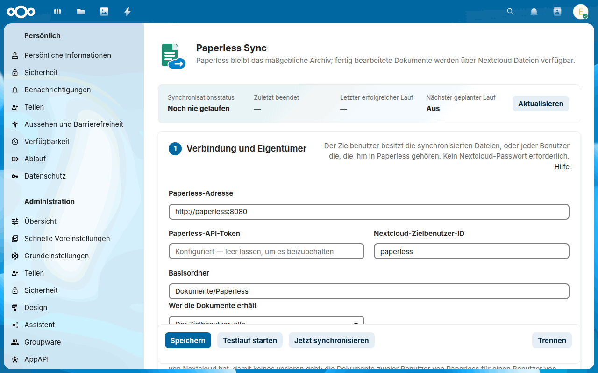
</picture>

--8<-- "README.de.md:features"

--8<-- "README.de.md:usage"

Das Archiv in Dateien, ein Ordner je Korrespondent, Dokumenttyp und Jahr:

<picture>
  <source media="(prefers-color-scheme: dark)" srcset="images/de/archive-dark.png">
  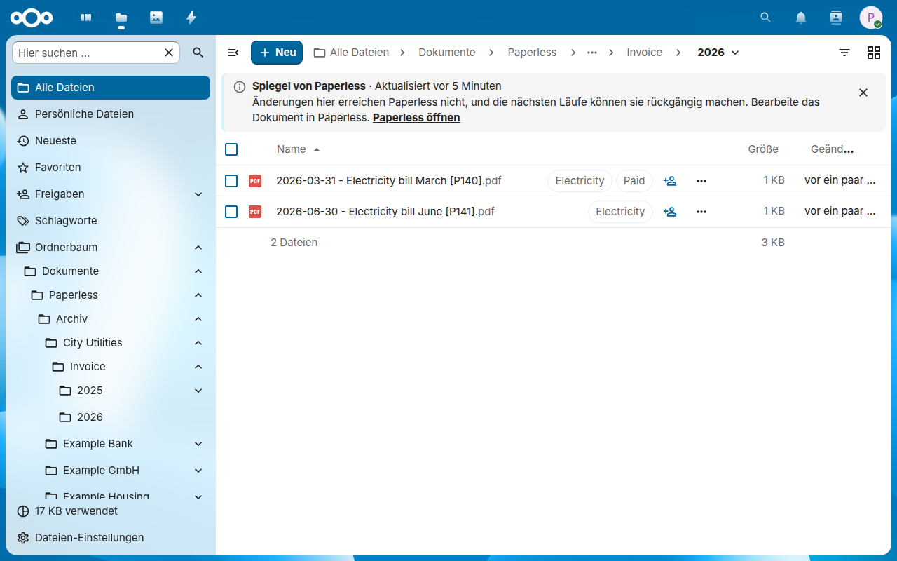
</picture>

--8<-- "README.de.md:configuration"

<picture>
  <source media="(prefers-color-scheme: dark)" srcset="images/de/settings-checklist-dark.png">
  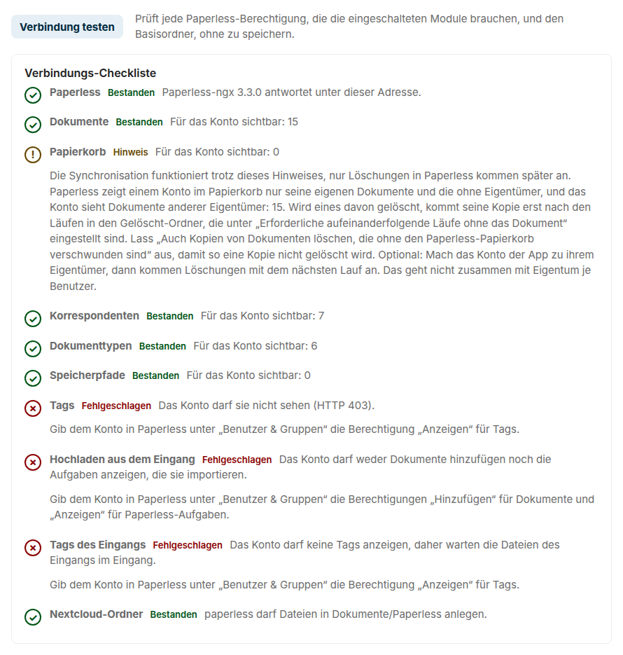
</picture>

--8<-- "README.de.md:configuration-checklist"

## Die Einstellungen, Abschnitt für Abschnitt

Die Einstellungen stehen unter **Administrationseinstellungen → Paperless Sync**. Bis der erste Lauf erfolgreich war, führt [Erste Schritte](guide.de.md#getting-started-in-the-settings) unter dem Titel durch die ersten Schritte. Über den Abschnitten zeigt der Status, wie der letzte Lauf endete, wann er fertig war, den letzten erfolgreichen Lauf und den nächsten geplanten Lauf, und die Fehler des letzten Laufs, wenn er welche hatte; darunter, in einer Leiste, die unten im Fenster bleibt, speichern die Knöpfe die Einstellungen, starten einen Testlauf oder einen Lauf und trennen Paperless, mit dem Hinweis auf ungespeicherte Änderungen und dem Ergebnis jeder Aktion daneben. *Speichern, pausieren und trennen* oben erklärt, wann das Speichern die Verbindung prüft, wie du die Synchronisation pausierst und was Trennen behält. Der Link *Hilfe* jedes Abschnitts führt zu seinem Teil dieser Anleitung, auf Deutsch, wenn Nextcloud mit dir Deutsch spricht, sonst auf Englisch; ebenso der Link einer Warnung unter *Administration → Übersicht*.

**1 · Verbindung und Eigentümer:** die Adresse von Paperless, sein API-Token, der Nextcloud-Benutzer, dem das Archiv gehört, ausgewählt aus den [Benutzern von Nextcloud](guide.de.md#zielbenutzer-und-tags), der Basisordner in den Dateien dieses Benutzers, den eine neue Installation in der Standardsprache von Nextcloud benennt, wie die anderen Ordner, so wie *Ordnernamen* oben beschreibt, ob Paperless in deinem lokalen Netzwerk läuft, unter einer Adresse, die Nextcloud sonst ablehnt, und wer die Dokumente erhält: der Zielbenutzer alle, oder [jeder Benutzer die, die ihm in Paperless gehören](guide.de.md#eigentum-je-benutzer), mit der Tabelle der Benutzer von Paperless mit einer anderen ID in Nextcloud und der Gruppe, deren Mitglieder allein ihre erhalten. **Verbindung testen** darunter prüft diese Einstellungen, ohne sie zu speichern, und listet jede Paperless-Berechtigung auf, die die eingeschalteten Module brauchen, wie *Verbindungs-Checkliste* oben beschreibt.

<picture>
  <source media="(prefers-color-scheme: dark)" srcset="images/de/settings-connection-dark.png">
  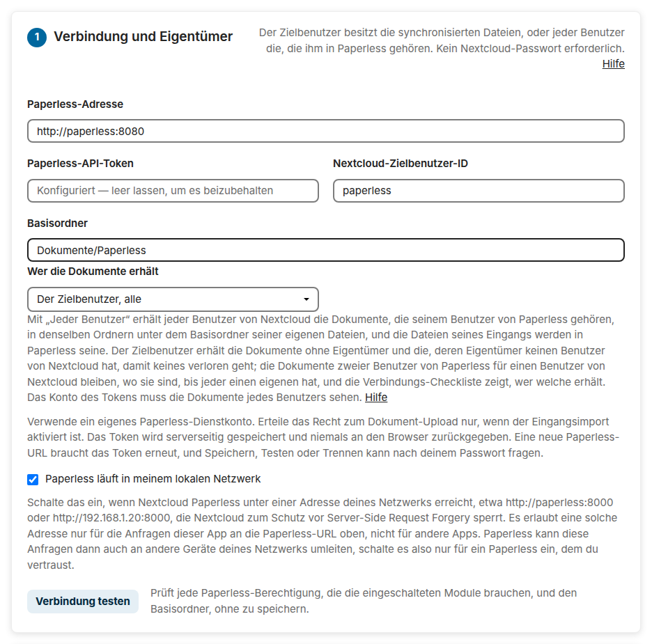
</picture>

**Ein Konto für die App in Paperless anlegen**, darunter zugeklappt, legt das Konto der App mit dem API-Token eines Paperless-Superusers an, das du einmal eingibst: einen Benutzer, der kein Superuser ist, `nextcloud-sync`, wenn du keinen anderen Namen wählst, mit den Berechtigungen, die die Module des Formulars brauchen. **Konto anlegen und speichern** speichert die Einstellungen mit dem Token dieses Kontos und zeigt seine Verbindungs-Checkliste, wie *Das Konto der App* oben beschreibt.

<!-- Das Bild kommt aus tests/e2e/screenshots.mjs, mit einem synthetischen Token. -->
<picture>
  <source media="(prefers-color-scheme: dark)" srcset="images/de/settings-account-dark.png">
  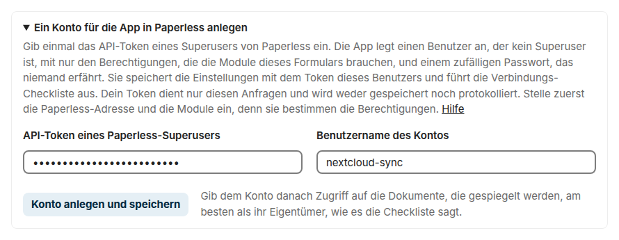
</picture>

**2 · Zeitplan und Module:** die geplante Synchronisation, der Export nach Nextcloud und der Import aus dem Eingang, jedes für sich, das [Intervall](guide.de.md#hintergrundjobs), von 5 Minuten bis zu einem Tag, und die meisten Änderungen eines Laufs.

<picture>
  <source media="(prefers-color-scheme: dark)" srcset="images/de/settings-schedule-dark.png">
  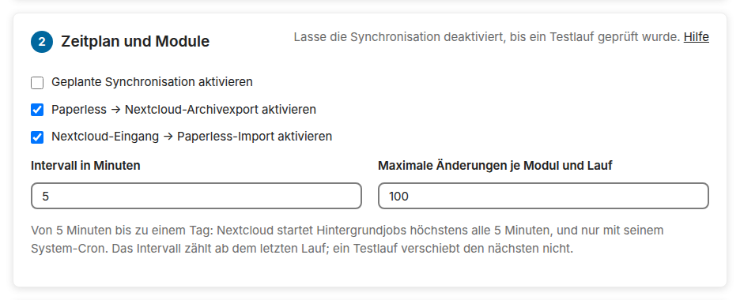
</picture>

**3 · Strukturiertes Archiv:** der Archivordner, die [Dateikonflikt-Regel](guide.de.md#dateikonflikt-regel) für eine Datei im Weg, die [Pfadvorlage](guide.de.md#variablen-der-pfadvorlage) mit einem Knopf für jede ihrer Variablen und den Pfaden der neuesten Dokumente mit ihr, während du tippst, die Archivversion oder das Original, welche Dokumente draußen bleiben: die im Posteingang von Paperless, die mit einem der [ausgeschlossenen Tags](guide.de.md#zielbenutzer-und-tags), ausgewählt aus den Tags von Paperless, und, mit [Tags zum Spiegeln](guide.de.md#welche-dokumente-das-archiv-spiegelt), die ohne jeden davon, ob die Läufe die [Metadaten neben dem Archiv](guide.de.md#metadaten-neben-dem-archiv) schreiben und ob die Kopien die [Tags von Paperless als Tags von Nextcloud](guide.de.md#tags-in-nextcloud) tragen.

<picture>
  <source media="(prefers-color-scheme: dark)" srcset="images/de/settings-archive-dark.png">
  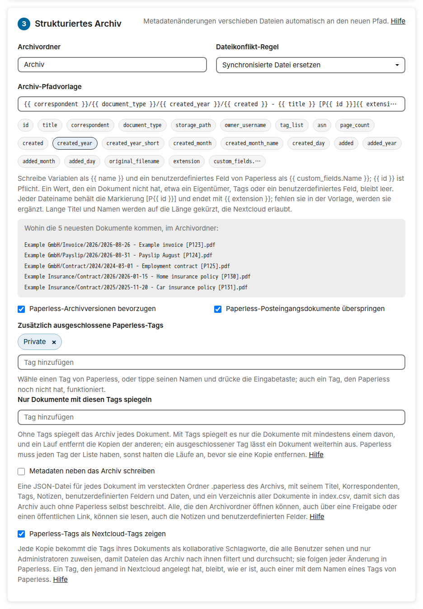
</picture>

**4 · Nextcloud-Eingang:** Die erste Zeile sagt, dass Videos, Programme und Archive [im Eingang bleiben](guide.de.md#nextcloud-inbox); dann der Eingangsordner, der Fehlerordner, die Unterordner des Eingangs, ob eine importierte Datei den Eingang verlässt, und die [Tags des Eingangs](guide.de.md#tags-des-eingangs): einer für jeden Unterordner, Tags für jeden Import, ausgewählt aus den Tags von Paperless, und ob die App die anlegt, die Paperless fehlen; darunter die Gruppe, deren Mitglieder [Dateien aus Dateien an Paperless senden](guide.de.md#aus-dateien-senden) dürfen, ausgewählt aus den Gruppen von Nextcloud.

<picture>
  <source media="(prefers-color-scheme: dark)" srcset="images/de/settings-inbox-dark.png">
  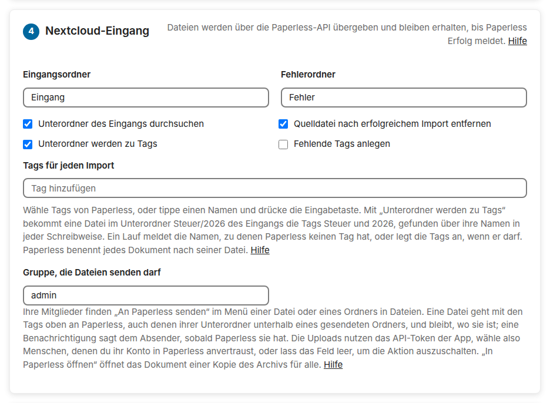
</picture>

**5 · Papierkorb und Löschsicherheit:** was ein Dokument im Papierkorb von Paperless mit seiner Kopie macht, der Gelöscht-Ordner, die Scans, bevor ein fehlendes Dokument als weg gilt, und die Schalter des endgültigen Löschens.

<picture>
  <source media="(prefers-color-scheme: dark)" srcset="images/de/settings-deletion-dark.png">
  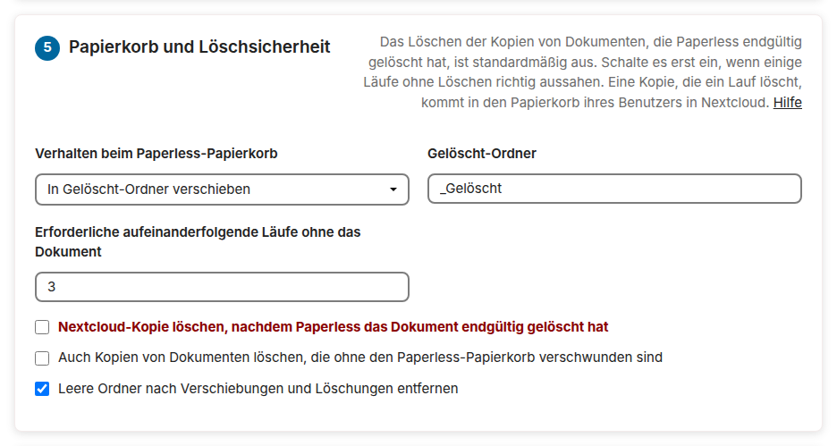
</picture>

**6 · Änderungen in Sekunden:** die Adresse des Webhooks, den ein Arbeitsablauf von Paperless aufruft, wenn er ein Dokument hinzufügt oder ändert, sein Geheimnis, das die Seite nach **Geheimnis erstellen** einmal zeigt, der letzte Aufruf und was daraus wurde, ob ein Aufruf sein Dokument sofort spiegelt, und die Schritte in Paperless, wie [Änderungen in Sekunden](guide.de.md#änderungen-in-sekunden) sie beschreibt und zeigt.

## Der Bericht eines Laufs

Ein Testlauf, ein Lauf von Hand oder ein Lauf von `occ paperless_sync:run` endet mit seinem Bericht: wie viele Dokumente jede Art von Änderung betraf, und eine Zeile für jede Datei, die der Lauf schreibt, verschiebt oder löscht, oder in einem Testlauf schreiben würde, bis zu 100 Zeilen, die Fehler und Löschungen zuerst. Die Einstellungsseite zeigt ihn in deiner Sprache, mit einem farbigen Abzeichen für jede Art von Änderung, den Fehlern oben, einem Filter für jede Art und, wenn du der Zielbenutzer bist, einem Link von jeder Datei zu ihrem Ordner; **Bericht kopieren** kopiert ihn für einen Fehlerbericht. Die Seite behält den Bericht des letzten Laufs, auch eines geplanten, für den nächsten Besuch. Eine Datei des Eingangs, die Paperless ablehnt, erscheint einmal, als *Abgelehnt* mit dem Grund von Paperless (`IMPORT REJECTED` auf der Kommandozeile), und zählt als fehlgeschlagener Import; bis sie sich ändert, zählen die Läufe danach sie als übersprungen. Dieser Testlauf kommt ein paar Tage nach der ersten Synchronisation, wenn Paperless zwei neue Dokumente hat, einen neuen Titel, ein Dokument in seinem Papierkorb, eines mit dem ausgeschlossenen Tag *Private* und einen abgeschlossenen Import:

<picture>
  <source media="(prefers-color-scheme: dark)" srcset="images/de/report-dark.png">
  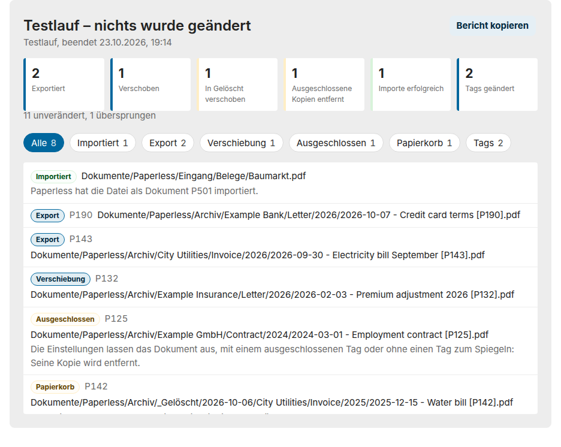
</picture>

## Status, Bericht und Protokoll

--8<-- "README.de.md:status"

<picture>
  <source media="(prefers-color-scheme: dark)" srcset="images/de/status-error-dark.png">
  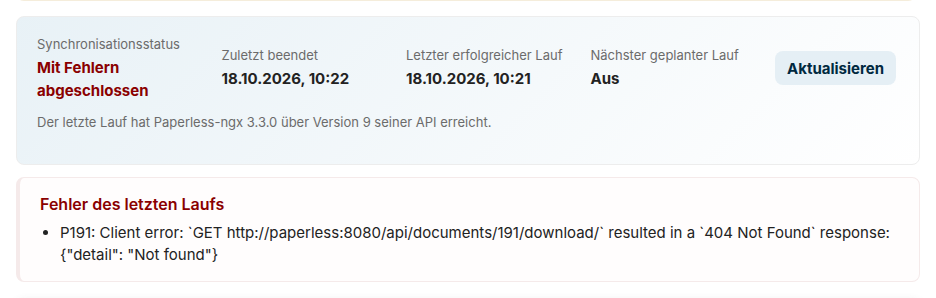
</picture>

--8<-- "README.de.md:status-report"

### Aktivität

--8<-- "README.de.md:activity"

### Benachrichtigungen

--8<-- "README.de.md:notifications"

## Kommandozeile

--8<-- "README.de.md:command-line"

## FAQ und Fehlerbehebung

Die [FAQ](faq.de.md) beantworten die häufigen Fragen, etwa was mit einer Bearbeitung einer gespiegelten Datei geschieht, wohin gelöschte Dateien gehen und wie lange die erste Synchronisation dauert. Die [Fehlerbehebung](troubleshooting.de.md) führt von einer Fehlermeldung, einem Lauf, der scheitert, oder einer Datei, die fehlt, zu ihrer Ursache und ihrer Lösung.

--8<-- "README.de.md:help"
