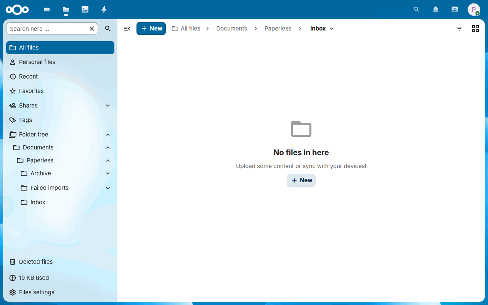
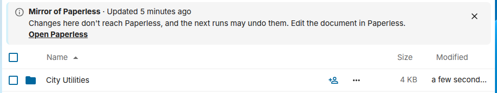
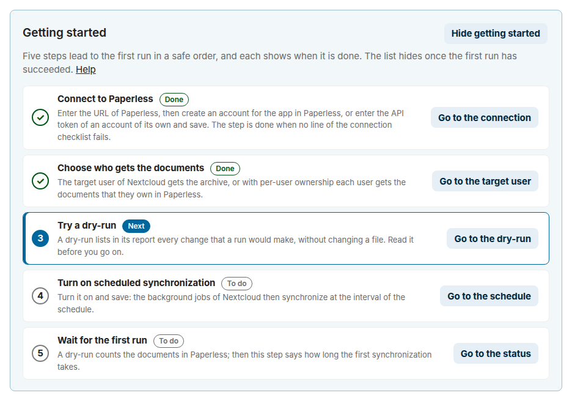
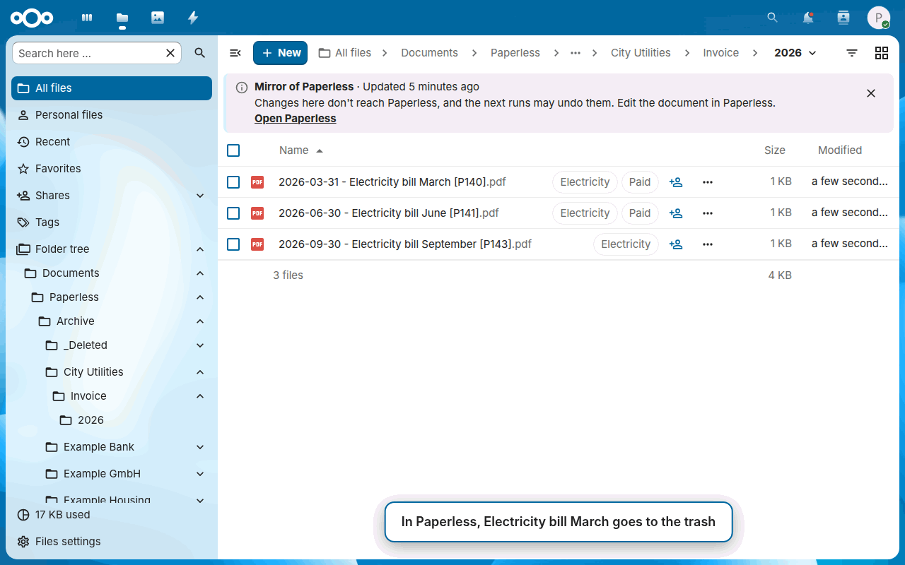
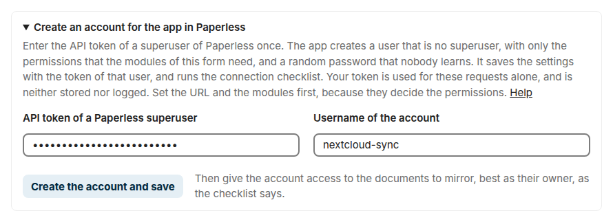
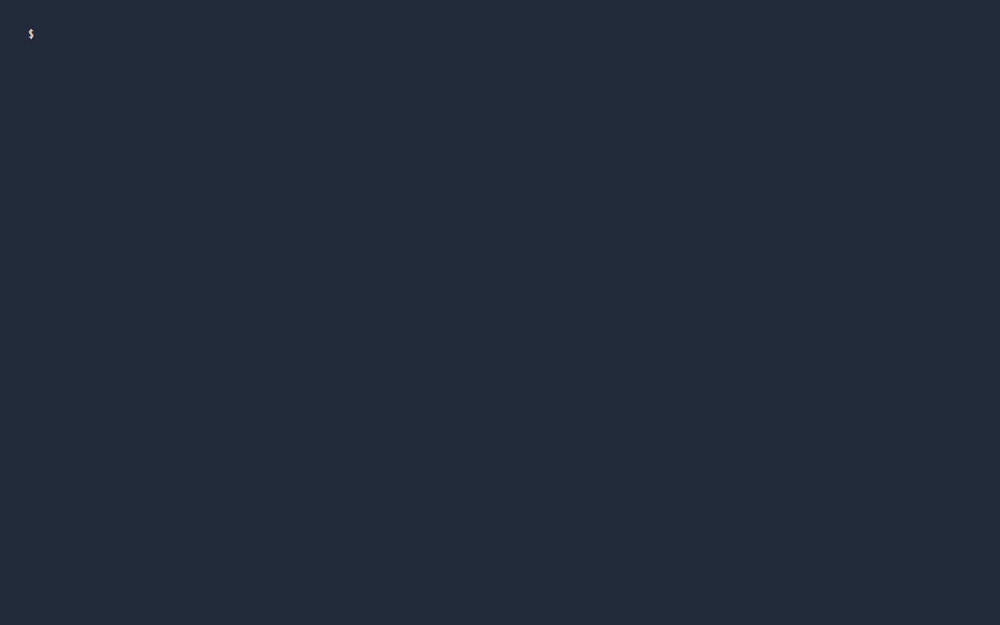

---
hide:
  - navigation
  - toc
# A link to the home page shows the social preview of the repository, with the layout
# in .github/social-cards/preview.yml.
social:
  cards_layout: preview
---

#  Paperless Sync { .ps-hero-title }

**Your finished Paperless-ngx documents, as a tidy archive in Nextcloud.**
{ .ps-hero-tagline }

A native Nextcloud app that mirrors finalized Paperless-ngx documents into a structured Nextcloud archive and can submit files from a Nextcloud inbox to Paperless. Paperless remains the source of truth.

<!-- On the website, the hook in .github/mkdocs_project.py writes the versions of appinfo/info.xml into the fields. -->
<ul class="ps-requirements" aria-label="Requirements">
  <li>Nextcloud 33–35</li>
  <li>PHP 8.2+</li>
  <li>Paperless-ngx 2.16+ with an API token</li>
  <li>Nextcloud's system cron</li>
</ul>

[Get it from the App Store](https://apps.nextcloud.com/apps/paperless_sync){ .md-button .md-button--primary }
[Try it](#try-it){ .md-button }
[Quick start](#quick-start){ .md-button }
[Requirements](guide.md#requirements){ .md-button }
{ .ps-hero-actions }

<picture>
  <source media="(prefers-color-scheme: dark)" srcset="images/archive-dark.gif">
  
</picture>

## Who it's for

- :material-home-heart:{ .lg .middle } **A household**

    ---

    The papers of the family are in Paperless, and everyone finds them in Nextcloud, also on the phone: in one archive that you share, or each person with the documents they own in Paperless.

    [:octicons-arrow-right-24: Using the archive](use.md)

- :material-office-building-outline:{ .lg .middle } **A small office**

    ---

    Colleagues send files to Paperless from Files, rules of Flow send them on their own, and the person who runs Paperless gets the settings without being an administrator of Nextcloud.

    [:octicons-arrow-right-24: Delegate the settings](guide.md#delegating-the-settings)

- :material-nas:{ .lg .middle } **Paperless on a NAS**

    ---

    Paperless may run on another machine: the app reaches it through its REST API, with no container next to it and no access to its media folder, and a switch allows an address of your network.

    [:octicons-arrow-right-24: Paperless in your local network](guide.md#paperless-in-your-local-network)

## What it does

### Archive

- :material-folder-sync-outline:{ .lg .middle } **A structured archive in Nextcloud**

    ---

    <picture>
      <source media="(prefers-color-scheme: dark)" srcset="images/path-preview-dark.png">
      
    </picture>

    Documents appear in folders of the configured Nextcloud user, by correspondent first by default, as archive PDF or original file. A path template decides where each one goes, and its preview shows that while you type.

    [:octicons-arrow-right-24: Path template](guide.md#path-template-variables)

- :material-file-move-outline:{ .lg .middle } **Follows changes in Paperless**

    ---

    <picture>
      <source media="(prefers-color-scheme: dark)" srcset="images/move-dark.gif">
      
    </picture>

    When the metadata of a document changes in Paperless, its file is renamed or moved in Nextcloud, with its shares, comments and versions. Documents in the Paperless inbox or with an excluded tag stay out, and the archive can mirror only the documents with the tags that you choose.

    [:octicons-arrow-right-24: Which documents the archive mirrors](guide.md#which-documents-the-archive-mirrors)

- :material-tag-multiple-outline:{ .lg .middle } **Tags and metadata come along**

    ---

    <picture>
      <source media="(prefers-color-scheme: dark)" srcset="images/archive-dark.png">
      
    </picture>

    The tags of Paperless can show as tags of Nextcloud on the copies, so that Files filters and searches by them. A JSON file for each document and an index as CSV keep its tags, notes, custom fields and dates next to the archive, which then describes itself also without Paperless.

    [:octicons-arrow-right-24: Tags in Nextcloud](guide.md#tags-in-nextcloud) · [Metadata](guide.md#metadata-next-to-the-archive)

- :material-account-group-outline:{ .lg .middle } **Each user their own documents**

    ---

    <picture>
      <source media="(prefers-color-scheme: dark)" srcset="images/settings-connection-dark.png">
      
    </picture>

    One user can own the archive and share it. Or each user of Nextcloud gets the documents they own in Paperless in their own files, through the one connection of the app, and, if you choose, those that Paperless shares with them.

    [:octicons-arrow-right-24: Per-user ownership](guide.md#per-user-ownership)

### Inbox and Files

- :material-inbox-arrow-up-outline:{ .lg .middle } **From a Nextcloud inbox to Paperless**

    ---

    <picture>
      <source media="(prefers-color-scheme: dark)" srcset="images/inbox-dark.gif">
      
    </picture>

    Files in a Nextcloud inbox folder, including its subfolders, are submitted to Paperless with their tags, and the app follows their Paperless tasks. A failed import moves to an error folder, next to the reason.

    [:octicons-arrow-right-24: Nextcloud inbox](guide.md#nextcloud-inbox)

- :material-send-outline:{ .lg .middle } **Send to Paperless in Files**

    ---

    <picture>
      <source media="(prefers-color-scheme: dark)" srcset="images/files-send-dark.png">
      
    </picture>

    The menu of a file or a folder sends it to Paperless, for the members of a group that you choose. It stays where it is, and a notification links the new document. *Open in Paperless* in the menu of a copy opens its document.

    [:octicons-arrow-right-24: Send from Files](guide.md#send-from-files)

- :material-sitemap-outline:{ .lg .middle } **Rules of Flow**

    ---

    <picture>
      <source media="(prefers-color-scheme: dark)" srcset="images/flow-rule-dark.png">
      
    </picture>

    Rules of Flow send files on their own, with tags of their own, such as every PDF that a member of a group uploads. Only the administrators make them.

    [:octicons-arrow-right-24: Send by a rule of Flow](guide.md#send-by-a-rule-of-flow)

- :material-information-outline:{ .lg .middle } **Files says what a folder does**

    ---

    <picture>
      <source media="(prefers-color-scheme: dark)" srcset="images/folder-note-dark.png">
      
    </picture>

    A note above the list says that the archive is a mirror, when the inbox sends its files and where the reasons of failed imports are, also for people who reach the folder through a share.

    [:octicons-arrow-right-24: What edits, renames and deletions do](use.md#what-edits-renames-and-deletions-do)

### Operations

- :material-webhook:{ .lg .middle } **Changes within seconds**

    ---

    <picture>
      <source media="(prefers-color-scheme: dark)" srcset="images/settings-webhook-dark.png">
      
    </picture>

    A workflow of Paperless calls the webhook of the app when it adds or changes a document, and its copy changes at once, without a container next to Paperless, its media folder or a password of Nextcloud.

    [:octicons-arrow-right-24: Changes within seconds](guide.md#changes-within-seconds)

- :material-format-list-checks:{ .lg .middle } **Getting started, step by step**

    ---

    <picture>
      <source media="(prefers-color-scheme: dark)" srcset="images/settings-getting-started-dark.png">
      
    </picture>

    Until the first run has succeeded, the settings open with the steps of the quick start in their safe order. Pickers offer the users and the tags, and mark one that doesn't exist. The administrators can delegate the settings to a group.

    [:octicons-arrow-right-24: Getting started](guide.md#getting-started-in-the-settings) · [Delegating the settings](guide.md#delegating-the-settings)

- :material-bell-alert-outline:{ .lg .middle } **Tells you when the mirror fails**

    ---

    <picture>
      <source media="(prefers-color-scheme: dark)" srcset="images/status-error-dark.png">
      
    </picture>

    Notifications, setup checks and a status API tell the administrators when the mirror keeps failing or has stopped, also in Uptime Kuma or Home Assistant. The Activity stream of the target user tells what each run changed and imported.

    [:octicons-arrow-right-24: Being notified](guide.md#being-notified) · [Activity](guide.md#activity)

- :material-console:{ .lg .middle } **On a schedule, on demand or from a script**

    ---

    <picture>
      <source media="(prefers-color-scheme: dark)" srcset="images/settings-schedule-dark.png">
      
    </picture>

    Nextcloud's cron runs it at the interval that you set, and the batch size limits the changes of one run. A run also starts from the settings, and `occ` commands serve scripts, cron jobs and monitoring, with JSON output and exit codes.

    [:octicons-arrow-right-24: Command line](guide.md#command-line)

### Safety

- :material-eye-check-outline:{ .lg .middle } **Dry run first**

    ---

    <picture>
      <source media="(prefers-color-scheme: dark)" srcset="images/report-dark.png">
      
    </picture>

    Synchronization stays off until you turn it on. A dry run lists what a run would change without changing anything. The status, the errors and the report of the last run, also of a scheduled one, stay on the settings page.

    [:octicons-arrow-right-24: Status, report and log](guide.md#status-report-and-log)

- :material-delete-clock-outline:{ .lg .middle } **Careful with deletions**

    ---

    <picture>
      <source media="(prefers-color-scheme: dark)" srcset="images/trash-dark.gif">
      
    </picture>

    The Paperless trash is mirrored into a folder of its own. Permanent deletion is off by default and, when enabled, waits for the configured number of complete scans.

    [:octicons-arrow-right-24: Deletion safety](guide.md#deletion-safety)

- :material-key-chain-variant:{ .lg .middle } **No passwords in Nextcloud**

    ---

    <picture>
      <source media="(prefers-color-scheme: dark)" srcset="images/settings-account-dark.png">
      
    </picture>

    The app works through Nextcloud's filesystem API, without WebDAV credentials or an app password. Its account in Paperless is no superuser, and the Paperless token stays in Nextcloud's credentials manager and never reaches the browser.

    [:octicons-arrow-right-24: The account of the app](guide.md#the-account-of-the-app)

- :material-lan-check:{ .lg .middle } **A connection that it checks**

    ---

    <picture>
      <source media="(prefers-color-scheme: dark)" srcset="images/settings-checklist-dark.png">
      
    </picture>

    *Test connection* checks every permission that your modules need and names what to grant in Paperless. A Paperless in your local network works without turning off Nextcloud's protection against server-side request forgery for the whole server.

    [:octicons-arrow-right-24: Connection checklist](guide.md#connection-checklist)

The settings speak English and German. They, the actions in Files and the form of the rule in Flow are checked for accessibility against WCAG 2.1 AA in every change of the app. Every release is signed, the same package in the Nextcloud App Store and on GitHub, with an SBOM and signed build provenance.

--8<-- "README.md:how-it-works"

## Try it

--8<-- "README.md:try-it"

<picture>
  <source media="(prefers-color-scheme: dark)" srcset="images/try-it-dark.gif">
  
</picture>

`demo/README.md` in [the repository](https://github.com/Dennis-Otto/paperless-sync) says what to try in it.

## Quick start

--8<-- "README.md:quick-start"

<picture>
  <source media="(prefers-color-scheme: dark)" srcset="images/dry-run-dark.gif">
  
</picture>

The [guide](guide.md) describes the configuration in detail: the Paperless account, the folders, the path template and the deletion safety.

## Learn more

- :material-book-open-variant:{ .lg .middle } **Guide**

    ---

    Installation, all features, usage and every part of the configuration.

    [:octicons-arrow-right-24: Read the guide](guide.md)

- :material-cellphone-text:{ .lg .middle } **Using the archive**

    ---

    For the people who read and send the documents: find them, send files to Paperless, scan with the phone, keep them offline and share them.

    [:octicons-arrow-right-24: Use the archive](use.md)

- :material-lifebuoy:{ .lg .middle } **FAQ and troubleshooting**

    ---

    What happens to edits and deletions, how long the first synchronization takes, and the fixes for the error messages.

    [:octicons-arrow-right-24: FAQ](faq.md) · [Troubleshooting](troubleshooting.md)

- :material-compare-horizontal:{ .lg .middle } **How it compares**

    ---

    Paperless Sync next to Nextcloud's Paperless integration, the WebDAV container, rclone and a mount, and how to move over.

    [:octicons-arrow-right-24: Compare](alternatives.md)

- :material-sitemap-outline:{ .lg .middle } **Architecture**

    ---

    How the app runs inside Nextcloud, reads Paperless through its REST API and writes files through Nextcloud's file API.

    [:octicons-arrow-right-24: Architecture](architecture.md)

- :material-shield-lock-outline:{ .lg .middle } **Security design**

    ---

    What the app protects, what it trusts, the threats with their countermeasures, and the risks that remain.

    [:octicons-arrow-right-24: Security design](security.md)

- :material-map-marker-path:{ .lg .middle } **Roadmap**

    ---

    What Paperless Sync intends to do in the next twelve months, and what it will not do.

    [:octicons-arrow-right-24: Roadmap](roadmap.md)

- :material-scale-balance:{ .lg .middle } **Decisions**

    ---

    The decisions that shape the project, each with its reasons.

    [:octicons-arrow-right-24: Decisions](decisions/README.md)

- :material-robot-outline:{ .lg .middle } **Automation**

    ---

    The bots that check every change, release and verify the app, answer issues and keep the repository current.

    [:octicons-arrow-right-24: Automation](automation.md)

- :material-hammer-wrench:{ .lg .middle } **Development and releases**

    ---

    How to build and test the app, how a release is made, signed and published in the Nextcloud App Store, and the changes of each version.

    [:octicons-arrow-right-24: Development](development.md) · [Releases](releases.md) · [Changelog](changelog.md)

--8<-- "README.md:help"
