# Security design

[← README](https://github.com/Dennis-Otto/paperless-sync) · [Architecture](architecture.md) · [Roadmap](roadmap.md) · [Releases](releases.md)

What Paperless Sync protects, what it trusts and which risks remain. [SECURITY.md](https://github.com/Dennis-Otto/paperless-sync/blob/main/SECURITY.md) says how to report a vulnerability and how to verify a release, and argues why the repository and its releases are safe.

## What you can expect

- Only administrators of Nextcloud can see and change the settings, start a run and read its status. Every request passes Nextcloud's login and its CSRF check.
- The Paperless API token is stored in Nextcloud's credentials manager, together with the Paperless URL that it was saved with, and leaves the server only in the requests to that URL: no response, page, message or log entry of the app contains it. Another URL needs the token again, also when it was set past the settings page, with `occ` or Nextcloud's provisioning API.
- Saving the settings, testing the connection and disconnecting Paperless ask for the password of the administrator, unless it was confirmed in the last 30 minutes.
- Synchronization stays off until an administrator has saved a configuration that works with Paperless and Nextcloud. A dry run changes nothing.
- The app writes only below the configured base folder of the target user, through Nextcloud's file API. Every path is built from cleaned metadata and can't leave that folder.
- Nothing is deleted for good unless an administrator turns permanent deletion on; even then, only after the document was missing from Paperless and its trash for the configured number of complete runs in a row. A run whose list of Paperless came back incomplete counts no document as missing.
- Requests to Paperless go through Nextcloud's HTTP client, which checks TLS certificates.
- Nextcloud's protection against server-side request forgery stays on for the whole server. A Paperless at an address of the local network is reached only after an administrator turns on *Paperless runs in my local network*, and then only by the requests of the app to the saved Paperless URL.

## What is protected

| Asset | Where it lives | Protection |
| --- | --- | --- |
| The Paperless API token | Nextcloud's credentials manager | Stored only there, together with the URL that it was saved with, and used only for that URL; the settings carry only whether a token is configured; saving without a new token keeps the stored one for the same URL only; kept out of the traces of errors in the log |
| Documents and their metadata | Paperless, and their copies in the folders of the target user | Read only with the token of a dedicated Paperless account; written only through Nextcloud's file API |
| The files of the target user | Nextcloud | Only below the base folder; files are replaced or moved only as the conflict policy allows; deletion only as configured |
| The configuration | Nextcloud's app configuration | Changed only by administrators; every value checked before it is saved |

## Trust boundaries

<picture>
  <source media="(prefers-color-scheme: dark)" srcset="images/diagrams/the-trust-boundaries-of-paperless-sync.dark.svg">
  
</picture>

Each numbered arrow crosses one of the boundaries below; the app checks whatever comes from the parties with a dashed red border.

1. **Browser → app.** Requests pass Nextcloud's login, its CSRF check and the check of the administrator; saving the settings and disconnecting also need the password of the administrator, confirmed in the last 30 minutes. The app checks every setting against what it may be: URLs with `http` or `https` and without credentials, a query or a fragment; numbers within their ranges; policies from a fixed list; folder names and paths without `.`, `..` or empty parts; a path template with known variables and the marker `{{ id }}`.
2. **App → Paperless.** Requests go only to the Paperless URL of the settings, and to an address of the local network only when the settings allow it. Every answer is untrusted input. JSON must have the expected shape, document IDs must be numbers, and every part of a path is cleaned of control characters, separators and names that Windows reserves, and kept within the bytes that Nextcloud accepts. A download goes to a temporary file first and follows at most three redirects, only to `http` or `https`; while the setting is off, the app refuses a redirect to an address of the local network itself, as Nextcloud does for its own redirects, also when an administrator turned off Nextcloud's `dns_pinning`.
3. **App → files of Nextcloud.** Only below the base folder of the target user, with the permissions of that user.
4. **Inbox folder → Paperless.** Every file that someone puts into the inbox folder is uploaded to Paperless as a new document, when the inbox import is on. With *Subfolders become tags*, the names of its folders choose tags of Paperless for it, and with *Create missing tags* also create them, so whoever writes to the inbox can add tags to Paperless; created tags have no match, so that Paperless assigns them to no other document.

## Threats and countermeasures

| Threat | Countermeasure | Evidence |
| --- | --- | --- |
| Another site uses the session of an administrator | Nextcloud checks the CSRF token of every request; no route of the app opts out of it or of the check of the administrator | the controllers in `lib/Controller/`, which carry no `NoCSRFRequired`, `NoAdminRequired` or `PublicPage` attribute |
| The API token reaches the browser | The token stays in the credentials manager; the settings and the status carry only whether one is configured | `tests/Unit/Service/ConfigServiceTest.php`, `tests/Unit/Settings/AdminSettingsTest.php` |
| The API token reaches the log of Nextcloud, which writes the arguments of every frame of the trace of an error, when Paperless can't be reached for example | Every parameter that takes the token is marked `#[\SensitiveParameter]`; a request to Paperless that fails ends in an error with only the cleaned message of the HTTP client, without the error of the client, whose trace holds the token in the options of the request; the scheduled job logs only the message of a failed run | `testFailedRequestKeepsTheTokenOutOfTheLog` in `tests/Unit/Service/PaperlessApiServiceTest.php`, `tests/Unit/SensitiveParametersTest.php`, the run without Paperless at the end of `tests/e2e/run.sh` |
| Someone with the session of an administrator points the Paperless URL at a server of their own and receives the stored token with the test of the connection, or with the next run after changing the URL through `occ` or Nextcloud's provisioning API, which can set any value of the app | The token is stored together with the URL that it was saved with and goes only to that URL, compared as a whole, path included, at every save and every request; another URL needs the token again, and until then the runs stop; *Test connection* follows the same rules; saving, testing and disconnecting need the password of the administrator | `testANewUrlNeedsTheTokenAgain` and `testAUrlChangedElsewhereGetsNoToken` in `tests/Unit/Service/ConfigServiceTest.php`, `testAUrlChangedElsewhereNeverGetsTheToken` in `tests/Unit/Service/SyncServiceTest.php`, `testStoredTokenNeverGoesToANewUrl`, `testTheTestSendsTheStoredTokenOnlyToItsUrl` and `testChangesOfTheConnectionNeedThePassword` in `tests/Unit/Controller/SettingsControllerTest.php`, the change of the URL through the provisioning API at the end of `tests/e2e/run.sh` |
| Metadata of Paperless or a setting leads a path out of the base folder | The path template accepts only known variables; every part is cleaned and `.`, `..` and empty parts are rejected | `testRejectsTraversalAndUnknownVariables`, `testCleansComponents` and `testRelativePathMustNotContainEmptyComponents` in `tests/Unit/Service/PathTemplateServiceTest.php`, `testEveryPathConsistsOfNamesThatNextcloudAccepts` in `tests/Unit/Service/PathTemplatePropertiesTest.php` |
| A title or name of Paperless makes the path of one document that of another, whose file is then replaced | Every value goes into the template as plain text in one pass; only the free text is shortened, so that every file name keeps its marker `[P<ID>]` and its extension | `testInsertsValuesAsTheyAre` and `testLongValuesKeepTheMarkerAndTheExtensionOfEveryDocument` in `tests/Unit/Service/PathTemplateServiceTest.php`, `testDocumentsWithTheSameMetadataGetDifferentPaths` in `tests/Unit/Service/PathTemplatePropertiesTest.php` |
| A malformed or hostile answer of Paperless | JSON is checked for its shape and types; a document without a numeric ID fails the run instead of writing a file | `testInvalidMetadataIsRejected` in `tests/Unit/Service/PaperlessApiServiceTest.php`, `testDocumentWithoutAValidIdFailsTheRun` in `tests/Unit/Service/SyncServiceTest.php` |
| Files are deleted by mistake | Permanent deletion is off by default, and without direct deletion only a copy of a document from the trash of Paperless is deleted; a missing document waits for the configured number of complete runs; a dry run never counts | `testMissingDocumentWaitsForTheConfiguredRuns`, `testDryRunDoesNotCountMissingRuns`, `testDocumentPurgedFromTheTrashKeepsItsCopyWhilePermanentDeletionIsOff` and `testVanishedDocumentMovesToTheDeletedFolderWithoutDirectDeletion` in `tests/Unit/Service/SyncServiceTest.php`, the step `deletion-off` of `tests/e2e/run.sh` |
| A short or empty page of Paperless, or a list that changes during a scan, makes existing documents look deleted | The documents are read in the order of their IDs; a scan counts only when every page came back full with the same count and every listed document arrived; after an incomplete scan, no document counts as missing | `testScanThatMayHaveMissedDocumentsIsIncomplete` in `tests/Unit/Service/PaperlessApiServiceTest.php`, `testIncompleteScanCountsNoDocumentAsMissing` in `tests/Unit/Service/SyncServiceTest.php`, the step `scan-incomplete` of `tests/e2e/run.sh` |
| A short page of tags makes a document with an excluded tag look untagged | The lists of tags, correspondents, document types and storage paths must be complete as well, and so must the users and the custom fields when the path template uses them; an incomplete one fails the run before it changes anything, as do a list that Paperless refuses and a custom field of the template that Paperless doesn't have | `testIncompleteListOfNamesFailsTheRun` in `tests/Unit/Service/PaperlessApiServiceTest.php`, `testAListThatPaperlessRefusesFailsTheRunWithThePermissionItNeeds` and `testACustomFieldThatPaperlessDoesNotHaveFailsTheRunBeforeAFileMoves` in `tests/Unit/Service/SyncServiceTest.php` |
| The preview of the path template or a dry-run of unsaved settings, which ask for no password, sends the stored token to another URL, reaches the local network or reads the files of another user | Both read Paperless with the saved connection only; a dry-run whose URL, *Paperless runs in my local network* or target user differ from the saved ones is refused, with the setting to save first, and neither saves a setting | `testADryRunKeepsTheSavedConnectionAndTargetUser` in `tests/Unit/Controller/SyncControllerTest.php`, `testThePreviewShowsThePathsOfTheNewestDocumentsWithTheTemplateOfThePage` in `tests/Unit/Controller/SettingsControllerTest.php`, the refused dry-run for another target user in `tests/e2e/run.sh`, [decision 0014](decisions/0014-try-unsaved-settings-with-the-saved-connection.md) |
| Text from Paperless runs as script on the settings page | The template escapes every value, and the script of the page writes text only as text | `templates/settings.php`, `js/settings.js` |
| Someone makes the server send requests into its own network, server-side request forgery | Nextcloud's HTTP client refuses addresses of the local network. The app lifts that only for its own requests to the saved Paperless URL, and only while *Paperless runs in my local network* is on: off by default, turned on only by a clear yes, saved only with the password of an administrator, which *Test connection*, which sends requests to the URL of the form, asks for as well. The app never needs `allow_local_remote_servers`, and its end-to-end tests run without it | `testRequestsAllowTheLocalNetworkOnlyWithTheSetting` and `testDownloadRefusesARedirectIntoTheLocalNetwork` in `tests/Unit/Service/PaperlessApiServiceTest.php`, `testOnlyAClearYesAllowsTheLocalNetwork` in `tests/Unit/Service/ConfigServiceTest.php`, `testARefusedLocalAddressSaysWhatToDo` in `tests/Unit/Controller/SettingsControllerTest.php`, the refused save at the start of `tests/e2e/run.sh` and the one in `tests/e2e/settings.mjs` |
| Two runs at once break the state | A lock lets only one run at a time, and the background job never runs in parallel | `testRunWhileAnotherRunIsActiveIsAConflict`, `testCronChecksEveryFiveMinutesAndNeverRunsTwice` |
| A slow or huge Paperless, or a storage that can't be written, ties up Nextcloud | Timeouts for every request; the batch size for the changes of one run, failed ones included; the free space is checked before every write, and the first write that a full, read-only or unavailable storage refuses ends the exports and moves of the run | `testBatchSizeLimitsTheChangesOfOneRun`, `testFailedExportsTakeTheirPlaceInTheBatch` and `testStorageThatCannotBeWrittenEndsTheExportsOfTheRun` in `tests/Unit/Service/SyncServiceTest.php`, `testWriteThatExceedsTheFreeSpaceIsRefusedBeforeAnyFolderIsCreated` in `tests/Unit/Service/NextcloudStorageServiceTest.php`, the step `export-stopped` of `tests/e2e/run.sh` |

### Which token a save tests

With scheduled synchronization on, or a token entered, saving tests the connection to Paperless first, with the token that goes with the URL. With the schedule off and no token entered, a save only checks that the URL is the one that the stored token was saved with, and no request leaves the server:

<picture>
  <source media="(prefers-color-scheme: dark)" srcset="images/diagrams/which-token-a-save-of-the-settings-tests.dark.svg">
  
</picture>

*Test connection* sends the token by the same rules, the stored one only to the URL that it was saved with, and Nextcloud asks for the password for it too, so that a session that someone else took over can't make the server send requests into its network. Every run checks the same before its first request: when the configured URL is not the one that the token was saved with, because it was changed with `occ` or Nextcloud's provisioning API, the run stops without sending the token, and the settings page asks for it again.

### A Paperless in the local network

Nextcloud checks the address of every request of its HTTP client and refuses one of the local network, such as `paperless`, `paperless.lan` or `192.168.1.20`, unless the request allows it. The app allows it in exactly one place, for the requests to the saved Paperless URL, and only with the setting on:

<picture>
  <source media="(prefers-color-scheme: dark)" srcset="images/diagrams/when-a-request-of-paperless-sync-may-reach-an-address-of-the-local.dark.svg">
  
</picture>

The system switch `allow_local_remote_servers` would allow local addresses for every app and every request that a user can start, such as link previews, calendar subscriptions, federation and external storage. [Decision 0008](decisions/0008-local-network-per-request.md) records why the app asks for its own setting instead.

The Docker end-to-end tests run the app in real Nextcloud containers of every supported version against a mock of the Paperless API, and the newest version also on PostgreSQL, and on MariaDB with S3 object storage. They check, among others, that the token appears in no response and no log line, that a document missing from Paperless keeps its copy for the grace runs and is never deleted without direct deletion, and that a file of the user at the path of a document stays when conflicts are skipped ([tests/e2e/README.md](https://github.com/Dennis-Otto/paperless-sync/blob/main/tests/e2e/README.md)).

## Residual risks

- The permissions of the Paperless account decide what the app can read and do. Use a dedicated account with only the permissions of the features you use, as the [README](https://github.com/Dennis-Otto/paperless-sync#paperless-connection) describes; *Test connection* shows which of them it has. Don't use a superuser account: its token sees the trash of every owner, but whoever obtains it can change and delete every document of Paperless. Make the account of the app the owner of the documents to mirror instead; the checklist counts the documents that it sees without owning them, and notes the token of a superuser.
- An `http` URL is allowed, for a Paperless in a trusted local network; then the token and the documents travel unencrypted. Use `https` whenever the connection leaves such a network.
- With *Paperless runs in my local network* on, an administrator can point the app at any address of the network of the server, and Paperless can redirect the requests of the app, downloads included, to other devices there, whose answer may then land in the archive. Turn the setting on only for a Paperless that you run and trust. It belongs to the URL that an administrator saves: a future mode in which users enter their own Paperless URLs must never apply it to those.
- Versions up to 0.1.10 wrote the token into the log of Nextcloud whenever a run couldn't reach Paperless. After the update, create a new token in Paperless, enter it in the settings, and delete the old logs of Nextcloud and their copies, such as in backups or log collectors.
- Everyone who can write to the inbox folder can add documents to Paperless while the inbox import is on. Share the inbox folder only with people who may do that.
- The mirrored files follow Nextcloud's sharing: whoever the target user shares the archive with sees the documents.
- Paperless remains the source of truth. With permanent deletion on, a document deleted in Paperless is deleted in Nextcloud too, after the grace runs. Keep independent backups.
