# Security design

[← README](https://github.com/Dennis-Otto/paperless-sync) · [Architecture](architecture.md) · [Roadmap](roadmap.md) · [Releases](releases.md)

What Paperless Sync protects, what it trusts and which risks remain. [SECURITY.md](https://github.com/Dennis-Otto/paperless-sync/blob/main/SECURITY.md) says how to report a vulnerability and how to verify a release, and argues why the repository and its releases are safe.

## What you can expect

- Only administrators of Nextcloud can see and change the settings, start a run and read its status. Every request passes Nextcloud's login and its CSRF check, but for the webhook that a workflow of Paperless calls, which opens only with its secret.
- Only the members of the group that the administrators choose, the administrators themselves by default, can send files to Paperless from Files, and only files that they may read and download and that the runs don't look after.
- Only administrators can save a rule of Flow that sends files to Paperless. Such a rule sends the files of every user that it matches, whatever the group of the setting, but never a file of the base folder of the target user, or with per-user ownership of the user's own base folder, a file that Paperless has already or a file that its owner may not read.
- The Paperless API token is stored in Nextcloud's credentials manager, together with the Paperless URL that it was saved with, and leaves the server only in the requests to that URL: no response, page, message or log entry of the app contains it. Another URL needs the token again, also when it was set past the settings page, with `occ` or Nextcloud's provisioning API. A run reads the token once, at its start, together with the URL, and sends it to that URL alone until it ends: settings saved during the run reach the next run ([decision 0020](decisions/0020-one-connection-to-paperless-for-each-run.md)).
- Saving the settings, testing the connection, setting up the account of the app in Paperless and disconnecting Paperless ask for the password of the administrator, unless it was confirmed in the last 30 minutes.
- The token of a superuser of Paperless, which the setup of the account of the app takes, goes only to the Paperless URL of the form, for the requests of the setup, and is never stored, logged or answered. The app never keeps the token of a superuser: the account that it creates is no superuser, and has only the permissions of the modules that are on ([the setup of the account](#the-setup-of-the-account)).
- Synchronization stays off until an administrator has saved a configuration that works with Paperless and Nextcloud. A dry run changes nothing.
- The webhook stays off until an administrator creates its secret. A call names only the ID of a document: what changes, the app reads from Paperless itself, with its own token and by the rules of a run, so a caller with the secret can make a copy current sooner, and nothing else.
- The app writes only below the configured base folder of the target user, through Nextcloud's file API, and with per-user ownership below the same folder of each user who gets documents. Every path is built from cleaned metadata and can't leave that folder.
- With per-user ownership, a document goes to the user of Nextcloud whose user of Paperless owns it, or else to the target user, with the documents that Paperless shares also to the user of Nextcloud of each user of Paperless who may view it, and never to anyone else: a document whose user isn't clear, such as of two users of Paperless for one user of Nextcloud, whose owner the app can't tell, or of the account of the app while an upload waits for its owner, stays where its copy is. [Per-user ownership](#per-user-ownership) has the details.
- Nothing is deleted for good unless an administrator turns permanent deletion on; even then, only after the document was missing from Paperless and its trash for the configured number of complete runs in a row. A run whose list of Paperless came back incomplete counts no document as missing.
- Requests to Paperless go through Nextcloud's HTTP client, which checks TLS certificates.
- Nextcloud's protection against server-side request forgery stays on for the whole server. A Paperless at an address of the local network is reached only after an administrator turns on *Paperless runs in my local network*, and then only by the requests of the app to the saved Paperless URL.

## What is protected

| Asset | Where it lives | Protection |
| --- | --- | --- |
| The Paperless API token | Nextcloud's credentials manager | Stored only there, together with the URL that it was saved with, and used only for that URL; the settings carry only whether a token is configured; saving without a new token keeps the stored one for the same URL only; kept out of the traces of errors in the log |
| Documents and their metadata | Paperless, and their copies in the folders of the target user | Read only with the token of a dedicated Paperless account; written only through Nextcloud's file API |
| The files of the target user, and of each user of per-user ownership | Nextcloud | Only below the base folder of each; files are replaced or moved only as the conflict policy allows; deletion only as configured; a copy only in the files of the user who gets its document |
| The configuration | Nextcloud's app configuration | Changed only by administrators; every value checked before it is saved |
| The secret of the webhook | its SHA-256 alone, in Nextcloud's credentials manager; the secret itself in the workflow of Paperless | 48 random letters and digits, about 285 bits; shown once, when an administrator creates it; compared in constant time; a new one replaces it at once |

## Trust boundaries

<picture>
  <source media="(prefers-color-scheme: dark)" srcset="images/diagrams/the-trust-boundaries-of-paperless-sync.dark.svg">
  
</picture>

Each numbered arrow crosses one of the boundaries below; the app checks whatever comes from the parties with a dashed red border.

1. **Browser → app.** Requests pass Nextcloud's login, its CSRF check and the check of the administrator; saving the settings and disconnecting also need the password of the administrator, confirmed in the last 30 minutes. The app checks every setting against what it may be: URLs with `http` or `https` and without credentials, a query or a fragment; numbers within their ranges; policies from a fixed list; folder names and paths without `.`, `..` or empty parts; a path template with known variables and the marker `{{ id }}`.
2. **App → Paperless.** Requests go only to the Paperless URL of the settings, and to an address of the local network only when the settings allow it. Every answer is untrusted input. JSON must have the expected shape, document IDs must be numbers, and every part of a path is cleaned of control characters, separators and names that Windows reserves, and kept within the bytes that Nextcloud accepts. A download goes to a temporary file first and follows at most three redirects, only to `http` or `https`; while the setting is off, the app refuses a redirect to an address of the local network itself, as Nextcloud does for its own redirects, also when an administrator turned off Nextcloud's `dns_pinning`.
3. **App → files of Nextcloud.** Only below the base folder of the target user, with the permissions of that user, and with per-user ownership below the base folder of each user who gets documents, with the permissions of that user.
4. **Inbox folder → Paperless.** Every file that someone puts into the inbox folder is uploaded to Paperless as a new document, when the inbox import is on. With *Subfolders become tags*, the names of its folders choose tags of Paperless for it, and with *Create missing tags* also create them, so whoever writes to the inbox can add tags to Paperless; created tags have no match, so that Paperless assigns them to no other document.
5. **Caller → webhook.** The webhook is a public page of Nextcloud: Paperless has no session, so it passes neither a login nor a CSRF check. It opens only with the secret in the header `Authorization`, as `Bearer <secret>`, and takes nothing from the call but the ID of a document, a number or the address of the document in Paperless. It reads that document from the saved Paperless URL with the saved token, and from then on the document takes the way of boundary 2. [The webhook of Paperless](#the-webhook-of-paperless) below has the details.
6. **Sender in Files → Paperless.** *Send to Paperless* in the menu of Files is the one route of the app that reaches Paperless for users other than the administrators, `POST /index.php/apps/paperless_sync/api/v1/send`, with `#[NoAdminRequired]`: it keeps Nextcloud's login and CSRF check, and the app checks itself that the user is a member of the group of the setting *Group that may send files*, `admin` by default, and the app is connected. It takes nothing but the IDs of files and folders, and finds each among the files that the user sees, also through a share: a file they can't read, or don't see, refuses the whole click, and so does a file of the base folder of the target user, which the runs look after, and with per-user ownership a file of the base folder of the user's own files, whose inbox, error folder and archive the runs look after as well; files with a marker such as `[P123]` stay out. A click queues at most a batch of files, each once, and `#[UserRateLimit]` allows 30 clicks a minute. The background job uploads the files with the token of the app, by the way of boundary 2, after it asked Paperless for a document with the same content.
   The note above the list of Files has two routes more with `#[NoAdminRequired]`, under `/index.php/apps/paperless_sync/api/v1/folder-info`, with Nextcloud's login and CSRF check, which reach neither Paperless nor the token. One answers with the folders of the app that the user of the session finds among their own files or through a share, at the paths that they see, and only then with the moments of the last success and the next run; it takes no parameter, so it can't name the folders of another user. The other keeps which kinds of the note that user hid, in their user settings, for a kind out of a fixed list, and `#[UserRateLimit]` allows 30 clicks a minute.
7. **Rule of Flow → Paperless.** *Send to Paperless* in the settings of Flow is an operation for the rules of the administrators alone (`isAvailableForScope(SCOPE_ADMIN)`), because its uploads use the token of the app: a user can't save one for their own files, and the setting *Group that may send files* doesn't apply, so a rule sends the matching files of every user. Flow saves a rule only after `validateOperation` accepted its operation, a JSON object with a list of names of tags, none with a comma or a line break, none longer than Paperless keeps. When a rule matches, the app queues the file for its owner, or, for a file without an owner, as of a group folder, for the user of the request, and only when that user may read it; folders, files of the base folder of the target user, files with a marker such as `[P123]` and every file while the app is not connected stay out, and a file waits in the queue once. The tags of the rule join the *Tags for every import* of the inbox and create tags only with *Create missing tags*, so the administrator who writes the rule chooses them, not the user whose file it is. `onEvent` never throws: an error is logged and the upload, move or tag that started the event stays done. The background job uploads the file by the way of boundary 2, after it asked Paperless for a document with the same content.

## Threats and countermeasures

| Threat | Countermeasure | Evidence |
| --- | --- | --- |
| Another site uses the session of an administrator | Nextcloud checks the CSRF token of every request; no route of the app opts out of it or of the check of the administrator, but for the webhook, which uses no session and opens only with its secret, and for *Send to Paperless*, which keeps the CSRF check and checks the group of the setting itself | the controllers in `lib/Controller/`, which carry no `NoCSRFRequired`, `NoAdminRequired` or `PublicPage` attribute but on `WebhookController::receive()` and the `NoAdminRequired` of `FileActionController::send()`; `testTheWebhookIsPublicButThrottledAndLimited` and `testTheSecretBelongsToAdministrators` in `tests/Unit/Controller/WebhookControllerTest.php`, `testOnlyAdministratorsReachTheSettings` in `tests/Unit/Controller/SettingsControllerTest.php`, `testTheRouteIsForEveryUserWithItsRequestTokenAndALimit` in `tests/Unit/Controller/FileActionControllerTest.php` |
| A user sends files to Paperless that they may not, or files of others | *Send to Paperless* answers 403 to everyone outside the group of the setting and while the app is not connected; it finds each file by its ID among the files that the user sees, refuses the whole click for one that they don't see or may not read and for one of the base folder of the target user, leaves out the files below a folder that they may not read, and queues at most a batch, each file once. A file of a share whose owner allows viewing only counts as unreadable, in the menu, for the click and again before the upload, because a copy in Paperless would be a download that the share forbids | `testOnlyMembersOfTheGroupMaySend`, `testAFileThatTheUserDoesNotSeeIsNotFound` and `testAFileOfTheFolderOfTheAppIsRefusedByItsName` in `tests/Unit/Controller/FileActionControllerTest.php`, `tests/Unit/Service/FileActionsTest.php`, `testAFileOfAViewOnlyShareIsNotReadable` in `tests/Unit/Service/NextcloudStorageServiceTest.php`, the click of `e2e-other` in `tests/e2e/run.sh` and `tests/e2e/files.mjs` |
| A rule of Flow sends files to Paperless that it should not, or a user writes such a rule | Only administrators can save a rule of *Send to Paperless*; Flow refuses an operation that is no list of names of tags that Paperless can take; a rule queues a file only for its owner, or the user of the request, who may read it, never a folder, a file of the base folder of the target user, a file with a marker or anything while the app is not connected; an error never fails the request that wrote the file | `testOnlyTheAdministratorsMayUseIt`, `testFlowRefusesARuleWhoseTagsPaperlessCanNotTake` and `testAnErrorNeverFailsTheRequestThatWroteTheFile` in `tests/Unit/Operation/SendToPaperlessTest.php`, `testARuleQueuesNothingWhileTheAppIsNotConnected`, `testARuleSkipsAFileThatIsGoneUnreadableOrAFolder`, `testARuleSkipsTheFilesOfTheFolderOfTheApp` and `testARuleSkipsAFileThatPaperlessHas` in `tests/Unit/Service/FileActionsTest.php`, the Flow section of `tests/e2e/run.sh` |
| Someone calls the webhook without the secret, or guesses it | Every call without the secret answers 401 and counts against the address of the caller in Nextcloud's brute-force protection, which delays the next calls of that address up to 25 seconds and then refuses them for a while; the secret has about 285 bits, compared in constant time; before an administrator creates it, the webhook refuses every call | `testACallWithoutTheSecretIsRefusedAndThrottled` and `testWithoutASecretEveryCallIsRefused` in `tests/Unit/Controller/WebhookControllerTest.php`, `testOnlyTheSecretAsBearerOpensTheWebhook` in `tests/Unit/Service/WebhookServiceTest.php`, the calls without and with a wrong secret in `tests/e2e/run.sh` |
| The secret leaks from the database or a backup of Nextcloud | The credentials manager keeps only its SHA-256, encrypted with the secret of the instance; no page, answer or log line holds the secret after its creation | `testTheSecretIsShownOnceAndStoredAsItsHashAlone` in `tests/Unit/Service/WebhookServiceTest.php`, `testAdministratorsCreateAndRemoveTheSecret` in `tests/Unit/Controller/WebhookControllerTest.php`, `testThePageShowsTheWebhookWithoutItsSecret` in `tests/Unit/Settings/AdminSettingsTest.php` |
| A caller with the secret changes the archive the way it likes | A call carries only the ID of a document; the app reads the document from the saved Paperless URL with its own token and applies the rules of a run to it, with a batch of one: the same path, exclusion and conflict policy; the trash and deletions stay with the scheduled runs and their missing scans, and nothing changes while scheduled synchronization or the export is off | `testTheRunOfOneDocumentFollowsTheRulesOfARun`, `testTheRunOfOneDocumentLeavesTrashedAndDeletedDocumentsToTheScheduledRuns` and `testTheRunOfOneDocumentFollowsTheSwitchesOfTheRuns` in `tests/Unit/Service/SyncServiceTest.php`, `testACallChangesNothingWhileSynchronizationIsOff` in `tests/Unit/Controller/WebhookControllerTest.php` |
| A flood of calls ties up Nextcloud or Paperless | Nextcloud accepts 120 calls a minute from one address; the runs of documents take the lock of the runs one at a time, and a document that waits is queued once, however often it is named | `testTheWebhookIsPublicButThrottledAndLimited` and `testACallDuringAnotherRunQueuesTheDocument` in `tests/Unit/Controller/WebhookControllerTest.php`, `tests/Unit/Cron/DocumentSyncJobTest.php` |
| Calls of the webhook hold back the scheduled runs, which alone find trashed and deleted documents | A run of one document is no run of the status: the schedule, the health and the notifications keep the last run, and it gives no sign of life that would make an interrupted run look active | `testTheRunOfOneDocumentLeavesTheStatusOfTheLastRunAlone` in `tests/Unit/Service/SyncServiceTest.php` |
| A document lands in the files of a user who isn't meant to see it | Per-user ownership gives a document to the user of Nextcloud of its owner in Paperless alone, and only the option of the documents that Paperless shares also to those whose users of Paperless may view it, which never counts the account of the app, by the table of the administrator or else by the same ID, never by a guess: two users of Paperless for one user of Nextcloud get neither, a user of the table that Nextcloud doesn't know gets nothing, and a save refuses such a table; a document whose owner Paperless didn't list, whose user's folder Nextcloud can't reach, or of two users of Paperless for one user of Nextcloud stays where its copy is; so does every document of the account of the app while an upload of a user waits for its owner, as Paperless names the uploading account its owner until then, and the webhook leaves such a document to a later run; the copy of a document whose user changed leaves the old archive in the same run; each user's report, Activity entries, notifications and metadata next to the archive hold their own documents alone; a dry-run of unsaved settings can't change who gets the documents | `tests/Unit/Service/OwnerMappingTest.php`, `tests/Unit/Service/PerUserOwnershipTest.php`, `tests/Unit/Service/SharedDocumentsTest.php`, `tests/Unit/Model/DocumentPermissionsTest.php`, `testADryRunKeepsTheSavedConnectionAndTargetUser` in `tests/Unit/Controller/SyncControllerTest.php`, the per-user and shared-documents scenarios in `tests/e2e/run.sh`, the shared document in `tests/e2e/contract.py` |
| The API token reaches the browser | The token stays in the credentials manager; the settings and the status carry only whether one is configured, and the tags of Paperless that the settings offer are read on the server, which answers with their names alone | `tests/Unit/Service/ConfigServiceTest.php`, `tests/Unit/Settings/AdminSettingsTest.php`, `testTagsAreTheNamesOfPaperlessThatTheSettingCanHold` in `tests/Unit/Controller/SettingsControllerTest.php` |
| The API token reaches the log of Nextcloud, which writes the arguments of every frame of the trace of an error, when Paperless can't be reached for example | Every parameter that takes the token is marked `#[\SensitiveParameter]`, and the connection of a run keeps it in a private property, which the log leaves out of the objects that it writes; a request to Paperless that fails ends in an error with only the cleaned message of the HTTP client, without the error of the client, whose trace holds the token in the options of the request; the scheduled job logs only the message of a failed run | `testFailedRequestKeepsTheTokenOutOfTheLog` in `tests/Unit/Service/PaperlessApiServiceTest.php`, `tests/Unit/SensitiveParametersTest.php`, `testTheTokenIsInNoPublicPropertyAndNoDump` in `tests/Unit/Model/PaperlessConnectionTest.php`, the run without Paperless at the end of `tests/e2e/run.sh` |
| Someone with the session of an administrator points the Paperless URL at a server of their own and receives the stored token with the test of the connection, or with the next run after changing the URL through `occ` or Nextcloud's provisioning API, which can set any value of the app | The token is stored together with the URL that it was saved with and goes only to that URL, compared as a whole, path included, at every save and at the start of every run, which keeps the URL and the token to its end; another URL needs the token again, and until then the runs stop; *Test connection* follows the same rules; saving, testing and disconnecting need the password of the administrator | `testANewUrlNeedsTheTokenAgain` and `testAUrlChangedElsewhereGetsNoToken` in `tests/Unit/Service/ConfigServiceTest.php`, `testAUrlChangedElsewhereNeverGetsTheToken` and `testASaveDuringARunReachesTheNextRunNotTheRestOfThisOne` in `tests/Unit/Service/SyncServiceTest.php`, `testStoredTokenNeverGoesToANewUrl`, `testTheTestSendsTheStoredTokenOnlyToItsUrl` and `testChangesOfTheConnectionNeedThePassword` in `tests/Unit/Controller/SettingsControllerTest.php`, the change of the URL through the provisioning API at the end of `tests/e2e/run.sh` |
| Metadata of Paperless or a setting leads a path out of the base folder | The path template accepts only known variables; every part is cleaned and `.`, `..` and empty parts are rejected | `testRejectsTraversalAndUnknownVariables`, `testCleansComponents` and `testRelativePathMustNotContainEmptyComponents` in `tests/Unit/Service/PathTemplateServiceTest.php`, `testEveryPathConsistsOfNamesThatNextcloudAccepts` in `tests/Unit/Service/PathTemplatePropertiesTest.php` |
| A broken file in the inbox carries the marker of a document, and Paperless Unified Search shows that document to those who may only read the error folder | A file that moves to the error folder loses every marker and takes the next free number; one that an earlier version moved there keeps its name until renamed | `testFailedImportLeavesTheMarkerOfTheFileBehind` and `testFailedImportsThatDifferOnlyByTheirMarkersKeepEachOther` in `tests/Unit/Service/SyncServiceTest.php`, `testANameLeavesOutItsMarkers` in `tests/Unit/Service/PathsTest.php`, `testANameThatLostItsMarkerTakesTheNextFreeNumber` in `tests/Unit/Service/ImportPlannerTest.php` |
| A title or name of Paperless makes the path of one document that of another, whose file is then replaced | Every value goes into the template as plain text in one pass; only the free text is shortened, so that every file name keeps its marker `[P<ID>]` and its extension | `testInsertsValuesAsTheyAre` and `testLongValuesKeepTheMarkerAndTheExtensionOfEveryDocument` in `tests/Unit/Service/PathTemplateServiceTest.php`, `testDocumentsWithTheSameMetadataGetDifferentPaths` in `tests/Unit/Service/PathTemplatePropertiesTest.php` |
| A malformed or hostile answer of Paperless | JSON is checked for its shape and types; a document without a numeric ID fails the run instead of writing a file | `testInvalidMetadataIsRejected` in `tests/Unit/Service/PaperlessApiServiceTest.php`, `testDocumentWithoutAValidIdFailsTheRun` in `tests/Unit/Service/SyncServiceTest.php` |
| Files are deleted by mistake | Permanent deletion is off by default, and without direct deletion only a copy of a document from the trash of Paperless is deleted; a missing document waits for the configured number of complete runs; a dry run never counts | `testMissingDocumentWaitsForTheConfiguredRuns`, `testDryRunDoesNotCountMissingRuns`, `testDocumentPurgedFromTheTrashKeepsItsCopyWhilePermanentDeletionIsOff` and `testVanishedDocumentMovesToTheDeletedFolderWithoutDirectDeletion` in `tests/Unit/Service/SyncServiceTest.php`, the step `deletion-off` of `tests/e2e/run.sh` |
| A short or empty page of Paperless, or a list that changes during a scan, makes existing documents look deleted | The documents are read in the order of their IDs; a scan counts only when every page came back full with the same count and every listed document arrived; after an incomplete scan, no document counts as missing; a complete scan counts a document as missing only when Paperless answers `404` for it alone, as one document deleted and another one added keep the count of Paperless and can shift a page | `testScanThatMayHaveMissedDocumentsIsIncomplete` in `tests/Unit/Service/PaperlessApiServiceTest.php`, `testIncompleteScanCountsNoDocumentAsMissing` and `testDocumentThatACompleteScanLeftOutButPaperlessStillHasKeepsItsCopy` in `tests/Unit/Service/SyncServiceTest.php`, the steps `scan-incomplete` and `left-out` of `tests/e2e/run.sh` |
| A short page of tags makes a document with an excluded tag look untagged, or one with a tag to mirror look as if it lacked it | The lists of tags, correspondents, document types and storage paths must be complete as well, and so must the users and the custom fields when the path template uses them; an incomplete one fails the run before it changes anything, as do a list that Paperless refuses, a custom field of the template and a tag to mirror that Paperless doesn't have | `testIncompleteListOfNamesFailsTheRun` in `tests/Unit/Service/PaperlessApiServiceTest.php`, `testAListThatPaperlessRefusesFailsTheRunWithThePermissionItNeeds`, `testACustomFieldThatPaperlessDoesNotHaveFailsTheRunBeforeAFileMoves` and `testATagToMirrorThatPaperlessDoesNotHaveFailsTheRunBeforeACopyIsRemoved` in `tests/Unit/Service/SyncServiceTest.php` |
| The preview of the path template or a dry-run of unsaved settings, which ask for no password, sends the stored token to another URL, reaches the local network or reads the files of another user | Both read Paperless with the saved connection only; a dry-run whose URL, *Paperless runs in my local network* or target user differ from the saved ones is refused, with the setting to save first, and neither saves a setting | `testADryRunKeepsTheSavedConnectionAndTargetUser` in `tests/Unit/Controller/SyncControllerTest.php`, `testThePreviewShowsThePathsOfTheNewestDocumentsWithTheTemplateOfThePage` in `tests/Unit/Controller/SettingsControllerTest.php`, the refused dry-run for another target user in `tests/e2e/run.sh`, [decision 0014](decisions/0014-try-unsaved-settings-with-the-saved-connection.md) |
| Text from Paperless runs as script on the settings page | The template escapes every value, and the script of the page writes text only as text, also the names of tags and users that the pickers offer | `templates/settings.php`, `js/settings.js` |
| Someone makes the server send requests into its own network, server-side request forgery | Nextcloud's HTTP client refuses addresses of the local network. The app lifts that only for its own requests to the saved Paperless URL, and only while *Paperless runs in my local network* is on: off by default, turned on only by a clear yes, saved only with the password of an administrator, which *Test connection*, which sends requests to the URL of the form, asks for as well. The app never needs `allow_local_remote_servers`, and its end-to-end tests run without it | `testRequestsAllowTheLocalNetworkOnlyWithTheSetting` and `testDownloadRefusesARedirectIntoTheLocalNetwork` in `tests/Unit/Service/PaperlessApiServiceTest.php`, `testOnlyAClearYesAllowsTheLocalNetwork` in `tests/Unit/Service/ConfigServiceTest.php`, `testARefusedLocalAddressSaysWhatToDo` in `tests/Unit/Controller/SettingsControllerTest.php`, the refused save at the start of `tests/e2e/run.sh` and the one in `tests/e2e/settings.mjs` |
| Two runs at once break the state | A lock lets only one run at a time, and the background job never runs in parallel | `testRunWhileAnotherRunIsActiveIsAConflict`, `testCronChecksEveryFiveMinutesAndNeverRunsTwice` |
| A slow or huge Paperless, or a storage that can't be written, ties up Nextcloud | Timeouts for every request; the batch size for the changes of one run, failed ones included; the free space is checked before every write, and the first write that a full, read-only or unavailable storage refuses ends the exports and moves of the run | `testBatchSizeLimitsTheChangesOfOneRun`, `testFailedExportsTakeTheirPlaceInTheBatch` and `testStorageThatCannotBeWrittenEndsTheExportsOfTheRun` in `tests/Unit/Service/SyncServiceTest.php`, `testWriteThatExceedsTheFreeSpaceIsRefusedBeforeAnyFolderIsCreated` in `tests/Unit/Service/NextcloudStorageServiceTest.php`, the step `export-stopped` of `tests/e2e/run.sh` |

### The webhook of Paperless

A workflow of Paperless calls `POST /index.php/apps/paperless_sync/api/v1/webhook` when it adds or changes a document, so that its copy changes within seconds; the [guide](guide.md#changes-within-seconds) says how to set it up. It is the one route of the app with `#[PublicPage]` and `#[NoCSRFRequired]`, because Paperless has neither a session of Nextcloud nor the token of a form, and so it protects itself:

- **Off until there is a secret.** An administrator creates it on the settings page, which asks for the password; the page shows it once, and Nextcloud keeps only its SHA-256. A new secret replaces the old one at once, and *Turn the webhook off* deletes it.
- **The secret, or nothing.** The header `Authorization` must be `Bearer <secret>`; the SHA-256 of what came is compared with the stored one in constant time. Nextcloud tries the header as a login of its own first and finds no user, so the call stays one without a user.
- **Throttled.** A call without the secret answers 401 under the action `paperless_sync_webhook` of `#[BruteForceProtection]`: Nextcloud delays the next calls of that address, more with each failure, up to 25 seconds, and refuses them after ten failures in half an hour, with 429 before the app sees the call. While the calls are only slower, a call with the secret ends the delay of its address, so that a Paperless whose secret an administrator fixed isn't held up; only who knows the secret can end it. A refusal ends after 30 minutes, or at once with `occ security:bruteforce:reset <address>`. Behind a proxy, set `trusted_proxies` in `config.php`, so that Nextcloud counts the address of the caller, not that of the proxy. `#[AnonRateLimit]` allows 120 calls a minute from one address, with the secret or without.
- **An ID, not an instruction.** The app takes the ID of a document from the call, nothing else: no path, no content, no metadata. It reads the document from the saved Paperless URL with its own token, and the rules of a run decide what happens to its copy, with a batch of one. A caller with the secret can make the copy of a document current sooner, or have the app read documents from Paperless that it would read in the next run anyway.
- **The switches of the runs.** While scheduled synchronization or the export is off, a call changes nothing. Trashed and deleted documents stay with the scheduled runs, which count the missing scans that the settings require.
- **No run of the status.** A call doesn't count as the last run, so the schedule, the setup checks, the status API and the notifications keep following the scheduled runs, and many calls can't keep the scheduled run that finds trashed documents from starting.

### Per-user ownership

With *Who gets the documents* set to *Each user, those they own in Paperless*, one account of Paperless still reads every document, with the one token of the settings, and the app gives each document to the user of Nextcloud of its owner ([decision 0025](decisions/0025-each-user-gets-the-documents-they-own-through-one-account-of-the-app.md)). No user enters a URL or a token of their own, so the protection of the token, the checks of the URL and the local network stay as they are. What changes:

- **The account sees the documents of every user.** Paperless shows an account only the documents that it owns, those without an owner and those shared with it, unless it is a superuser. Per-user ownership needs the documents of every user, so either make the account a superuser, whose token then controls all of Paperless, or give it the permission **View** on the documents of the users: on the existing ones with the bulk editor of Paperless, *Permissions*, and on new ones with a workflow of Paperless, trigger *Document Added*, action *Assignment*, *Grant view permissions* to the account. The connection checklist counts the documents of each user that the account sees.
- **It may view the users.** The run reads the users of Paperless to find the owner of each document, which needs the permission **View** for Users; a run fails without it, before a copy changes, and the checklist names the permission.
- **It gives uploads their owner.** Paperless makes the account that uploads a file the owner of its document. The inbox of a user, *Send to Paperless* and a rule of Flow then make the user of Paperless of that user the owner, with **Change** for Documents, which the account has on a document that it owns; only the owner changes, not the permissions, so give the account **View** on new documents as above, or it no longer sees the document of the upload. Paperless-ngx 2.x answers such a change with 404 when the account no longer sees the document, though the owner changed, which the app takes as done. Until the document has its owner, it looks like a document of the account, so while an upload waits, the runs leave every document of the account where its copy is, and need its ID from **View** for UI Settings: without it, the export waits. A document that Paperless had already, found by the content of a file, keeps its owner.
- **It passes on what Paperless shares, when you choose it.** With *Each user, those they own or may view in Paperless*, a run also reads who may view each document, with `full_perms=true`, and the groups of Paperless, which needs **View** for Groups, and gives each user of Nextcloud whose user of Paperless may view a document a copy of their own ([decision 0033](decisions/0033-each-user-also-gets-a-copy-of-what-paperless-shares-with-them.md)). The app takes what Paperless says as it is, so a permission that names too many gives them a copy, and a change in Paperless reaches Nextcloud with the next run: until then the old copy stays, and what a user has downloaded or shared of it stays with them, as for any file. A user of Paperless without a user of Nextcloud gets no copy, and the target user gets none in their place; neither does the account of the app, also with a user of Nextcloud of the same name, and a run fails without its ID, before a copy changes. An answer that doesn't say who may view a document takes no copy away and gives none to anyone but its owner, and without the list of the groups a run fails before a copy changes.
- **Whose files.** The table *Paperless users with another Nextcloud ID* and the same ID decide, and only administrators change them, with their password. Single sign-on that gives a user the same ID in both, such as OpenID Connect, needs no table; with another sign-in, a user of Nextcloud whose ID someone may register later, such as on a server with self-registration, could get the documents of the user of Paperless with that ID, so restrict the users to a group, *Only members of this group*, or name them in the table.

### The setup of the account

*Create an account for the app in Paperless* takes the API token of a superuser of Paperless once ([decision 0027](decisions/0027-the-account-of-the-app-from-one-token-of-a-superuser.md)). Why that is acceptable, although the app never uses a superuser otherwise:

- **It is used, not kept.** The token goes to the Paperless URL of the form in three requests: they look the user up, create or update it, and ask for its token. Then the app saves the settings with the token of the new account, and the token of the superuser is gone: it is in no setting, no credential, no answer, no log line and no trace of an error, where every parameter that carries it is a `#[\SensitiveParameter]`. The end-to-end tests look for it in every answer, in the configuration of the app and in the log, and a unit test fails for a parameter named after a token or a password without the attribute.
- **What it creates is small.** The account is no superuser and no staff, with exactly the permissions of the modules of the form, by the same table that the connection checklist checks, and a random password of 64 letters and digits that nobody learns: it signs in only with its token. The access to the documents of other owners is no permission of an account, so the setup can't grant it; the checklist says how to give it.
- **Nothing is taken over.** A superuser is never changed, not even with an update, and a user that exists already changes only after the administrator agreed to the question of the page, which names its new permissions and its new password. An update also takes away *Admin* (staff), which reads the logs and the status of Paperless; the permissions that the user has from its groups stay, so remove it from groups that it doesn't need.
- **Only an administrator, with their password.** The setup is a route of the administration settings, and Nextcloud asks for the password of the administrator first, as for a save; settings that can't be saved reach no Paperless.
- **Not needed at all.** Administrators who give no token of a superuser to Nextcloud create the account by hand, or with the commands for `curl` in the [README](https://github.com/Dennis-Otto/paperless-sync#the-account-of-the-app), which run on a machine of their own; the contract tests run those commands against a real Paperless-ngx 2.x and 3.x.

What remains: whoever controls the server of Nextcloud while the setup runs could catch the token of the superuser, as they could catch any token that the settings take, and an update replaces the password of an existing user, so a person who signed in with it can't any more. Create a new token for the superuser afterwards, under *My Profile* in Paperless, when that matters to you.

### Which token a save tests

With scheduled synchronization on, or a token entered, saving tests the connection to Paperless first, with the token that goes with the URL. With the schedule off and no token entered, a save only checks that the URL is the one that the stored token was saved with, and no request leaves the server:

<picture>
  <source media="(prefers-color-scheme: dark)" srcset="images/diagrams/which-token-a-save-of-the-settings-tests.dark.svg">
  
</picture>

*Test connection* sends the token by the same rules, the stored one only to the URL that it was saved with, and Nextcloud asks for the password for it too, so that a session that someone else took over can't make the server send requests into its network. Every run checks the same before its first request: when the configured URL is not the one that the token was saved with, because it was changed with `occ` or Nextcloud's provisioning API, the run stops without sending the token, and the settings page asks for it again.

### A Paperless in the local network

Nextcloud checks the address of every request of its HTTP client and refuses one of the local network, such as `paperless`, `paperless.lan` or `192.168.1.20`, unless the request allows it. The app allows it in exactly one place, for the requests to the saved Paperless URL, and only with the setting on:

<picture>
  <source media="(prefers-color-scheme: dark)" srcset="images/diagrams/when-a-request-of-paperless-sync-may-reach-an-address-of-the-local.dark.svg">
  
</picture>

The system switch `allow_local_remote_servers` would allow local addresses for every app and every request that a user can start, such as link previews, calendar subscriptions, federation and external storage. [Decision 0008](decisions/0008-local-network-per-request.md) records why the app asks for its own setting instead.

The Docker end-to-end tests run the app in real Nextcloud containers of every supported version against a mock of the Paperless API, and the newest version also on PostgreSQL, and on MariaDB with S3 object storage, where they also update an installation in use from the signed package of the last release, which `occ integrity:check-app` must find intact, to the package of the commit, keeping its token and its data. They check, among others, that the token appears in no response and no log line, that a document missing from Paperless keeps its copy for the grace runs and is never deleted without direct deletion, and that a file of the user at the path of a document stays when conflicts are skipped ([tests/e2e/README.md](https://github.com/Dennis-Otto/paperless-sync/blob/main/tests/e2e/README.md)).

## Residual risks

- The permissions of the Paperless account decide what the app can read and do. Use a dedicated account with only the permissions of the features you use, as the [README](https://github.com/Dennis-Otto/paperless-sync#paperless-connection) describes; *Test connection* shows which of them it has. Don't use a superuser account: its token sees the trash of every owner, but whoever obtains it can change and delete every document of Paperless. Make the account of the app the owner of the documents to mirror instead; the checklist counts the documents that it sees without owning them, and notes the token of a superuser.
- An `http` URL is allowed, for a Paperless in a trusted local network; then the token and the documents travel unencrypted. Use `https` whenever the connection leaves such a network.
- With *Paperless runs in my local network* on, an administrator can point the app at any address of the network of the server, and Paperless can redirect the requests of the app, downloads included, to other devices there, whose answer may then land in the archive. Turn the setting on only for a Paperless that you run and trust. It belongs to the URL that an administrator saves: a future mode in which users enter their own Paperless URLs must never apply it to those.
- Versions up to 0.1.10 wrote the token into the log of Nextcloud whenever a run couldn't reach Paperless. After the update, create a new token in Paperless, enter it in the settings, and delete the old logs of Nextcloud and their copies, such as in backups or log collectors.
- Everyone who can write to the inbox folder can add documents to Paperless while the inbox import is on. Share the inbox folder only with people who may do that.
- The members of the group that may send files add documents to Paperless with the account of the app, whatever their own account of Paperless may do, and Paperless shows those documents to everyone who sees the documents of that account. Choose that group with care, or leave the setting empty. *Open in Paperless* gives every user of Files the Paperless URL of the settings, as the metadata next to the archive does; Paperless still asks each of them for their own login.
- Paperless keeps the secret of the webhook in its database, in the headers of the workflow, and shows it to everyone who may change workflows. Whoever has it can make the app read and mirror documents of Paperless sooner, nothing more; create a new secret when it may have leaked. With an `http` URL of Nextcloud, the secret travels unencrypted.
- A call of the webhook without the secret answers 401, not 404, so whoever can reach Nextcloud can tell that the app is installed.
- With *Show Paperless tags as Nextcloud tags* on, the names of the mirrored Paperless tags become collaborative tags of the whole instance: every user of Nextcloud sees those names in Files, its tag picker and the WebDAV listing of tags, also users who can't open the archive, though not the files that carry them. Paperless tag names can be sensitive, such as of an illness, a court case or a person, so turn the setting on only when the names may be seen by everyone on the instance.
- The mirrored files follow Nextcloud's sharing: whoever the target user shares the archive with sees the documents, and with per-user ownership whoever a user shares their archive with sees theirs.
- With per-user ownership, the token of the app reads the documents of every user of Paperless, and the target user gets every document without an owner or whose owner has no user of Nextcloud. Changing the owner of a document in Paperless, or the table, moves its copy to another user, and the old copy goes to the trash bin of Nextcloud of the old user, from which they can restore it for a while; a user who leaves the group of the setting loses the copies of their archive the same way.
- With the documents that Paperless shares, every copy counts against the quota of its user, and a permission that is taken away in Paperless removes the copy with the next run, into the trash bin of that user, from which they can restore it for a while.
- Paperless remains the source of truth. With permanent deletion on, a document deleted in Paperless is deleted in Nextcloud too, after the grace runs. Keep independent backups.
