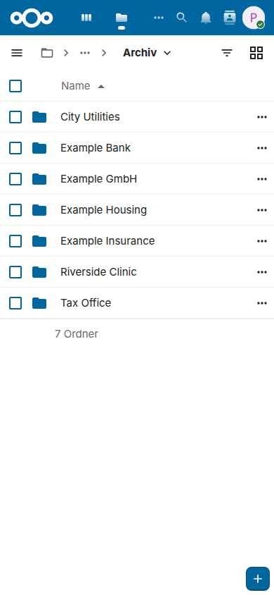

# Das Archiv nutzen

Diese Seite ist für die Menschen, die die Dokumente lesen und senden: im Web, am Computer und auf dem Handy. Paperless Sync legt eine Kopie jedes Dokuments von Paperless-ngx in Nextcloud Dateien ab, in einem Ordner für seinen Korrespondenten, seinen Typ und sein Jahr, und schickt die Dateien eines Eingangsordners an Paperless. Alles hier funktioniert mit Nextcloud allein, im Browser, mit dem Desktop-Client und mit den Nextcloud-Apps für Android und iOS; du brauchst kein Konto von Paperless, um ein Dokument zu lesen oder zu senden. Die [Anleitung](guide.de.md) ist die Seite für die Administration, die die App einrichtet.

Die Namen auf dieser Seite sind die, die eine neue Installation auf Deutsch vorschlägt, `Dokumente/Paperless` mit den Ordnern `Archiv`, `Eingang` und `Fehler`; deine Administration kann andere gewählt haben und entscheidet, wer das Archiv sieht und wer senden darf.

## Deine Dokumente finden

Das Archiv ist ein Ordner von Nextcloud, und seine Kopien sind Dateien von Nextcloud: Sie öffnen sich im Viewer, sie haben Versionen, Kommentare und Favoriten, und die Suche von Nextcloud findet sie nach ihren Namen. Wo du es findest, hängt davon ab, wie deine Administration die App eingerichtet hat:

- **Ein geteiltes Archiv:** Der Eigentümer des Archivs, das Konto von Nextcloud, für das die App es schreibt, teilt den Ordner `Archiv` mit dir oder mit einer deiner Gruppen, in der Regel nur zum Lesen. Er erscheint unter *Mit dir geteilt* in Dateien und in dem Ordner, in den deine Nextcloud die Ordner legt, die andere teilen.
- **Ein eigenes Archiv:** Mit dem [Eigentum je Benutzer](guide.de.md#per-user-ownership) bekommst du die Dokumente, die dir in Paperless gehören, in deine eigenen Dateien, in `Dokumente/Paperless/Archiv`, neben einem eigenen Eingang.

Dateien im Browser eines Handys zeigt dasselbe Archiv, im schmalen Layout von Nextcloud:

<picture>
  <source media="(prefers-color-scheme: dark)" srcset="images/de/phone-archive-dark.png">
  
</picture>

### Was die Namen sagen

Mit der Standard-Pfadvorlage liegt eine Kopie unter einem Pfad wie `Archiv/Example GmbH/Invoice/2026/2026-08-26 - Example invoice [P123].pdf`: der Korrespondent, der Dokumenttyp und das Jahr des Dokuments als Ordner, dann sein Datum, sein Titel, eine Markierung und seine Endung.

- **Die Markierung `[P123]`** ist die ID des Dokuments in Paperless, hier 123. Sie hält den Namen eindeutig, *In Paperless öffnen* findet das Dokument über sie, und *An Paperless senden* erkennt an ihr, dass Paperless die Datei schon hat. Lass sie im Namen.
- **Ein Dokument ohne Korrespondent oder Typ** kommt in einen Ordner für den fehlenden Teil, wie `_Ohne Korrespondent`.
- **Wenn sich ein Dokument in Paperless ändert,** etwa sein Titel oder sein Korrespondent, wandert seine Kopie mit dem nächsten Lauf an ihren neuen Pfad und behält ihre Freigaben, Kommentare, Favoriten und Versionen; die Desktop- und die Mobil-Apps benennen sie nur um.

### Suche, Tags und Favoriten

- **Nach ihrem Namen:** Die Suche von Nextcloud, oben auf jeder Seite, und der Filter von Dateien finden eine Kopie nach ihrem Titel oder ihrem Datum, die in ihrem Namen stehen, und einen Korrespondenten oder einen Typ nach seinem Ordner; der Filter von Dateien grenzt den geöffneten Ordner ein.
- **Nach ihrem Text:** Paperless liest den Text jedes Dokuments, und die Kopie, in der Regel das Archiv-PDF von Paperless, trägt diesen Text. Der Viewer von Nextcloud findet ein Wort in einem geöffneten PDF, und das tut jede PDF-App auf deinem Computer oder Handy. Eine Suche im Text aller Kopien auf einmal braucht die Volltextsuche von Nextcloud, die eine Administration einrichtet, oder die App [Paperless Unified Search](https://github.com/Dennis-Otto/paperless-unified-search), die die Suche von Paperless in die Suche von Nextcloud bringt und mit denselben Markierungen arbeitet.
- **Nach ihren Tags:** Wenn deine Administration die [Tags in Nextcloud](guide.de.md#tags-in-nextcloud) eingeschaltet hat, trägt jede Kopie die Tags ihres Dokuments, wie *Steuer 2026*. Die Ansicht *Schlagworte* von Dateien listet jede Datei mit einem Tag, und die Suche von Nextcloud findet sie.
- **Als Favorit:** Der Stern einer Kopie markiert sie als Favorit, und *Favoriten* in Dateien listet sie. Der Favorit bleibt, wenn die Kopie nach einer Änderung in Paperless wandert.

### Ein Dokument in Paperless öffnen

*In Paperless öffnen* im Menü einer Kopie öffnet ihr Dokument in Paperless, unter der Adresse, die deine Administration eingestellt hat: Dort siehst du seine Notizen, seinen Verlauf und seine Felder und änderst es, wenn dein Konto von Paperless das darf. Paperless fragt nach seiner eigenen Anmeldung und zeigt das Dokument nur, wem es das erlaubt; eine Kopie braucht kein Konto von Paperless.

Auf dem Handy öffnet der Knopf mit den drei Punkten einer Kopie ihr Menü:

<picture>
  <source media="(prefers-color-scheme: dark)" srcset="images/de/phone-menu-dark.png">
  
</picture>

## Dokumente an Paperless senden

Ein neues Dokument kommt über Nextcloud zu Paperless, ohne die Webseite von Paperless: Lege es in den Eingangsordner, oder sende es aus dem Menü einer Datei. Paperless liest seinen Text, sortiert es mit seinen Regeln und benennt das neue Dokument nach der Datei, ein Name wie `Brief der Versicherung 2026-10.pdf` ergibt also einen guten Titel. Seine Kopie kommt ins Archiv, sobald das Dokument den Posteingang von Paperless verlassen hat, also sobald es dort jemand fertig bearbeitet hat, und nur, wenn das Archiv es spiegelt: Mit *Dokumente im Posteingang von Paperless überspringen*, standardmäßig an, wartet ein Dokument mit einem Posteingangs-Tag von Paperless, und ein Archiv, das nur bestimmte Tags spiegelt, lässt ein Dokument ohne sie aus.

### Der Eingangsordner

Jede Datei, die du in `Dokumente/Paperless/Eingang` legst, oder, in der Regel, in einen Ordner darunter, geht mit dem nächsten Lauf der App an Paperless, den deine Administration auf ein Intervall von standardmäßig 5 Minuten einstellt.

- **Sobald Paperless sie importiert hat,** verlässt die Datei den Eingang, außer deine Administration behält sie dort, und ihre Kopie erscheint mit dem nächsten Lauf, nachdem das Dokument den Posteingang von Paperless verlassen hat, wie [oben](#dokumente-an-paperless-senden) beschrieben.
- **Wenn der Import scheitert,** etwa bei einem beschädigten PDF oder einer Aufgabe, die Paperless abgebrochen hat, wandert die Datei nach `Fehler`, neben eine `.error.txt` mit dem Grund.
- **Wenn Paperless die Datei sofort ablehnt,** etwa eine eines Typs, den es nicht annimmt, bleibt die Datei im Eingang, und die nächsten Läufe lassen sie dort, bis du sie neu speicherst, umbenennst oder ersetzt.
- **Der Eigentümer des Eingangs erfährt von beidem,** mit einer Benachrichtigung, die den Grund nennt: du, wenn der Eingang dein eigener ist, sonst der Eigentümer des Archivs.
- **Ein Ordner unterhalb des Eingangs kann Tags nennen:** Mit *Unterordner werden zu Tags* bekommt eine Datei in `Eingang/Steuern/2026` in Paperless die Tags *Steuern* und *2026*. Deine Administration sagt dir, ob das an ist.

Die [Anleitung](guide.de.md#nextcloud-inbox) hat die Einzelheiten für die Administration, wie die Wiederholungen und die Tags für jeden Import.

### An Paperless senden im Menü einer Datei

Eine Datei muss nicht durch den Eingang: **An Paperless senden** im Menü einer Datei, eines Ordners oder einer Auswahl davon schickt eine Kopie an Paperless, und die Datei bleibt, wo sie ist. Die Aktion gibt es für die Mitglieder der Gruppe, die deine Administration gewählt hat, und eine Benachrichtigung sagt dir, wie jeder Import ausging, mit einem Link zum neuen Dokument in Paperless.

<picture>
  <source media="(prefers-color-scheme: dark)" srcset="images/de/files-send-dark.png">
  
</picture>

Dateien, die die App schreibt, wie die Kopien des Archivs, haben diese Aktion nicht: Paperless hat sie schon.

### Regeln deiner Administration

Deine Administration kann Dateien ohne einen Klick senden, mit einer Regel von Flow, etwa jedes PDF, das du in einen Ordner mit dem Tag *An Paperless* hochlädst. Die Datei bleibt, wo sie ist, und du hörst von einem Import nur, wenn er gescheitert ist. Die [Anleitung](guide.de.md#durch-eine-regel-von-flow-senden) zeigt, wie eine solche Regel entsteht.

## Rezepte

### Mit dem Handy in den Eingang scannen

Die Nextcloud-Apps für Android und iOS haben einen Dokumentenscanner: Er findet die Ränder der Seite, richtet sie gerade und speichert die Seiten als ein PDF, direkt in einen Ordner von Nextcloud.

1. Öffne die Nextcloud-App und gehe in den Ordner `Dokumente/Paperless/Eingang`, oder in den Eingang, den jemand mit dir geteilt hat.
2. Tippe auf **+** und wähle **Dokument scannen**.
3. Fotografiere jede Seite, prüfe die Seiten und speichere sie als PDF in diesem Ordner, mit einem Namen, der sagt, was das Dokument ist.

<picture>
  <source media="(prefers-color-scheme: dark)" srcset="images/diagrams/how-a-scan-on-the-phone-reaches-paperless.de.dark.svg">
  
</picture>

Die Namen der Menüs unterscheiden sich ein wenig zwischen den Versionen der Apps. Paperless liest den Text des Scans selbst, die Texterkennung der App darf also aus bleiben.

### Einen Ordner des Handys von selbst hochladen

Das automatische Hochladen der Nextcloud-App für Android lädt jede neue Datei eines Ordners des Handys, etwa des Ordners, in dem eine Scanner-App ihre PDFs speichert, in einen Ordner von Nextcloud:

1. Öffne in der Nextcloud-App **Automatisches Hochladen**, in ihrem Menü oder in ihren Einstellungen.
2. Richte einen eigenen Ordner ein, im Menü der Seite: den Ordner des Handys als Quelle und den Eingang, `Dokumente/Paperless/Eingang`, als Ordner in Nextcloud.
3. Behalte die Originaldatei auf dem Handy, und wähle, ob das Hochladen auf WLAN wartet.

Das automatische Hochladen der App für iOS nimmt die Fotos und Videos des Handys, nicht seine Dateien, auf einem iPhone ist der Scanner der App also der bessere Weg in den Eingang. Um eine Datei aus einer anderen App zu senden, etwa ein PDF aus einer Mail, nutze **Teilen** und die Nextcloud-App, und wähle den Eingang als ihren Ordner.

### Ein Scanner im Netzwerk

Ein Scanner oder ein Drucker mit Scanner, der in WebDAV speichern kann, oft *Scan to Cloud* oder *Scan to WebDAV* genannt, schreibt direkt in den Eingang:

1. In Dateien zeigt **Dateien-Einstellungen** unten in der Navigation die WebDAV-Adresse deiner Dateien, wie `https://cloud.example.com/remote.php/dav/files/alice/`.
2. In den Einstellungen deines Kontos erstellt **Sicherheit** ein App-Passwort für den Scanner, damit der Scanner nie dein eigenes Passwort kennt und du es allein widerrufen kannst.
3. Trage im Scanner die Adresse mit dem Pfad des Eingangs am Ende ein, wie `https://cloud.example.com/remote.php/dav/files/alice/Dokumente/Paperless/Eingang/`, deinen Benutzernamen und das App-Passwort, und lass ihn PDF-Dateien speichern.

Ein Scanner, der nur auf eine Netzwerkfreigabe speichert oder eine Mail sendet, erreicht Paperless ohne Nextcloud, über den Consume-Ordner oder die Mail-Regeln von Paperless; deine Administration weiß, ob die eingerichtet sind.

### Das Archiv auf deinem Computer

Der Desktop-Client von Nextcloud hält das Archiv in einem Ordner deines Computers, damit jedes Programm die Kopien öffnet, auch ohne Browser:

- **Virtuelle Dateien,** unter Windows und macOS, zeigen jede Kopie ohne ihren Platz auf der Festplatte und laden sie herunter, wenn du sie öffnest, was zu einem Archiv vieler Jahre passt.
- **Offline-Ordner:** Für die Ordner, die du ohne Internet brauchst, wie das Jahr deiner Steuererklärung, wähle *Immer lokal verfügbar machen* im Nextcloud-Menü des Ordners, unter Windows auch **Immer auf diesem Gerät beibehalten** im Menü des Explorers, und *Lokalen Speicherplatz freigeben* oder **Speicherplatz freigeben**, um den Platz zurückzugeben. Die Namen unterscheiden sich ein wenig zwischen den Systemen und den Versionen des Clients.
- **Ohne virtuelle Dateien** nimmt die Auswahl der Ordner in den Einstellungen des Clients nur die Ordner des Archivs, die du brauchst.

Ein geteiltes Archiv ist auch auf dem Computer nur zum Lesen: Der Client hält die Kopien so, wie Paperless sie hat. Um eine eigene Version zu behalten, kopiere die Datei aus dem Archiv heraus.

### Offline auf dem Handy

Die Nextcloud-Apps halten eine Datei oder einen Ordner mit **Offline verfügbar** in ihrem Menü auf dem Handy, etwa die Versicherungsunterlagen für eine Reise. Sie zeigen die Kopien des Archivs wie jede andere Datei, und *In Paperless öffnen* steht im Menü von Dateien im Browser des Handys.

### Mit deiner Familie oder einer Steuerberatung teilen

Wer einen Ordner des Archivs teilen darf, sein Eigentümer oder jemand, mit dem er samt dem Recht zum Weiterteilen geteilt wurde, gibt anderen Zugriff darauf wie auf jeden Ordner von Nextcloud, in seinen Details unter **Teilen**:

- **Mit einem Benutzer oder einer Gruppe von Nextcloud:** Tippe den Namen ein und wähle **Nur anzeigen**, damit niemand eine Kopie bearbeitet, die die nächste Änderung in Paperless ersetzt.
- **Mit jemandem ohne Konto,** etwa einer Steuerberatung: **Link teilen** erstellt einen öffentlichen Link. Wähle **Nur anzeigen**, setze ein **Ablaufdatum** und ein **Passwort**, und sende das Passwort auf einem anderen Weg als den Link. Wer den Link hat, sieht die Dateien, nicht Paperless.

Eine Freigabe einer Kopie bleibt bei ihr, wenn sie nach einer Änderung in Paperless wandert. Eine Freigabe eines Ordners zeigt, was die Pfadvorlage in diesen Ordner legt: Mit der Standardvorlage enthält der Ordner eines Jahres die Dokumente eines Korrespondenten und eines Typs, und eine Freigabe eines solchen Ordners, den die Pfadvorlage baut, verschwindet samt ihrem Link, wenn eine Änderung in Paperless oder an der Vorlage alle seine Kopien wegbewegt. Gib also den Ordner `Archiv` selbst frei, den die Vorlage nicht ändert, oder bitte deine Administration um eine Pfadvorlage, oder einen Speicherpfad von Paperless, deren oberster Ordner sammelt, was du freigibst, etwa die Dokumente einer Steuererklärung. Die [FAQ](faq.de.md#kann-ich-die-pfadvorlage-später-ändern) erklärt, warum.

## Was Bearbeiten, Umbenennen und Löschen bewirken

Das Archiv ist ein Spiegel von Paperless: Nichts, was du mit einer Kopie in Nextcloud tust, ändert Paperless. Ändere ein Dokument in Paperless, und der nächste Lauf bringt die Änderung zu seiner Kopie.

| Was du in Nextcloud tust | Was passiert |
| --- | --- |
| Eine Kopie bearbeiten | Die Änderung bleibt, solange ihr Dokument in Paperless gleich bleibt. Ändert sich das Dokument dort, kann der nächste Lauf die Kopie neu schreiben, je nach Änderung, und deine Änderung bleibt dann als frühere Version erhalten, unter *Versionen* in den Details der Datei, außer deine Administration hat gewählt, deine Änderung zu behalten und einen Konflikt zu melden. |
| Eine Kopie umbenennen oder verschieben | Sie bleibt, wo du sie hingelegt hast, als deine eigene Datei, und der nächste Lauf schreibt das Dokument neu an seinen Pfad im Archiv. |
| Eine Kopie löschen | Sie kommt in deinen Papierkorb, und der nächste Lauf schreibt sie neu. Um ein Dokument zu entfernen, lösche es in Paperless. |
| Eine Datei in den Eingang legen | Sie geht an Paperless, und ihre Kopie kommt ins Archiv, sobald das Dokument dort fertig bearbeitet ist. |

Wenn ein Dokument in den Papierkorb von Paperless geht, wandert seine Kopie in den Ordner `_Gelöscht` des Archivs, und wenn es von dort zurückkommt, auch seine Kopie. Die [FAQ](faq.de.md#das-archiv-in-nextcloud) beantwortet mehr: [was mit einer Änderung passiert](faq.de.md#was-passiert-wenn-ich-eine-gespiegelte-datei-bearbeite), [wohin gelöschte Dateien gehen](faq.de.md#wohin-gehen-gelöschte-dateien) und [ob eine Änderung Paperless erreicht](faq.de.md#erreichen-meine-änderungen-in-nextcloud-paperless).
