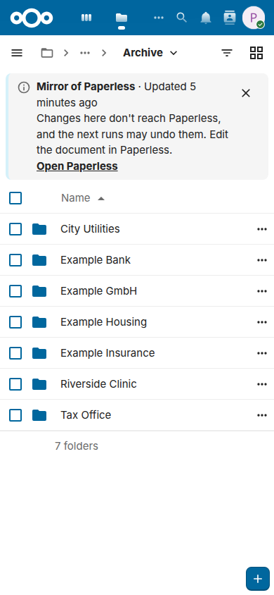

# Using the archive

This page is for the people who read and send the documents: on the web, on the computer and on the phone. Paperless Sync puts a copy of each document of Paperless-ngx into Nextcloud Files, in a folder for its correspondent, its type and its year, and sends the files of an inbox folder to Paperless. Everything here works with Nextcloud alone, in the browser, with the desktop client and with the Nextcloud apps for Android and iOS; you need no account of Paperless to read or send a document. The [guide](guide.md) is the page for the administrator who sets the app up.

The names on this page are those that a new installation proposes, `Documents/Paperless` with the folders `Archive`, `Inbox` and `Failed imports`; your administrator may have chosen others, and decides who sees the archive and who may send.

## Find your documents

The archive is a folder of Nextcloud, and its copies are files of Nextcloud: they open in the viewer, they have versions, comments and favorites, and the search of Nextcloud finds them by their names. Where you find it depends on how your administrator set the app up:

- **A shared archive:** the owner of the archive, the account of Nextcloud that the app writes it for, shares the folder `Archive` with you or with a group of yours, read-only as a rule. It shows in *Shared with you* in Files and in the folder where your Nextcloud puts the folders that others share.
- **An archive of your own:** with [per-user ownership](guide.md#per-user-ownership), you get the documents that you own in Paperless in your own files, in `Documents/Paperless/Archive`, next to an inbox of your own, and, when your administrator chose it, [a copy of those that Paperless shares with you](guide.md#documents-that-paperless-shares).

Files in the browser of a phone shows the same archive, in the narrow layout of Nextcloud:

<picture>
  <source media="(prefers-color-scheme: dark)" srcset="images/phone-archive-dark.png">
  
</picture>

### What the names say

With the default path template, a copy is at a path such as `Archive/Example GmbH/Invoice/2026/2026-08-26 - Example invoice [P123].pdf`: the correspondent, the document type and the year of the document as folders, then its date, its title, a marker and its extension.

- **The marker `[P123]`** is the ID of the document in Paperless, 123 here. It keeps the name unique, *Open in Paperless* finds the document by it, and *Send to Paperless* knows by it that Paperless has the file already. Leave it in the name.
- **A document without a correspondent or a type** goes into a folder for the missing part, such as `_No correspondent`.
- **When a document changes in Paperless,** such as its title or its correspondent, its copy moves to its new path with the next run and keeps its shares, comments, favorites and versions; the desktop and the mobile apps only rename it.

### Search, tags and favorites

- **By its name:** the search of Nextcloud, at the top of every page, and the filter of Files find a copy by its title or its date, which are in its name, and a correspondent or a type by its folder; the filter of Files narrows the folder that is open.
- **By its text:** Paperless reads the text of every document, and the copy, the archive PDF of Paperless as a rule, carries that text. The viewer of Nextcloud finds a word in an open PDF, and so does every PDF app on your computer or phone. A search through the text of every copy at once needs the full-text search of Nextcloud, which an administrator sets up, or the app [Paperless Unified Search](https://github.com/Dennis-Otto/paperless-unified-search), which brings the search of Paperless into the search of Nextcloud and works with the same markers.
- **By its tags:** when your administrator turned on the [tags in Nextcloud](guide.md#tags-in-nextcloud), each copy carries the tags of its document, such as *Tax 2026*. The view *Tags* of Files lists every file with a tag, and the search of Nextcloud finds them.
- **As a favorite:** the star of a copy marks it as a favorite, and *Favorites* in Files lists it. The favorite stays when the copy moves after a change in Paperless.

### Open a document in Paperless

*Open in Paperless* in the menu of a copy opens its document in Paperless, at the address that your administrator set: there you see its notes, its history and its fields, and change it, when your account of Paperless may. Paperless asks for its own login and shows the document only to whom it allows; a copy needs no account of Paperless.

On the phone, the button with the three dots of a copy opens its menu:

<picture>
  <source media="(prefers-color-scheme: dark)" srcset="images/phone-menu-dark.png">
  
</picture>

## Send documents to Paperless

A new document goes to Paperless through Nextcloud, without the web page of Paperless: put it into the inbox folder, or send it from the menu of a file. Paperless reads its text, sorts it with its rules and names the new document after the file, so a name such as `Insurance letter 2026-10.pdf` makes a good title. Its copy comes into the archive once the document has left the inbox of Paperless, that is, once someone finished it there, and only when the archive mirrors it: with *Skip Paperless inbox documents* on, as it is by default, a document with an inbox tag of Paperless waits, and an archive that mirrors only certain tags leaves out a document without them.

### The inbox folder

Every file that you put into `Documents/Paperless/Inbox`, or, as a rule, into a folder below it, goes to Paperless with the next run of the app, which your administrator sets to an interval of 5 minutes by default.

- **Once Paperless imported it,** the file leaves the inbox, unless your administrator keeps it there, and its copy appears in the archive with the next run after the document has left the inbox of Paperless, as [above](#send-documents-to-paperless).
- **When the import fails,** such as for a damaged PDF or a task that Paperless cancelled, the file moves into `Failed imports`, next to a `.error.txt` with the reason.
- **When Paperless refuses the file at once,** such as one of a type that it doesn't take, the file stays in the inbox, and the next runs leave it there until you save it anew, rename or replace it.
- **The owner of the inbox hears of both,** with a notification that gives the reason: you, when the inbox is your own, or else the owner of the archive.
- **A video, a program or an archive stays where it is:** `mp4`, `exe`, `zip` and the like never go to Paperless, which can't use them as documents, and the report of each run names them as *Set aside* until you move or delete them. How many files you put in the inbox doesn't matter: a large batch of scans goes through as one page does.
- **A folder below the inbox can name tags:** with *Subfolders become tags*, a file in `Inbox/Taxes/2026` gets the tags *Taxes* and *2026* in Paperless. Your administrator says whether that is on.

Two scans in the inbox: Paperless imports the first, and the second, which it couldn't import, waits in `Failed imports` next to its reason:

<picture>
  <source media="(prefers-color-scheme: dark)" srcset="images/inbox-dark.gif">
  
</picture>

The [guide](guide.md#nextcloud-inbox) has the details for the administrator, such as the retries and the tags of every import.

### Send to Paperless in the menu of a file

A file needn't go through the inbox: **Send to Paperless** in the menu of a file, a folder or a selection of them sends a copy to Paperless, and the file stays where it is. The action is there for the members of the group that your administrator chose, and a notification tells you how each import ended, with a link to the new document in Paperless.

<picture>
  <source media="(prefers-color-scheme: dark)" srcset="images/files-send-dark.png">
  
</picture>

Files that the app writes, such as the copies of the archive, have no such action: Paperless has them already.

### Rules of your administrator

Your administrator may send files without a click, with a rule of Flow, such as every PDF that you upload into a folder with the tag *To Paperless*. The file stays where it is, and you hear of an import only when it failed. The [guide](guide.md#send-by-a-rule-of-flow) shows how such a rule is made.

## Recipes

### Scan with your phone into the inbox

The Nextcloud apps for Android and iOS have a document scanner: it finds the edges of the page, straightens it and saves the pages as one PDF, straight into a folder of Nextcloud.

1. Open the Nextcloud app and go to the folder `Documents/Paperless/Inbox`, or to the inbox that someone shared with you.
2. Tap **+** and choose **Scan document**.
3. Take a picture of each page, check the pages, and save them as a PDF in this folder, with a name that says what the document is.

<picture>
  <source media="(prefers-color-scheme: dark)" srcset="images/diagrams/how-a-scan-on-the-phone-reaches-paperless.dark.svg">
  
</picture>

The names of the menus differ a little between the versions of the apps. Paperless reads the text of the scan itself, so the text recognition of the app may stay off.

### Upload a folder of your phone on its own

The auto upload of the Nextcloud app for Android uploads every new file of a folder of the phone, such as the folder where a scanner app saves its PDFs, into a folder of Nextcloud:

1. In the Nextcloud app, open **Auto upload**, in its menu or in its settings.
2. Set up a custom folder, in the menu of the page: the folder of the phone as the source, and the inbox, `Documents/Paperless/Inbox`, as the folder in Nextcloud.
3. Keep the original file on the phone, and choose whether the upload waits for Wi-Fi.

The auto upload of the app for iOS takes the photos and videos of the phone, not its files, so on an iPhone the scanner of the app is the better way into the inbox. To send one file from another app, such as a PDF of a mail, use **Share** and the Nextcloud app, and choose the inbox as its folder.

### A scanner on the network

A scanner or a multifunction printer that can save to WebDAV, often named *Scan to cloud* or *Scan to WebDAV*, writes straight into the inbox:

1. In Files, **Files settings** at the bottom of the navigation shows the WebDAV address of your files, such as `https://cloud.example.com/remote.php/dav/files/alice/`.
2. In the settings of your account, **Security** creates an app password for the scanner, so that the scanner never knows your own password and you can revoke it alone.
3. In the scanner, enter the address with the path of the inbox at its end, such as `https://cloud.example.com/remote.php/dav/files/alice/Documents/Paperless/Inbox/`, your user name and the app password, and let it save PDF files.

A scanner that saves to a network share or sends a mail alone can reach Paperless without Nextcloud, through the consume folder or the mail rules of Paperless; your administrator knows whether those are set up.

### The archive on your computer

The desktop client of Nextcloud keeps the archive in a folder of your computer, so that every program opens the copies, also without a browser:

- **Virtual files,** on Windows and macOS, show every copy without its space on the disk and download it when you open it, which suits an archive of many years.
- **Offline folders:** for the folders that you need without the internet, such as the year of your tax return, choose *Make always available locally* in the Nextcloud menu of the folder, on Windows also **Always keep on this device** in the menu of Explorer, and *Free up local space* or **Free up space** to give the space back. The names differ a little between the systems and the versions of the client.
- **Without virtual files,** *Choose what to sync* in the settings of the client takes only the folders of the archive that you need.

A shared archive is read-only on the computer too: the client keeps the copies as Paperless has them. To keep a version of your own, copy the file out of the archive.

### Offline on the phone

The Nextcloud apps keep a file or a folder on the phone with **Set as available offline**, or **Available offline**, in its menu, such as the insurance papers for a journey. They show the copies of the archive as any other file, and *Open in Paperless* is in the menu of Files in the browser of the phone.

### Share with your family or a tax adviser

Whoever may share a folder of the archive, its owner or someone that it was shared with together with the permission to share, gives others access to it as to any folder of Nextcloud, in its details under **Sharing**:

- **With a user or a group of Nextcloud:** type the name and choose **View only**, so that nobody edits a copy that the next change in Paperless replaces.
- **With someone without an account,** such as a tax adviser: **Share link** makes a public link. Choose **View only**, set an **expiration date** and a **password**, and send the password another way than the link. Whoever has the link sees the files, not Paperless.

The archive of a household, shared:

<picture>
  <source media="(prefers-color-scheme: dark)" srcset="images/diagrams/sharing-the-archive-with-your-household.dark.svg">
  
</picture>

A share of a copy stays with it when it moves after a change in Paperless. A share of a folder shows what the path template puts into that folder: with the default template, the folder of a year holds the documents of one correspondent and one type, and a share of such a folder, which the path template builds, disappears when a change in Paperless or of the template moves all its copies away, and with it its link. So share the folder `Archive` itself, which the template doesn't change, or ask your administrator for a path template, or a storage path of Paperless, whose top folder collects what you share, such as the documents of a tax return. The [FAQ](faq.md#can-i-change-the-path-template-later) explains why.

## What edits, renames and deletions do

The archive is a mirror of Paperless: nothing that you do with a copy in Nextcloud changes Paperless. Change a document in Paperless, and the next run brings the change to its copy.

When a document gets a new type and a new title in Paperless, for example, the next run moves its copy and renames it:

<picture>
  <source media="(prefers-color-scheme: dark)" srcset="images/move-dark.gif">
  
</picture>

| What you do in Nextcloud | What happens |
| --- | --- |
| Edit a copy | The edit stays while its document stays the same in Paperless. When the document changes there, the next run may write the copy anew, depending on the change, and your edit then remains as an earlier version, under *Versions* in the details of the file, unless your administrator chose to keep your edit and report a conflict. |
| Rename or move a copy | It stays where you put it, as a file of your own, and the next run writes the document anew at its path in the archive. |
| Delete a copy | It goes into your trash bin, and the next run writes it anew. To remove a document, delete it in Paperless. |
| Put a file into the inbox | It goes to Paperless, and its copy comes into the archive once the document is finished there. |

When a document goes to the trash of Paperless, its copy moves into the folder `_Deleted` of the archive, and when it comes back from there, so does its copy. The [FAQ](faq.md#the-archive-in-nextcloud) answers more: [what happens to an edit](faq.md#what-happens-when-i-edit-a-mirrored-file), [where deleted files go](faq.md#where-do-deleted-files-go) and [whether a change reaches Paperless](faq.md#do-my-changes-in-nextcloud-reach-paperless).

A bill goes to the trash of Paperless and comes back:

<picture>
  <source media="(prefers-color-scheme: dark)" srcset="images/trash-dark.gif">
  
</picture>
