# Docker end-to-end tests

The suite mounts this checkout read-only as a Nextcloud Custom App and connects it to a deterministic local Paperless API mock.

<picture>
  <source media="(prefers-color-scheme: dark)" srcset="../../docs/images/diagrams/what-the-end-to-end-tests-run.dark.svg">
  
</picture>

`run-all.sh` runs the scenario against the current release of every Nextcloud version from `min-version` to `max-version` in `appinfo/info.xml`, and against the newest of them on [other databases and object storage](#databases-and-object-storage), side by side, as the CI does; `run.sh` runs it against one version, by default the one that `compose.yaml` pins, or the image in `NEXTCLOUD_IMAGE`, such as `nextcloud:35-apache`. Every week, the CI also runs it against [the coming Nextcloud](#the-coming-nextcloud).

Run locally:

```bash
bash tests/e2e/run-all.sh
bash tests/e2e/run.sh
```

Both run in Git Bash on Windows too, with Docker Desktop.

The scenario verifies:

- administrator configuration and server-side token handling, in the browser too: saving after Nextcloud asks for the password, and a new Paperless URL, which needs the token again, see [Accessibility](#accessibility)
- a Paperless in the local network without `allow_local_remote_servers`: Nextcloud refuses the mock at its address of the network of Compose, the save says how to allow it and the page moves the focus to *Paperless runs in my local network*, and with that setting on, the whole scenario runs
- the connection checklist: *Test connection* with the token of an account that may view the documents but neither the tags nor add documents and view their tasks names those permissions to grant and the document of another owner that the trash leaves out, and saves nothing; a save with that token goes on with the same checklist; without **View** for UI Settings, the lines of the trash and the upload name that permission; with the token of the full account, every check passes, in the browser too, and a refused local address moves the focus to its setting after *Test connection* as after a save
- dry-run behavior without filesystem mutations
- archive export through the Paperless download API, and a full quota of the target user, which stops the exports of a run
- metadata-only moves without downloading the PDF again, with the SHA-256 checksums of Paperless-ngx 3 and, in a mode of the mock, the MD5 checksums of Paperless-ngx 2
- a mirrored file that keeps its file ID through every move and every new content, a share of it that shows the new content, and the version of the previous content that the background job leaves, which a dry-run right before it doesn't hold back
- titles and names that the path template keeps as plain text, such as `$1` or `{{ correspondent }}`, and long names in Chinese, emoji and Cyrillic, which are shortened to the bytes that Nextcloud accepts
- Paperless inbox-tag exclusion and empty-folder pruning
- Paperless trash mirroring and guarded permanent deletion, also after a page of Paperless came back incomplete, and no deletion of a document purged from the trash while permanent deletion is off
- successful and failed Nextcloud inbox imports, with the ID of the new document and with the reason of Paperless in the `.error.txt`, a duplicate and a task that Paperless revoked, in the task shapes of Paperless-ngx 3.x and 2.20, and a file that Paperless refuses, which waits in the inbox until it changes
- the Activity stream of the target user, through the API of the Activity app: no entry for a dry-run, one entry for a run with the link of the file that it wrote, also for the background job without a user session, and one entry for each import that Paperless finished, with the link of the new document, failed, with its reason, or refused
- target-user ownership and access isolation
- background-job registration, status reporting, and clean application logs
- the background job as system cron starts it: once synchronization is enabled and the interval since the last run has passed, it runs, and started again at once, it waits
- a document restored from the Paperless trash, whose copy moves back from the deleted folder without a download
- conflicts: with `skip`, a file of the user at the path of a document stays and the run reports it; with `replace`, the document takes its place
- a document that vanishes from Paperless without passing through its trash: its copy waits for the grace runs, then moves to the deleted folder, and stays there, as direct deletion is not allowed
- version 9 of the Paperless API in every request, which the mock counts, the version of Paperless in the status, and a Paperless-ngx 2.15 without version 9, whose run says which Paperless the app needs
- a run that can't reach Paperless, near the end, whose error the log of Nextcloud holds without the token, with the arguments of the frames of its trace that PHP replaced
- a Paperless URL changed through Nextcloud's provisioning API, at the very end, which doesn't get the token until the URL that the token was saved with is back
- accessibility of the administration settings and the run report, see [Accessibility](#accessibility)

Optional environment variables:

- `E2E_PORT`: host port for Nextcloud, default `18083`
- `DOCKER_BIN`: Docker CLI path, default `docker`
- `E2E_PROJECT_NAME`: Compose project name, default `paperless_sync_e2e`
- `NEXTCLOUD_IMAGE`: pinned Nextcloud image override
- `E2E_DATABASE`: the database of Nextcloud, `sqlite` by default, `mysql` for MariaDB or `pgsql` for PostgreSQL, see [Databases and object storage](#databases-and-object-storage)
- `E2E_OBJECTSTORE`: the primary storage of Nextcloud, `local` by default, or `s3` for an object store
- `E2E_ACCESSIBILITY=0`: leave out the accessibility check at the end
- `KEEP_E2E=1`: keep containers and the disposable volume after the suite
- `E2E_IGNORE_MAX_VERSION=1`: enable the app with `--force` on a Nextcloud newer than `max-version`, as `canary.sh` does

All credentials, users, filenames, document content, and metadata are synthetic. The Paperless mock rejects every token except the explicit `e2e-only-token` fixture, an account that is no superuser, with every permission of a run, and the owner of every document; `e2e-view-only-token`, an account without the permissions for the tags, for adding documents and for their tasks; and `e2e-no-ui-settings-token`, an account without **View** for UI Settings. It records whether uploads arrived intact. Like Paperless-ngx, it answers each endpoint only with its permission, names the ID and the permissions of the account in `/api/ui_settings/`, and filters the documents by their owner. Like Paperless, it refuses an upload without a `Content-Length` with `No file was submitted.` It plays Paperless-ngx 3.3.0, or 2.20.15 and 2.15.3 after `/control/paperless/<version>`: it serves the versions of the API that each of them serves, by the header `Accept` or its default, refuses the others with `406 Not Acceptable`, names itself in `X-Version` and `X-Api-Version`, and lists tasks in the shapes of their serializers. `/control/tasks/<end>` and `/control/task-of/<file>/<end>` end tasks with `success`, `failure`, `duplicate` or `revoked`, as Paperless-ngx 3.x stores them.

## Every supported version at once

`run-all.sh` starts `run.sh` for every supported version at the same time, each in a Compose project of its own, `paperless_sync_e2e_<version>`, on the port `18080 + <version>`, such as `18113` for Nextcloud 33. Besides, it runs the newest version on PostgreSQL, and on MariaDB with an S3 object store, in the projects `paperless_sync_e2e_<version>_pgsql` and `paperless_sync_e2e_<version>_mysql_s3`, on ports 100 and 200 higher. While one downloads its images, another one installs, so that all take little longer than one. Each `run.sh` of a version also downloads the image of Playwright in the background while Nextcloud installs, and the accessibility check at the end waits for it; the variants of a database or a storage leave that check out, as it doesn't depend on them. When all are done, `run-all.sh` prints the log of each, in a group of its own in the CI, with a table of the results, the database, the storage and the Nextcloud release that each ran, and fails if one of them failed.

<picture>
  <source media="(prefers-color-scheme: dark)" srcset="../../docs/images/diagrams/what-run-all-sh-runs-side-by-side.dark.svg">
  
</picture>

- `E2E_VERSIONS`: the major versions to run instead, such as `"33 35"`; `none` runs only the variants, on `max-version`
- `E2E_VARIANTS`: the variants to run besides, on the newest of the versions, by default `"pgsql mysql+s3"`: each a database, `sqlite`, `mysql` or `pgsql`, with `+s3` for an object store; `none` runs none
- `E2E_VERSION_TIMEOUT`: the time after which a run that hangs ends as failed, default `15m`, below the 20 minutes of the job in the CI, so that the logs of all runs are still printed

Ctrl-C ends every run, each with the cleanup of `run.sh`, and prints the logs so far. A failed run names the command that runs it again on its own.

`KEEP_E2E=1` keeps the containers of every run. In the CI, the suite leaves its containers running, as the runner is thrown away with them. The suite turns off the password policy's look-up of new passwords at Have I Been Pwned: a request to the internet that the tests don't need and that can fail.

## In the CI

The workflow `.github/workflows/e2e.yml` runs `run-all.sh` in two jobs side by side, each on a runner of its own, and both are required checks of pull requests. `nextcloud` runs every supported version (`E2E_VARIANTS=none`). *nextcloud on PostgreSQL, MariaDB and S3* runs the newest version on [the other databases and S3](#databases-and-object-storage) (`E2E_VERSIONS=none`). In one job, the five installations took more than five minutes on the four cores of a runner; split, the variants finish before the versions, so that a pull request waits no longer than for the versions alone ([decision 0007](../../docs/decisions/0007-end-to-end-tests-on-real-databases-and-storage.md)).

<picture>
  <source media="(prefers-color-scheme: dark)" srcset="../../docs/images/diagrams/when-the-end-to-end-tests-run.dark.svg">
  
</picture>

In a pull request, `affected.sh` first compares the merge commit with its base. Only a change of the code, the metadata or the assets of the app (`lib/`, `appinfo/`, `templates/`, `js/`, `css/`, `l10n/`, `img/`, `composer.json`), of the end-to-end tests other than their Markdown, or of the workflow itself can make the tests fail. In `appinfo/info.xml`, the lines that the release bot writes in every release, `<version>` and those marked `x-release-please-version`, don't count, so a release pull request passes at once, while the upstream bot's change of `max-version` runs the tests. Any other pull request passes the check in seconds, and its summary says *E2E skipped: the change cannot affect the app*.

Of the changes that run the tests, those that can behave differently on another database or storage also run [PostgreSQL, and MariaDB with S3](#databases-and-object-storage): the migrations (`lib/Migration/`), the queries of the state (`lib/Service/SyncStateRepository*`), the files in Nextcloud (`lib/Service/NextcloudStorage*`), the uploads to Paperless (`lib/Service/PaperlessApiService.php`), `appinfo/info.xml` as above, the end-to-end tests and their workflow. For any other change of the app, that job passes at once, and its summary says *E2E on SQLite with local storage only*. `scripts/check-project.sh` tests these rules with sample paths and changes.

Every push to `main`, a run by hand and every night run both jobs in any case: the images `nextcloud:<version>-apache` move with each point release of Nextcloud, which the nightly run catches before the next pull request. A newer push to a pull request or to `main` cancels the run of the older one; a run by hand and the scheduled runs go to the end.

## Databases and object storage

Few installations of Nextcloud run on SQLite: most keep their tables in MariaDB, MySQL or PostgreSQL, and larger ones keep their files in an object store with the API of S3. The state of the app lives in two tables of its own, which its migrations create, and on an object store Nextcloud reads every file as a stream of no known size, which once made Paperless refuse every upload of the inbox ([#73](https://github.com/Dennis-Otto/paperless-sync/issues/73)). `run.sh` runs the same scenario on them as well:

```bash
E2E_DATABASE=pgsql bash tests/e2e/run.sh
E2E_DATABASE=mysql E2E_OBJECTSTORE=s3 bash tests/e2e/run.sh
```

`compose.pgsql.yaml` (PostgreSQL 17), `compose.mysql.yaml` (MariaDB 11.4, with the settings that Nextcloud asks for) and `compose.s3.yaml` join `compose.yaml`. The databases keep their data in memory, for speed. [SeaweedFS](https://github.com/seaweedfs/seaweedfs) serves the API of S3 and accepts only the key of the tests; Nextcloud creates its bucket and keeps every file there, through the variables `OBJECTSTORE_S3_*` of its image. `run.sh` installs Nextcloud on that database and fails if Nextcloud then runs on another database or storage, so that a variant can't pass on SQLite and its disk by mistake. Renovate keeps their images current, each pinned by its digest.

## Accessibility

At the end of the scenario, `accessibility.mjs` checks the pages of the app in Chromium with [axe-core](https://github.com/dequelabs/axe-core) against WCAG 2.1 at levels A and AA, in the light and the dark theme of Nextcloud: the administration settings with every section open, the report of a dry-run over a larger archive of the mock, whose list of changes scrolls, the status of a run that failed after errors of single documents, which the page gets as its answer to *Refresh*, the connection checklist of the view-only token, with lines that passed, failed and have a note, and the note about unsaved changes with an error next to the buttons. It signs in through the login form and looks only into `#paperless-sync-settings`, the element that holds the markup of `templates/`, `js/` and `css/`, so that what Nextcloud draws around it doesn't count. A serious or critical violation fails the suite; the others are listed in the log.

Then `settings.mjs` uses the settings as an administrator does. First it checks what the CSS of Nextcloud, which styles every button and input, could break: *Disconnect* at the right end of the bar of buttons, every checkbox on the first line of its label, the shortest interval of five minutes and the link of every section to its part of the guide. Another Paperless URL must ask for the token again, and the saved one must not. The save button must say *Save* while the schedule is off and no token is entered, and *Test connection and save* when saving tests the connection. Right after the login, Nextcloud counts the password as confirmed, so the check answers the first save as Nextcloud does after 30 minutes: the page must show Nextcloud's dialog for the password, confirm it, and save the same settings again, without a test of the connection, as the schedule is off, and the form must show the URL as Nextcloud stored it. A save that tests the connection must show the checklist with every check of the export and the inbox passed; *Test connection* with the view-only token must count two failed checks, name the permission for the tags, note the trash, and save nothing, and changing the token must take the checklist away. A change must show the note about unsaved changes, hold *Synchronize now* back and ask before the page is left, and a change made while the server answers a save must stay in the form as an unsaved change. A local address that *Test connection* or a save refuses must move the focus to its setting, and the save must bring it into view above the bar of the buttons, which sticks to the bottom of the window. With the page scrolled to its top, the error of an invalid URL must be in view next to the buttons and take the focus. The check answers a run with a gateway timeout as an HTML page of a proxy while the status shows the run, with a bad gateway after the run ended, with a gateway timeout while the status fails too, where the status must keep the last state that Nextcloud sent, a run with two errors, a status that fails, a lost connection and an ended session, and the page must say what each means, never in HTML. *Disconnect* must leave the form with the settings that stay, as a reload shows them too; then the check connects again with the token. Last, it switches the language of the administrator to German, where the question of *Disconnect* and the save button must be German, and back.

The browser runs in the image of Playwright that `run.sh` names, inside the network of the Compose project, and reaches Nextcloud as `http://nextcloud`; the suite turns off the first-run wizard of Nextcloud, which would cover the pages. `package.json` and `package-lock.json` pin axe-core and playwright-core. Keep playwright-core at the version of the image: Renovate updates both together (`.github/renovate.json5`), and `scripts/check-project.sh` compares them.

## Screenshots

The pictures of the documentation in `docs/images/` and of the App Store in `screenshots/` come from the same containers:

```bash
bash tests/e2e/screenshots.sh
```

The Paperless mock serves a small household archive of invented documents (`showcase.py`): fourteen documents of seven correspondents, one still in the Paperless inbox, each a one-page PDF. `screenshots.mjs` then follows the quick start in Chromium: a dry-run and the first synchronization, recorded as `dry-run.gif`; the settings, each of their sections, and the archive in Files, in the light and the dark theme; a walk through the archive to a document in the viewer, recorded as `archive.gif`; and a dry-run a few days later, when the archive has a new title, a document in the trash, one with the excluded tag *Private*, two new documents and a finished import.

The GIFs show a drawn pointer, since a screenshot has none, and share one palette across their frames. The image of Playwright has no font for the interface of Nextcloud, so the script installs Inter (`fonts.conf`). `E2E_PORT` (default `18084`), `E2E_PROJECT_NAME` and `KEEP_E2E=1` work as for `run.sh`. Look at every picture before committing it.

## The coming Nextcloud

Every Monday, and when started by hand, the workflow also runs the suite against the coming Nextcloud:

```bash
bash tests/e2e/canary.sh
```

The coming Nextcloud is the newest beta or release candidate of the next major version while Nextcloud publishes one, in `https://download.nextcloud.com/server/prereleases/`, and otherwise the daily build of its master branch, `https://download.nextcloud.com/server/daily/latest-master.tar.bz2`. Nextcloud no longer publishes Docker images of betas and release candidates, so the script checks the signature of the package against the release key of Nextcloud, as the official image does, and puts its code into the image of the newest release, `nextcloud:apache`, which keeps its PHP, Apache and start script. The suite enables the app with `--force`, as `max-version` of `appinfo/info.xml` doesn't name that version yet; the upstream bot raises `max-version` once Nextcloud releases the version.

The canary is no required check and blocks nothing. When it fails, it opens the issue *The coming Nextcloud breaks the app* with a link to the run, adds every further failed run to it, and closes it once the tests pass again.

Optional environment variables, besides those of `run.sh`:

- `CANARY_BASE_IMAGE`: the image whose code the coming Nextcloud replaces, default `nextcloud:apache`
- `CANARY_IMAGE`: the local image the script builds, default `paperless-sync-e2e:coming`
